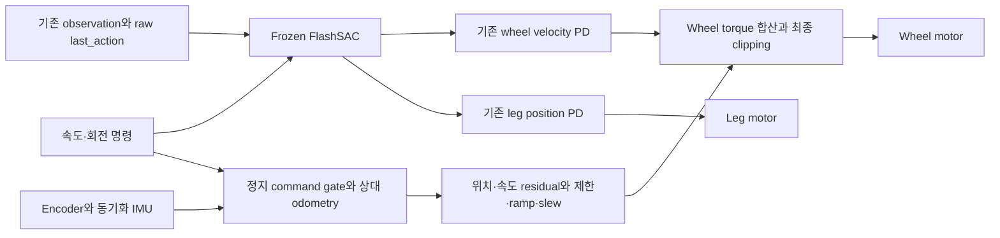
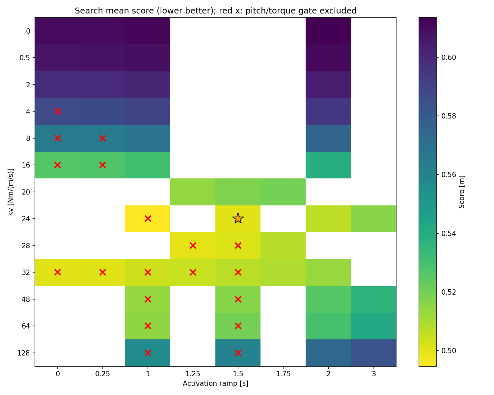
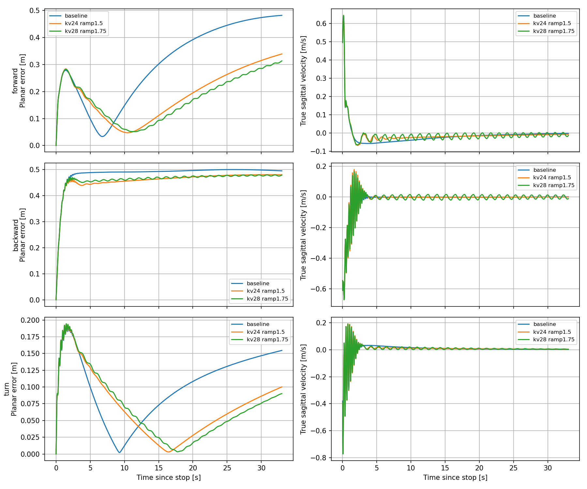

# F-1 추가 실험 종합 보고서 — 속도 명령 결합과 이동 후 정지

작성일: 2026-10-15 (Asia/Seoul)

Execution Domain: DESKTOP_DRY_RUN (본 보고서 작성·증거 검토), VALIDATION_SIM (인용 실험)

Policy Checkpoint SHA256: `3fd6113b95be69e0956f1510d4002dd161bc7226e0f1d9ade205117fc3edaed6`

ONNX SHA256: `e9c40d1af7e6a9e54f6336ef684927d3806f1a46ef02c34a91bd1ed732382039`

Evidence Status: PASS — 센서 시점 진단·제한값/계수 비교·일부 위치 밀림 감소·구현 무결성. FAIL — 이동 후 완전 정지와 정지점 복귀. SUSPICIOUS — horizon/목적함수에 따른 최적 계수 의존성. 실기 검증: NOT_TESTED.

Observed Metrics / Behavior / Log Summary:

**F-1은 FlashSAC의 wheel·leg 제어를 유지하면서 위치 drift를 줄이는 보정으로 유효했지만, 이동·회전 후 제자리에서 완전히 멈추는 제어는 아직 달성하지 못했다.** IMU 동기화는 후진 떨림을 크게 줄였고, 합 residual 제한을 ±1→±2 Nm로 늘리면 포화와 잔류 이동이 감소했다. 추가로 kv/ramp를 조정하면 반대 방향 밀림을 줄일 수 있었으나 잔류 속도는 오히려 증가했다.

현재 시험 범위의 위치 오차·잔류 속도 종합점수 기준 추천 절충안은 **kp=2, kv=24, residual 활성화 ramp=1.5초, 합 residual ±2 Nm, 합 slew 2 Nm/s**다. 이 설정을 완전 정지 해결값, 연속 계수 공간의 전역 최적값 또는 실기 배포 승인값으로 해석하지 않는다.

## 1. 목적과 기존 결과의 위치

초기 F-1은 frozen FlashSAC의 기존 토크에 작은 위치·속도 residual을 더해 zero-command drift를 줄이는 실험이었다. 기존 wheel 출력을 대체한 E와 달리 FlashSAC wheel torque를 계속 적용한다. F-1은 LQR이나 온라인 적응 제어가 아니라 고정 위치·속도 피드백 residual이다.

| 기존 nominal 12초, 각9회 | A: FlashSAC | F-1: kp2/kv0.5, 합 한도1 Nm |
|---|---:|---:|
| 정상 완료 | 9/9 | 9/9 |
| 최대 planar drift 평균 | 0.4968 m | 0.3281 m |
| Pitch error RMS 평균 | 0.0941 rad | 0.0950 rad |
| Wheel torque RMS 평균/바퀴 | 0.1683 Nm | 0.1333 Nm |

이 조건에서 drift34.0% 감소, pitch RMS 약1% 증가, wheel RMS 약20.8% 감소가 확인됐다. 원본은 [FlashSAC torque residual 보고서](flash_torque_residual_summary.md)에 있다.

이번 추가 실험의 질문은 다르다. **이동 명령이 있을 때 residual을 해제하고, 명령을0으로 바꾼 뒤 상대 위치를 유지할 수 있는가?** 초기 zero-command 시험에는 없던 감속·회전·명령 전환·정지점 통과가 포함된다. 또한 신규 actor IMU 동기화로 폐루프 응답이 바뀌었다. 기존0.328 m와 이번 정지 후 최대 이동을 같은 조건의 성능 숫자로 직접 비교하지 않는다.

기존12초 표의 drift/pitch는 원보고서의 cached axle/sensor 평가 정의이고, 이번 추가 실험의 위치·속도·pitch 정량 평가는 fresh MuJoCo GT를 사용한다. 이 평가 정의 차이도 보존한다.

F-2 폐루프 LQR 및 G 온라인 gain adaptation의 재실험은 이번 범위에 포함하지 않는다.

## 2. 유지한 제어 경로와 추가한 stop hold



- FlashSAC는 기존33-value observation으로 전체8개 action을 계산한다. Wheel velocity PD(Kd=0.5)와 leg position PD(Kp=60/Kd=1.5), action scale/clip/order를 유지한다.
- `last_action`은 직전 전체 raw actor output이다. Residual Nm 값을 action history에 넣거나 wheel history를0으로 만들지 않는다.
- 합 residual을 native wheel axis sign에 맞춰 바퀴당 절반씩 더한다. 원래 FlashSAC 토크가 이미 effort clipping된 경로에 더하고, 최종±12 Nm/바퀴 제한을 다시 적용한다. Leg torque는 바꾸지 않는다.
- **이동 명령:** residual 목표를0으로 두고 slew로 해제한다. 즉시0으로 점프하지 않으며, 해제 후 이동 정상 구간의 residual은0이다. Hold용 위치는 이동 중 적분하지 않는다. Actor의 관절·IMU observation은 계속 사용한다.
- **정지 명령 진입:** encoder/IMU odometry를 한 번 reset해 p_ref=0을 잡는다. 실제 속도가 남아 있어도 command가 정지이면 hold를 유지한다. 매 tick p를0으로 재설정하지 않는다.
- Gate 진입은 |vx|,|vy|≤0.02 m/s 및 |yaw command|≤0.03 rad/s, 해제는 |vx| 또는 |vy|≥0.04 m/s 또는 |yaw command|≥0.06 rad/s의 hysteresis를 사용한다.

정지 보정은 다음 순서다.

```text
raw       = -kp*p - kv*v
activation= smoothstep(min(hold_age / ramp_s, 1))
target    = activation * clip(raw, -residual_limit, +residual_limit)
u_total   = slew(target, 2 Nm/s)
wheel_i   = clip(tau_FlashSAC_i + native_sign_i*u_total/2, -12, +12 Nm)
```

ramp=0 시험에서도 slew는 유지한다. 여기서 ramp는 **residual 활성화 시간**이며 속도 명령 ramp가 아니다. p/v는 encoder와 IMU로 얻은 sagittal 경로/속도이고, world xy/yaw hold가 아니다. Ground-truth 위치·속도는 평가에만 사용했다.

## 3. 추가 실험 구성

| 단계 | 조건·비교 | 핵심 실행 범위 | 결과 |
|---|---|---|---|
| 이동 command 결합 | 이동 시 해제, 정지 시 상대 hold | 32초 전진→정지→후진→정지, gate 단위 검사 | 경로·제한 PASS, 위치 유지 미달 |
| 떨림 진단 | residual OFF, command ramp, actor IMU 동기화 | 4군×3 seeds, 각42초 | IMU 시점 영향 확인 |
| 정지 drift 추적 | hold/off/±1 Nm 방향 검사, 근사 수동 이력 | 직선8회×90초 + 이력2회×160초 | 실제 이동과 포화 확인 |
| residual 한도 | 합 ±1/1.5/2/3 Nm | 동일 근사 이력, seed42, 각160초 | ±2 Nm 후보 선정 |
| kv/ramp ablation | 53개 조합 탐색 후 새 초기 조건 검증 | 159회 탐색 +54회 짧은 검증 +6회 긴 검증 +1회 smoke | 위치 밀림 개선과 잔류 속도 악화 동시 확인 |
| 수동 viewer | 동기화·±2 Nm·kv24/ramp1.5 버전 순차 확인 | 개별 smoke 및 실제 키보드 조작 | 실행 확인, 정량 정지 성공 판정에는 사용하지 않음 |

각 단계의 baseline 재현/반복 실행이 포함되어 있으므로 실행 횟수를 독립 표본 수로 합산하지 않는다. 일반 조건은 nominal 평지, physics/control dt=0.005/0.02초, frozen model_100000, 추가 외란 없음이다. 기존12초 zero-command 결과에는3초 시점 외란이 있었으므로 조건 차이를 유지해 읽는다.

## 4. 후진 떨림: actor IMU 시점 영향

기존 actor observation은 현재 joint qpos/qvel과 MuJoCo cached quaternion/gyro를 섞어 사용했다. Clone mjData에 mj_forward를 수행해 현재 qpos/qvel 시점의 IMU를 만들고 actor 입력만 동기화했다. 원본 시뮬레이터를 refresh하거나 정책/PD를 튜닝하지 않았다.

정상 후진26–33초, seeds42/43/44 평균:

| 조건 | Pitch 각속도 RMS rad/s | Leg 관절속도 RMS rad/s | Wheel torque RMS Nm |
|---|---:|---:|---:|
| 기존 step + stop residual | 0.05590 | 0.15109 | 0.46353 |
| 기존 step, residual OFF | 0.06032 | 0.16335 | 0.50495 |
| 명령 ramp0.5 m/s², residual OFF | 0.05833 | 0.15794 | 0.48531 |
| 동일 명령 ramp + actor IMU 동기화 | **0.00500** | **0.01390** | **0.08425** |

같은 command ramp에서 IMU 동기화만으로 pitch 각속도 RMS91.4%, leg 속도 RMS91.2%, wheel RMS82.6%가 감소했다. 모든 정상 이동 구간의 residual은0이었다. 따라서 이 후진 떨림을 F-1이나 정책 가중치 자체만의 문제로 단정할 근거는 없다. Command ramp만으로는 지속 진동이 제거되지 않았다.

다만 명령±0.2 m/s에 실제 속도가 약+0.504/-0.523 m/s, 동기화 후 후진 약-0.538 m/s였던 추종 오차는 남았다. 모든 수동 전진/후진 조작 이력을 설명하거나 속도 추종을 복구했다는 결과는 아니다. [상세 보고서](moving_vibration_diagnosis_summary.md), [비교 그림](moving_vibration_diagnosis/backward_vibration.png).

## 5. 정지 후 relative p 증가: 실제 이동이었다

후진·회전 후 정지한 사용자 조작 이력을 근사 재현했다. 마지막 정지 명령은62.26초이며, yaw 시작 시각은1초 해상도 로그에 근거해 exact replay는 아니다.

합 residual ±1 Nm 조건의140–160초 결과:

| 관측 | 값 |
|---|---:|
| 실제 sagittal 속도 평균 | +0.005327 m/s |
| Encoder/IMU 추정 속도 평균 | +0.005322 m/s |
| 추정 relative p | 1.001→1.108 m |
| GT sagittal path | 1.003→1.109 m |
| residual | -1 Nm, 포화 |

위치 추정값만 증가한 것이 아니라 약20초 동안 실제로0.106 m 움직였다. 이 구간의 속도 추정 RMS 오차는4.41e-6 m/s였다. 적어도 이 nominal 재현에서는 odometry 오차가 주요 설명이 아니다. 미끄러짐이 있는 다른 조건에서도 추정이 정확하다는 의미는 아니다.

한편 전진 후 정지 때의 후진은 별도 직선 조건에서 residual OFF로도 발생했다. 따라서 뒤로 밀림 전체를 residual 과다 또는 한도 증대 때문으로 단정하지 않는다. Raw FlashSAC 토크와 residual이 반대 부호의 평균 토크를 보인 구간도 있었지만, 균형 동역학에서 평균 순토크가 작을 수 있으므로 단순 상쇄 수치만으로 원인을 확정하지 않았다.

p를 다시0으로 만드는 것은 실제 drift의 해결책이 아니다. [상세 보고서](stop_hold_drift_diagnosis_summary.md), [실제 위치와 추정 비교](stop_hold_drift_diagnosis/history_stop_drift.png).

## 6. Residual 제한 ±1→±2 Nm

kp2/kv0.5, residual ramp1초와 slew2 Nm/s를 고정하고 합 토크 한도만 바꿨다. 동일 seed42/근사 수동 이력160초 결과:

| 합 residual 한도 ±Nm | 바퀴당 추가분 한도 ±Nm | 후반140–160초 속도 평균 mm/s | 최종정지 후 최대 planar 이동 m | 후반 포화 비율 |
|---:|---:|---:|---:|---:|
| 1.0 | 0.50 | 5.327 | 1.1081 | 100% |
| 1.5 | 0.75 | 1.603 | 0.7954 | 100% |
| **2.0** | **1.00** | **0.822** | **0.7774** | **0%** |
| 3.0 | 1.50 | 0.822 | 0.7774 | 0% |

±2 Nm에서는 residual 실제 peak가1.55433 Nm여서 포화가 없어졌고, ±3 Nm와 전체 trace가 정확히 같았다. 이 조건에서±3 Nm의 추가 이득은 없었다. Pitch RMS와 실제 wheel RMS는 악화되지 않았다.

한도 증대는 잔류 이동을 줄였지만 약0.78 m의 위치 오차를 남겼다. 또한 포화 전의 PD gain 자체는 바뀌지 않으므로 한도 증대만으로 초기 제동 특성이 전반적으로 강해지는 것은 아니다. [제한값 비교 보고서](residual_limit_sweep_summary.md), [원시 요약](residual_limit_sweep/summary.json).

## 7. kv와 residual 활성화 ramp ablation

### 탐색과 검증

kp=2, 합 한도±2 Nm, 합 slew2 Nm/s를 고정했다. Screen28조합, 범위 확장16조합, 국소 탐색9조합으로 총53조합을 전진/후진/후진+회전 정지에서 비교했다. 탐색 gain은0~128, ramp는0~3초이며 모든 연속 조합을 시험한 것은 아니다.

짧은 시험은0–2초 정지,2–7초 drive,7–40초 정지다. Drive는+0.2, -0.2, 또는 vx=-0.1/yaw=+0.15다. 탐색은 seed42/pitch0, 추가 검증은 seed43/44×pitch[-0.035,0,+0.035]로 설정당18회다. 긴160초 근사 조작 이력은 설정당2회다. 초기 physics state hash는 같은 조건끼리 일치했다. 이전 hold의 영향으로 정지 직전 상태는 설정별로 달라질 수 있다.

사전에 manifest에 기록한 점수는 `평균 planar 오차 +0.5×최대 planar 오차 +0.5×반대 방향 이동 +5×마지막10초 속도 RMS`다. 완료 여부와 paired pitch RMS≤110%, pitch rate RMS≤125%, wheel RMS≤125% 조건도 적용했다. 이 가중치/허용폭은 운영상 선택이며 사용자 지정 정량 사양은 아니다.53개 중34개 조합이 조건을 충족했다.

kv24/ramp1초는 점수가 낮아도 후진 wheel RMS 기준을 넘었다. Ramp를1.5초로 늘린24/1.5초는 기준을 충족하며 탐색의 최저 종합점수를 보였다. 큰 kv와 짧은 ramp를 무조건 선택하지 않은 이유다.

### 새 초기 조건의 짧은 정지 검증: 각18회 평균

| kv / ramp s | 종합점수 | 최대 planar 이동 m | 반대 방향 최대 이동 m | 마지막10초 속도 RMS mm/s | Pitch RMS rad | Wheel RMS Nm/바퀴 |
|---|---:|---:|---:|---:|---:|---:|
| 기존0.5 / 1.0 | 0.609084 | 0.391169 | 0.197230 | **3.324** | 0.094106 | 0.335870 |
| **24 / 1.5** | **0.499778** | **0.337726** | **0.128122** | 5.405 | 0.094036 | 0.356135 |
| 28 / 1.75 | 0.507445 | 0.329148 | 0.115576 | 9.898 | 0.094075 | 0.354098 |

Pitch RMS는7–40초 정지 구간이고, wheel RMS는 초기 미적용 zero row를 제외한 episode 전체의 두 바퀴 physics substep을 사용한다. 표는 각 trial 지표의 평균이다.

24/1.5초는 최대 이동13.66%, 반대 방향 밀림35.04%, 점수17.95%를 줄였다. Pitch RMS는 거의 같고 wheel RMS는6.03% 증가했다. **잔류 속도 RMS는62.62% 증가했다.** 밀림 감소를 더 빠른 완전 정지로 표현하면 안 된다.

### 긴 조작 이력 검증: 각2회 평균

| kv / ramp s | 종합점수 | 최종정지 이후 최대 planar 이동 m | 마지막10초 속도 RMS mm/s |
|---|---:|---:|---:|
| 기존0.5 / 1.0 | 1.399769 | 0.777389 | **0.791** |
| 24 / 1.5 | 1.318574 | 0.755506 | 1.085 |
| 28 / 1.75 | **1.295393** | **0.745570** | 1.186 |

긴 이력에서는28/1.75초가 위치 지표에 더 유리하다.24/1.5초의 최대 이동 개선은2.82%로 작고, 잔류 속도는37.13% 증가했다. 세 설정 모두 residual 포화 비율0이므로 남은 오차를 한도 부족만으로 설명할 수 없다.

짧은18개와 긴2개 검증 조건을 episode별 동일 가중치로 합친20개 평균에서는24/1.5초의 점수가15.48% 감소했고20/20 paired 점수가 개선됐다. 하지만 최대 이동/반대 방향 이동 개선은 각각14/20, 잔류 속도 개선은6/20이었다. 모든 성능 지표가 좋아진 것은 아니다.

Horizon별 동일 가중치로 점수를 합치면28/1.75초가 약간 우세해지는 민감도도 있다. 이는 long 결과 일부가 생성된 뒤 기록한 사후 분석으로, 사전 등록 기준이라고 주장하지 않는다.24/1.5초는 원래 episode별 점수 평균과28보다 작은 잔류 속도/낮은 gain을 고려한 절충안이다. [전체 ablation 보고서](stop_kv_ramp_summary.md), [최종 수치](stop_kv_ramp_ablation/summary.json), [추천 설정](stop_kv_ramp_ablation/best_settings.json).





## 8. 현재 도달점과 미해결 사항

| 확인 항목 | 판정 | 근거·제한 |
|---|---|---|
| FlashSAC wheel/leg 경로 보존 및 additive residual | PASS | Leg torque 변경0, raw last_action 보존, wheel 합산 검사 |
| 후진 떨림의 IMU 시점 영향 | PASS | 같은 정책/PD에서 동기화 시 각속도 RMS91.4% 감소 |
| ±2 Nm 선택 근거 | PASS | ±1 대비 개선, 포화 해소, ±3 추가 이득 없음 |
| kv/ramp 조정으로 일부 위치 밀림 감소 | PASS | 새 초기 조건 paired 비교 및 긴 이력 검증 |
| 더 빠르고 완전한 정지 | FAIL | 잔류 속도·미세 주기 응답이 남고 일부 지표 악화 |
| 정지점 복귀 및 world xy/yaw 유지 | FAIL / NOT_TESTED | 1D path 보정이며 원점 복귀 미달, xy/yaw hold 제어 미구현 |
| 명령 속도 추종 정확도 | SUSPICIOUS | ±0.2 명령과 실제 약±0.5의 차이가 남음 |
| 실물·mismatch로 일반화 | NOT_TESTED | 이번 이동 후 정지 계수의 검증 범위는 nominal 평지 |

관찰된 정지 응답은 관성으로 이동한 뒤 기준점을 지나 반대 방향으로 밀리거나, 위치 오차를 남긴 상태에서 느리게 움직이는 형태를 포함했다. 이 현상을 센서 적분 오차, 정책 자체 결함, 보정 부호 반전, residual 한도 중 하나로만 확정하지 않는다. Wheel PD·정책·leg/contact가 포함된 폐루프 상호작용의 추가 분리가 필요하다.

현재 별도 실험 viewer는 kv24/ramp1.5초를 적용해 수동 확인할 수 있다. 이는 `test/play_flash_velocity_hold_kv24.py` 경로이며, 표준 ROS2 `sim2sim_node.py`/launch/state_machine에 이 residual이 통합됐다는 검증은 아니다. 본 보고서 작성 중 새 simulation이나 제어 변경은 수행하지 않았다.

향후 검토할 주제는 정지 명령 직후 감속과 위치 복귀의 목표 분리, command/실제 속도 추종 불일치, 충분히 긴 구간의 잔류 진동·위치 오차 수렴이다. 이번에는 새 알고리즘, integral, online adaptation, 실기 적용을 추가하지 않고 여기까지의 결과를 보존한다.

## 9. 증거·검증·재현

- 제어 경로·gate: [velocity command 보고서](velocity_command_hold_summary.md), `test/test_velocity_command_hold.py`의 기존2개 검사 PASS.
- 센서 진단 채택 데이터: `moving_vibration_diagnosis/full_checked/`. 초기 indexing 오류로 중단한 full 결과는 제외했다.
- 정지 실패 재현: `stop_hold_drift_diagnosis/full/`, `history/`, [상세 보고서](stop_hold_drift_diagnosis_summary.md).
- 토크 한도 sweep: `residual_limit_sweep/screen/`, `summary.json`. ±1 Nm baseline의 기존160초 trace 정확 재현 및±2/3 전체 trace 동일 확인.
- kv/ramp: `stop_kv_ramp_ablation/`의 각 stage manifest/inputs/results/NPZ, `metrics.csv`, 순위·요약 JSON. [220회 무결성 기록](stop_kv_ramp_ablation/integrity.json): 모든 source hash·입력 snapshot 일치, residual bound/slew/motor 제한 유지, leg torque 차이0, wheel 합산 최대 오차2.38e-7 Nm.
- 기존 설정1500 sensor step 동등성 및 실제 baseline40초 모든 motor substep 정확 재현 PASS. [Viewer 계수 동등성](velocity_hold_kv24_live/controller_equivalence.log):1200 step에서 ablation TunedStopHold(24,1.5)와 정확 일치.
- [현재 viewer 실행 기록](velocity_hold_kv24_live_summary.md). 수동 조작은 통제된 paired 평가로 취급하지 않는다.

재현은 기존 evaluator와 저장된 design으로 가능하다. Output은 새 경로를 사용한다.

```bash
PYTHONDONTWRITEBYTECODE=1 MUJOCO_GL=glfw MPLCONFIGDIR=/tmp/lqr_mpl /home/cocel/venvs/cosim_ros2_jazzy/bin/python test/play_flash_velocity_hold_kv24.py --viewer --manual --output docs/exp/2026-10-15/f1_additional_replay/live
PYTHONDONTWRITEBYTECODE=1 OPENBLAS_NUM_THREADS=1 OMP_NUM_THREADS=1 MPLCONFIGDIR=/tmp/lqr_mpl /home/cocel/venvs/cosim_ros2_jazzy/bin/python test/eval_stop_kv_ramp.py --design docs/exp/2026-10-15/stop_kv_ramp_ablation/validation_design.json --output docs/exp/2026-10-15/f1_additional_replay/validation --workers 3
```

이번 문서 작업에서 실행한 검사는 기존 증거의 수치·링크 검산과 `./scripts/agent-check.sh`다. 이전 simulation/단위 검사를 이번 문서 작성에서 재실행했다고 주장하지 않는다. 문서 검산·agent-check·최종 diff·기존 파일 보존 기록은 `f1_additional_report/`에 저장한다. 기존 소스·설정·개별 보고서는 유지하고 본 종합 보고서와 검토 증거만 추가했다.

브랜치: `agent/codex/dev_tita_gluon`.
