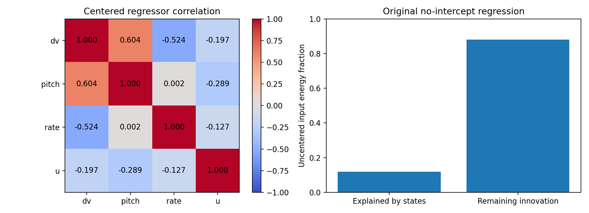
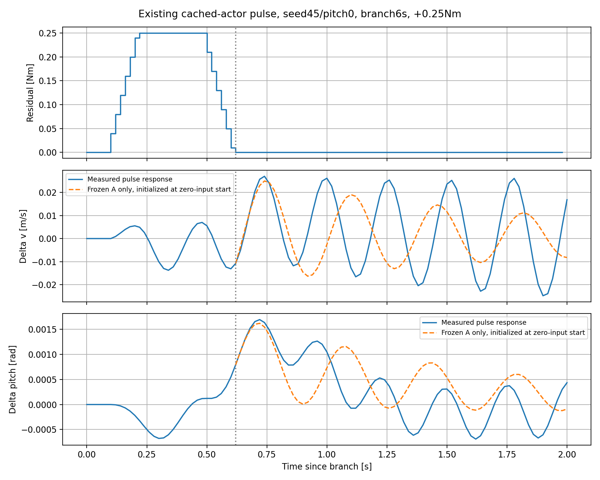

# F-2 B 과소추정 진단 — 입력 공선성인가, 불완전한 폐루프 표현인가?

작성일: 2026-10-15 (Asia/Seoul)

Execution Domain: DESKTOP_DRY_RUN — 기존 VALIDATION_SIM archive의 수치 분석. 신규 MuJoCo 실행 0회.

Policy Checkpoint SHA256: `3fd6113b95be69e0956f1510d4002dd161bc7226e0f1d9ade205117fc3edaed6`

ONNX SHA256: `e9c40d1af7e6a9e54f6336ef684927d3806f1a46ef02c34a91bd1ed732382039`

Evidence Status: **PASS — archive 재구성·부분 회귀·손실 분해·입력 파일 보존 검사. SUSPICIOUS — 불완전한 상태/이력 표현에 의한 B 편향. FAIL — 기존 A의 입력 종료 후 장기 응답 예측.** 특정 누락 상태의 인과적 원인 확정: NOT_TESTED.

Observed Metrics / Behavior / Log Summary:

**현재 데이터는 “현재 상태와 torque의 강한 공선성 때문에 A가 B를 거의 전부 흡수했다”는 설명을 지지하지 않는다.** 실제 회귀에 들어간 세 상태로 설명되는 입력 에너지는 11.93%이고, B를 구분하는 잔여 입력 에너지는 88.07%였다. 입력 VIF는 1.1355, 열별 norm으로 정규화한 회귀행렬 condition number는 3.0803이다. B가 작은 것은 행렬의 거의 특이한 방향을 선택한 수치 현상으로 보이지 않는다.

반면 **회귀 오차에는 현재 상태와 현재 입력으로 설명되지 않는 과거 입력·action·관절 상태와의 관련성이 남는다.** 입력이 0이 된 뒤 실측 상태로 초기화해도 A의 예측이 실제 응답에서 벗어난다. 이 결과는 4-state 상수 계수 회귀가 폐루프의 이력/내부 반응을 충분히 표현하지 못해 B가 순간 입력 효과와 다른 회귀 계수가 되었을 가능성을 지지한다. 단, 누락 상태, 비선형성, 동작점 변화의 기여를 각각 확정하지는 못했다.

## 1. 분석 범위와 재사용한 데이터

- [기존 identification.npz](flash_torque_residual/f2_closed/identification.npz): train 7,344 transitions, held-out 3,672 transitions.
- 기존 다중 sine probing 27 episodes: seeds42/43의 18회 학습, seed44의 9회 검증. 대응 A baseline을 함께 읽었다.
- [기존 직접 B 측정](f2_response_validation/direct_B.json): cached actor의 54개 중앙 차분 쌍. 6개 초기 조건, 4/6/8초의 18개 관련된 시작 상태다.
- [기존 pulse archive](f2_response_validation/primary/): 양/음 pulse, amplitude parameter 0.1/0.25/0.5 Nm, 18개 시작 상태의 **108개 응답**을 재사용했다.

모든 주 분석은 **기존 cached IMU actor** 조건이다. 식별 상태는 동기화 encoder/IMU이며, 최근 actor까지 동기화한 F-1 viewer와 다르다. 이번에는 두 센서 경로를 섞지 않았다.

요청대로 입력 시점·단위·부호를 다시 실험하지 않았다. Episode별 배열을 기존 archive와 연결하기 위해 같은 mask와 저장된 입력 정의를 사용했으며, 합친 train/held-out의 x/y/u는 identification.npz와 **배열 전체가 정확히 일치**했다. A/B/K/Q/R, feedforward, 상태 차원, 정책 및 실제 제어 경로를 변경하지 않았다.

## 2. B를 분리할 입력 정보가 실제로 부족했는가?

원래 회귀는 위치 translation 대칭을 강제한다. 따라서 현재 위치는 자유 회귀변수가 아니다.

```text
C = [delta_v, delta_pitch, delta_pitch_rate]
Y = [delta_p_next - delta_p, delta_v_next, delta_pitch_next, delta_pitch_rate_next]
Y ≈ C * D + u * B_transpose       # intercept 없음

u_perp = u - projection_on_C(u)
Y_perp = Y - projection_on_C(Y)
B_transpose = (u_perp_transpose * Y_perp) / (u_perp_transpose * u_perp)
```

이는 Frisch–Waugh–Lovell 부분 회귀이며, 동일 회귀에서 **상태가 이미 설명하는 부분을 제거한 입력만으로 B를 계산**한다. 이 계산은 기존 B를 수치 오차 1e-12/상대 1e-9 허용 범위에서 재현했다.

| 지표 | 값 | 의미 |
|---|---:|---|
| 입력 u RMS | 0.096749 Nm | 전체 입력 크기 |
| 상태 제거 후 u_perp RMS | 0.090793 Nm | B 분리에 남는 입력 크기 |
| 상태로 설명되는 입력 에너지 | 11.933% | 원래 intercept 없는 회귀 기준 |
| 남는 입력 에너지 | **88.067%** | 상태와 선형적으로 겹치지 않는 부분 |
| 입력 VIF | **1.1355** | 강한 현재 상태 공선성을 시사하지 않음 |
| 회귀행렬 rank | 4/4 | 회귀 계수의 선형적 분리 가능 |
| 열 norm 정규화 condition number | **3.0803** | 회귀변수 상관 자체를 비교하는 지표 |
| 기존 고정 scale 기준 condition number | 29.0524 | scale 정의가 달라 위 값과 충돌하지 않음 |

현재 입력과 각 상태의 Pearson 상관계수는 velocity **−0.1967**, pitch **−0.2894**, pitch rate **−0.1267**이었다. Pearson 표는 평균을 뺀 값이며, 위 에너지 분해와 VIF는 원래 intercept 없는 회귀를 그대로 따른다.



**88%가 남는다는 것이 인과적 시스템 식별에 충분한 excitation을 증명하지는 않는다.** 현재 상태와의 공선성이 작다는 뜻이다. 시간적으로 입력이 독립적인지, 누락 상태/오차와 무상관인지, 다른 동작점까지 유효한지는 별도 조건이다. 올바른 선형 모델에 오차가 없다면 공선성만으로 OLS의 B가 체계적으로 작아지지는 않는다.

## 3. 다른 데이터 부분에서도 B가 작은가?

아래는 동일 4-state 회귀를 부분 데이터에 재계산한 **진단 통계**다. 새 모델 파일이나 제어 gain을 만들지 않았다.

| 데이터 | Velocity B (m/s)/Nm | Pitch B rad/Nm |
|---|---:|---:|
| 기존 학습 전체 | 0.004008386 | −0.000005361588 |
| amplitude parameter 0.1 | 0.010285094 | −0.000012380312 |
| amplitude parameter 0.25 | 0.007757879 | −0.000008651759 |
| amplitude parameter 0.5 | 0.002247531 | −0.000003740981 |
| held-out seed44만 재계산 | 0.004186710 | −0.000005705872 |
| 학습의 2–5초 구간 | 0.003809598 | −0.000003778765 |
| 학습의 5–10.5초 구간 | 0.004123321 | −0.000006366364 |
| 기존 직접 B 측정 중앙값 | **0.022699171** | **−0.000156719757** |

Amplitude parameter는 원래 probing 설정값이다. 실제 입력은 네 sine의 평균, ramp와 slew를 거친다. 실제 u RMS는 각 amplitude에서 약 0.03609/0.08525/0.13968 Nm이므로 표의 설정값을 실제 peak나 RMS로 해석하지 않는다.

18개 학습 episode를 하나씩 제외한 B 범위는 velocity **0.003836894–0.004279830**, pitch **−0.000005657781–−0.000005194502**다. 특정 episode 하나가 전체 B를 왜곡한 설명은 약하다. 이는 관련된 결정론적 데이터의 민감도이며 신뢰구간이 아니다.

가장 작은 amplitude 부분에서도 직접 측정값보다 velocity 약 **2.21배**, pitch 약 **12.66배** 작다. 동시에 amplitude에 따라 회귀 계수가 크게 바뀐다. 따라서 하나의 상수 B가 모든 probing 응답에서 동일한 물리 입력 미분을 대표한다고 보기 어렵다. 비선형성·slew로 달라진 파형·서로 다른 상태/이력 분포를 여기서 분리하지는 못했다.

직접 B는 다른 seeds45/46의 baseline 시작 상태에서 작은 한 step 입력으로 얻었다. 기존 학습의 매 상태에서 직접 미분을 측정한 값은 아니다. 위 비교만으로 학습 전 구간의 정확한 참 B가 일정하다고 가정하지 않는다.

## 4. 직접 B를 기준으로 놓으면 A가 차이를 흡수할 수 있는가?

직접 B 중앙값을 고정하고, 나머지 회귀 계수 A를 최적으로 선택했을 때의 **학습 손실 profile**을 계산했다. A의 자유 계수는 이 계산의 nuisance parameter이며 새 동역학 모델로 저장하거나 적용하지 않았다.

| 성분 | 원래 OLS RMSE | 직접 B 고정 후 최소 RMSE | 비율 |
|---|---:|---:|---:|
| Velocity | 0.001802954 m/s | 0.002475972 m/s | **1.3733배** |
| Pitch | 0.000006772339 rad | 0.000015320414 rad | **2.2622배** |

직접 B를 사용할 때 추가되는 입력 효과의 **11.93% 에너지**만 A 조정으로 상쇄할 수 있었다. 나머지 88.07%는 현재 상태의 선형 조합에 들어가지 않는다. 손실 증가가 정확히 `||u_perp||² * (B_reference−B_OLS)²`와 같다는 것도 검사했다.

이 결과는 “실제 B와 거의 같은 학습 오차를 내는 다른 A/B가 있는데 우연히 작은 B를 골랐다”는 설명에 반대된다. **주어진 데이터와 4-state 상수 회귀 목적함수 자체가 작은 B를 선호한다.** 단순 solver 변경이나 scale 조정이 직접 입력 미분을 복원할 근거는 없다.

참고 B를 고정하고 A를 제거한 뒤 남는 오차와 u_perp의 상관은 velocity **−0.6854**, pitch **+0.8970**이었다. 이는 이미 정한 참고 B에 대한 손실 분해이며, 그 자체로 특정 누락 상태를 직접 측정한 증거는 아니다.

## 5. 시간적 excitation과 모델 오차의 이력 의존성

현재 상태와 입력의 공선성은 작지만 **입력은 시간적으로 강하게 관련**돼 있다.

- 같은 amplitude의 9개 초기 조건에서 입력 파형은 최대 약 **1.31e-8 Nm** 차이만 났다. Seed 분리는 독립적인 probing 위상/파형 분리가 아니었다.
- 원래 sine 주파수는 0.37/1.1/2.7/5.3 Hz로 고정됐다. Amplitude별 slew 때문에 실제 파형에는 차이가 있지만 새로운 무작위 위상은 없다.
- Episode별 상태 제거 입력 u_perp의 20 ms 간격 상관은 **0.9510**, 40 ms는 **0.8319**였다. 이를 독립 표본 수로 환산하지 않았다.

현재 회귀변수 `[delta_v,delta_pitch,delta_rate,u]`를 양쪽에서 제거한 뒤, 원래 모델 오차와 과거 입력의 partial correlation을 계산했다. Episode 경계와 제외된 외란 구간을 가로지르는 lag는 사용하지 않았다.

| 과거 입력 시차 | Velocity 오차와의 partial correlation | Pitch 오차와의 partial correlation |
|---|---:|---:|
| 20 ms | −0.4965 | +0.6572 |
| 40 ms | −0.6447 | +0.6660 |
| 100 ms | **−0.7869** | **+0.5085** |
| 200 ms | −0.5714 | +0.5205 |
| 500 ms | −0.1912 | +0.1292 |

원래 OLS가 현재 입력과 오차의 상관을 0으로 만든다고 해서 모델이 올바르다는 뜻은 아니다. 과거 입력과의 관련성이 크게 남는 것은 현재 4-state 회귀가 시간적 반응을 완전히 표현하지 못한다는 진단 신호다. 관련된 sine 데이터에서 계산했으므로 p-value나 인과 효과로 해석하지 않는다.

## 6. 입력이 0일 때 A만으로 진행을 예측하는가?

기존 108개 pulse는 한 step impulse가 아니라 0.1–0.5초의 유한 pulse와 slew tail을 포함한다. 새 impulse 실험을 만든 것으로 보고하지 않는다. 각 trace에서 **실제 residual이 마지막으로 0이 아닌 step 이후**를 찾고, 그 시점의 실측 delta_state로 초기화한 뒤 `delta_next=A*delta`만 전개했다. 이후 입력 크기는 1e-7 Nm 이하였고, 초기 B 효과와 입력이 있는 구간의 예측 오차를 초기 상태에 떠넘기지 않았다.

입력 종료 시점은 분기 후 0.54–0.74초다. 아래는 동일 horizon의 108개 예측 오차 RMS를 실제 delta 응답 RMS로 나눈 pooled NRMSE이며, 이전 보고서의 per-trace 중앙값과 집계법이 다르다.

| 입력 종료 후 예측 시간 | Velocity RMSE m/s | Velocity NRMSE | Pitch RMSE rad | Pitch NRMSE |
|---|---:|---:|---:|---:|
| 0.1초 | 0.004952 | 30.1% | 0.000375540 | 21.6% |
| 0.2초 | 0.011709 | 117.9% | 0.000898450 | 65.6% |
| 0.5초 | 0.016197 | **225.7%** | 0.000640702 | **327.4%** |
| 1.0초 | 0.006878 | 99.8% | 0.000462367 | 114.9% |

0.5초의 실제 pitch 응답 RMS가 0.000195700 rad로 작아서 NRMSE가 커지는 점에 유의한다. 그러나 같은 시점의 velocity 응답 RMS도 0.007177 m/s인 데 비해 오차가 0.016197 m/s이고, 전체 파형에서도 위상/감쇠가 어긋난다. 모든 horizon에서 오차가 단조 증가해야 하는 지표는 아니다. GT로 계산한 상세 통계도 pulse_a_only.json에 함께 저장했다.



따라서 **B만 직접 측정값으로 교체하면 문제가 해결된다는 근거도 없다.** 현재 A가 입력 종료 후 응답을 충분히 표현하지 못하므로 A/B를 함께 회귀한 결과의 B가 물리 입력 미분과 어긋나는 문제를 더 살펴봐야 한다.

## 7. 저장된 내부 상태와의 관련성 — 차원 확장 없이 검사

A-only 검사를 확인한 뒤, 기존 trace에 이미 저장된 세 그룹에 대해서만 오차 관련성을 계산했다. 새로운 회귀 상태를 추가하거나 augmented 모델을 학습하지 않았다. 현재 회귀변수를 제거한 뒤 8개 native channel의 partial correlation을 모두 저장했고, 아래에는 각 그룹의 최대 절댓값을 제시한다. 최대값 선택에 따른 기술 통계이며 유의성/원인 순위가 아니다.

| 저장된 변수 그룹 | Velocity 오차 최대 abs correlation | Pitch 오차 최대 abs correlation |
|---|---:|---:|
| 직전 raw actor action | **0.9809** | **0.8252** |
| Joint position | **0.9742** | 0.5923 |
| Joint velocity | 0.3246 | 0.2981 |

`직전 action`은 현재 transition의 actor가 실제 last_action으로 받을 값이다. 기존 archive의 row k `policy_action`을 사용했다. Row k `history_input`은 직전 inference에서 사용한 더 오래된 history이므로 혼동하지 않았다. Joint position/velocity 역시 transition 시작 상태를 사용했다.

이런 변수들은 서로 및 과거 입력과도 관련돼 있다. **특정 leg joint나 action history가 B 편향의 유일한 원인이라고 결론내리지 않는다.** 센서 지연, contact, roll/yaw, 비선형 동작점 변화도 이번 조건부 상관만으로 배제하지 못한다. 특히 이 분석은 같은 4-state인데 숨은 상태만 다른 쌍을 실험적으로 만든 조건부 인과 검사가 아니다.

## 8. 두 가설에 대한 판정

| 가설 | 이번 증거로 내릴 판단 |
|---|---|
| A: 현재 상태와 sine torque의 강한 공선성 때문에 A/B 분리가 불가능했다 | **주된 설명으로 지지되지 않음.** Rank 4, 입력 VIF 1.1355, 잔여 입력 에너지 88.07%. 직접 B를 고정하면 A를 조정해도 손실이 뚜렷하게 증가한다. |
| B: 4-state가 표현하지 못한 내부 상태/이력이 B 회귀에 섞였다 | **SUSPICIOUS — 더 강하게 지지됨.** 입력 0에서도 A 장기 예측이 불충분하고, 오차에 과거 입력·action·joint position 관련성이 남는다. 단일 누락 상태의 인과 기여는 미확정. |

두 가설이 완전히 배타적인 것은 아니다. **동시점 공선성은 작아도, 부드럽고 반복된 probing이 이력 효과를 구분하는 데 부족할 수 있다.** 상관된 이력/모델 오차가 존재하면 현재 상태로 설명되지 않는 입력도 오차와 관련될 수 있다. 그런 경우 OLS B는 전체 폐루프의 순간 인과 미분이 아니라 제한된 관측 회귀의 계수가 된다.

이번에 좁혀진 문제는 **“B를 계산할 입력 열이 거의 없었다”가 아니라 “직접 입력 효과와 다른 계수를 선호하도록 만드는 모델 오차가 데이터에 남는다”**는 것이다. 작은 probing에서 B가 여전히 작고 amplitude별 계수가 바뀐다는 점도 함께 고려해야 한다.

다음에 인과 구분을 더 한다면 학습 probing의 같은 전체 상태에서 ±한 step 입력을 비교해 학습 동작점의 직접 B를 얻고, 현재 4-state가 유사하되 history가 다른 경우의 후속 응답 차이를 확인하는 것이 유용하다. 이는 후속 진단 제안이며 이번에는 실행하지 않았다. Q/R, feedforward, 새 LQR, 온라인 식별, 상태 확장은 아직 적용할 근거가 확보되지 않았다.

## 9. 변경·검증·재현

신규 파일은 `test/analyze_f2_b_identifiability.py`, `test/test_f2_b_identifiability.py`, 본 보고서와 `f2_b_identifiability/` 증거다. 기존 제어 소스·설정·보고서·식별 모델은 변경하지 않았다. 실행 중 읽은 기존 파일 **174개**의 SHA256이 분석 전후 일치한다: [integrity.json](f2_b_identifiability/integrity.json).

수치 검사 PASS: 원본 train/held-out 6개 배열 정확 재구성, OLS/FWL B 재현, 참고 B 손실 분해 항등식, A 보상 항등식, 입력 hash 보존. 독립적인 Walsh 직교 배열을 사용한 단위 검사 **2개 PASS**: 강한 공선성만으로 정확한 B가 바뀌지 않는 경우와 누락 효과가 입력 잔여분과 관련되어 B가 달라지는 경우. 이 합성 검사는 진단 계산의 검증이며 실제 로봇의 원인을 증명하는 실험이 아니다.

`./scripts/agent-check.sh`는 **전체 FAIL**이다. Python syntax **361개 PASS**, URDF XML **8개 PASS**이지만, 이번 작업 시작 전부터 수정되어 있던 `lab/ddt_lab/ddt_lab/tasks/manager_based/locomotion/robots/tita/my_flat_env_cfg.py`의 trailing whitespace 때문에 저장소 전체 diff 검사가 실패했다. 이 파일은 수정하지 않았다. 이번 신규 파일의 diff/보존 검사는 별도로 PASS이며 agent_check.log와 final_review.json에 기록했다. 브랜치: `agent/codex/dev_tita_gluon`. Hardware 실행·새 시뮬레이션·배포 없음. 현재 센서 동기화 actor를 위한 새 A/B도 생성하지 않았다.

```bash
MPLCONFIGDIR=/tmp/lqr_mpl /home/cocel/venvs/cosim_ros2_jazzy/bin/python test/test_f2_b_identifiability.py
MPLCONFIGDIR=/tmp/lqr_mpl /home/cocel/venvs/cosim_ros2_jazzy/bin/python test/analyze_f2_b_identifiability.py --output docs/exp/2026-10-15/new_f2_b_identifiability
./scripts/agent-check.sh
```

산출물: [regression_diagnostics.json](f2_b_identifiability/regression_diagnostics.json), [pulse_a_only.json](f2_b_identifiability/pulse_a_only.json), 상관/입력 정보량 및 pulse 그래프, unit_tests.log, analysis_run.log, integrity.json, agent_check.log, final_review.json, task.diff.
