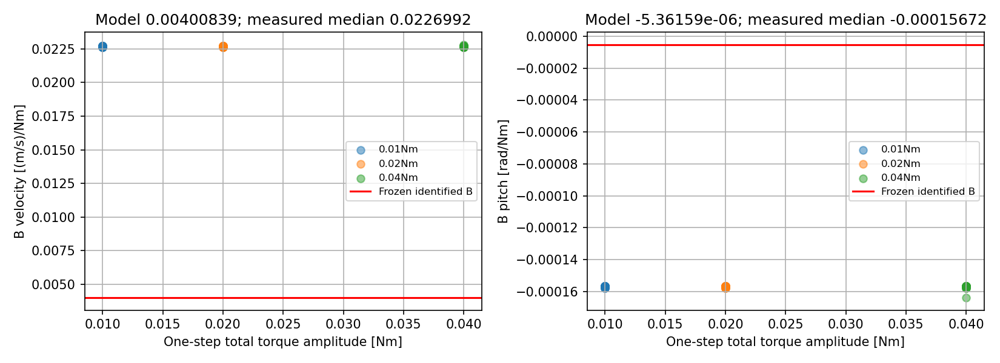
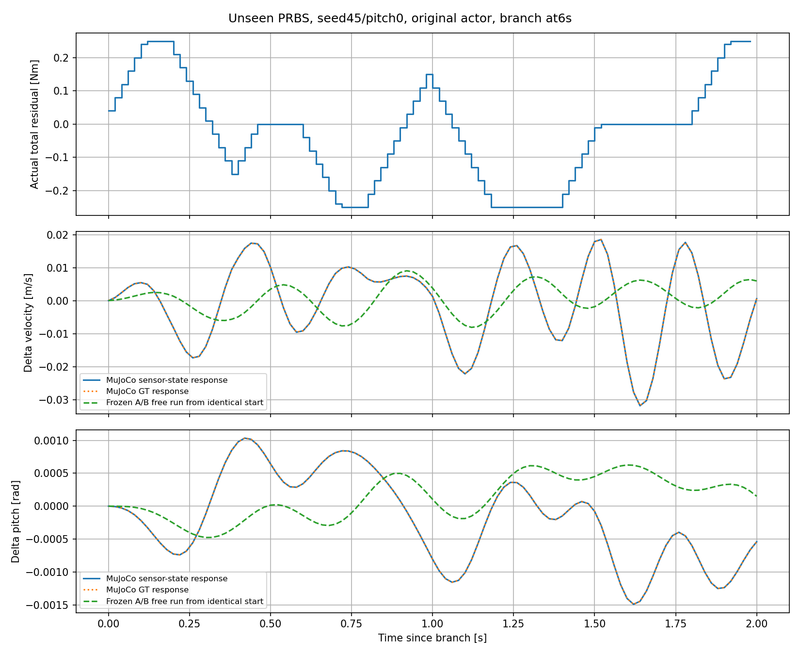

# F-2 A/B 검증 — residual torque가 속도와 pitch에 미치는 영향을 예측하는가?

작성일: 2026-10-15 (Asia/Seoul)

Execution Domain: VALIDATION_SIM (수치 분석·무결성 검사: DESKTOP_DRY_RUN)

Policy Checkpoint SHA256: `3fd6113b95be69e0956f1510d4002dd161bc7226e0f1d9ade205117fc3edaed6`

ONNX SHA256: `e9c40d1af7e6a9e54f6336ef684927d3806f1a46ef02c34a91bd1ed732382039`

Evidence Status: **FAIL — 기존 F-2 A/B의 새로운 residual 입력 응답 예측 정확도.** PASS — 원본 모델/기준 궤적 재현, 동일 전체 상태 분기, 입력·상태 시점 및 무결성 검사. 실제 정지 제어 개선·feedforward 적용·실기: NOT_TESTED.

Observed Metrics / Behavior / Log Summary:

**현재 F-2 A/B는 residual torque에 따른 실제 속도·pitch 변화의 크기와 시간 응답을 충분히 정확하게 예측하지 못했다.** 같은 MuJoCo 전체 상태에서 토크만 바꾼 검사에서 실제20 ms 입력 효과는 식별된 B보다 속도에서 약5.66배, pitch에서 약29.23배 컸다. 새로운 입력324개 응답에서2초 자유 예측의 NRMSE 중앙값은 속도111%, pitch135%로, baseline 대비 변화가0이라는 예측보다도 오차가 컸다.

한 step pitch 예측은 상대적으로 정확했으나, 매 step 실제 상태를 주입하는 예측과 residual 입력의 누적 효과를 예측하는 것은 다르다. 이번 결과는 **F-2의 drift 악화를 feedforward 누락 하나로 설명하기 전에 모델의 입력 채널과 다중 step 예측을 개선해야 한다**는 판단을 지지한다. Feedforward 누락이 실제 실패의 유일한 원인인지, 또는 개선된 모델+feedforward가 정지를 달성하는지는 이번에 시험하지 않았다.

## 1. 검증 질문과 고정한 대상

검증 대상은 기존 식별 모델 그대로다.

```text
state = [encoder sagittal path, velocity, pitch error, pitch rate]
delta_state(t) = state_with_residual(t) - matched_FlashSAC_baseline(t)
delta_state(t+1) = A_closed * delta_state(t) + B_res * residual_total(t)
control dt = 0.02 s, physics dt = 0.005 s
```

[원본 model.json](flash_torque_residual/f2_closed/model.json), [identification.npz](flash_torque_residual/f2_closed/identification.npz), [원본 F-2 보고서](flash_torque_residual_summary.md)를 사용했다. A/B/K/Q/R을 새 결과에 맞춰 수정하지 않았다. 저장된 학습 데이터를 기존 least squares 함수로 다시 계산했을 때 원본 A/B가 수치 허용오차1e-10 내에서 재현됐고, 원래 held-out 점수도 재현됐다. 이는 재현 검사이며 새 모델을 설계한 것이 아니다.

원본 F-2의 actor는 cached IMU를 사용하며, 식별 상태는 동기화 encoder/IMU다. 이후 F-1에서 actor IMU까지 동기화한 경로와 구분해야 한다. **주 결과는 원래 cached actor 조건**이고, 현재 동기화 actor로의 이전은 별도 보조 실험이다.

원본 입력/상태 정렬을 감사했다. 저장 row t+1의 substep torque가 t→t+1에 적용된 토크이며, 입력은 `실제 wheel command - 원래 FlashSAC wheel torque`의 signed 합이다. 새 데이터는 N개 입력과 N+1개 상태를 별도로 저장했다. 바퀴당 토크와 합 토크,20 ms 이산 모델과 연속시간 모델을 혼동하지 않았다.

## 2. 실험 설계

### 원본 증거 재검산

- 기존 학습: seeds42/43,18 probing episodes,7,344 transitions.
- 기존 held-out: seed44,9 probing episodes,3,672 transitions. 동일한 다중 sine 주파수와 amplitude군에서 seed를 분리한 검증이었다.
- 원본 seed44/pitch0 A baseline12초의 동기화 상태·GT·위치·action·모든 physics motor substep을 새 runner로 **정확히 재현**했다.
- 기존 F-2 feedback 평가 중 seed44/nonzero alpha 데이터도 읽어 실제 제어 입력 분포의 one-step 오차를 분석했다. 새로 제어기를 실행하거나 변경하지 않았다.

### 새로운 입력: 주 실험

Seeds45/46 × 초기 pitch perturbation[-0.035,0,+0.035]의6개 nominal 초기 조건에서 FlashSAC baseline을 실행했다. 기존 조건과 동일하게3초의12 N/0.1초 외란을 prefix에 유지했다.4/6/8초의3개 시점에서 전체 상태를 복제해 baseline과 residual 응답을 분기했다. 분기 이후에는 외부 힘을 추가하지 않았다.

복제 대상은 qpos/qvel만이 아니다. **MuJoCo mjData의 cached 센서/시간/내부 상태, actor last_action, encoder/IMU odometry의 적분·이전 상태, GT path의 이전 위치/heading**도 복제했다. 원본 mjData에 mj_forward를 호출해 cached actor의 조건을 바꾸지 않았다. Fresh IMU용 clone도 함께 복원했다.

- 18개 시작 상태 ×6개 입력 종류 ×3개 amplitude = **324개2초 응답**.
- 입력 종류: 양/음 step, 양/음 pulse, PRBS, 새로운 다중 sine.
- 합 amplitude:0.1/0.25/0.5 Nm. 최대1 Nm 제한과2 Nm/s slew를 유지했다.
- 새 sine 주파수:0.63/1.73/3.41 Hz. 기존0.37/1.1/2.7/5.3 Hz와 다르다. PRBS는 seed1729의 고정 sequence다.
- 동일 분기의 무입력 응답은 원래 baseline의 다음2초 상태·action·motor substep과 정확히 일치했다.

324개는 독립 초기 상태324개가 아니라 **6개 초기 조건·18개 시작 상태의 관련된 응답들**이다. 겹치는 예측 창도 독립 표본으로 해석하지 않는다. 아래 중앙값/범위는 기술 통계이며 모집단 유의성이나 실기 강건성 추론이 아니다.

### 직접 B 검사

18개 시작 상태에서 ±0.01/0.02/0.04 Nm를 각각20 ms 적용했다. 최대0.04 Nm 첫 입력은2 Nm/s slew 범위 안이다. 각 ±분기의 첫 actor action이 무입력 action과 정확히 같은 것도 검사했다.

```text
B_empirical = (state_next(+a) - state_next(-a)) / (actual_u_plus - actual_u_minus)
```

첫 상태 차이가0이므로 이 검사는 `A*delta_state`의 영향 없이 한 step 입력 효과를 측정한다. **54개 중앙 차분 쌍**, 실제 ±분기108회다. Wheel/leg PD는 각 physics substep에서 원래 방식대로 반응하므로 검사 대상인 폐루프 actuator 경로를 포함한다.

### 동기화 actor 이전 검사 및 smoke

동기화 actor는 seeds45/46,pitch0,4/6/8초에서 step±0.25 Nm와PRBS0.25 Nm의 **18개 응답** 및18개 B 차분 쌍을 별도로 얻었다. Cached/sync smoke 응답2개와6개 B 차분 쌍도 실행했다.

정식 채택 데이터 전체는344개 응답,78개 B 차분 쌍,26개 무입력 분기 재현 및10개 prefix다. 개발 초기 `smoke/`는 본 결과에서 제외하고 `smoke_final/`, `primary/`, `transfer/`만 채택했다. 초기 cached smoke의 source snapshot은 별도 보존했다.

## 3. 판정 지표

1. **One-step:** 매 시점의 실제 delta_state를 넣고 다음20 ms만 예측한다.
2. **여러 step:** 실제 시작 상태에서 한 번 초기화한 뒤, 이후 상태를 실제 값으로 보정하지 않고 A/B로 전개한다. 미래 residual 입력은 실측값을 알려준 조건이다. 입력 예측 오차를 모델 상태 예측 오차와 섞지 않는다.
3. **2초 전체 자유 예측:** 분기 시 delta_state=0에서 시작해2초 동안 한 번도 상태를 재주입하지 않는다.
4. **대조군:** one-step persistence(delta_next=delta_now), A-only(B=0), baseline 대비 변화0 예측.

```text
response NRMSE = RMS(predicted_delta - actual_delta) / RMS(actual_delta)
change NRMSE   = RMS(predicted_delta - actual_delta) / RMS(actual_delta_end - actual_delta_start)
```

이 보고서의 주 NRMSE는 **response NRMSE**다. 원본 보고서의 한 step 변화량 대비 비율(change NRMSE)과 분모가 다르다.2초 전체 예측에서 response NRMSE=100%는 변화0 예측과 같은 RMS 오차다. 작은 분모는 [p1e-7 m,v1e-5 m/s,pitch1e-7 rad,rate1e-5 rad/s] floor를 둔다.

새 결과를 얻기 전 evaluation_plan.json에 기록한 운영 기준은 v/pitch의0.1/0.5/1초 예측 NRMSE 중앙값≤30%, 충분한 변화가 있는 창의 방향 일치≥90%였다. 이는 사용자가 지정한 수치 사양은 아니다. 실제 오차는 변화0 예측보다 큰 수준이므로30% threshold의 세부 선택만으로 결론이 달라지지는 않는다.

## 4. 결과 A — 직접 측정한 입력 효과가 B와 크게 다르다

원래 actor 조건,54개 차분 쌍 중앙값. B는 **합1 Nm가20 ms 적용될 때 다음 상태가 얼마나 변하는지**의 단위다.

| 성분 | 기존 식별 B | 실제 sensor-state B 중앙값 | 실제/모델 |
|---|---:|---:|---:|
| Path m/Nm | 0.000053709 | 0.000301987 | 5.62배 |
| **Velocity (m/s)/Nm** | **0.004008386** | **0.022699171** | **5.66배** |
| **Pitch rad/Nm** | **-0.000005362** | **-0.000156720** | **29.23배** |
| Pitch rate (rad/s)/Nm | -0.001315204 | -0.015067468 | 11.46배 |

Velocity의 실제 B 범위는0.0226514–0.0228162, pitch는-0.000163722–-0.000156626이었다. 여러 시작 상태/작은 amplitude에서도 같은 규모의 차이가 남았다. B의 부호는 이 즉시 반응에서는 맞지만 크기를 크게 과소평가한다. 측정값 기준 과소평가율은 v약82.3%, pitch약96.6%다.

GT로 계산해도 velocity B 중앙값0.022681508, pitch B는-0.000156720이었다. Sensor-state와 GT의 차이는 모델과 실제 사이의 차이를 설명하지 못한다. 단, 이 값은 검사한 움직이는 상태의 국소 입력 미분이며 정지 평형점의 정확한 B를 새로 식별했다는 의미는 아니다. A의 모든 원소가 틀렸다는 주장도 아니다.



## 5. 결과 B — 한 step 정확도만으로 입력 응답이 검증되지 않는다

새 입력324개 응답의 per-trace RMS 중앙값:

| One-step 예측기 | 속도 RMSE mm/s | Pitch RMSE rad |
|---|---:|---:|
| Persistence | 3.322 | 0.000109761 |
| 기존 A/B | 2.405 | 0.000010840 |
| A-only, B=0 | **2.320** | **0.000010577** |

A/B는 pitch의 한 step 연속성을 잘 예측하며 persistence보다 나은 경우가 많다. 하지만 B를 빼도 오차가 더 작았다. Per-trace 비교에서 A/B가 A-only보다 좋은 경우는 속도30/324, pitch36/324에 그쳤다. A-only는 원인 분리를 위한 예측 대조군이지 제어기로 쓰자는 제안이 아니다.

원본 held-out probing 데이터에서는 속도 one-step RMSE가 A/B1.837 mm/s, A-only1.878 mm/s로 B를 넣은 이득이 작았다. 반면 원본 held-out **F-2 feedback 입력**에서는 A/B2.099 mm/s, A-only1.627 mm/s로 B를 넣은 쪽이 나빴다. Pitch도 해당 feedback 데이터에서1.593e-5→1.503e-5 rad로 A-only가 더 작았다. 자세한 원본 데이터 재검산은 archive_audit.json에 있다.

따라서 원본3672개 held-out transition의 작은 one-step pitch 오차만으로, 제어 입력을 바꿨을 때의 동역학까지 정확히 식별됐다고 판단할 수 없다. 실제 현재 상태를 매번 제공하면 생략 상태·위상·입력 효과의 오류 일부가 가려질 수 있다.

## 6. 결과 C — 여러 step 응답의 크기와 위상을 맞추지 못한다

원래 actor의324개 응답. 각 시작점에서 실제 상태로 초기화하고 미래 실측 입력을 알려준 자유 예측 창을5 step 간격으로 잡았다. 표는 각 trace에서 계산한 지표의 중앙값이다.

| 예측 horizon | 속도 RMSE mm/s | Pitch RMSE rad | 속도 response NRMSE | Pitch response NRMSE |
|---|---:|---:|---:|---:|
| 0.1 s | 6.462 | 0.000312840 | 59.1% | 45.5% |
| 0.2 s | 12.777 | 0.000821155 | 124.0% | 120.2% |
| 0.5 s | 14.227 | 0.001114922 | 137.0% | 153.8% |
| 1.0 s | 12.890 | 0.000928086 | 118.1% | 155.1% |

NRMSE 중앙값은 per-trace 비율의 중앙값으로, 표의 RMSE 중앙값을 다른 중앙값으로 나눈 수치가 아니다. 충분한 실제 변화가 있는 창의 변화 방향을 집계하면0.5초 속도56.2%/pitch47.1%,1초 속도51.4%/pitch52.1% 일치였다. 방향은 `delta_end-delta_start`의 부호를 비교하며 겹치는 창을 독립 표본으로 해석하지 않는다.

분기 시작부터 **2초 전체**를 예측한 경우:

| 평가 상태 | 속도 RMSE 중앙값 mm/s | Pitch RMSE 중앙값 rad | 속도 NRMSE 중앙값 | Pitch NRMSE 중앙값 |
|---|---:|---:|---:|---:|
| 동기화 encoder/IMU state | 11.743 | 0.000871083 | 110.6% | 135.3% |
| MuJoCo Ground Truth state | 11.726 | 0.000871083 | 110.7% | 135.3% |

Sensor state가 모델의 원래 좌표다. GT 열은 동일 A/B를 GT delta에 적용한 보조 진단으로, GT 모델을 다시 학습한 결과가 아니다. 두 결과가 거의 같으므로 이번 nominal 응답의 예측 실패를 센서 추정 오차만으로 설명하기 어렵다. Pitch 절대 오차는 약0.05°로 작아 보여도, residual이 유발한 pitch 변화 자체에 비하면 크다. 이는 큰 자세 오차의 모든 용도에서 무조건 못 쓰는 모델이라는 주장과 구분한다.

대표 그림은 seed45/pitch0,6초 분기,0.25 Nm PRBS다. 실제 sensor와 GT 반응은 거의 겹치지만, 모델은 크기와 위상을 따라가지 못한다.



### 입력 크기·학습 범위 진단

2초 전체 예측 NRMSE 중앙값:

| 합 amplitude Nm | 속도 | Pitch |
|---:|---:|---:|
| 0.10 | 106.4% | 130.5% |
| 0.25 | 109.0% | 133.6% |
| 0.50 | 118.6% | 143.2% |

0.1 Nm의 작은 입력에서도 실패했다. 새로운 sine/PRBS/양음 pulse/양음 step 각각의 family 중앙값도 속도와 pitch 모두100%를 넘었다.

회귀 상태[v,pitch,rate]가 학습 데이터의 성분별 min/max 안에 있는 비율의 trace별 중앙값은96.0%였다. 그 비율이95% 이상인192개 응답만 사용해도2초 NRMSE는 속도108.1%, pitch132.7%였다. 성분별 box는 숨은 상태나 결합 분포의 동일성을 보장하지 않지만, 큰 입력/관측 상태 범위 이탈만으로 결과 전체를 설명하기는 어렵다.

## 7. 동기화 actor로의 이전은 더 나은 결과를 보이지 않았다

기존 A/B를 바꾸지 않고 actor IMU만 동기화한 별도18개 응답의2초 NRMSE 중앙값은 속도130.1%, pitch200.4%였다. 즉시 입력 효과의 B 과소평가도 속도약5.66배/pitch29.24배로 비슷했다.

이 결과를 주 실험과 합치지 않는다. Actor sensing 시점을 바꾸면 폐루프가 달라지므로 기존 A/B를 그대로 옮겨 쓸 근거가 없다. 더 중요한 것은 **원래 cached actor 조건에서도 이미 예측 정확도가 부족했다**는 점이다. 이번 실패가 actor 동기화로 인한 조건 불일치 때문에만 생긴 것은 아니다.

## 8. 정지 목표와 feedforward 가설의 의미

사용자가 제시한 구분은 이번 검증과 양립한다. 목표가 baseline 추종이 아니라 정지점 유지이면 일반적으로 delta_target=0이 아니다.

```text
delta_target(t) = x_target - x_base(t)
e(t) = delta_x(t) - delta_target(t) = x(t) - x_target
g(t) = delta_target(t+1) - A*delta_target(t)
e(t+1) = A*e(t) + B*r(t) - g(t) + model_error(t)
```

따라서 r=r_ff-Ke를 쓸 때 이상적인 오차 동역학에는 `B*r_ff = g`가 필요할 수 있다. 입력이1개라 g의4성분을 매 순간 정확히 만족할 수 있는 보장은 없으며 토크/slew 한도도 있다. 기존 F-2는 이 feedforward를 명시적으로 계산하지 않았다. 원래 제어 오차는 `[p-p_hold, v, pitch_error-0.094531, pitch_rate]`이므로 상태 좌표 전체를 단순히0으로 만드는 제어와도 구분한다.

주324개 응답 검사는 LQR/목표추종 제어기 대신 지정된 residual 입력을 적용하고, 그 실제 입력을 예측기에 모두 알려줬다. 따라서 delta_target 또는 feedforward 설정이 이번 주 실험의 예측 오차를 직접 만든 것은 아니다.

그러나 위 관계가 유용하려면 A/B와 모델 유효 범위를 먼저 믿을 수 있어야 한다. 이번에는 model_error가 작다는 전제가 검증되지 않았다. **Feedforward 누락은 남아 있는 가설이며, 현재 모델의 입력 응답 부정확성이 새로 확인된 별도의 문제다.** Feedforward를 더하면 F-2가 반드시 개선된다거나, 모델 오류만이 기존 drift 악화의 유일한 원인이라고 결론 내리지 않는다.

이 연구 방향은 계속 검증할 수 있지만, 현재 저장된 A/B로 계산한 고유값이나 LQR gain만으로 실제 정지 성능을 예상하는 근거는 약하다. 원래 rho(A-BK)=0.999532는 식별 모델 내부 값이며 실제 MuJoCo의 안정성·위치 수렴 증거가 아니다.

## 9. 원인 해석과 다음 판단

확인한 사실은 B의 국소 입력 gain 불일치, 새로운 입력에서의 자유 예측 실패, 센서/GT 결과 일치다. 다음은 원인 후보이며 각각의 인과 기여를 확정한 실험은 아니다.

- 4-state에 leg 상태, roll/yaw, contact 상태, raw action history, sensor cache의 지연 상태가 생략돼 Markov 폐루프 모델이 아닐 수 있다. 정책에 RNN이 있다는 뜻은 아니다.
- 동일 sine 입력의 seed 분리만으로는 새로운 입력 family와 feedback 입력으로의 일반화를 확인하기 어렵다.
- Input과 상태·생략 상태가 상관된 회귀에서는 A가 과거 입력의 영향을 일부 흡수해 one-step 오차가 작아도 B의 직접적인 인과 gain이 부정확할 수 있다.
- 움직이는 trajectory 전역에 하나의 LTI 투영을 적용하는 근사와 비선형/contact 효과가 남아 있다.

이번 단계의 결정은 **기존 A/B를 검증 완료한 모델로 취급하지 않는 것**이다. 후속 모델을 비교한다면 동일한 state/history·센서 시점·PD/contact 조건을 고정하고, 이번 작은 ±토크 미분과 새로운 입력 자유 예측을 통과하는지 먼저 확인할 필요가 있다. 새 모델 형태, 온라인 식별, LQR/FF 설계 또는 정책 재학습은 이번에 수행하지 않았다.

## 10. 구현·검증·재현

신규 파일:

- `test/validate_f2_residual_response.py`: 전체 상태 복제, matched baseline, 새 입력 및 직접 B 검사.
- `test/analyze_f2_residual_response.py`: 원본 fit/held-out 재현, one-step/자유 예측·대조군·GT·범위 분석, CSV/그림.
- `test/test_f2_response_prediction.py`: 알려진 선형 시스템의 독립적인 closed-form convolution으로 입력 시점과 모든 예측 horizon 계산을 검증.1개 검사 PASS: unit_test.log.
- 본 보고서와 `f2_response_validation/` 증거. 기존 소스·보고서·정책·원본 A/B·K/Q/R은 보존했고, 현재 수동 viewer도 변경하지 않았다.

[무결성 기록](f2_response_validation/integrity.json): 채택344개 응답,78개 B 차분 쌍,26개 무입력 분기 정확 재현,10개 prefix. 모든 run source hash와 입력 snapshot 일치. Leg torque 변경0 Nm, 실제 residual 입력 반올림 오차 최대2.76e-8 Nm, bound/slew/motor limit 및 N+1 states/N inputs 정렬 확인. 원본12초 재현은 prefix_reproduction.json, 모델/기존 데이터 재검산은 archive_audit.json에 있다.

[전체 요약](f2_response_validation/summary.json), `response_metrics.json`, `direct_B.json`, `metrics.csv`, 각 stage manifest/inputs/contexts 및 raw NPZ, `analysis_integrity.json`에 수치를 보존했다. source/data 보존 및 final diff는 final_review.json/task.diff, 최종 agent-check는 agent_check.log에 기록한다. 브랜치: `agent/codex/dev_tita_gluon`.

```bash
PYTHONDONTWRITEBYTECODE=1 OPENBLAS_NUM_THREADS=1 OMP_NUM_THREADS=1 MPLCONFIGDIR=/tmp/lqr_mpl /home/cocel/venvs/cosim_ros2_jazzy/bin/python test/validate_f2_residual_response.py --design docs/exp/2026-10-15/f2_response_validation/primary_design.json --output docs/exp/2026-10-15/new_f2_response/primary --workers 3
PYTHONDONTWRITEBYTECODE=1 OPENBLAS_NUM_THREADS=1 OMP_NUM_THREADS=1 MPLCONFIGDIR=/tmp/lqr_mpl /home/cocel/venvs/cosim_ros2_jazzy/bin/python test/validate_f2_residual_response.py --design docs/exp/2026-10-15/f2_response_validation/transfer_design.json --output docs/exp/2026-10-15/new_f2_response/transfer --workers 2
PYTHONDONTWRITEBYTECODE=1 MPLCONFIGDIR=/tmp/lqr_mpl /home/cocel/venvs/cosim_ros2_jazzy/bin/python test/analyze_f2_residual_response.py --root docs/exp/2026-10-15/new_f2_response
PYTHONDONTWRITEBYTECODE=1 MPLCONFIGDIR=/tmp/lqr_mpl /home/cocel/venvs/cosim_ros2_jazzy/bin/python test/test_f2_response_prediction.py
./scripts/agent-check.sh
```

주 결과의 범위는 nominal 조건, 새로운2 seeds/3 pitch, 제한된 입력과2초 응답이다. 더 긴 응답, dynamics mismatch, 정지 목표 근처에서의 유효성, 실제 로봇 응답은 NOT_TESTED다.
