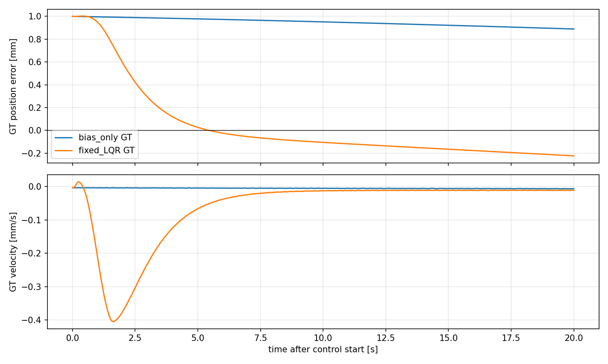
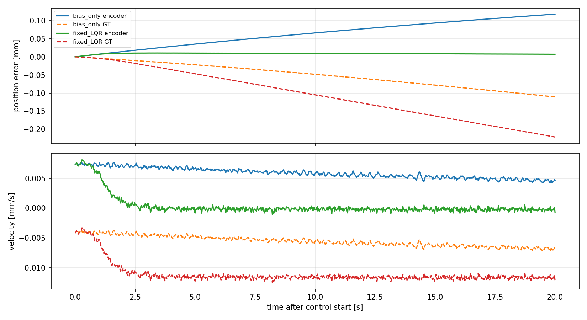

# model_60000 — 운용점 affine 검증과 Fixed Residual LQR 복원 시험

작성일: 2026-10-15 (Asia/Seoul)

Execution Domain: **VALIDATION_SIM** (회귀·LQR 계산·결과 분석: **DESKTOP_DRY_RUN**)

Policy Checkpoint: `lab/ddt_lab/logs/flash_sac/tita_flash_sac_115632_883848/model_60000/actor.pt`

Policy Checkpoint SHA256: `6d3cba9fa76eebe9fb2f40ef23d34115b8b95028ec788571531ffb33ce821a05`

ONNX SHA256: `f44f07ed44970e3ff565eae67fd9229adf0be5c02215591c52a691ffcbb71b2a`

Evidence Status: **PASS — A/B 고정·train offset 보정 M4 affine의 새 초기 조건 검증, Fixed LQR의 위치 목표 변경 복원·입력/안정성 검사. FAIL — 최초 absolute joint-LS affine의 baseline 기준, Fixed LQR의 무외란·미세 토크 외란 GT 개선을 포함한 전체 성공 기준.** Online identification·mismatch·실기: **NOT_TESTED**.

Observed Metrics / Behavior / Log Summary:

**M4 affine를 새 초기 조건에서 검증한 뒤 Fixed Residual LQR을 실제 MuJoCo에서 평가했다.** LQR은 ±0.5/±1 mm 위치 목표 변경에서 bias-only 대비 GT 위치 IAE를 **73.9% 감소**, 마지막5초 GT 위치RMSE를 **0.750→0.192 mm**로 줄였고48/48쌍 모두 개선됐다. 모든 군 합계432/432회 정상 완료했다.

그러나 무외란·미세 토크 외란에서는 원래 bias-only보다 GT 오차가 커져 **전체 성공 판정은 FAIL**이다. LQR의 sensor 위치는 약0.009 mm로 복원됐지만 GT에는 약0.192 mm가 남았다. 해당 운용점에서 측정된 encoder/IMU 속도와GT 속도의 차이 약0.01144 mm/s,20초 누적 경로 차이 약0.229 mm를 함께 확인했다. **위치 복원 가능성은 실증했지만, 센서 기준 유지와 실제 물리 위치 유지는 구분해야 한다.**

## 1. 검증한 affine 모델

기존에 채택한 M4의 24-state 구성을 유지했다. p/v는 encoder/동기화 IMU의 sagittal path/velocity다. 이전 actor action 8개와 leg position/velocity 12개는 실제 비영 상태를 사용한다. 예측 중 미래 실측 action·leg 상태를 넣지 않는다.

```text
z_next = A z + B r + c_absolute

채택한 모델의 중심 좌표 표현:
zeta = z − z_reference, u = r − 0.4828
zeta_next = A zeta + B u + c_center
```

수치 계산은 중심 좌표에서 수행하며 `c_absolute`도 저장했다. p는 snapshot 시작 encoder 위치를 0으로 옮겼고, 위치 translation symmetry A첫 열=[1,0,…]를 유지했다. 다른 상태는 평균을 빼서 회귀하더라도 물리 좌표의 비영 기준을 복원했다. 현재 torque가 이미 계산된 actor output에 영향을 줄 수 없으므로 B의 previous-action 8행=0 제약도 유지한다.

### 처음부터 성공한 affine 회귀는 아니었다

1. 기존 운용점 train234개 probe와 고유 baseline18개, 총100,800 transitions로 A/B/c를 함께 least squares 식별했다. 기존 test306개 probe와18 baseline에서 평가했다.
2. 응답 예측 기준은 통과했지만, baseline18개 중9개가8초 위치RMSE≤0.05 mm를 넘었다. 최대0.05505 mm였다. 이 최초 결과는 **FAIL로 보존**했다.
3. 그다음 이미 검증된 paired-response M4의 **A/B를 그대로 고정**하고, train baseline18개·7,200 transitions의 평균 one-step defect로 offset만 추정했다. 기존 test에서 통과했어도 이미 확인한 cohort이므로 최종 독립 검증으로 쓰지 않았다.
4. 보정한 모델을 먼저 고정한 뒤 새 seed220/221의 데이터를 수집했다. 새 데이터에서는 재회귀·offset 조정·모델 선택을 하지 않았다.

두 번째 방법도 같은24-state affine 구조다. A/B의 토크 응답 식별과 일정bias에서의 평균 상태 진행을 나눠 추정한 방법이며, 새 상태·정규화 탐색·비선형 모델을 추가한 것이 아니다. 최초 회귀가 실패한 원인을 특정 상태 하나로 확정하지 않는다.

## 2. 사전 기준과 새 데이터

모든 단계에서 +0.4828 Nm를 baseline/probe 양쪽에 유지하고 F-1을 해제했다. 기존 sensor-synchronized actor·raw last_action·wheel velocity PD·leg position PD를 실행한다. 기존 wheel torque에 total residual의 절반씩 더하고 기존 바퀴당±12 Nm clipping을 유지한다. Leg torque는 각 physics substep 원래 ActionAdapter와 정확히 같음을 검사했다.

- 기존 train: seeds180/181 ×3 pitch,18 snapshots. 기존 test: seeds190/191 ×3 pitch,18 snapshots. 초기 조건 단위 분리를 유지했다.
- 새 확인: seeds220/221 × pitch−0.035/0/+0.035,6초기 조건·12snapshots. 각 조건의 bias 전환 후1000/1120초에서 분기했다. Zero/high 접근은 각3조건이며 전체 Cartesian grid는 아니다.
- Zero 접근은 원래 FlashSAC8초, high 접근은 +0.6 Nm30초 후 +0.4828 Nm로 전환한다. 충분히 정착한 뒤 직전180초의 기존 속도·위치·pitch·leg 기준을12/12 통과했다.
- 새 확인은8초 probe204개, baseline12개, 직접B ±0.01 Nm 차분12쌍이다. Sine/PRBS·±pulse·±step·미학습±bipolar pulse×0.02/0.05 Nm와 microPRBS0.01 Nm를 사용했다. Physics/control dt=0.005/0.02초, probe slew2 Nm/s다.
- 전체 mjData·sensor 적분기·raw history를 snapshot으로 복제했다. 직렬화해 다시 읽은 snapshot의8초 baseline이 연속 prefix의 state·observation·action/history·모든 substep torque와 정확히 일치했다.

주 응답 기준은 기존과 같다: 최초2초 및 rolling0.1/0.5/1/2초의 p/v NRMSE 중앙값 모두≤30%, 직접B_v 부호 일치·상대 차이≤30%. 여기서 오차는 **absolute z 예측 오차**이며 분모는 matched probe−baseline 응답 RMS다. 큰 비영 상태값으로 나눠 낮은 오차처럼 보이게 하지 않았다. 기존 floor p=1e−7 m/v=1e−5 m/s를 유지한다.

Bias-only는 응답 분모가 없으므로 절대RMSE로 별도 검사한다. 모든 test baseline에서2초 p/v≤0.02 mm/0.02 mm/s,8초≤0.05 mm/0.02 mm/s로 수집·회귀 전에 기록했다. 이는 이번 연구의 운영 기준이며 사용자 정량 사양이나 제어 안정성 정리가 아니다. 첫 FAIL 이후 같은 기준을 유지했다.

## 3. Affine 결과

| 모델·cohort | 최초2초 p/v NRMSE | 2초rolling p/v NRMSE | 전체8초 p/v NRMSE | Baseline 기준 |
|---|---:|---:|---:|---:|
| Joint-LS, 이전 test | 3.05 / 2.74% | 3.31 / 8.87% | 7.52 / 3.48% | 9/18, **FAIL** |
| A/B고정+offset, 이전 test, 보조 | 3.25 / 2.76% | 2.93 / 7.97% | 8.15 / 3.27% | 18/18 |
| **A/B고정+offset, 새 test** | **2.85 / 2.62%** | **2.22 / 4.79%** | **4.16 / 2.76%** | **12/12 PASS** |

새 test에서 최초2초 absolute p/v RMSE 중앙값은0.005109 mm/0.01976 mm/s였다. Bias-only8초 absolute p/v RMSE의 전체12개 최대값은 **0.005898 mm/0.002706 mm/s**였다. 직접B_v 대비 오차는0.323%였다.

이 PASS는 **센서로 정의한 z의 유한 시간 진행**에 대한 검증이다. 지속 yaw 회전은 남아 있으며 정적 평형을 가정하거나 `(I−A)`를 역산해 새 평형 torque를 만들지 않았다. 입력 기준은 이전 실측값 +0.4828 Nm다. 4초rolling은 이전 cohort에서 속도43.66%로 기준 밖이었고 새 cohort에서는12.23%였다. 새 결과가 모든 운용 시각·조건에서의 장기 예측을 보장하지는 않는다. A/B의 condition number 약32,803과 이전의 개별8초 위치 오차 한계도 남는다.

## 4. 조건부 Fixed Residual LQR 설계와 비교 방법

새 affine 판정 PASS를 확인한 뒤에만 gain을 한 번 계산해 고정했다. Q/R은 결과를 보고 탐색하지 않았다.

```text
Q = diag(250000,250000,0,...,0)
R = 400
e = measured_z − finite_reference
r = 0.4828 + limited(−K e)

limited: total correction ±0.05 Nm, smoothstep ramp1.5초, slew2 Nm/s
```

Q는 p와v만 비용으로 둔다. **피드백은24개 전체 상태를 사용하며 pitch/action/leg gain도 생긴다.** K의 첫 두 성분은[−19.74244,−20.69638]이다. 이를 p/v만의 PD로 따로 떼어 사용하지 않는다. 전체K는 `fixed_gain_frozen.json`에 있다. Train state scale로 좌표를 바꿔 DARE를 계산했고 상대 residual7.21e−13, 식별 모델의ρ(A−BK)=0.999340이었다. 수치해 검증이며 실제 MuJoCo 안정성 보장은 아니다.

기준 상태는 train baseline의 비영 내부 상태 평균에 p_target과v_target=0을 지정한 **유한 시간 reference**다. 그 상태의 one-step defect도 함께 저장했다. 모든 내부 상태가 정확히 일정한 평형 해라고 주장하지 않으며, 별도 feedforward torque를 외삽하지 않았다. 제어에는 GT를 쓰지 않는다.

| 군 | 기존 FlashSAC 위에 적용한 total residual |
|---|---|
| bias-only | +0.4828 Nm |
| F-1 runtime-only | 현재 ResidualWheelPD 그대로: kp2,kv24,ramp1.5초,cap2 Nm,slew2; bias 없음 |
| bias+PD-local | bias + kp2/kv24의 p/v보정; LQR과 같은cap0.05/ramp1.5/slew2 |
| Fixed LQR | bias + 전체24-state LQR 보정; cap0.05/ramp1.5/slew2 |

F-1 runtime-only는 원래 구현의 성능 비교이며 bias 제거·더 큰 제한까지 포함한 다른 폐루프다. **Bias+PD-local이 같은 운용점·같은 입력 제한에서 피드백 구조를 비교하는 군**이다. 이전 model_100000의 F-1 수치와 직접 비교하지 않는다.

각 snapshot에서 같은 원본 상태를 복원하고 다음9조건을20초씩 평가한다. 위치 조건은 물리 teleport가 아니라, 시작 위치 대비±0.5/±1.0 mm의 목표 변경으로 초기 위치 오차를 만든다. 속도 조건은 bias 위에±0.01/±0.02 Nm를20 ms 가한 뒤 전체 상태를 복제해 복원 시험을 시작한다. 순수한v만 바꾼 상태가 아니라 actor history·leg 반응까지 일치하는 작은 토크 외란이다. 무외란도 포함한다.

평가의 p목표는 sensor와GT 각각의 외란 전 시작점을 같은 양만큼 옮겨 정의한다. 제어는 sensor p/v, 성능 판정은GT sagittal 위치 오차로 한다. World planar 위치/yaw hold는 이번 목표가 아니다. 모든 초기 조건·시각은 네 군에서 같고, 각 초기 observation/action/history와 실제 wheel/leg 경로를 검사한다.

사전 LQR성공 기준은 전체 완료, position/kick 각각GT IAE중앙값≤bias의80%, 마지막5초 위치RMSE중앙값≤bias의50%, paired IAE개선≥80%다. 각 trial의 pitch RMS≤max(1.25×bias,0.002 rad), wheel torque RMS≤1.25×bias도 요구한다. 무외란은 마지막5초 위치RMSE≤max(bias+0.05 mm,0.1 mm), 평균속도 절댓값≤0.02 mm/s다. 결과를 보기 전 `control_plan.json`에 기록한 운영 기준이며 사용자 사양은 아니다.

## 5. Fixed LQR 실제 복원 결과

12snapshot ×9조건 ×4군 = **432개20초 episode**, 각 군108/108 정상 완료다. 위치 목표 변경48개, 미세 torque kick48개, 무외란12개씩이다. 같은 snapshot의 반복 분기는 관련돼 있으며 모집단 유의성이나 실물 성능을 주장하지 않는다.

### 위치 목표 변경: 복원 개선 PASS

| 군,48조건씩 | GT IAE 중앙값 mm·s | 마지막5초 GT 위치RMSE mm | 마지막5초 sensor 위치RMSE mm |
|---|---:|---:|---:|
| bias-only | 15.000 | 0.7501 | 0.7502 |
| F-1 runtime-only | 14,239.6 | 1,364.5 | 1,363.1 |
| bias+PD-local,kv24 | 182.391 | 21.327 | 21.305 |
| **Fixed LQR** | **3.914** | **0.1920** | **0.00879** |

LQR의 IAE는bias의26.09%, 마지막5초 GT 위치RMSE는25.60%였고 **48/48 paired IAE가 감소**했다. 실제 GT 마지막5초 위치RMSE 범위는0.1836–0.1987 mm, sensor 범위는0.00309–0.01637 mm였다. 0.5/1 mm 오차에서 실제 위치 복원을 개선했다는 결과지만 정확한0으로 수렴했다는 뜻은 아니다.

동일한 bias·작은 입력 제한의 PD도 위치 오차를 키웠다. 이 운용점에서는 순간 B_v의 부호와 장기 응답 방향이 다르다는 기존 결과와 맞는 현상이지만, PD 부호 하나만으로 전체 폐루프 원인을 확정하지 않는다. 현재24-state LQR은 그 시간 응답을 포함해 계산한 gain이다.

F-1 runtime-only는 bias 제거와 원래2 Nm 제한을 모두 포함하므로, 이 큰 차이를 전부 LQR gain 설계만의 이득으로 해석하지 않는다. 이 결과는 **model_60000의 현재kv24/ramp1.5 구현**이며, 이전 model_100000에서 평가한kv0.5 F-1을 일반적으로 부정하는 결과도 아니다.

아래 그림은 고정된 정렬의 첫 조건, seed220/pitch0/high, bias 적용1000초, 초기오차+1 mm다. 실제 GT 경로를 그렸다. 같은bias의 세 군 전체 비교는 [PD 포함 그림](flash_affine_lqr/control_position.png)에 있다.



### 작은 토크 외란과 무외란: GT 개선 FAIL

| 조건 | 군 | GT IAE mm·s | 마지막5초 GT 위치RMSE mm | 같은 sensor 위치RMSE mm |
|---|---|---:|---:|---:|
| 미세kick | bias-only | 0.4286 | 0.03157 | 0.1693 |
| 미세kick | Fixed LQR | 2.1199 | 0.19201 | 0.00904 |
| 무외란 | bias-only | 0.3560 | 0.03139 | 0.1694 |
| 무외란 | Fixed LQR | 2.1082 | 0.19182 | 0.00900 |

미세kick의 LQR IAE는bias의4.95배, 마지막5초 GT 위치RMSE는6.08배였고, **48쌍 모두 IAE가 증가**했다. Sensor 기준으로는 오차가 감소해도 물리 위치 개선 기준은 통과하지 못했다. 무외란도GT 위치 기준을 만족하지 못해 전체성공 FAIL이다. 기준을 결과에 맞춰 완화하거나 Q/R을 재튜닝하지 않았다.

## 6. 관측 위치와 실제 위치의 차이

LQR 무외란12조건의20초 종료 시각:

| 지표 | 범위 또는 중앙값 |
|---|---:|
| 마지막5초 sensor 위치RMSE 중앙값 | 0.00900 mm |
| 마지막5초 GT 위치RMSE 중앙값 | 0.19182 mm |
| 마지막5초 sensor 평균속도 범위 | −0.000225∼+0.000200 mm/s |
| 같은GT 평균속도 범위 | −0.01166∼−0.01123 mm/s |
| 같은sensor−GT 속도 차이 | +0.011435∼+0.011437 mm/s |
| 20초 sensor−GT 누적 경로 차이 | +0.22866∼+0.22881 mm |
| 종료 시점 GT 위치 오차 | −0.22522∼−0.21249 mm |

약0.01144 mm/s의 차이가20초 누적된0.229 mm는 sensor와GT 경로 차이의 크기를 설명한다. 제어기는 자신이 관측한 p/v를 목표 근처로 가져갔으나 실제 로봇에는 작지만 음의 속도가 남았다. 차이는bias-only에서도 관측되므로 LQR을 넣으면서 처음 생긴 센서 정의의 차이는 아니다.

이 진단은GT를 제어에 넣거나 bias를GT로 온라인 보정한 결과가 아니다. 발생 원인이 미끄러짐·기구학 근사·접촉·센서 계산의 어느 항에 있는지는 아직 분리하지 않았다. Actor와LQR은 모두 동기화 IMU를 사용했으며, 이 수치만으로 과거의 IMU 시점 문제가 재발했다고 판단하지 않는다.

이 결과는 affine 모델이 **센서로 정의한 상태**를 정확히 예측해도 GT 정지 정확도는 별도로 확인해야 한다는 근거다. 정상상태 토크를 모델에서 크게 외삽한 실패와도 다르다. 이번에는 검증된 +0.4828 Nm 근처의 작은 입력만 썼다.



## 7. 입력·자세·범위와 판단

- LQR108/108 정상 완료, 모든 finite/attitude/height/leg-limit guard 통과. Pitch 및wheel torque 사전 비교 기준도 전 trial에서 통과했다.
- LQR의 실제 추가 보정 최대값은 합 **0.013431 Nm**로0.05 Nm 제한보다 작았다. 위치 조건의 trial별 보정peak 중앙값은0.009761 Nm다. 이번 잔류오차를 단순히 residual 포화 때문이라고 설명할 증거는 없다.
- 위치 조건의 pitch 기준오차RMS 중앙값은0.0000301 rad, 전체LQR 최대는0.0000418 rad다. Wheel torque RMS 중앙값은0.10555 Nm/바퀴로bias-only와 거의 같았다. 실제 physics substep의 양쪽 wheel만 집계했고 leg torque를 포함하지 않았다.
- LQR의 비위치 상태는 모든 control step에서 train의 좌표별 min/max 범위 안이었다. 이 검사는 다변량 분포 안이라는 보장이나 perturbation 강건성 증명이 아니다. F-1/PD 군은 그 범위를 벗어났으므로 이들의 큰 이동을 M4 유효 범위 안의 선형 예측 실패로 해석하지 않는다.
- 모든 군에서 FlashSAC wheel·leg torque 경로와raw history를 유지했다. RLS/online model/gain update는0회다.

현재 판단은 **M4 affine의 유한 시간 센서 상태 예측과 Fixed LQR의 작은 위치 목표 복원은 실증, 물리 정지 정밀도를 포함한 전체목표는 미달**이다. 이제는 위치·속도 관측과GT 사이의 잔류차이가 복원 오차에 미치는 영향을 확인할 근거가 생겼다. 온라인 A/B 갱신이나 상태 차원 확대가 이 차이를 자동으로 해결한다는 결론은 내리지 않는다. Gain을 runtime이나 실기로 연결하지 않았다.

## 8. 변경·검사·재현

- 신규 코드5개: `test/analyze_flash_operating_affine.py`, `test/calibrate_flash_operating_affine.py`, `test/eval_flash_affine_confirmation.py`, `test/eval_flash_fixed_residual_lqr.py`, `test/test_flash_affine_lqr.py`. 이 보고서와 `flash_affine_lqr/` 증거만 추가했다. 기존runtime·정책·설정·이전 보고서·모델·데이터는 보존했다.
- 새 affine 수집 **204응답·12직접B 차분쌍·12전체 snapshot 직렬화/8초exact replay PASS**. Control 수집 **432/432 정상 완료·12추가 snapshot exact replay PASS**. 네 군의 초기상태·첫observation/action/history, wheel 합산·slew·제한, 각substep leg 경로 보존을 검사했다.
- 독립 수치 검사 **4개PASS**: 비영 reference의 알려진24-state affine 계수 복원, augmented matrix-power와8초 예측 비교·큰 절대offset으로 오차를 숨기지 않는 정규화, scaled LQR과별도 physical-coordinate DARE의 일치, 제한/ramp/slew 및affine FAIL일 때gain 생성 거부. `unit_tests.log`.
- Joint-LS 최초FAIL, paired A/B와offset 추정, 새 확인, gain 설계, 제어 평가의 순서와 각 frozen hash를 보존했다. `control_plan.json`은 제어 결과 전 기록했다. Gain/Q/R은 한 번 고정해 모든 제어 trial에 동일하게 사용했다.
- 실행source snapshot을 보관했다. Control 수집판v1 이후 분석판v2에서 sensor/GT 오차 지표와라벨을 추가했다. 수집·gain·raw NPZ는 변경하지 않았다. 실행판hash와분석판hash를 분리해 기록했다.
- `./scripts/agent-check.sh` **전체FAIL**: 기존 `my_flat_env_cfg.py`의trailing whitespace6곳. Python syntax **389개PASS**, URDF XML **8개PASS**. 신규파일 diff·기존변경 보존·보호hash·보고서 링크는 별도 검사했다. `agent_check.log`와 `final_review.json`에 기록한다.
- 작업 중 별도 갱신도 관측했다: 기존 `my_flat_env_cfg.py`의mtime이 작업 시작 후인2026-10-15 19:31 KST로 바뀌어 전체 tracked diff hash는 시작 시점과 달라졌다. 이 파일은 이번 작업에서 쓰거나 되돌리지 않았고 현재 내용을 유지했다. 보호한 기존 실행기·정책·이전 데이터649개hash는 모두 동일했다.
- 브랜치 **`agent/codex/dev_tita_gluon`**. Commit/push·hardware·정책 재학습·online adaptation·mismatch·nonzero velocity command 없음. 무한 시간 평형·초기900초 정착 단축·yaw hold는 이번 범위가 아니다.

```bash
MPLCONFIGDIR=/tmp/lqr_mpl /home/cocel/venvs/cosim_ros2_jazzy/bin/python test/test_flash_affine_lqr.py
MPLCONFIGDIR=/tmp/lqr_mpl /home/cocel/venvs/cosim_ros2_jazzy/bin/python test/analyze_flash_operating_affine.py --output docs/exp/2026-10-15/new_affine_lqr/affine
MPLCONFIGDIR=/tmp/lqr_mpl /home/cocel/venvs/cosim_ros2_jazzy/bin/python test/calibrate_flash_operating_affine.py --stage fit --output docs/exp/2026-10-15/new_affine_lqr/calibrated
MPLCONFIGDIR=/tmp/lqr_mpl /home/cocel/venvs/cosim_ros2_jazzy/bin/python test/eval_flash_affine_confirmation.py --model docs/exp/2026-10-15/new_affine_lqr/calibrated/affine_model_frozen.json --output docs/exp/2026-10-15/new_affine_lqr/fresh --workers 3
MPLCONFIGDIR=/tmp/lqr_mpl /home/cocel/venvs/cosim_ros2_jazzy/bin/python test/calibrate_flash_operating_affine.py --stage confirm --output docs/exp/2026-10-15/new_affine_lqr/calibrated --fresh /home/cocel/Desktop/Research/tita_gluon_wbc/docs/exp/2026-10-15/new_affine_lqr/fresh
```

제어 재현은 기존 [control_plan.json](flash_affine_lqr/control_plan.json)을 새root에 복사해 같은 사전 조건을 보존한 뒤 수행한다. Affine 새 확인이FAIL이면 gain 설계가 거부된다. 출력은 미생성 폴더를 사용하고 기존행렬/gain을 덮어쓰지 않는다.

```bash
MPLCONFIGDIR=/tmp/lqr_mpl /home/cocel/venvs/cosim_ros2_jazzy/bin/python test/eval_flash_fixed_residual_lqr.py --stage design --root docs/exp/2026-10-15/new_affine_lqr
MPLCONFIGDIR=/tmp/lqr_mpl /home/cocel/venvs/cosim_ros2_jazzy/bin/python test/eval_flash_fixed_residual_lqr.py --stage run --root docs/exp/2026-10-15/new_affine_lqr --workers 3
MPLCONFIGDIR=/tmp/lqr_mpl /home/cocel/venvs/cosim_ros2_jazzy/bin/python test/eval_flash_fixed_residual_lqr.py --stage analyze --root docs/exp/2026-10-15/new_affine_lqr
./scripts/agent-check.sh
```

산출물: [최초affine FAIL](flash_affine_lqr/affine/summary.json), [offset 보정 모델](flash_affine_lqr/calibrated/affine_model_frozen.json), [새affine 확인](flash_affine_lqr/calibrated/fresh_confirmation.json), [고정gain·Q/R](flash_affine_lqr/fixed_gain_frozen.json), [제어판정](flash_affine_lqr/control_summary.json), [개별제어지표](flash_affine_lqr/control_metrics.json), [sensor/GT 차이](flash_affine_lqr/observation_bias_facts.json), [무결성검사](flash_affine_lqr/final_review.json), 전체prefix/probe/control NPZ·snapshot·단계별source/hash/로그.
