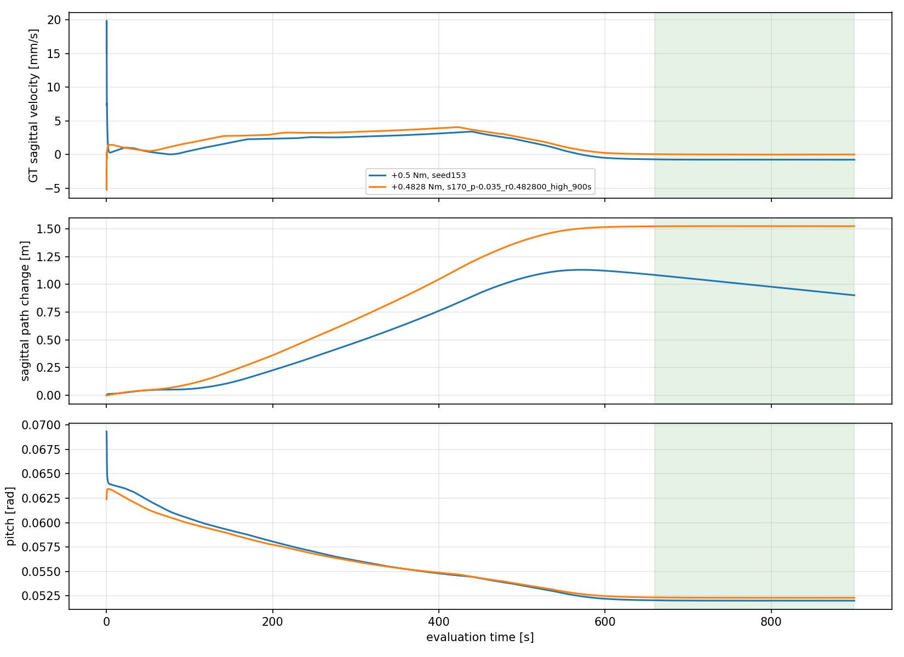
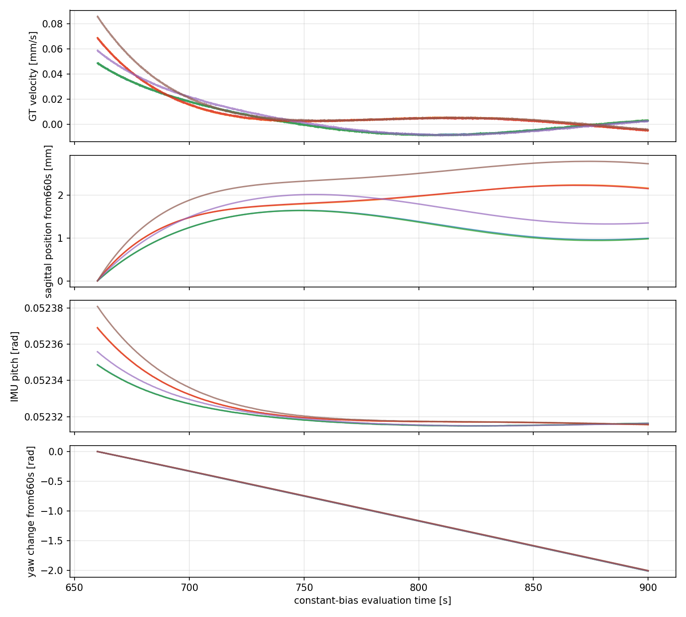
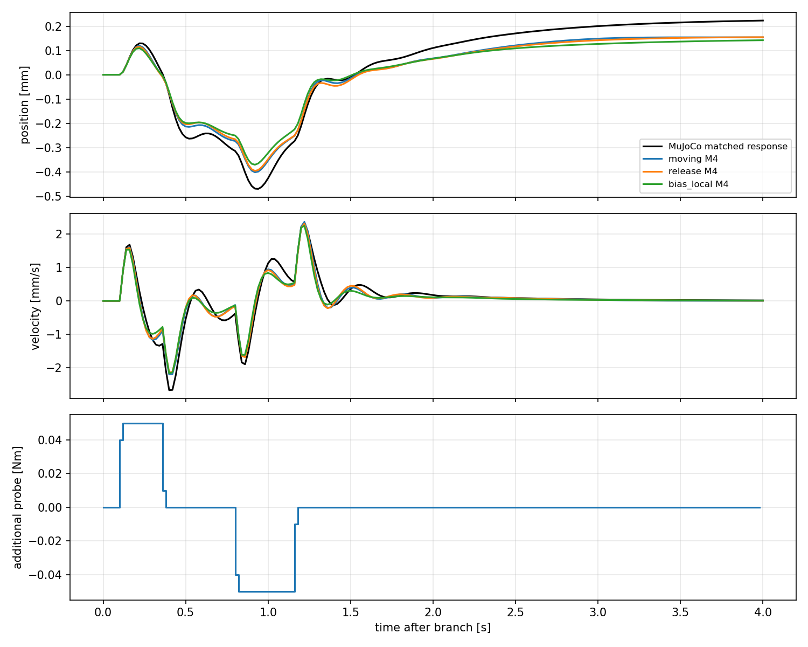

# model_60000 — 일정 residual torque의 장시간 응답과 저속 운용점

작성일: 2026-10-15 (Asia/Seoul)

Execution Domain: **VALIDATION_SIM** (선택·예측·무결성 분석: **DESKTOP_DRY_RUN**)

Policy Checkpoint: `lab/ddt_lab/logs/flash_sac/tita_flash_sac_115632_883848/model_60000/actor.pt`

Policy Checkpoint SHA256: `6d3cba9fa76eebe9fb2f40ef23d34115b8b95028ec788571531ffb33ce821a05`

ONNX SHA256: `f44f07ed44970e3ff565eae67fd9229adf0be5c02215591c52a691ffcbb71b2a`

Evidence Status: **PASS — +0.4828 Nm의 긴 정착 후 유한 시간 위치·속도 유지 기준 6/6 및 경로 무결성. FAIL — 초기 정지 유지 기준, yaw까지 포함한 완전 정지, 기존 M2/M4의 운용점 예측 전이.** 새 A/B·affine 식별·LQR·online adaptation·실기: **NOT_TESTED**.

Observed Metrics / Behavior / Log Summary:

**일정 합 residual +0.4828 Nm에서, 충분히 긴 정착 뒤 작은 위치 범위에 머무는 운용 상태를 확인했다.** 새 초기 조건 6개에서 토크 적용 **660–900초**의 전후방 위치 변화폭은 **1.64–2.79 mm**, 평면 위치의 시작점 대비 최대 반경은 **1.61–2.34 mm**였다. 마지막 60초 평균 속도는 **−0.002085∼+0.000454 mm/s**였다.

그러나 **명령 직후의 정지 제어에 성공한 것은 아니다.** 이 구간에 도달하기 전 초기점 대비 최대 약 **1.45–1.49 m** 멀어졌고, 마지막 240초에도 yaw가 약 **−2.01 rad** 회전했다. 제자리 회전을 허용한 위치 유지 운용점이며, 로봇 전체의 정적 평형점이나 zero-twist hold가 아니다.

이 운용점의 작은 probing에서 기존 이동/release/bias-local M2/M4 **6개 모델 모두** 2초 rolling 예측 기준을 넘었다. **운용점 확보와 그 주변 모델 확보는 별개**이며, 현재 matrices로 LQR을 설계하지 않았다.

## 1. 고정한 제어 경로

- F-1은 전 구간 완전히 해제했다. 이번 collector는 `StateRunner`를 직접 사용하며 F-1 controller를 생성하거나 update/apply하지 않는다.
- Frozen FlashSAC·기존 33-value observation·전체 raw action history·wheel velocity PD·leg position PD를 유지했다. Actor/계측은 현재 qpos/qvel 시점의 clone-refreshed IMU를 사용한다. GT는 평가·오프라인 토크 선택에만 썼다.
- 매 physics substep 기존 FlashSAC torque를 계산한 뒤 native wheel axis에 합 residual의 절반씩 더하고 기존 바퀴당 ±12 Nm clipping을 유지한다. Leg torque는 원래 ActionAdapter와 정확히 같음을 검사했다.
- 일정 입력으로 전환하는 동안만 합 torque slew2 Nm/s를 사용한다. 이후 gain adaptation·피드백·probe 없이 일정 토크를 유지한다. Sensor/GT 상태를 보고 유지 토크를 온라인으로 바꾸지 않았다.
- Nominal 평면, command=[0,0,0], physics/control dt=0.005/0.02초, 외란 push·mismatch 없음. 기존 실험처럼 floor 외 world 장애물 접촉은 메모리에서만 비활성화했다. Startup transform_up→RL, 첫 1초의 기존 저자세 전환은 별도 기록하며 측정 전에 기립을 마친다.
- `zero` 접근은 원래 FlashSAC 8초 후 목표 residual로 전환한다. `high` 접근은 +0.6 Nm를 30초 유지한 뒤 목표로 전환한다. 전체 MuJoCo 상태·적분기·history는 reset 없이 이어진다.

## 2. 정지 판정과 긴 정착 진단을 분리했다

처음 180초 수집 전에 manifest에 진단 기준을 기록했다.

| 항목 | 기준 |
|---|---|
| 안정성 | 전체 측정 정상 완료, 기존 finite/attitude/height/leg-limit guard 통과 |
| 속도 | 평가 구간의 각 40초 block마다 GT 평균 절댓값 ≤0.2 mm/s, RMS ≤0.5 mm/s |
| 전후방 위치 | 평가 구간 GT sagittal path의 최대−최소 ≤20 mm |
| 평면 위치 | 평가 구간 시작 axle 위치 대비 최대 평면 반경 ≤30 mm |
| Pitch/leg | pitch 표준편차 ≤0.01 rad, leg joint limit margin ≥0.01 rad |

이는 사용자가 지정한 정량 사양이나 무한 시간 유계성 증명이 아니라 이번 진단의 운영 기준이다. Position은 wheel axle 기준이며 world x/y와 encoder/IMU sagittal path를 구분해 기록했다. Yaw hold는 위 위치 기준에 포함하지 않고 별도 계측했다.

**초기 판정:** 토크 전환 후 60초부터 종료까지 위 기준을 적용했다. 마지막 구간 평균 속도만 작고 그 전에 움직인 경우를 통과시키지 않았다. 이 기준은 모든 장시간 조건에서 FAIL이었다.

**별도 긴 정착 진단:** 180/300초에서도 속도 block이 변해, 900초 연장 실행 전에 **660–900초만 같은 기준으로 평가**하는 보조 진단을 사전 기록했다. 이전 FAIL을 PASS로 바꾼 것이 아니다. 마지막 60초 평균/RMS와 마지막 240초 위치 범위를 각각 표시한다. 그림·JSON의 sliced-window `after60` 필드는 이 보조 진단에서 원래 시간 660초에 해당한다.

내부 action/leg 상태가 반드시 0이거나 정확히 일정하다는 조건은 두지 않았다. 평균·표준편차·joint velocity·limit margin을 관찰했다.

## 3. 탐색·독립 검증 순서

| 단계 | 조건 | 유지 시간 | 실행 수 | 결과 |
|---|---|---:|---:|---|
| Scan | seeds150/151, pitch0; r=0/0.48/0.50/0.52/0.54/0.56/0.60 Nm | 180초 | 14 | 초기 유지 기준 모두 FAIL |
| Fine | seed152, pitch0; 0.55–0.57 Nm, 간격0.0025 | 180초 | 9 | 마지막 평균 최소는 +0.5525, 전체 기준 FAIL |
| 초기 확인 | seeds160–162×3 pitch의 zero9개, pitch0의 high3개; r=0.5525 | 300초 | 12 | 모두 FAIL |
| 긴 진단 | seed153, pitch0; r=0.5/0.5525/0.6 | 900초 | 3 | 후반 정상 속도는 모두 음수, 유지 기준 FAIL |
| 부호 구간 | 새 seed154, pitch0; r=0.47/0.48/0.49 | 900초 | 3 | +0.48과 +0.49 사이에서 속도 부호 변경 |
| 최종 확인 | (seed170,pitch−0.035)/(171,0)/(172,+0.035) 각각 zero/high; r=0.4828 | 900초 | 6 | 초기 기준 FAIL, **660–900초 위치·속도 기준 6/6 PASS** |

총 **47개 장시간 rollout 모두 전도/limit failure 없이 완료**했다. 초기 상태 47개가 서로 독립인 모집단 표본이라는 의미는 아니다. 최종 확인은 seed와 pitch를 짝지은 3조건×2접근이며, 3seed×3pitch 전체 Cartesian grid가 아니다.

Scan/Fine에서는 기준을 통과한 토크가 없었다. +0.5525는 정지 성공 토크가 아니라 마지막 평균 속도가 가장 작은 **진단용 fallback**으로 기록했다. 이후 900초의 실측 부호 구간에서만 새 후보를 계산했다.

## 4. +0.5 Nm의 30초 결과를 정상상태로 보면 안 되는 이유

새 900초 +0.5 Nm 실행 하나 안에서도 속도가 크게 변했다.

| 같은 rollout의 시간 구간 | GT 평균 속도 mm/s |
|---|---:|
| 60–100초 | +0.185 |
| 140–180초 | +2.006 |
| 420–460초 | +3.241 |
| 660–700초 | −0.746 |
| 860–900초 | −0.770 |

따라서 이전 30초 평가의 작은 전진 속도를 장시간 정상 속도로 외삽할 수 없다. 이전 평가와 이번 prefix도 다르므로 모든 차이를 시간 하나의 영향으로 확정하지 않는다. 위 표는 같은 실행 내의 변화다. Pitch·leg/action 상태와 yaw도 함께 변했다. 원인을 특정 내부 상태나 contact 효과 하나로 확정하는 추가 실험은 하지 않았다.

또한 +0.5525 Nm의 180초 마지막 60초 평균은 **+0.0227 mm/s**였지만, 60초 이후 위치 변화폭은 **88.1 mm**였다. 독립 300초 확인에서는 마지막 평균이 **+0.616–+0.645 mm/s**, 위치 변화폭은 약 **95–111 mm**가 됐다. 작은 최종 평균이나 작은 최종 변위가 중간 이동과 지속성을 대신하지 못했다.



## 5. 실측 부호 구간에서 찾은 +0.4828 Nm

900초 실행의 마지막 60초 GT 평균이다. 고정 torque와 frozen policy만 사용했다.

| 합 residual Nm | 평균 속도 mm/s | 660–900초 sagittal 위치 변화폭 mm |
|---:|---:|---:|
| +0.47 | +0.5712 | 143.14 |
| +0.48 | +0.1264 | 33.09 |
| +0.49 | −0.3241 | 75.19 |
| +0.50 | −0.7689 | 182.73 |
| +0.5525 | −3.0843 | 740.46 |
| +0.60 | −5.1693 | 1239.77 |

+0.48/+0.49의 실측 값을 선형 보간한 zero crossing은 **0.48280526 Nm**였다. 이를 **0.4828 Nm**로 반올림해 고정하고 이후 확인에서 재튜닝하지 않았다. Affine 모델의 평형식이나 B의 부호로 이 값을 결정하지 않았다. 이 소수점 정밀도는 이번 이상적인 MuJoCo 조건의 실험 파라미터이며 실제 motor 정밀도나 mismatch 강건성을 검증한 값은 아니다.

새 6조건에서 확인한 범위:

| 지표 | 결과 |
|---|---:|
| 마지막 60초 평균 GT 속도 | **−0.002085∼+0.000454 mm/s** |
| 마지막 60초 GT 속도 RMS | **0.00263–0.00349 mm/s** |
| 660–900초 sagittal 위치 변화폭 | **1.64–2.79 mm** |
| 같은 구간 평면 위치 최대 반경 | **1.61–2.34 mm** |
| 마지막 60초 평균 pitch | 약 **0.052316 rad** |
| 660–900초 pitch 표준편차 | **7.89e−6–1.46e−5 rad** |
| 최소 leg joint limit margin | 약 **0.751916 rad** |
| 660–900초 yaw 변화 | **−2.015∼−2.006 rad** |

이전 action과 leg 자세도 관찰했다. 최종 60초 평균의 조건 평균은 아래와 같다. Raw action은 policy 단위이고 Nm가 아니다.

```text
leg q ≈ [0.01218, 0.87425, −1.81934, −0.03348, 0.85230, −1.80957] rad
raw previous_action ≈ [−0.81801, 0.36110, −0.13208, −0.01246,
                        0.73146, 0.25011, −0.10895, −0.03608]
```

마지막 60초의 각 성분 표준편차 최대값은 leg q 약 **2.75e−5 rad**, raw action 약 **2.03e−5**였다. 이를 모두 0으로 놓지 않았다. 큰 주기 운동이 필요하다는 결론도 내리지 않았다. World yaw가 계속 변하므로 전체 MuJoCo qpos의 정적 평형점은 아니다.

**실용적 한계:** 이 작은 위치 범위에 도달하기 전 900초 전체의 초기 axle 위치 대비 최대 평면 drift는 **1.45–1.49 m**였다. 긴 정착을 거쳐 현재 위치를 유지하는 상태를 찾은 것이며, 초기 목표 위치로 복귀하거나 정지 명령 직후 멈추게 하는 제어를 구현한 것은 아니다.



## 6. 같은 일정 토크를 유지한 작은 probe 검증

후반 유지 기준을 통과한 6개 상태에서 전체 mjData·sensor 적분기·raw last_action snapshot을 복제했다.

```text
baseline: FlashSAC + 0.4828 Nm
probe:    FlashSAC + 0.4828 Nm + w(t)

delta_z = probe − baseline
```

이번에는 확보한 운용점을 보존하기 위해 **상수 bias를 양쪽에 유지**했다. 이전 `flash_stop_release`의 residual0 baseline과 구분한다. F-1은 양쪽 모두 없다.

Sine/PRBS/±pulse/±step/±bipolar pulse의 합 amplitude0.02/0.05 Nm, microPRBS0.01 Nm, 각각 4초다. 총 **102개 응답**, 직접 B **18개 ±차분 쌍**(amplitude0.005/0.01/0.02 Nm), exact baseline replay **6개**를 저장했다. Leg 경로·history와 초기 상태/첫 action 동일성을 검사했다.

기존 6개 matrices를 복사·고정한 뒤 예측만 수행했다. 이 데이터로 재학습하지 않았다. 미래 실제 action/leg state를 넣지 않고 M2의 12개 또는 M4의 24개 상태를 모두 재귀 예측했다. 기존 진단 기준인 최초2초 및 rolling0.1/0.5/1/2초의 p/v NRMSE 중앙값 ≤30%, B_v 부호 및 상대 오차 ≤30%를 유지했다.

| 기존 모델의 출처 | 최초2초 p/v NRMSE | 2초 rolling p/v NRMSE | 최초2초 v RMSE mm/s | 판정 |
|---|---:|---:|---:|---|
| 이동 M2 | 15.43 / 21.77% | 24.17 / 47.41% | 0.1676 | FAIL |
| 이동 M4 | 16.27 / 21.54% | 458.35 / 408.35% | 0.1636 | FAIL |
| Release M2 | 17.69 / 26.63% | 15.74 / 52.90% | 0.2046 | FAIL |
| Release M4 | 17.64 / 24.68% | 53.89 / 66.89% | 0.1920 | FAIL |
| 이전 bias-local M2 | 22.90 / 28.47% | 24.68 / 48.17% | 0.2207 | FAIL |
| 이전 bias-local M4 | 23.09 / 28.03% | 109.23 / 56.99% | 0.2151 | FAIL |

NRMSE 분모는 실제 matched residual 응답 RMS이며 작은 응답을 고려한 기존 floor도 유지했다. RMS 중앙값 비율과 NRMSE 중앙값이 같을 필요는 없다. 2초 rolling v RMSE 중앙값은 모델별 약 **0.065–1.091 mm/s**로, 상대 오차와 함께 원시 JSON에 기록했다. 모든 모델이 모든 개별 응답에서 나쁘다는 뜻은 아니지만 전체 기준은 통과하지 못했다.

직접 B_v 중앙값은 **+0.02245521 (m/s)/Nm**였다. 기존 모델의 B_v 오차는 모두 **0.64% 이내**, 첫 유효 입력 직후 속도 방향은 모든 모델에서 **102/102개 일치**했다. 즉시 입력 효과는 맞아도 긴 후속 응답의 전이는 충분하지 않았다. GT delta p/v 교차 평가에서도 비슷했으며, 센서 시점이나 B 부호만을 실패 원인으로 확정할 근거는 없다.



## 7. 판단과 다음에 필요한 검증

**긴 정착 후의 위치 유지 운용점은 제한적으로 확인했다.** 하지만 yaw 전체 정지·짧은 정착 시간·초기 위치 복귀는 달성하지 않았고, 기존 A/B도 이 상태에서 충분히 검증되지 않았다. 이번 결과만으로 Residual LQR 설계 준비가 완료됐다고 판단하지 않는다.

다음에는 이번 운용점과 주변 범위를 명시해 학습/독립 검증 데이터를 나누고, **동일 M2/M4 구조의 국소 A/B와 affine offset을 새로 식별·검증**할 근거가 생겼다. 상태 차원 증가나 Q/R 조정부터 시작하지 않는다. Nominal의 정밀한 일정 입력이 mismatch·명령 변화·실물에도 그대로 통한다는 결론은 내리지 않는다.

## 8. 변경·검사·재현

- 신규 코드 4개: `test/eval_flash_constant_hold.py`, `test/eval_flash_constant_extended.py`, `test/analyze_flash_constant_hold.py`, `test/test_flash_constant_hold.py`. 본 보고서와 증거를 추가했다. 기존 runtime·정책·설정·이전 모델/보고서는 변경하지 않았다.
- 단위 검사 **4개 PASS**: 주기적인 내부 상태를 가진 작은 유계 운동 허용, 최종 평균0이 앞선 drift를 숨기지 않는지, 좌우 이동/물리 실패 제외, 900초 terminal slicing의 상태/transition 정렬과 초기 FAIL 보존.
- 장시간 47개 정상 완료, 조건부 probe102개·직접 B18쌍·baseline6개 exact replay **PASS**. 유지 torque와 실제 residual 차이 <1e−6 Nm. F-1 실행0, online update0. 모델 예측 성능 FAIL과 구현 무결성 PASS를 구분했다.
- 단계별 실행 source hash를 보존했다. `collector_v1/v2_source.txt`, `extended_v1_source.txt`, `analysis_v1_source.txt`는 실행 당시 코드 증거이며 실행용 새 test script가 아니다. Terminal 진단 추가 전후 source를 구분한다.
- High 접근의 probe 시각 metadata를 **RL908→930초**로 수정했다(prefix30초). NPZ·측정·예측 값은 변경하지 않았다. 원인·전후 hash는 `probe_timestamp_correction.json`에 기록했고 향후 collector도 수정했다.
- 기존 runtime/모델/config hash, probe 초기 상태/history/leg 경로, frozen model hash와 source 버전 대조 **PASS**: `completion_audit.json`. 신규 diff와 관련 없는 변경 보존 검사는 `final_review.json`에 기록했다.
- `./scripts/agent-check.sh` **전체 FAIL**: 기존 `my_flat_env_cfg.py`의 trailing whitespace 6곳. Python syntax **381개 PASS**, URDF XML **8개 PASS**, 신규 파일 diff 검사는 별도 PASS다. `agent_check.log`에 기록했으며 다른 작업의 기존 변경은 수정하지 않았다.
- 브랜치: **`agent/codex/dev_tita_gluon`**. Commit/push·hardware·새 controller 적용 없음.

```bash
MPLCONFIGDIR=/tmp/lqr_mpl /home/cocel/venvs/cosim_ros2_jazzy/bin/python test/test_flash_constant_hold.py
MPLCONFIGDIR=/tmp/lqr_mpl /home/cocel/venvs/cosim_ros2_jazzy/bin/python test/eval_flash_constant_hold.py --stage scan --workers 3 --output docs/exp/2026-10-15/new_constant_hold/scan
MPLCONFIGDIR=/tmp/lqr_mpl /home/cocel/venvs/cosim_ros2_jazzy/bin/python test/analyze_flash_constant_hold.py --stage select --root docs/exp/2026-10-15/new_constant_hold/scan
MPLCONFIGDIR=/tmp/lqr_mpl /home/cocel/venvs/cosim_ros2_jazzy/bin/python test/eval_flash_constant_hold.py --stage fine --selection docs/exp/2026-10-15/new_constant_hold/scan/selection.json --workers 3 --output docs/exp/2026-10-15/new_constant_hold/fine
MPLCONFIGDIR=/tmp/lqr_mpl /home/cocel/venvs/cosim_ros2_jazzy/bin/python test/analyze_flash_constant_hold.py --stage select --root docs/exp/2026-10-15/new_constant_hold/fine
MPLCONFIGDIR=/tmp/lqr_mpl /home/cocel/venvs/cosim_ros2_jazzy/bin/python test/eval_flash_constant_hold.py --stage confirm --selection docs/exp/2026-10-15/new_constant_hold/fine/selection.json --workers 3 --output docs/exp/2026-10-15/new_constant_hold/confirm
```

긴 진단은 `test/eval_flash_constant_extended.py --output <new_root>/extended`로 실행한다. 부호 구간/최종 확인은 같은 명령에 아래 jobs를 지정한다. 최종 분석은 같은 evidence root 아래 `scan`의 보호 hash manifest도 확인한다.

```bash
MPLCONFIGDIR=/tmp/lqr_mpl /home/cocel/venvs/cosim_ros2_jazzy/bin/python test/eval_flash_constant_extended.py --jobs docs/exp/2026-10-15/flash_constant_hold/bracket_jobs.json --output docs/exp/2026-10-15/new_constant_hold/bracket
MPLCONFIGDIR=/tmp/lqr_mpl /home/cocel/venvs/cosim_ros2_jazzy/bin/python test/eval_flash_constant_extended.py --jobs docs/exp/2026-10-15/flash_constant_hold/qualification_jobs.json --output docs/exp/2026-10-15/new_constant_hold/qualification
MPLCONFIGDIR=/tmp/lqr_mpl /home/cocel/venvs/cosim_ros2_jazzy/bin/python test/analyze_flash_constant_hold.py --stage validate --root docs/exp/2026-10-15/new_constant_hold/qualification
./scripts/agent-check.sh
```

산출물: [실측 보간 후보](flash_constant_hold/long_warmup_candidate.json), [6조건 확인 및 모델 지표](flash_constant_hold/qualification/summary.json), [운용점 범위·내부 상태](flash_constant_hold/operating_point_facts.json), [900초 연장](flash_constant_hold/extended/terminal_summary.json), [부호 구간](flash_constant_hold/bracket/terminal_summary.json), [사용한 frozen 모델](flash_constant_hold/qualification/models_used.json), 전체 hold/probe NPZ·manifest·로그·각 단계 FAIL 기록.
