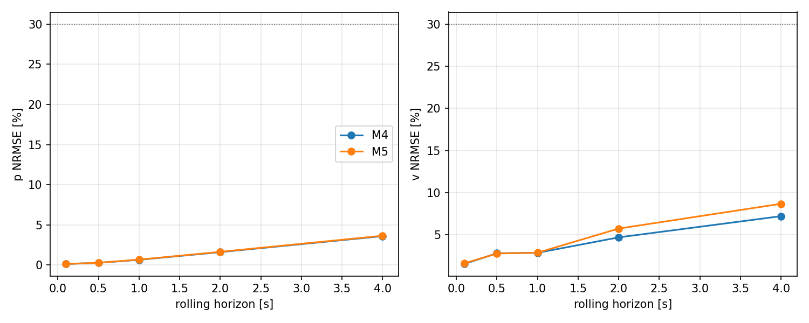
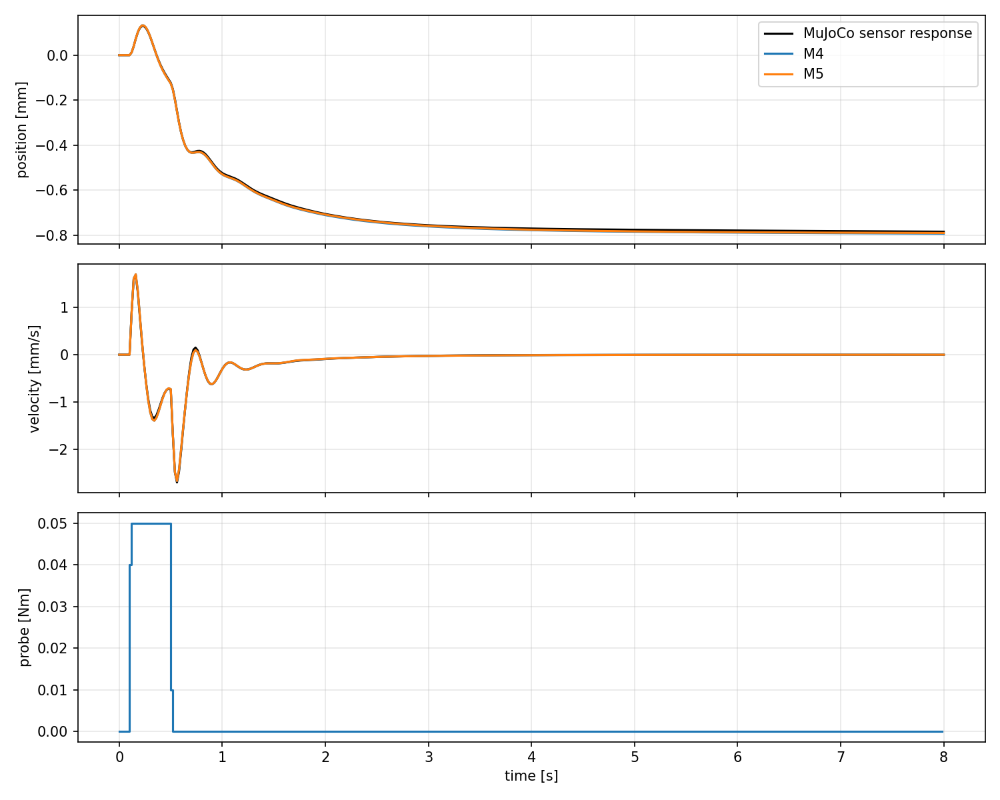
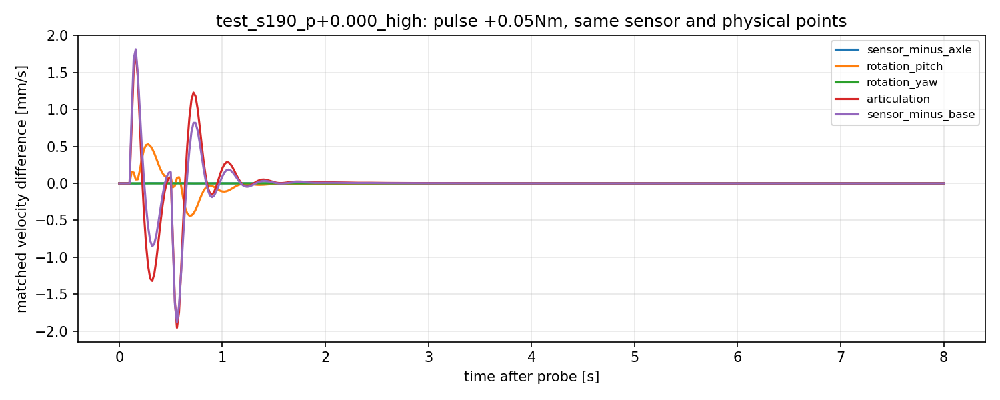

# model_60000 — M5 yaw-rate 추가와 M4 비교

작성일: 2026-10-15 (Asia/Seoul)

Execution Domain: **VALIDATION_SIM** (재식별·예측·기준점 분석: **DESKTOP_DRY_RUN**)

Policy Checkpoint: `lab/ddt_lab/logs/flash_sac/tita_flash_sac_115632_883848/model_60000/actor.pt`

Policy Checkpoint SHA256: `6d3cba9fa76eebe9fb2f40ef23d34115b8b95028ec788571531ffb33ce821a05`

ONNX SHA256: `f44f07ed44970e3ff565eae67fd9229adf0be5c02215591c52a691ffcbb71b2a`

Evidence Status: **PASS — M4/M5의 기존 센서 p/v 예측 기준과 exact replay. FAIL — M5의 예측 개선 기준.** M5 Fixed LQR·M6·추정기 보정·online adaptation·실기: **NOT_TESTED**.

Observed Metrics / Behavior / Log Summary:

**M5는 충분히 작은 예측 오차를 냈지만, M4보다 나아지지 않았다.** 2초 rolling 속도 NRMSE는 **4.71→5.75%**, 속도 RMSE는 **0.003956→0.004633 mm/s**로 증가했다. 독립 test 초기 조건 6개 모두 이 속도 RMSE가 악화됐다. 따라서 이번에는 **M4를 유지하고 M5 LQR과 M6는 진행하지 않는다.** 이 결과는 yaw의 물리적 영향을 부정하거나 다른 운용 영역에서도 yaw rate가 불필요하다는 증거가 아니다.

## 1. 기준점과 상태 정의를 분리했다

사용자 선택에 따라 **물리 위치 유지 평가는 base_link 원점이 주 지표, wheel midpoint가 보조 지표**다. 각 점의 world 이동을 구간 중간 horizontal heading에 투영해 적분한 sagittal path와, 같은 현재 heading에 투영한 Jacobian 속도를 사용한다. 고정 world x 좌표나 planar/yaw 전체 정지를 뜻하지 않는다.

이번 M4/M5의 p/v는 기존 encoder/IMU rolling 추정식을 유지했다. 이를 GT base-link p/v로 바꾸거나 접촉·기준점 보정을 추가하지 않았다. **Base origin을 평가 기준으로 정한 것과 센서 추정값이 base origin의 물리량이 된 것은 다르다.** 아래 모델 PASS는 기존 센서 좌표의 응답 예측 판정이며, base-link GT 유지 제어의 PASS가 아니다.

```text
M4: [p, v, pitch, pitch_rate, previous_raw_action(8), leg_q(6), leg_dq(6)]      24-state
M5: [p, v, pitch, pitch_rate, yaw_rate, previous_raw_action(8), leg_q(6), leg_dq(6)] 25-state

baseline: FlashSAC + 0.4828 Nm total residual
probe:    FlashSAC + 0.4828 Nm + w(t)
delta_z_next = A delta_z + B actual_w
```

Yaw rate는 동기화 IMU의 body gyro와 현재 roll/pitch로 계산한 Euler heading 변화율이다.

```text
yaw_rate = (sin(roll)*gyro_y + cos(roll)*gyro_z) / cos(pitch)
```

Body gyro-z나 world-vertical angular velocity와 일반적으로 같지 않다. 미래 yaw 차분이나 GT 속도를 사용하지 않았고, 절대 yaw 또는 sin/cos(yaw)를 모델 상태에 추가하지 않았다. 기존 odometry의 heading 계산은 유지한다. 예비 baseline yaw rate는 약 −0.00843 rad/s였다. 이번에는 제어를 실행하지 않았으며, yaw rate=0 목표도 부여하지 않았다.

기존 24개 무외란 궤적의 동일 기준점 지표는 [이전 진단](flash_odometry_diagnostics_summary.md)에서 보존했다. 마지막 5초 위치 RMSE 중앙값은 아래와 같다. **이번에 다시 제어한 결과가 아니고, 기존 wheel-midpoint FAIL을 사후 변경하지 않는다.**

| 기존 제어기 | Base origin, 주 지표 mm | Wheel midpoint, 보조 mm | Encoder path mm |
|---|---:|---:|---:|
| bias-only | 0.19250 | 0.03137 | 0.16926 |
| M4 Fixed LQR | 0.03215 | 0.19170 | 0.00900 |

## 2. 동일 데이터 조건과 검증 순서

기존 `flash_operating_local/full`의 prefix와 모든 residual 입력을 MuJoCo에서 재실행했다. 전체 snapshot·sensor 적분기·raw history를 복제하고, 기존 state/observation/action/history 및 physics-substep wheel/leg torque가 **540개 응답과 36개 baseline 모두 exact 일치**함을 검사했다. 원래 archive를 변경하지 않고 yaw rate·gyro·base-link position/velocity만 별도 NPZ에 기록했다. 끝점까지 N+1 상태를 직접 계측했으며 마지막 yaw rate를 미래 차분으로 메우지 않았다.

| 분리 | Seed × initial pitch | 운용점 hold 시각 s | Snapshot | 8초 응답 | Transitions |
|---|---|---|---:|---:|---:|
| Train | 180/181 × −0.035/0/+0.035 | 900/1020/1140 | 18 | 234 | 93,600 |
| Test | 190/191 × 같은 pitch | 960/1080/1200 | 18 | 306 | 122,400 |

- 기존처럼 zero/high 접근을 그룹별 3조건씩 유지했다. F-1 OFF, 고정 bias +0.4828 Nm, zero command, nominal 평면, physics/control dt=0.005/0.02초다. 장애물 비활성화·startup·failure guard도 기존 경로와 같다.
- Train/test의 sine 주파수·PRBS block·phase·input seed 분리를 보존했다. Pulse/step은 두 분리에 있고 bipolar pulse는 test에만 있다. Probe amplitude는 합 0.02/0.05 Nm, microPRBS 0.01 Nm, slew2 Nm/s다.
- 기존 deterministic actor·동기화 IMU·33-value observation·전체 raw last_action·wheel velocity PD·leg position PD를 유지한다. Wheel에만 residual을 더하고 기존 ±12 Nm/바퀴 saturation을 적용한다. GT는 제어에 들어가지 않는다.
- Train만으로 두 모델에 같은 RMS-scaled least squares/rcond=1e−10을 적용했다. A 첫 열=[1,0,…]와 causal previous-action B 8행=0 제약을 유지했다. M5에서는 action 행을 5–12로 이동시켜 yaw-rate 행을 잘못 0으로 묶지 않았다.
- **M4 A/B는 이전 frozen M4와 bitwise 일치했다.** 두 모델을 `models_frozen.json`에 고정한 다음 test 배열을 열었다. 계수·Q/R·상태 정의를 test 결과로 조정하지 않았다. 미래 실측 yaw rate/action/leg 상태를 주입하지 않고 모든 상태를 재귀 예측했다.
- 직접 B는 train/test 각각 54개 ±차분 쌍으로 검사했다. 같은 snapshot에서 여러 응답을 얻었으므로 test306개를 독립 초기 조건306개로 해석하지 않는다. 이전 cohort를 재계측한 비교이며 새로운 독립 모집단 확인은 아니다.

사전 모델 기준은 기존 **최초2초와 rolling0.1/0.5/1/2초의 p/v NRMSE 중앙값 모두≤30%, 직접 B_v 부호 일치·오차≤30%**다. 별도로 M5 LQR 진입 조건을 기록했다: M5 모델 기준 PASS, rolling2초 속도 NRMSE와 RMSE 각각 M4보다≥10% 감소, test 초기 조건≥5/6에서 해당 RMSE 개선, 전체8초 p/v NRMSE 각각 M4의105% 이내. 이는 이번 실험의 운영 기준이며 사용자 정량 사양이나 안정성 정리가 아니다.

## 3. M4/M5 예측 결과

| 지표, 응답별 지표의 중앙값 | M4 | M5 |
|---|---:|---:|
| 최초2초 p/v NRMSE | 2.38 / 2.58% | 2.27 / 2.56% |
| 최초2초 p RMSE mm | 0.003749 | 0.004770 |
| 최초2초 v RMSE mm/s | 0.02005 | 0.01991 |
| 2초 rolling p/v NRMSE | 1.60 / 4.71% | 1.64 / 5.75% |
| 2초 rolling v RMSE mm/s | 0.003956 | 0.004633 |
| 전체8초 p/v NRMSE | 4.04 / 2.66% | 4.09 / 2.65% |
| 전체8초 p RMSE mm | 0.007151 | 0.008720 |
| 전체8초 v RMSE mm/s | 0.01016 | 0.01013 |
| 직접 B_v 대비 차이 | 0.323% | 0.321% |
| RMS-scale condition number | 32,803 | 33,352 |
| Scaled rank | 24/24 | 25/25 |
| 기존 예측 기준 | PASS | PASS |
| M4 대비 개선 기준 | 기준 모델 | **FAIL** |

각 응답의 NRMSE를 구한 뒤 중앙값을 취한다. RMSE 중앙값÷signal RMS 중앙값은 NRMSE 중앙값과 같지 않으므로, 최초2초 p의 NRMSE와 절대 RMSE 변화 방향이 다를 수 있다. Floor는 기존 p=1e−7 m, v=1e−5 m/s다.

| Rolling horizon | M4 p/v NRMSE | M5 p/v NRMSE |
|---|---:|---:|
| 0.1초 | 0.13 / 1.56% | 0.13 / 1.63% |
| 0.5초 | 0.27 / 2.82% | 0.27 / 2.80% |
| 1초 | 0.65 / 2.88% | 0.67 / 2.89% |
| 2초 | 1.60 / 4.71% | 1.64 / 5.75% |
| 4초, 보조 | 3.59 / 7.22% | 3.64 / 8.69% |

M5의 rolling2초 속도 NRMSE는 상대22.1%, 절대 RMSE는17.1% 증가했다. 초기 조건별 해당 RMSE 개선은 **0/6**이었다. 단, 절대 오차 증가량은 약0.000677 mm/s로 작고, 새 controller를 실행한 것이 아니므로 balancing 악화나 불안정화 결과로 해석하지 않는다.

직접 B_v 중앙값은 +0.022455126 (m/s)/Nm이고 M4/M5 추정값은 +0.022527589/+0.022527158이다. 두 모델 모두 72개 pulse의 첫 방향과 반전을 맞췄으며 반전시각 오차 중앙값은0초(20 ms 격자)였다. Pulse 4–8초 tail 속도 RMSE는 M4 **0.0006765**, M5 **0.0008809 mm/s**다. 전체8초 p/v 모두30% 이하인 응답은 두 모델 모두286/306개로, 전 응답 통과는 아니다.





## 4. Base origin의 응답과는 여전히 다르다

같은 frozen 모델의 **센서 delta p/v 예측값**을 실제 기준점별 delta p/v와 대조했다. 별도 GT 모델을 학습하거나 제어한 비교가 아니다.

| 최초2초 교차 대조, NRMSE 중앙값 | M4 p/v | M5 p/v |
|---|---:|---:|
| Wheel midpoint GT | 2.36 / 2.52% | 2.25 / 2.51% |
| Base origin GT | **19.85 / 182.84%** | **19.84 / 182.67%** |

Base 속도 대조의 RMSE 중앙값도 약0.5345/0.5342 mm/s였다. 이는 같은 물리량을 예측하도록 학습한 두 모델의 순수 예측 점수가 아니다. **센서가 정의하는 wheel rolling 응답을 base origin의 실제 응답으로 바로 사용하는 데 한계가 크다는 진단**이다. Yaw rate 상태를 추가해도 기준점 변환은 자동으로 생기지 않는다.

정상 유지 상태의 작은 상수 차이와 달리, probe 중에는 다리 자세와 pitch가 변하며 base origin과 wheel midpoint의 상대 운동도 생긴다. 같은 test 로그를 다음 관계로 분해했다.

```text
sensor_v − base_v
  = (sensor_v − axle_v)
    + Omega_base_l*d_z − Omega_base_z*d_l + relative_leg_translation_f
d = wheel_midpoint_position − base_origin_position
```

Matched probe−baseline 차이의 최초2초 RMS를 응답별 계산한 뒤 중앙값을 취했다.

| 성분 | RMS 중앙값 mm/s |
|---|---:|
| sensor−wheel-midpoint 차이의 변화 | 0.000894 |
| Base pitch 회전 transport 변화 | 0.1612 |
| Base yaw 회전 transport 변화 | 0.000138 |
| 상대 articulation/leg translation 변화 | 0.6106 |
| 전체 sensor−base 차이의 변화 | 0.5361 |

Articulation은 측정된 두 점의 상대속도에서 rigid-base 회전항을 뺀 잔여다. 항별 RMS는 서로 더해지지 않고, 고유한 인과 비율을 뜻하지 않는다. 합성 항등식 잔차는 최대1.74e−18 m/s였다. 이번 transient에서 yaw transport 변화만으로 base와 wheel의 응답 차이를 설명할 수는 없다. 이전 무외란 정상상태에서 yaw transport가 중요했다는 결과와 모순되지 않는다.



## 5. 판단·범위·검증

**이번 운용점에서는 M4를 유지한다.** M5는 예측 모델로서 기존 기준을 통과했지만 추가 상태의 이득이 확인되지 않았다. M5 affine/gain을 만들거나 LQR을 재실행하지 않았다. M6·새 상태 탐색·Q/R tuning·추정기 수정·online identification·mismatch·hardware도 수행하지 않았다.

다음에 base-link 위치 유지 성능을 검토할 때는, 기존 rolling p/v와 base-origin p/v의 관측량 관계를 명시적으로 검증해야 한다. 이 문제를 M6 또는 online A/B 학습이 자동으로 해결한다고 가정하지 않는다. 현재 결과만으로 M4의 센서 상태 예측 PASS나 이전 위치 목표 복원 결과를 부정하지 않는다.

- 신규 코드4개: `test/eval_flash_m5_yaw_rate.py`, `test/analyze_flash_m5_yaw_rate.py`, `test/analyze_flash_m5_reference_points.py`, `test/test_flash_m5_yaw_rate.py`. 기존 runtime·정책·설정·A/B·보고서는 변경하지 않았다.
- 본 수집 **540응답·36 baseline exact replay·108 직접 B 차분 쌍 PASS**. 기존 actor/history/leg/wheel 경로와 raw archive를 보존했다. M4 이전 A/B exact 재현, 초기 seed 분리, test 평가 전 두 모델 고정, 전 상태 재귀 예측, 보호 hash 및 frozen hash 보존 PASS.
- 독립 수치 검사 **4개 PASS**: body gyro로 계산한 heading 변화율과 회전 적분의 일치/절대 heading 불변성, 25-state 알려진 계수 복원과 causal 행 이동, M4에서 yaw만 제외한 계수 복원, 미래 측정을 받지 않는 재귀 예측.
- 최초 smoke는 계측 재현은 통과했지만 실행 중 metadata filtering을 수정해 목록이 실제13개 대신39개로 남고 source hash도 달랐다. **SUSPICIOUS로 별도 보존·본 분석에서 제외**했다. 실행판 원문 hash를 복원해 보존했고, 본 수집은 수정된 고정 source로 수행해 source/hash 보존을 통과했다.
- `./scripts/agent-check.sh` **전체 FAIL**: 기존 `my_flat_env_cfg.py`의 trailing whitespace 6곳. Python syntax **396개 PASS**, URDF XML **8개 PASS**다. 신규4개 코드와 보고서의 diff 검사는 PASS이며, 기존 tracked diff 및 보호640파일 hash가 동일함을 확인했다. `agent_check.log`, `final_review.json`에 기록했다. 브랜치 **`agent/codex/dev_tita_gluon`**. Commit/push 없음.

## 6. 재현과 산출물

```bash
MPLCONFIGDIR=/tmp/lqr_mpl /home/cocel/venvs/cosim_ros2_jazzy/bin/python test/test_flash_m5_yaw_rate.py
MPLCONFIGDIR=/tmp/lqr_mpl /home/cocel/venvs/cosim_ros2_jazzy/bin/python test/eval_flash_m5_yaw_rate.py --workers 3 --output docs/exp/2026-10-15/new_m5/full
MPLCONFIGDIR=/tmp/lqr_mpl /home/cocel/venvs/cosim_ros2_jazzy/bin/python test/analyze_flash_m5_yaw_rate.py --root docs/exp/2026-10-15/new_m5/full
MPLCONFIGDIR=/tmp/lqr_mpl /home/cocel/venvs/cosim_ros2_jazzy/bin/python test/analyze_flash_m5_reference_points.py --root docs/exp/2026-10-15/new_m5/full
./scripts/agent-check.sh
```

새 출력 폴더를 사용하며 frozen 행렬 덮어쓰기는 거부한다. 이번 실행은 train 수집 후 `--stage fit`, 전체 수집 후 `--stage evaluate`로 분리해 test 분석 전에 행렬을 먼저 고정했다. 재현에는 기존 `flash_operating_local/full`의 원본 NPZ가 필요하다.

산출물: [비교 판정](flash_m5_yaw_rate/full/summary.json), [M4/M5 A/B](flash_m5_yaw_rate/full/models_frozen.json), [기준점 규약과 기존 제어 지표](flash_m5_yaw_rate/reference_protocol.json), [base 응답 차이](flash_m5_yaw_rate/full/reference_response_facts.json), [직접 B](flash_m5_yaw_rate/full/direct_B.json), [수집 무결성](flash_m5_yaw_rate/full/completion.json), [분석 무결성](flash_m5_yaw_rate/full/analysis_integrity.json), [최종 변경 감사](flash_m5_yaw_rate/final_review.json), 개별 지표·전체 snapshot·추가 계측 NPZ·source snapshot·실행 로그.
