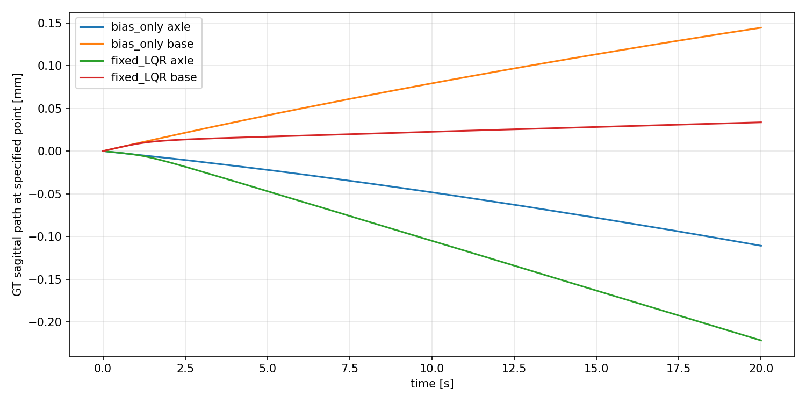
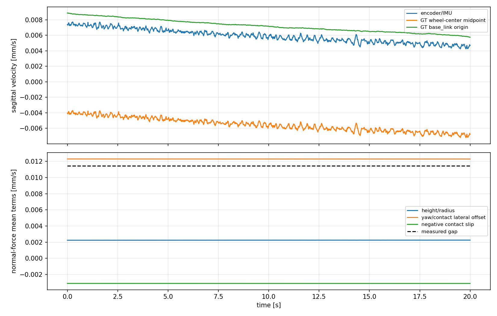

# model_60000 — 0.01144 mm/s 차이의 기준점·yaw·접촉 기하/slip 진단

작성일: 2026-10-15 (Asia/Seoul)

Execution Domain: **VALIDATION_SIM** (기존 로그·기구학·수치 분석: **DESKTOP_DRY_RUN**)

Policy Checkpoint: `lab/ddt_lab/logs/flash_sac/tita_flash_sac_115632_883848/model_60000/actor.pt`

Policy Checkpoint SHA256: `6d3cba9fa76eebe9fb2f40ef23d34115b8b95028ec788571531ffb33ce821a05`

ONNX SHA256: `f44f07ed44970e3ff565eae67fd9229adf0be5c02215591c52a691ffcbb71b2a`

Evidence Status: **PASS — 기존24궤적 exact replay, 같은 시점·좌표의 속도 정의 확인, 기준점 transport와 접촉 항등식 분해, 50/200 Hz 교차 확인.** 새 estimator/controller·A/B 재학습·Q/R tuning·yaw/마찰을 바꾼 물리 개입·실기: **NOT_TESTED**.

Observed Metrics / Behavior / Log Summary:

**0.01144 mm/s를 단일한 센서 bias로만 해석하기에는 기준점과 접촉 조건의 영향이 크다.** 기존 GT는 base-link 속도가 아니라 양쪽 wheel 중심 속도의 평균이었다. 두 점은 yaw 회전 중 서로 다른 전후방 속도를 갖는다. Wheel midpoint가 base origin보다 옆방향으로 약−1.513 mm 치우쳐 있고, yaw 회전이 만드는 두 점의 속도 차이는 약 **−0.01275 mm/s**였다.

같은 LQR 로그에서 `sensor−GT`는 wheel midpoint 기준 **+0.011436 mm/s**, base origin 기준 **−0.001316 mm/s**로 달라졌다. 따라서 먼저 제어·평가의 기준점을 명시해야 한다. 현재 odometry가 base 속도를 정확히 측정한다는 결론도 아니다.

Wheel midpoint 기준의 차이도 직접 분해했다. 대표20초 trial의 마지막5초에서 **height/radius 항 +0.002273, yaw×접촉 옆방향 오프셋 항 +0.012284, 접촉 상대속도 항 −0.003120 mm/s**가 합쳐 관측 차이 +0.011437 mm/s를 설명했다. URDF 관절축·측정 수치 오차는 이보다 매우 작았다. **이상적인 중심 접촉·무미끄럼 가정의 한계와 실제 MuJoCo 접촉 상대운동이 함께 확인됐다.** 다중 접촉이므로 두 항에 고유한 원인 비율을 붙이지 않는다.

## 1. 실행 범위와 증거

- 이전 `flash_affine_lqr`의 무외란 bias-only12개와 Fixed LQR12개, 총 **24개20초 궤적**만 다시 재생했다. Seeds220/221 ×3pitch의6초기 조건, hold1000/1120초의12snapshot을 재사용했다. 새 제어 입력이나 초기 조건을 탐색하지 않았다.
- 저장된 전체 mjData·sensor 적분기·raw history snapshot을 복원하고, 이전에 실제 적용한 residual 시퀀스를 그대로 입력했다. Actor는 원래대로 실행했다. 기존 state·observation·action/history·모든 physics-substep wheel/leg torque가 **전 구간 exact 일치**했다.
- 계측은 원래 GT와 같은 fresh `mjData` 또는 별도 clone에서만 수행했다. 원본 physics state·제어기·estimator 적분 상태를 수정하지 않았다. 기존 controller/gain을 새로 계산하거나 실행 경로에 보정하지 않았다.
- 모든24궤적을50 Hz에서 분석했다. 고정된 첫 조건 seed220/pitch0/high, hold1000초의 LQR 궤적은200 Hz/4,000 substeps로 추가 계측하고, 이때도 이전 제어·상태·motor 출력을 exact 재현했다.
- 통계는 각 궤적의 **15≤t<20초 평균을 먼저 계산한 뒤12개 중앙값**을 취한다. 다른 구간은 별도 표기한다. 관련 snapshot 반복이므로 독립 표본24개로 모집단 유의성을 주장하지 않는다.

## 2. 같은 물리량인지 확인

World horizontal heading을 `f=[cos(yaw),sin(yaw),0]`, 그 왼쪽 방향을 `l=[−sin(yaw),cos(yaw),0]`로 쓴다.

| 값 | 실제 구현·정의 |
|---|---|
| Encoder/IMU v | `r × mean(l · omega_wheel)`; body gyro와 각 leg/wheel 관절 angular velocity를 합쳐 wheel의 world angular velocity를 계산한다. |
| 기존 GT v_A | 각 wheel-link 원점에서 `mj_jac @ qvel`로 얻은 world 선속도를 산술평균한 뒤 f에 투영한다. |
| 진단 GT v_B | base_link 원점의 Jacobian 선속도를 같은 f에 투영한다. |

이번 모델에서 wheel collision cylinder의 local center는 wheel-link 원점과 같았다. 따라서 기존 GT의 점은 **양쪽 wheel 기하학적 중심의 midpoint**다. Base origin이나 robot 전체 CoM 속도가 아니다.

Encoder 공식은 wheel 접촉점이 중심 바로 아래에 있고, 원통의 이상적 rolling/no-slip 조건이 성립하면 wheel-center 평균 속도를 추정한다. 실제 접촉 기하·상대운동이 이 가정을 벗어나면 GT와 자동으로 같아지지 않는다. Encoder 값이 처음부터 base-link 원점 속도로 정의됐다고 해석해서도 안 된다.

방향·시점 불일치도 검사했다. 두 주요 계산은 같은 현재 yaw의 **수평 f/l**을 사용한다. Actor/계측 모두 현재 qpos/qvel에서 clone-refreshed IMU를 사용하며 같은 시점의 snapshot으로 계산했다. 독립 재계산한 sensor v와 기존 estimator v, wheel-center Jacobian v와 기존 GT v는1e−14 m/s 허용오차 내에서 일치했다.

## 3. Yaw와 기준점 이동의 영향

`A=wheel midpoint`, `B=base origin`, `d=P_A−P_B`라 두면:

```text
v_A − v_B = [Omega_base × d] · f + v_leg_translation · f
            = Omega_l*d_z − Omega_z*d_l + v_leg_translation_f
```

이 식에는 base 회전뿐 아니라 leg 자세 변화에 따른 midpoint의 상대 선속도도 포함했다. 특정 다리를 고정했다고 가정하지 않았다.

LQR12궤적에서 `d_l≈−0.00151308 m`, base world-z angular velocity는 약−0.008430 rad/s였다. 주된 항은 `−Omega_z*d_l≈−0.012755 mm/s`다. Pitch 회전·leg translation 항은 각각 중앙값 수e−6 mm/s 수준으로 작았다. Point-transport 항등식도 각 계측 시점에서 수치적으로 닫혔다.

| LQR 마지막5초,12궤적 중앙값 | mm/s |
|---|---:|
| sensor − wheel-midpoint GT | +0.011436 |
| sensor − base-origin GT | −0.001316 |
| wheel midpoint − base origin의 yaw 항 | −0.012755 |

같은 양의 다른 분해다: `sensor−A = (sensor−B) − (A−B)`. 아래 접촉 분해와 이 표의 항을 서로 더해 중복으로 원인을 계산하지 않는다.

자세·leg가 거의 일정한20초에서는 `p_A−p_B ≈ −d_l*Delta_yaw`도 성립한다. 관측된 yaw 변화 약−0.1686 rad와 lateral offset−1.513 mm는 약 **−0.255 mm**의 두 기준점 sagittal path 차이를 만든다. 이 path는 매 시각 heading에 투영해 누적하므로 고정 world x변위와 같지 않다. 회전하는 로봇의 한 점이 만드는 path 증가를 곧바로 로봇 전체의 직선 drift로 읽으면 안 된다.

Yaw는 실제로 전후방 진행량 비교에 영향을 준다. 회전 중 다른 점의 속도와 경로를 비교하면, 동일한 로봇에서도 상수에 가까운 차이가 생길 수 있다. 반면 heading 좌표 자체를 공통 회전시키는 검사는 불변성을 확인했다. 최대 차이는1.41e−18 m/s로, world x와 heading을 잘못 섞어서 생긴 차이라는 증거는 없었다.

### 기준점에 따라 무외란 지표도 달라진다

동일 궤적에서 각 점의 world 위치를 같은 midpoint-heading 방식으로 적분했다. 시작점은 각각0이다. 새 controller를 실행한 비교가 아니다.

| 무외란 마지막5초 위치RMSE,12조건 중앙값 | bias-only mm | Fixed LQR mm |
|---|---:|---:|
| **기존 기준: wheel midpoint GT** | 0.03137 | 0.19170 |
| **추가 진단: base origin GT** | 0.19250 | 0.03215 |
| 기존 encoder/IMU path | 0.16926 | 0.00900 |

Base-origin 기준으로는 LQR이 개선되는 반면 기존 wheel-midpoint 기준에서는 악화된다. **이 표로 기존 FAIL 기준을 사후 교체하거나 전체성공을 선언하지 않는다.** 이전 판정은 명시한 wheel-midpoint 목표에서 유효하고 그대로 보존한다. 다만 이를 기준점 없이 “실제 로봇 위치 전체가 더 나빠졌다”로 일반화하면 불충분하다.

이 표는200 Hz와 정렬하기 위해 끝점20초를 제외했다. 이전 보고서는20초 표본도 포함해0.19182 mm로 집계했으며, 그 작은 수치 차이는 지표 변경이나 데이터 수정이 아니다. Base의20초 최대 평면 반경 중앙값도 LQR0.377 mm로0은 아니고 yaw도 계속된다. 한 점의 sagittal path 유지와 전체 planar/yaw 정지는 구분한다.



## 4. 접촉 기하와 실제 접촉 상대속도의 분리

Wheel center `C`, 접촉 constraint point `P`, `delta=P−C`, wheel world angular velocity `omega`에 대해 다음을 직접 계산했다.

```text
s = v_center + omega × delta − v_ground

r*omega_l − v_center_f
    = (r+delta_z)*omega_l − delta_l*omega_z − s_f − v_ground_f
       height/radius          yaw lever      slip       ground
```

여기서 `s`는 **같은 constraint point에서 wheel-body와 바닥의 상대속도**다. 접촉점 좌표의 시간미분이나 contact locus의 이동속도가 아니다. MuJoCo body Jacobian/qvel로 구한 rigid-body velocity field를 사용했다. 바닥은 정지 world body이므로 ground 항은0이었다.

Encoder angular 계산과 MuJoCo의 실제 wheel angular velocity 차이를 별도 항 `epsilon_axis`로 추가했다. 좌우 wheel에는 기존 estimator/GT와 같은 산술평균을 적용한다. 한 wheel의 다중 접촉만 아래 방식으로 모은다.

접촉식의 `omega_z`는 wheel의 world-vertical angular velocity다. 위 기준점 transport 식의 base angular velocity나 Euler yaw derivative와 같다고 놓지 않았다.

대표 LQR trial의15–20초,200 Hz 평균, **각 wheel 안에서 normal-force 가중 후 좌우 산술평균**:

| 관측된 차이에 더해지는 항 | mm/s |
|---|---:|
| `(r+delta_z)*omega_l` | +0.002273 |
| `−delta_l*omega_z` | +0.012284 |
| `−s_f` | −0.003120 |
| 바닥 이동 | 0 |
| Angular 구현·센서 수치 차이 | 약−0.00000002 |
| 합 / 관측 sensor−GT 차이 | **+0.011437** |

전체24궤적의 모든 sample과 접촉 가중 방식에서 항등식의 최대 잔차는 **5.76e−19 m/s**였다. 이는 회귀 fit 결과가 아니라 같은 실제 state의 속도 관계를 분해한 수치 검증이다.

### 실제 접촉은 이상적인 중심 한 점이 아니었다

반지름은 URDF와 MuJoCo 모두 **0.0925 m**로 일치했다. Cylinder half-width는0.017 m이며 접촉점의 옆방향 offset은0이 아니었다. 대표 상태에서:

| 접촉 | normal force N | 중심 대비 lateral offset mm | 상대 전후속도 mm/s |
|---|---:|---:|---:|
| 왼쪽 주 접촉 | 약108.09 | −15.461 | 약−0.0351 |
| 왼쪽 다른 접촉 | 약17.66 | +18.534 | 약+0.2443 |
| 오른쪽 접촉 | 약126.28 | +14.312 | 약+0.00208 |

따라서 접촉 상대운동은0이 아니다. 특히 왼쪽 가벼운 접촉의 tangential/normal force 비는1.0으로, 관측된 contact friction1.0의 한계와 일치하는 상태였다. 모든 접촉이 큰 sliding 상태였다고 단정하지는 않는다. 나머지 두 접촉의 비는약0.192/0.080이었다.

Wheel geom의 friction0.4만으로 실제 접촉 마찰을 해석하지 않았다. 이 snapshot의 **실제 contact friction은1.0, contact.dim=3**이었다. Wheel geom의condim1을 보고 frictionless라고 판정해서도 안 된다. Geom margin/contact include margin은1 mm로, 양의distance를 가진 세 접촉에도 실제 양의normal force가 있었다. 이 값들을 수정하지 않았다.

### 기구학과 slip의 고유한 비율은 정하지 않는다

같은 대표 trial을 다르게 집계해도 총차이는 같지만 개별 항은 달라진다.

| Wheel 내부 접촉 집계 | height 항 mm/s | yaw 항 mm/s | −slip 항 mm/s | 총차이 mm/s |
|---|---:|---:|---:|---:|
| Normal force 가중 | +0.002273 | +0.012284 | −0.003120 | +0.011437 |
| 하중 있는 접촉 균등 | +0.003550 | +0.061248 | −0.053361 | +0.011437 |
| 가장 큰normal 접촉만 | +0.001774 | −0.006835 | +0.016498 | +0.011437 |

하중이 작은 접촉도 실제 상대속도가 크므로 이를 포함하는 방법에 따라 geometry/slip 배분이 달라진다. **“오차의 몇 %는 기구학, 나머지는 slip”이라는 유일한 원인 비율은 이 데이터만으로 정하지 않는다.** 다만 두 현상이 실제로 존재하며, 기존 이상적 rolling 관계에서 누락된 항으로 관측 차이가 설명된다는 점은 확인했다.



## 5. 주요 원인으로 보기 어려운 항과 한계

- **URDF 관절축 계산:** MuJoCo wheel angular velocity와 재구성한 URDF angular velocity의 최대 vector 차이는약1.87e−8 rad/s였다. 관련 평균 속도차는 약1.7e−8 mm/s로0.01144 mm/s보다 훨씬 작았다. 관절축 FK 구현과 접촉 rolling 가정의 근사를 구분한다.
- **Float32:** 같은 식을 double q/dq로 계산한 차이도 평균 수e−9 mm/s 수준이었다. 반지름 값 자체도 동일했다.
- **수평 heading와3D body x:** 두 주요 값은 원래 같은 수평 heading을 쓰며, 다른3D body x 투영으로 바꾼 LQR 속도의 차이는약0.0000157 mm/s였다. 목표 차이의 주된 설명이 아니다.
- **위치 적분·20 ms sampling:** GT 위치 경로를 원래 정의대로 재구성해 기존 archive와2e−14 m 이내 일치했다. GT path와 trapezoid 속도적분의 최대 차이는약0.0000513 mm, encoder path에서는약0.0002001 mm였다. 약0.229 mm 누적차이를 설명할 크기가 아니다.
- **50/200 Hz:** 대표 trial의 마지막5초 mean gap 차이는 **6.81e−10 mm/s**였다. Substep 검사에서도 원래 제어·motor·상태가 exact 일치했다.

이번에는 yaw를 실제로 멈추거나 friction/margin/바퀴 형태를 바꾸는 물리 개입을 하지 않았다. 항별 속도 분해는 확인했지만, 그런 변경 뒤 policy 폐루프가 어떻게 정착할지는 **NOT_TESTED**다. 측정값은 이 MuJoCo 모델과 장시간 정착 운용점의 결과로, 실물 타이어 slip/bias로 그대로 일반화하지 않는다.

## 6. 판단과 연구상 의미

1. 현재 sensor v와 기존 GT v는 같은 방향·시점이지만, 전자는 이상적인 rolling 기반 추정이고 후자는 wheel-center midpoint의 직접 선속도다. 실제 접촉 조건에서 두 값의 일치를 보장할 수 없다. Base-origin GT는 다시 다른 물리량이다.
2. 지속 yaw는 lateral contact offset과 기준점 간 lateral offset을 통해 전후방 속도·진행량에 영향을 준다. 단순 좌표 회전 버그나 이전 IMU cache 불일치가 주원인이라는 증거는 없었다.
3. 관절축 구현오차보다 **중심 바로 아래 접촉·무slip 가정의 한계와 분포 접촉 상대운동**이 관련된다. 다중 접촉 때문에 두 항의 유일한 인과 비율은 아직 정하지 못한다.

다음 비교에서는 유지할 물리 기준점과 heading/path 정의를 먼저 고정하고, 관측량을 그 기준점과 일치시키는 관계를 검증해야 한다. 이번에 base-origin 지표가 개선됐다고 목표를 사후 변경해 이전 전체성공 FAIL을 지우지 않는다. 또한 online A/B identification은 주어진 관측 상태의 동역학을 학습할 뿐, 기준점 차이나 rolling 가정의 오차를 자동으로 해결하지 않는다.

새 추정기·보정·제어기를 구현하지 않았고 기존 A/B·affine·K·Q/R·데이터·보고서는 그대로 보존했다.

## 7. 변경·검사·재현

- 신규 코드3개: `test/diagnose_flash_odometry.py`, `test/analyze_flash_odometry.py`, `test/test_flash_odometry_diagnostics.py`. 본 보고서와 `flash_odometry_diagnostics/` 증거만 추가했다.
- 기존24개20초 trajectory exact replay와 대표1개200 Hz/4,000 substeps exact replay **PASS**. Original physics/estimator 상태를 계측 중 변경하지 않음을 검사했다.
- 독립 수치 검사 **4개PASS**: 임의 state의 접촉 항등식/heading 회전 불변성, 중심 접촉에서 yaw geometry항0, 다중 접촉 가중에 따른 배분·총차이 보존, rigid point yaw transport 부호. `unit_tests.log`.
- 보호한 기존 runtime·정책·snapshot·control archive468개hash 및신규 실행source hash 보존 **PASS**. 기존 기준점 경로·상태/입력의 재현과항별 closure를 `completion.json`, `analysis_integrity.json`, `final_review.json`에 기록했다.
- 재현 명령이 실제contact 설정·50/200 Hz 비교 파일도 생성하도록 분석 출력 코드를 보완했다. 초기 분석source를 별도 보관하고 다시 확인했으며, 핵심분해 결과와physics 계측 배열이 같은지 최종감사에 기록했다.
- `./scripts/agent-check.sh` **전체FAIL**: 기존 `my_flat_env_cfg.py`의trailing whitespace6곳. Python syntax **392개PASS**, URDF XML **8개PASS**. 신규파일 diff와기존변경 보존은 별도 검사했다. `agent_check.log`.
- 브랜치 **`agent/codex/dev_tita_gluon`**. Commit/push·hardware·새 controller/estimator·A/B/Q/R/gain 업데이트·추가 probing 없음.

```bash
MPLCONFIGDIR=/tmp/lqr_mpl /home/cocel/venvs/cosim_ros2_jazzy/bin/python test/test_flash_odometry_diagnostics.py
MPLCONFIGDIR=/tmp/lqr_mpl /home/cocel/venvs/cosim_ros2_jazzy/bin/python test/diagnose_flash_odometry.py --output docs/exp/2026-10-15/new_odometry_diagnostics/full --workers 3
MPLCONFIGDIR=/tmp/lqr_mpl /home/cocel/venvs/cosim_ros2_jazzy/bin/python test/analyze_flash_odometry.py --root docs/exp/2026-10-15/new_odometry_diagnostics/full --substeps
./scripts/agent-check.sh
```

출력은 아직 없는 폴더를 지정한다. 재현에는 기존 `flash_affine_lqr/fresh`의 전체snapshot과 `control` archive가 필요하다. 계측sample의 접촉점별값·세집계방식·기준점별 속도/위치를 모두NPZ에 남겼다.

산출물: [전체분해·기준점·개별궤적](flash_odometry_diagnostics/full/summary.json), [200Hz 확인·geometry](flash_odometry_diagnostics/full/substep_check.json), [sampling 교차](flash_odometry_diagnostics/full/sampling_check.json), [실제contact 설정·힘](flash_odometry_diagnostics/full/contact_settings.json), [분석무결성](flash_odometry_diagnostics/full/analysis_integrity.json), [최종검사](flash_odometry_diagnostics/final_review.json), 전체diagnostic NPZ·source/hash·로그.
