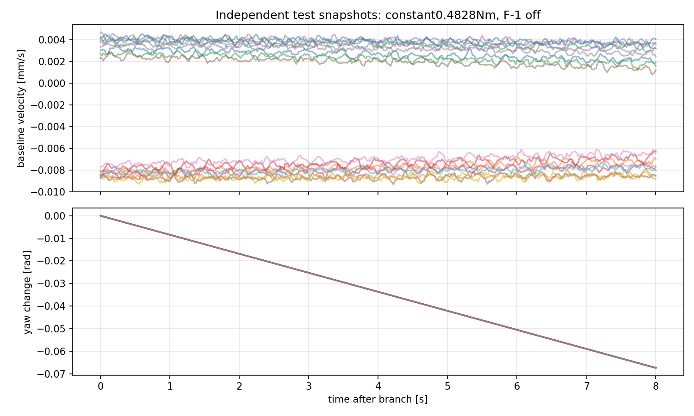
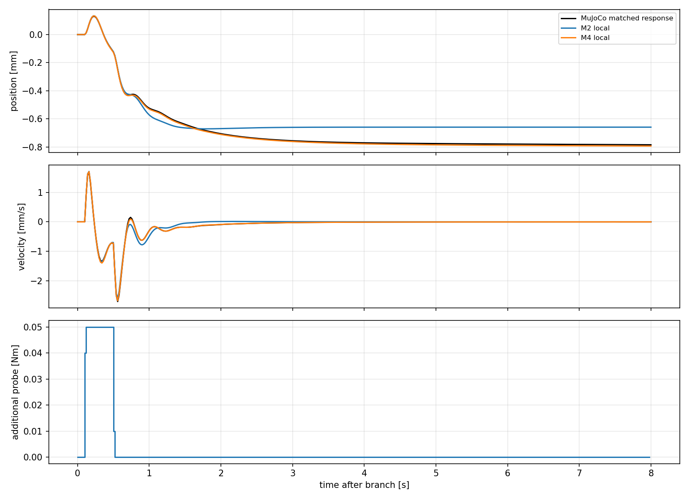
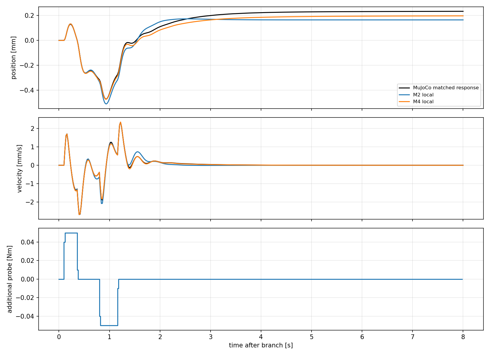

# model_60000 — +0.4828 Nm 운용점의 M2/M4 국소 A/B 재식별

작성일: 2026-10-15 (Asia/Seoul)

Execution Domain: **VALIDATION_SIM** (식별·예측·무결성 분석: **DESKTOP_DRY_RUN**)

Policy Checkpoint: `lab/ddt_lab/logs/flash_sac/tita_flash_sac_115632_883848/model_60000/actor.pt`

Policy Checkpoint SHA256: `6d3cba9fa76eebe9fb2f40ef23d34115b8b95028ec788571531ffb33ce821a05`

ONNX SHA256: `f44f07ed44970e3ff565eae67fd9229adf0be5c02215591c52a691ffcbb71b2a`

Evidence Status: **PASS — 국소 M4의 사전 0.1–2초 예측·직접 B 기준, 4/8초 보조 중앙값 기준 및 수집 무결성. FAIL — M2의 2초 rolling 속도 기준.** 개별 장시간 응답 일부는 기준 밖이다. Affine/평형 입력 식별·LQR·Q/R tuning·online adaptation·실기: **NOT_TESTED**.

Observed Metrics / Behavior / Log Summary:

**고정 residual +0.4828 Nm를 양쪽 분기에 유지하고 새로 재식별한 M4가 독립 test의 기존 기준을 통과했다.** M4의 최초 2초 p/v NRMSE 중앙값은 **2.38%/2.58%**, 2초 rolling은 **1.60%/4.71%**였다. 8초 전체 자유 예측도 **4.04%/2.66%**였다. M2는 최초 2초 **5.77%/9.56%**로 개선됐지만 2초 rolling 속도 **66.88%**로 실패했다.

요청한 선택 규칙에 따라 **이번 운용점의 다음 예측 모델 후보로 M4를 채택**하고 M2는 비교 모델로 보존한다. 상태 차원은 늘리지 않았다. 이번 성공은 저속·지속 yaw 회전 운용점 주변의 작은 residual 응답 예측에 한정된다. 정적 평형·초기 위치 복귀·LQR 제어 성능은 아직 검증하지 않았다.

## 1. 고정한 시스템과 분기

```text
같은 전체 MuJoCo snapshot + sensor 적분기 + raw previous_action
  ├─ Baseline: FlashSAC + 0.4828 Nm
  └─ Probing:  FlashSAC + 0.4828 Nm + w(t)

delta_z = probing state − matched baseline state
delta_z_next = A_local delta_z + B_local actual_w

M2: [p, v, pitch, pitch_rate, previous_raw_action(8)]            12-state
M4: [M2, leg_position(6), leg_velocity(6)]                       24-state
```

- 전 구간 F-1 OFF. StateRunner를 직접 사용해 F-1 controller를 생성·업데이트·적용하지 않았다. Bias는 관측에 따라 바꾸지 않고 양쪽 분기에서 같은 값을 유지했다.
- 지정 model_60000 deterministic actor, 33-value observation, 전체 8개 raw action history, 기존 wheel velocity PD·leg position PD·action scale/clip/order를 유지했다.
- Actor와 계측 상태 모두 현재 qpos/qvel 시점에 mjData clone을 mj_forward한 동기화 IMU를 사용했다. 원본 physics cache는 refresh하지 않았다. GT는 평가·운용점 판정용이며 제어에 사용하지 않았다.
- 매 physics substep의 기존 wheel torque에 native axis sign을 반영해 total residual의 절반씩 더하고 기존 ±12 Nm/바퀴 clipping을 유지했다. Leg torque는 원래 ActionAdapter 출력과 각 substep에서 정확히 같음을 검사했다.
- `actual_w`는 probe와 대응 baseline의 실제 추가 토크 차이다. 요청 파형만으로 회귀하지 않았다. `last_action`에는 직전 전체 raw actor output을 유지하고 residual Nm를 넣지 않았다.
- Nominal 평면, command=[0,0,0], physics/control dt=0.005/0.02초. Floor 외 장애물은 메모리에서만 비활성화했다. Push·mismatch·정책 재학습 없음.

## 2. 운용점 확보와 독립 분리

| 분리 | 초기 조건 | Bias 전환 시작부터 분기 시각 | Snapshot | 8초 응답 | Transitions |
|---|---|---|---:|---:|---:|
| Train | seeds180/181 × pitch −0.035/0/+0.035 rad | 900/1020/1140초 | 18 | 234 | 93,600 |
| Test | seeds190/191 × 같은 3 pitch | 960/1080/1200초 | 18 | 306 | 122,400 |

각 그룹은 6개 초기 조건이다. 한 초기 조건의 모든 시각·입력을 같은 분리에 두고 seed 집합을 분리했다. 각 그룹에 zero/high 접근을 3조건씩 배치했으며, 모든 초기 조건에서 두 접근을 모두 실행한 Cartesian grid는 아니다. 같은 snapshot의 여러 응답은 관련돼 있으므로 test306개를 독립 초기 조건306개로 해석하지 않는다.

`zero`는 원래 FlashSAC 8초 후, `high`는 +0.6 Nm로 30초 후 +0.4828 Nm로 전환한다. 전환 때만 합 torque slew2 Nm/s를 사용한 뒤 일정 bias를 유지했다. Reset 없이 운용점까지 이어갔다. Startup은 기존 transform_up→RL이다. 첫 RL1초의 기존 저자세 전환 위반은 별도 기록하고, 이후 prefix와 모든 본 응답에는 finite/attitude/height/leg-limit guard를 적용했다.

각 snapshot의 **직전180초**에 기존 속도40초 block 평균/RMS·위치 범위·pitch·leg margin 기준을 적용해 **36/36 통과**했다. 구현은 직전240초를 잘라 기존 settle60초를 제외한180초를 평가한다. 순간 속도만으로 선별하지 않았다.

| 확보 상태의 실측 범위, 전체36 snapshot | 결과 |
|---|---:|
| 직전60초 GT평균 속도 | −0.00844∼+0.00408 mm/s |
| 직전180초 sagittal 위치 변화폭 | 0.280–0.860 mm |
| 같은 구간 시작점 대비 최대 평면 반경 | 0.388–1.068 mm |
| 같은 구간 yaw 변화 | −1.517∼−1.514 rad |
| 분기 후 baseline8초 GT평균 속도 | −0.00867∼+0.00393 mm/s |
| 같은8초 yaw 변화 | −0.06746∼−0.06740 rad |

저속 위치 운용은 유지됐지만 yaw는 계속 회전했다. 전체 자세의 정적 평형점이 아니다. 900초 이상 기다린 확보 방법이며 정지 명령 직후 감속·초기 위치 복귀를 구현한 것도 아니다.



## 3. 입력·회귀·판정

Train은 새 random-phase sine/PRBS, ±pulse, ±step × 합 amplitude0.02/0.05 Nm와 microPRBS0.01 Nm다. Test에는 별도 주파수/phase/seed/block의 sine/PRBS와 같은 pulse/step, 학습에 없는 ±bipolar pulse를 사용했다. Snapshot당 train13종/test17종, 응답8초, probe slew2 Nm/s다. Bias는 계속 유지했다. 입력을8초 동안 계속 주는 파형과 조기 종료해 자유 감쇠를 보는 파형을 함께 썼다.

Sine 주파수는 train0.43/1.37/3.17/6.23 Hz, test0.67/1.91/4.31/7.13 Hz다. PRBS block은 train1/3/5/9, test3/7/11 control steps다. 위상·입력 seed는 초기 조건·시각·파형별로 분리했다. Pulse는0.1–0.5초, step은0.1–1.5초에 활성화한다. Bipolar는0.1–0.35초의 한 부호와0.8–1.15초의 반대 부호를 조합한다. 각 snapshot에서 ±0.005/0.01/0.02 Nm를20 ms 가하는 직접B 차분도 측정했다.

두 모델 모두 **train만**으로 RMS-scale least squares, rcond=1e−10을 적용했다. 위치 translation symmetry의 A첫 열=[1,0,…], 현재 torque가 이미 계산된 actor output에 영향을 줄 수 없다는 previous-action의 B8행=0 제약을 유지했다. Intercept·regularization 탐색·구조 변경 없음. 행렬을 `local_models_frozen.json`에 저장한 후 test배열을 읽었고, test결과로 재학습하지 않았다.

모든 모델 상태를 재귀 예측하며 미래 실측 action/leg state를 넣지 않는다. 응답별 p/v 지표를 먼저 계산한 뒤 중앙값을 취한다.

```text
NRMSE = RMS(predicted_delta − actual_delta) / max(RMS(actual_delta), floor)
floor: p=1e−7 m, v=1e−5 m/s
```

주 판정은 기존과 같다: **최초2초 전체 및 rolling0.1/0.5/1/2초의 p/v NRMSE 중앙값 모두≤30%, 직접B_v와 부호 일치·상대 차이≤30%**. 4초rolling과4/8초 전체는 보조 기준이며 주 판정을 바꾸지 않는다. 임계값은 진단 기준이지 제어 안정성 정리가 아니다.

Rolling은8초 trace에서 시작점을0.2초씩 이동하고, 실제 시작 상태에서 해당 horizon의 endpoint를 예측한다. 전체 자유 예측은 분기에서 한 번만 초기화한 구간 전체RMS다. 두 지표는 시작점·구간·분모가 다르다. RMSE중앙값÷signal중앙값이 NRMSE중앙값과 같을 필요도 없다.

## 4. 직접B와 즉시 반응

| 모델/실측 | B_p m/Nm | B_v (m/s)/Nm | 직접B_v 대비 상대 차이 |
|---|---:|---:|---:|
| Test직접 차분54쌍 중앙값 | 0.0002980631 | **+0.0224551262** | 기준 |
| Local M2 | 0.0003011110 | +0.0226013211 | 0.651% |
| Local M4 | 0.0003001239 | +0.0225275893 | **0.323%** |

Test직접 B_v 범위는+0.02245410∼+0.02245598, GT중앙값은+0.02247171이다. 두 모델 모두 test306/306 응답에서 첫 유효 입력 직후 속도 방향이 일치했다. 즉시B가 크게 틀렸던 이전 저차 모델과는 다른 상황이며, 이번 두 모델의 차이는 주로 이후 응답에 나타났다.

## 5. p/v 자유 예측

각 값은 응답별 지표의 중앙값이다.

| 모델 | 최초2초 p/v NRMSE | 같은 p RMSE mm | 같은 v RMSE mm/s | 2초rolling p/v NRMSE | 주 판정 |
|---|---:|---:|---:|---:|---|
| M2,12-state | 5.77 / 9.56% | 0.01445 | 0.06567 | 8.56 / **66.88%** | **FAIL** |
| M4,24-state | **2.38 / 2.58%** | **0.003749** | **0.02005** | **1.60 / 4.71%** | **PASS** |

| Rolling horizon | M2 p/v NRMSE | M4 p/v NRMSE |
|---|---:|---:|
| 0.1초 | 0.60 / 13.58% | 0.13 / 1.56% |
| 0.5초 | 2.96 / 18.38% | 0.27 / 2.82% |
| 1초 | 5.20 / 18.00% | 0.65 / 2.88% |
| 2초 | 8.56 / 66.88% | 1.60 / 4.71% |
| 4초, 보조 | 13.31 / 17.45% | 3.59 / 7.22% |

M4의2초rolling 속도RMSE 중앙값은 **0.003956 mm/s**, M2는0.03134 mm/s다. 각 응답의2초rolling p/v 모두≤30%인 경우는 M4 **306/306**, M2 **80/306**이다. Pulse군 속도NRMSE 중앙값은 M2 약115.4%, M4는positive10.32%/negative13.83%로, 입력 종료 후 작은 후속 응답에도 차이가 있었다.

GT delta p/v에 같은 행렬을 적용한 최초2초 NRMSE는 M2 **5.74/9.55%**, M4 **2.36/2.52%**였다. GT로 재학습하지 않았다. 주 상태는 encoder/동기화IMU의 sagittal path/velocity이며 world planar 위치/yaw hold 모델이 아니다.

### 4·8초 보조 결과와 한계

| 모델 | 전체4초 p/v NRMSE | 전체8초 p/v NRMSE | 전체8초 p/v RMSE mm·mm/s |
|---|---:|---:|---:|
| M2 | 12.59 / 15.03% | 15.68 / 15.05% | 0.05235 / 0.05824 |
| M4 | **3.42 / 2.64%** | **4.04 / 2.66%** | **0.007151 / 0.01016** |

두 모델 모두4/8초 보조 중앙값 기준은 통과하지만 M2의 주 판정FAIL은 유지한다. M2의4초rolling 속도중앙값이2초보다 작은 것도 서로 다른 window·응답 분모의 집계이며, horizon이 늘수록 정확해진다는 뜻이 아니다.

**M4의 전체8초 p/v 모두≤30%는286/306, 4초rolling은297/306이다.** 전체8초 위치의 최대NRMSE는78.31%다. 해당 seed191/pitch+0.035/high, RL990초, validationPRBS0.05 Nm에서 실제 위치signal RMS0.3389 mm에 위치오차0.2654 mm였다. 같은 응답의M2 오차는0.2241 mm로, M4가 모든 개별 응답·지표에서 우월하지는 않았다. 장시간 적분 위치 예측까지 전 응답 통과라고 주장하지 않는다.

최초2/4/8초 p/v signal이floor 미만인 trace는 없다. 반면4–8초tail 속도는180/306에서floor0.01 mm/s 미만으로, 이때tail NRMSE는floor로 정규화된다. 작은 절대 응답과 상대 오차를 구분한다.

## 6. 방향 전환과 감쇠

72개±pulse 모두 실제 속도가 먼저 입력 방향으로 반응한 뒤 반전했고, M2/M4 모두 첫 반전을 같은control 표본에서 예측했다. 첫 유효 속도 응답 후 반전까지0.12초, 반전시각 오차0초였다. 20 ms 격자의 검증이므로 표본보다 작은 시간 정확도를 의미하지 않는다.

| ±pulse72응답의4–8초tail 중앙값 | 실측 | M2예측 | M4예측 |
|---|---:|---:|---:|
| 속도RMS mm/s | 0.002706 | 0.0000240 | 0.003061 |
| 속도예측RMSE mm/s | — | 0.002721 | **0.0006765** |

M2는 초기 방향 전환을 맞춰도 이후 속도를 너무 빨리0으로 감쇠시킨다. M4는 작은 후속 응답을 더 잘 추적했다. 특정leg 관절이 유일한 원인이라고 확정하지 않는다. 내부 상태를 포함한 M4 재귀 예측이 이번 국소 데이터에서 유효했다는 증거다.

그림은 고정된 정렬 순서의 첫 test, seed190/pitch0/high, RL990초, amplitude0.05 Nm다. 성능을 보고 다시 고르지 않았다. 위치는baseline과의 차이이며 절대 위치 복귀 그림이 아니다.





## 7. 채택 판단과 다음 범위

| 회귀 진단 | M2 | M4 |
|---|---:|---:|
| Scaled rank | 12/12 | 24/24 |
| RMS-scale condition number | 300.75 | **32,803.36** |
| 다른 상태를 제거한 입력innovation energy | 17.89% | 17.77% |

**이번에는 M4만 주 판정PASS이므로 M4를 다음 국소 예측 모델로 보관한다.** 새로운 상태·구조를 추가할 필요성은 이번 실험에서 드러나지 않았다. M2는 짧은 초기 응답에는 유효하지만 현재 기준의 주 모델로 채택하지 않는다.

M4의condition number는 커서 계수의 수치 감도나 온라인 업데이트에 유리하다고 판단할 수 없다. 이번 예측PASS가 RLS·계수 섭동 내성·후보gain 안정성 검증을 대신하지 않는다. A에는 위치translation의 고유값1이 포함되며 유한 시간 예측으로 무한 시간 평형·유계성을 보장하지 않는다.

다음 검토 범위는 이bias와 비영 내부 상태를 기준으로 한 **유한 시간 유지 모델·affine offset·유효 범위 안의 유지 입력 검증**이다. 이번에는 `r_eq`를 모델에서 계산하거나 내부action/leg를 모두0으로 놓고 평형식을 풀지 않았다. 실측bias를 고정한delta 모델이다. LQR설계, 초기 정지 과도응답, yaw제어, mismatch적응, Sim2Real은 별도 단계로 남는다.

## 8. 변경·검사·재현

- 신규 코드3개: `test/eval_flash_operating_local.py`, `test/analyze_flash_operating_local.py`, `test/test_flash_operating_local.py`. 본 보고서와 `flash_operating_local/` 증거만 추가했다. 기존runtime·정책·설정·이전 실험·행렬은 수정하지 않았다.
- 본 수집 **540응답·108직접B 차분쌍·36개8초exact baseline replay PASS**. 초기상태·첫observation/action·전체raw history를 검사했다. 각substep leg 경로 및 residual 합산오차<1e−6 Nm도 검사했다. F-1/adaptation 없음. 기존seed170의900초prefix 전체배열 exact재현을 포함한smoke는 별도3응답/3차분쌍/1replay로 학습에 포함하지 않았다.
- 독립 수치 검사 **4개PASS**: 알려진M2/M4 계수 복원·causal action제약, matrix-power convolution을 통한4/8초·rolling 시간정렬, 역응답의 반전/감쇠 지표, probe형태/진폭/slew. `unit_tests.log`.
- Train전용 회귀 후 행렬 고정, test seed분리, 전체 내부상태 재귀 예측, 평가 전후frozen hash, 기존 보호24파일hash 보존 **PASS**. `completion.json`, `analysis_integrity.json`, `final_review.json`. 실행source snapshot도 보관했다.
- `./scripts/agent-check.sh` **전체FAIL**: 기존 `my_flat_env_cfg.py`의trailing whitespace6곳. Python syntax **384개PASS**, URDF XML **8개PASS**. 신규파일 diff는 별도 검사했으며 기존 변경은 수정하지 않았다. `agent_check.log`.
- 브랜치: **`agent/codex/dev_tita_gluon`**. Commit/push·hardware·LQR/Q/R·affine fitting·online update·nonzero-command·mismatch 실행 없음.

```bash
MPLCONFIGDIR=/tmp/lqr_mpl /home/cocel/venvs/cosim_ros2_jazzy/bin/python test/test_flash_operating_local.py
MPLCONFIGDIR=/tmp/lqr_mpl /home/cocel/venvs/cosim_ros2_jazzy/bin/python test/eval_flash_operating_local.py --workers 3 --output docs/exp/2026-10-15/new_operating_local/full
MPLCONFIGDIR=/tmp/lqr_mpl /home/cocel/venvs/cosim_ros2_jazzy/bin/python test/analyze_flash_operating_local.py --root docs/exp/2026-10-15/new_operating_local/full
./scripts/agent-check.sh
```

수집은 아직 없는 출력폴더를 지정한다. 분석은 기존frozen 행렬 덮어쓰기를 거부한다. 이전 행렬·test결과를 보존하고 별도 폴더로 재수집한다.

산출물: [모델선택·전체지표](flash_operating_local/full/summary.json), [새A/B](flash_operating_local/full/local_models_frozen.json), [직접B](flash_operating_local/full/direct_B_summary.json), [pulse반전·tail](flash_operating_local/full/pulse_diagnostics.json), [개별입력의한계](flash_operating_local/full/additional_facts.json), [확보운용점](flash_operating_local/full/operating_facts.json), [분석무결성](flash_operating_local/full/analysis_integrity.json), 전체prefix/zero/probe NPZ·manifest·collection/analysis/unit/agent-check 로그.
