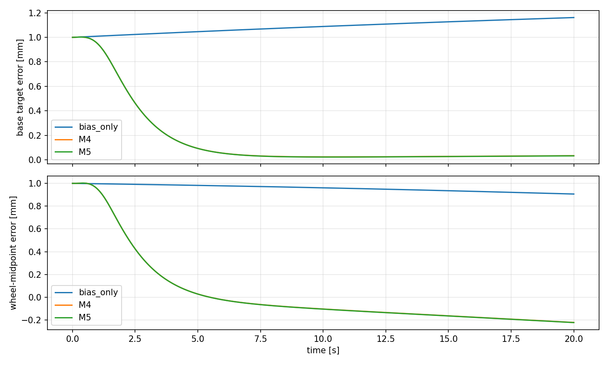
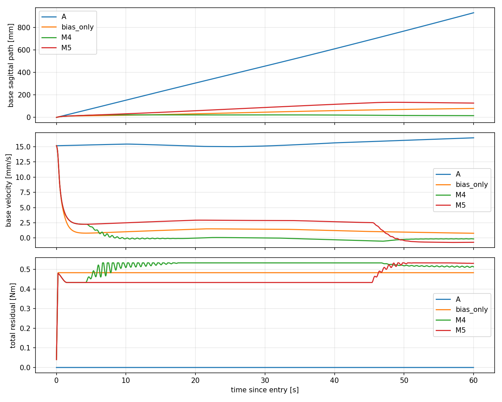

# model_60000 — 단계별 gate를 적용한 야간 M4/M5 실험

작성일: 2026-10-15 (Asia/Seoul)

Execution Domain: **VALIDATION_SIM** (식별·검증·보고: **DESKTOP_DRY_RUN**)

Policy Checkpoint SHA256: `6d3cba9fa76eebe9fb2f40ef23d34115b8b95028ec788571531ffb33ce821a05`

ONNX SHA256: `f44f07ed44970e3ff565eae67fd9229adf0be5c02215591c52a691ffcbb71b2a`

Evidence Status: **FAIL — 연구 성능의 전체 기준.** 단계별 결과를 아래에 구분한다. 파이프라인 정상 종료는 모든 연구 가설의 PASS를 뜻하지 않는다.

Observed Metrics / Behavior / Log Summary:

| 단계 | 실험 | 결과 |
|---|---|---|
| 1 | identification | **PASS**  |
| 2 | independent_affine | **PASS**  |
| 3 | fixed_LQR | **PASS**  |
| 4 | drift_entry | **FAIL**  |
| 5 | mismatch_robustness | **NOT_TESTED** prerequisite stage 4 failed |
| 6 | online_RLS_accuracy | **NOT_TESTED** prerequisite stage 4 failed |
| 7 | adaptive_LQR | **NOT_TESTED** prerequisite stage 4 failed |

**국소 운용점의 Fixed LQR은 두 모델 모두 통과했지만, 초기 drift 진입에서는 M4 PASS, M5 FAIL였다.** 이 구분을 유지하고 선행 gate가 충족되지 않은 mismatch·RLS·Adaptive 실험으로 넘어가지 않았다.

## 1. 파이프라인과 고정한 조건

기존 M4/M5 비교에서는 M5의 상대 개선 한도를 별도로 사용했다. 이번 목표는 M5 자체의 A/B·affine 유효성 검증을 필수로 요구하므로, 상대 개선 FAIL을 이유로 2단계를 생략하지 않았다. 이전 결과와 보고서는 유지한다.

단계1은 기존 train/test 비교의 실제 지표와 frozen hash를 확인한다. 단계2는 A/B를 고정하고 train baseline18개로 offset만 추정한 뒤, 새 seed260/261 × initial pitch−0.035/0/+0.035의6조건, hold1000/1120초의12snapshot에서 독립 검증한다. 총204개8초 probe, baseline12개, 직접B±차분12쌍이다. 모든 미래 yaw rate/action/leg 상태는 모델이 재귀 예측하며 실측값을 주입하지 않는다.

FlashSAC model_60000, 동기화 IMU, 원래 wheel/leg PD와 전체 raw last_action을 유지한다. F-1은 모델 수집에서 OFF다. 고정 bias는 합+0.4828 Nm, physics/control dt는0.005/0.02초다. GT는 제어에 쓰지 않는다.

**주 물리 평가점은 base_link 원점, wheel midpoint는 보조 지표**다. 각 점의 world 이동을 구간 중간 horizontal heading에 투영해 누적한 sagittal path다. 센서 p/v는 기존 rolling odometry이며 이를 base-origin GT로 재정의하거나 보정하지 않았다. 모델의 센서 상태 예측과 물리 제어 평가는 구분한다. Yaw rate는 body gyro와 roll/pitch에서 계산한 heading 변화율이며, M5의 내부 기준값은 train의 비영 평균이다. yaw-rate0 제어 목표를 추가하지 않는다.

각 gate·Q/R·토크 제한은 새 수집 전에 plan.json에 기록했다. 모델 기준은 최초2초 및 rolling0.1/0.5/1/2초 p/v NRMSE 중앙값≤30%, 직접B_v 부호 일치·상대오차≤30%다. Affine baseline은 모든12개에서2초 p/v RMSE≤0.02mm/0.02mm/s,8초≤0.05mm/0.02mm/s를 요구한다. 운영 기준이며 사용자 정량 사양이나 안정성 정리는 아니다.

단계2 실패 시 gain을 생성하지 않는다. 단계3은 먼저 실제 MuJoCo9회 pilot을 실행하고, 통과할 때만324회 비교를 진행한다. 실패/예외/누락 gate는 FAIL로 처리하며 이후 실험은 NOT_TESTED로 남긴다. Resume는 이전 stage artifact·source·plan뿐 아니라 검증된 A/B·gain·snapshot·raw log hash도 검사하고 실패한 단계를 자동 재실행하지 않는다. OS flock으로 동시 coordinator를 막는다.

## 2. 독립 A/B·affine 검증

| 모델 | Affine 최초2초 p/v NRMSE | Affine rolling2초 p/v NRMSE | Baseline PASS | 판정 |
|---|---:|---:|---:|---|
| M4 | 2.83 / 2.63% | 2.28 / 4.86% | 12/12 | PASS |
| M5 | 3.04 / 2.59% | 2.15 / 5.87% | 12/12 | PASS |

같은 초기 조건의 여러 시각·입력은 관련된 응답이다.204회를 독립 초기 조건204개로 해석하지 않는다. Affine는 train18개 baseline의 평균 one-step defect로 offset만 추정했고, 새 검증 결과로 계수나 입력 기준을 재튜닝하지 않았다. 정적 평형을 역산하거나 큰 torque를 외삽하지 않는다.

## 3. Fixed Residual LQR 비교

두 모델 모두 Q_p=Q_v=250000, 나머지 상태 비용0, R=400을 한 번 적용했다. 전체24/25개 상태를 피드백하므로 pitch/action/leg/yaw-rate gain이 생길 수 있다. 단순 p/v PD로 gain 첫 두 개만 분리하지 않는다. 명령은 bias + 제한된−K오차이며 추가보정±0.05Nm(total), smoothstep ramp1.5초, slew2Nm/s다. Gain/reference/Q/R은 전 비교에서 고정했다.

사전 gate는 두 모델 모두 전체 완료 및 pitch/wheel torque 기준, position/kick 각각 base IAE중앙값≤bias의80%, 마지막5초 위치RMSE≤bias의50%, paired IAE개선≥80%다. 무외란은 마지막5초 RMSE≤max(bias+0.05mm,0.1mm), 평균 속도 절댓값≤0.02mm/s다. 실패한 짧은 episode를 작은 drift 성공으로 집계하지 않는다.

| 군 | 조건 | 완료 | Base IAE mm·s | Base 마지막5초 RMSE mm | Wheel-midpoint RMSE mm |
|---|---|---:|---:|---:|---:|
| bias_only | position | 48/48 | 15.0000 | 0.75028 | 0.75006 |
| bias_only | kick | 48/48 | 2.1204 | 0.19240 | 0.03170 |
| bias_only | zero | 12/12 | 2.1948 | 0.19252 | 0.03136 |
| M4 | position | 48/48 | 2.3617 | 0.03185 | 0.19201 |
| M4 | kick | 48/48 | 0.4431 | 0.03217 | 0.19194 |
| M4 | zero | 12/12 | 0.4412 | 0.03213 | 0.19171 |
| M5 | position | 48/48 | 2.3553 | 0.03150 | 0.19236 |
| M5 | kick | 48/48 | 0.4388 | 0.03192 | 0.19219 |
| M5 | zero | 12/12 | 0.4363 | 0.03186 | 0.19200 |

총324회는12snapshot×9조건×3군이다. Position은±0.5/±1mm 목표 변경, kick은±0.01/±0.02Nm를20ms 적용한 뒤 복원이며, 순수한v만 바꾼 상태가 아니다.



## 4. 초기 drift 정지 진입과 후속 단계

새 seed270/271 ×3pitch의6조건에서 FlashSAC-only8초 후 같은 상태를 복제했다. A/bias/M4/M5를60초 비교했다. Bias 전환은2Nm/s로 제한하며 LQR 보정 ramp/제한도 유지한다. 이 초기 상태는 국소 학습 범위 밖일 수 있고 support fraction을 별도 기록한다.

| 군 | 완료 | 최대 planar drift 중앙값 m | 마지막5초 base 속도RMS mm/s | 마지막5초 base 위치범위 mm |
|---|---:|---:|---:|---:|
| A | 6/6 | 0.93421 | 16.4830 | 82.0856 |
| bias_only | 6/6 | 0.07947 | 0.7477 | 3.7217 |
| M4 | 6/6 | 0.02220 | 0.1373 | 0.6821 |
| M5 | 6/6 | 0.13170 | 0.6899 | 3.4353 |

진입 gate는 전체 완료, 각 trial의 최대 planar drift≤bias의80%, 마지막5초 base 속도RMS≤0.2mm/s 및 위치범위≤5mm다. 국소 복원 PASS를 초기 drift 상태의 진입 성공으로 일반화하지 않는다.

### 진입 시 유효 범위와 입력 제한

| 모델 | 비위치 상태 train 범위 내 비율 | 초기 raw 보정 범위 Nm | raw가±0.05Nm를 넘는 시간 비율 |
|---|---:|---:|---:|
| M4 | 0.0% | -0.349～-0.315 | 57.8～61.4% |
| M5 | 0.0% | -3.239～-3.101 | 73.6～86.0% |

좌표별 train min/max 검사이며 다변량 유효성 증명은 아니다. 초기 drift의 내부 상태는 두 모델 모두 국소 수집 범위 밖이었다. Raw 보정이 커도 실제 추가 보정은±0.05Nm를 넘지 않았다. M5의 긴 포화와 진입 실패가 함께 관측됐지만, yaw feedback 하나가 유일한 원인이라고 확정하거나 Q/R을 사후 조정하지 않는다.




**최초 실패 단계는 4 (drift_entry)다.** 이후 단계는 선행 gate 미충족으로 실행하지 않았다. 이를 강건성 또는 Adaptive LQR의 성능 FAIL/PASS로 해석하지 않는다.

단계5가 허용될 경우 mass1.15/1.30, wheel motor gain0.8/1.2, lag0.02/0.05에서 A/bias/F-1/M4/M5의60초 응답을 비교한다. Mass/inertia 변경은 snapshot qpos/qvel을 보존하며, motor 변경은 residual 합산 후 physics substep에 wheel에만 적용한다. 이번 실행 여부는 단계표를 따른다. RLS 및 Adaptive LQR은 선행 단계 통과 전 구현·적용하지 않는다.

## 5. 검증과 재현

파이프라인 수치/흐름 검사6개와 제어 gate/실제 motor 경로 검사4개를 실행했다. Affine FAIL/exception/missing gate의 후속 실행 금지, 실패 단계 재실행 금지, stage 증거 및 검증된 A/B/gain 변조 거부, 재개 후 정확한 skip 사유 갱신, base 기준점 우선 판정, 미완료 episode 거부, nominal motor wrapper의 원래 상태/action/history/torque exact 재현, wheel-only gain/physics-dt lag를 검사한다. 실제 로그는 상위 evidence 폴더의 unit_tests_final.log/control_unit_tests.log다.

기존 runtime·정책·훈련 설정·이전 모델/보고서는 보존한다. 신규 코드6개는 test/run_flash_overnight_pipeline.py, test/flash_overnight_model_stages.py, test/flash_overnight_control_stages.py, test/analyze_flash_overnight_pipeline.py, test/test_flash_overnight_pipeline.py, test/test_flash_overnight_control.py다. 본 보고서와 실험 증거를 추가했다. Hardware·정책 재학습·commit/push 없음. 브랜치 agent/codex/dev_tita_gluon. 최종 agent-check 결과와 기존 변경 보존 감사는 상위 evidence 폴더의 agent_check.log/final_review.json에 기록한다.

```bash
MPLCONFIGDIR=/tmp/lqr_mpl /home/cocel/venvs/cosim_ros2_jazzy/bin/python test/run_flash_overnight_pipeline.py --root docs/exp/2026-10-15/new_overnight/run --workers 3
MPLCONFIGDIR=/tmp/lqr_mpl /home/cocel/venvs/cosim_ros2_jazzy/bin/python test/analyze_flash_overnight_pipeline.py --root docs/exp/2026-10-15/new_overnight/run --report docs/exp/2026-10-15/new_overnight_summary.md
```

기존 root를 재개할 때는 --resume을 사용한다. 실패한 stage를 덮어쓰거나 자동 재튜닝하지 않는다. 실행 중 중단된 RUNNING stage는 증거 확인 없이 재실행하지 않는다.

초기 coordinator 실행은 run/에 보존했다. 재개 시 출력 A/B/gain/raw log를 hash로 묶는 검사를 추가하고 NOT_TESTED 사유가 이전 --through 값에 남는 문제를 수정한 뒤, run_final/에서 같은 사전 기준·계수·초기 조건으로 전체 파이프라인을 다시 실행했다. 주 결과는 run_final/만 사용한다. 두 실행은 같은 조건의 재현이므로 독립 표본 수를 늘려 합산하지 않는다. 초기 실행 source는 coordinator_v1.source.txt로 보존한다.

최종 검증: pipeline6개+control4개 **10개 PASS**. agent-check는 기존 my_flat_env_cfg.py의 trailing whitespace6곳으로 **전체 FAIL**이며, Python syntax402개와 URDF8개 검사는 PASS다. 기존 문제를 수정하거나 전체 검사를 PASS로 바꾸지 않았다.

산출물: [단계 상태](flash_overnight_pipeline/run_final/pipeline_state.json), [사전 계획](flash_overnight_pipeline/run_final/plan.json), [독립 검증](flash_overnight_pipeline/run_final/02_independent_affine.json), [고정 gain](flash_overnight_pipeline/run_final/gains_frozen.json), [Fixed LQR 판정](flash_overnight_pipeline/run_final/03_fixed_LQR.json).
