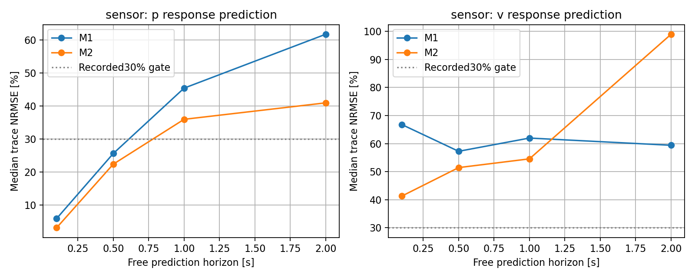
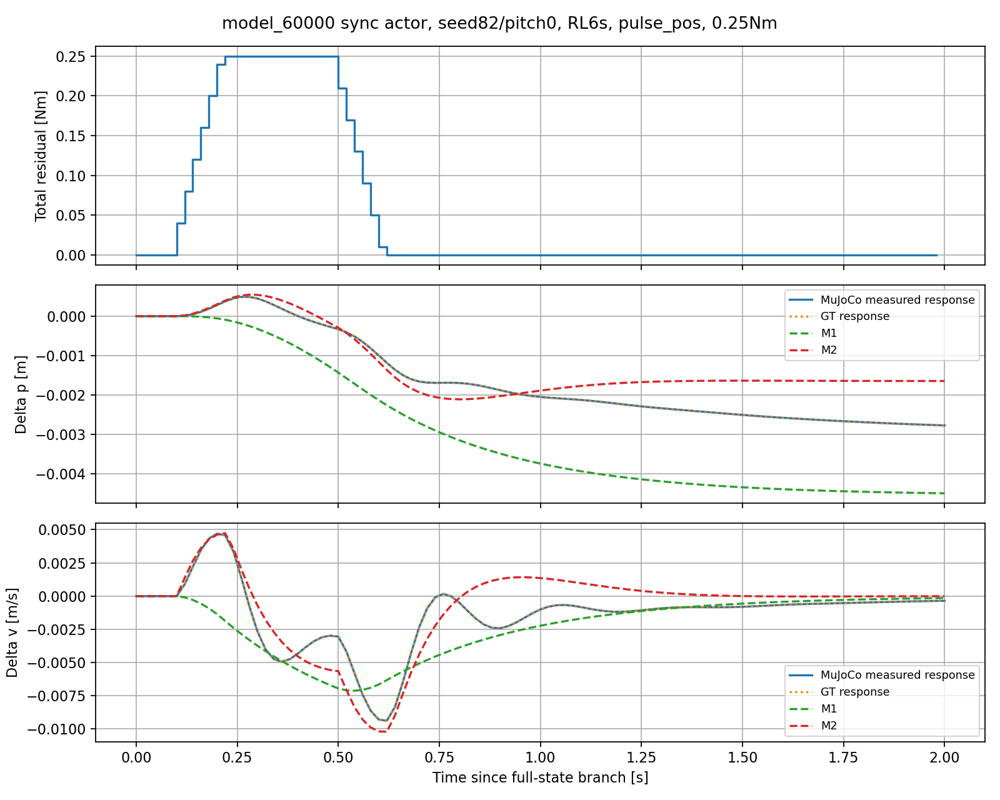
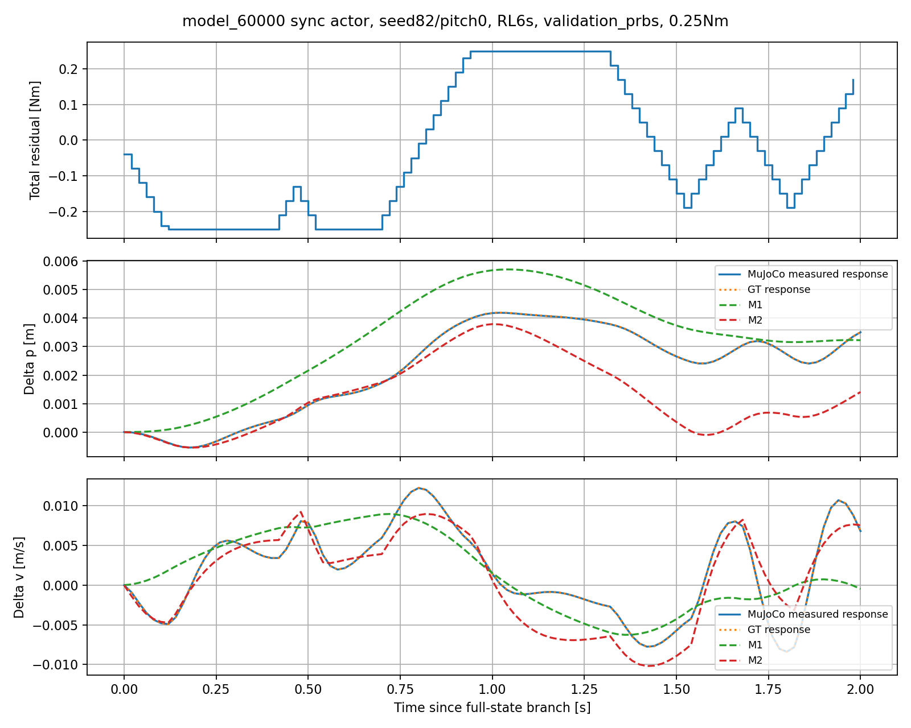

# model_60000 FlashSAC — 2-State와 4-State의 residual → p/v 예측 비교

작성일: 2026-10-15 (Asia/Seoul)

Execution Domain: VALIDATION_SIM (식별·예측 분석: DESKTOP_DRY_RUN)

Policy Checkpoint: `lab/ddt_lab/logs/flash_sac/tita_flash_sac_115632_883848/model_60000/actor.pt`

Policy Checkpoint SHA256: `6d3cba9fa76eebe9fb2f40ef23d34115b8b95028ec788571531ffb33ce821a05`

ONNX SHA256: `f44f07ed44970e3ff565eae67fd9229adf0be5c02215591c52a691ffcbb71b2a`

Evidence Status: **FAIL — M1/M2의 사전 기록한 p/v 예측 기준. PASS — 데이터 수집·동일 상태 분기·센서 경로·기존 소스 보존·수치 검사.** Residual LQR 설계, 실제 정지 제어 개선, 실기: NOT_TESTED.

Observed Metrics / Behavior / Log Summary:

**지정한 model_60000과 동기화 IMU에서, 2-State [p,v] 상수 선형 모델만으로 residual 입력의 p/v 응답을 충분히 설명하지 못했다.** Pitch/pitch-rate를 포함한 4-State는 예측을 개선했지만 충분한 정확도에 도달하지 못했다. Held-out 324개 응답의 2초 자유 예측 p/v NRMSE 중앙값은 M1 **74.4%/69.2%**, M2 **32.6%/48.1%**였다.

M1의 학습 velocity B는 **−0.00242379**로, 같은 새 정책에서 직접 측정한 **+0.02232157**과 부호부터 달랐다. M2는 **+0.03428487**로 부호는 맞았으나 약 **53.6% 과대**였다. Pulse에서는 실제 속도가 먼저 입력 방향으로 반응한 뒤 반대 방향으로 바뀌었지만, M1은 첫 반응부터 반대로 예측했다. 이는 balancing을 FlashSAC에 맡긴다고 해서 그 내부 동역학을 20 ms의 [p,v] Markov 모델에서 생략해도 된다는 근거가 확보되지 않았음을 뜻한다.

이번 결과로 F-1의 p/v feedback 효과를 부정하지 않는다. **좋은 feedback 구조와 정확한 저차 동역학 모델은 별개의 검증 항목**이다. 현재 식별값으로 LQR gain을 만들지 않았다.

## 1. 고정한 폐루프와 모델

기존 model_60000 deterministic actor, 저장된 33-value observation/action 순서·scale·clip, native leg position PD와 wheel velocity PD를 그대로 실행했다. `last_action`은 직전 전체 raw actor output이다. Wheel PD가 만든 토크에 prescribed residual을 더하고 기존 바퀴당 ±12 Nm로 clip했다. Leg 토크는 매 physics substep 원본 ActionAdapter 출력과 정확히 같음을 검사했다.

Actor와 식별 상태 모두 **현재 qpos/qvel 시점에 mjData clone을 mj_forward한 IMU**를 사용했다. 원본 physics cache를 refresh하지 않았다. F-1 위치 feedback과 online adaptation은 적용하지 않았다. 입력은 학습한 제어기가 아닌 미리 정한 probing torque다.

```text
M1: x = [encoder path p, encoder/IMU velocity v]
M2: x = [p, v, IMU pitch, IMU pitch_rate]

delta_x = residual branch state - matched zero-residual branch state
delta_x_next ≈ A * delta_x + B * actual_total_residual
```

두 모델에 동일한 train transitions와 실제 적용 입력을 사용했다. Intercept 없는 offline least squares이며 **두 모델 모두 A의 첫 열을 [1,0,...]로 고정**했다. 평탄 접촉에서 위치 translation을 정책이 관측하지 않고 wheel position observation도 0으로 처리하는 대칭을 반영했다. 나머지 계수는 열 RMS scale 후 동일 rcond=1e-10으로 계산했다. 추가 상태, regularization tuning, nonlinear 모델은 비교하지 않았다.

주 상태 p는 encoder/IMU sagittal 경로이며 world x/y position이 아니다. GT axle path/velocity는 평가 대조에만 썼다. Pitch는 M2의 후보 내부 상태이며 **성공 기준은 p/v만**이다. Pitch 제어 gain이나 비용함수를 설계하지 않았다.

## 2. 수집과 학습/검증 분리

| 구분 | 초기 조건 | 시작 상태 | 입력 | 응답 수 | transitions |
|---|---|---|---|---:|---:|
| Train | seeds80/81 × initial pitch −0.025/0/+0.025 rad | RL 4/6/8초 | 무작위 위상 sine, PRBS × 3 amplitudes | **108** | **10,800** |
| Held-out | seeds82/83 × 동일 pitch 범위 | RL 4/6/8초 | 새 sine, 새 PRBS, ±step, ±pulse × 3 amplitudes | **324** | **32,400** |

- Physics/control dt = 0.005/0.02 s. 모든 응답은 2초, N=100 입력과 N+1=101 상태를 저장했다.
- Amplitude는 합 0.1/0.25/0.5 Nm, 합 torque slew 2 Nm/s다. Actual torque와 요청값 차이는 1e-6 Nm 미만이었다. 초기부터 slew를 적용하며 F-1의 feedback activation ramp를 식별 입력에 중복 적용하지 않았다.
- Train sine: 0.43/1.37/3.17/6.23 Hz. Validation sine: 0.67/1.91/4.31/7.13 Hz. 위상은 초기 조건·분기 시각·amplitude별로 무작위화했다.
- Train PRBS block은 1/3/5/9 control steps, validation은 3/7/11 steps다. Seed를 분리했다. PRBS도 slew 이후 실제 입력으로 회귀한다.
- Startup은 기존 transform_up → RL 경로다. Seed별 초기 vx ±0.015 m/s와 leg velocity 작은 perturbation을 적용했다. Floor 외 world obstacle은 **모델 메모리에서만** 비활성화했다. 외란 push나 dynamics mismatch는 적용하지 않았다.
- 모든 snapshot에서 전체 mjData, fresh sensor clone, raw last_action, encoder 적분 이전 상태, GT 적분 상태를 복제했다. 입력 0 분기는 36개 시작 상태에서 원래 prefix의 sensor/GT/position/rpy·action·motor·observation·history와 정확히 일치했다.
- 같은 상태에서 ±0.01/0.02/0.04 Nm의 20 ms 입력으로 직접 B도 측정했다. Train 54쌍, held-out 54쌍이며 첫 actor output은 대응 zero branch와 같았다.
- M1/M2 matrices는 **train만으로 계산·저장한 다음** held-out 응답을 읽었다. Validation을 보고 재식별하거나 모델/입력 조건을 튜닝하지 않았다.

초기 기립 전환을 정상 정지 조건과 혼동하지 않았다. 첫 smoke는 RL 진입 즉시의 낮은 sit 자세/soft joint-limit 위반을 실패로 처리해 중단됐다. Startup 진단에서 이후 정상 자세로 전환됨을 확인하고, **첫 RL 1초의 위반을 별도 기록하며 모델 수집에서 제외**하도록 collector를 수정했다. 본 수집 전 manifest에 이 규칙을 기록했다. 실제 snapshot은 RL 4초 이후이며 모든 본 응답에서 failure guard를 통과했다. 초기 실패 smoke는 결과에 포함하지 않고 accepted smoke 4개 응답은 본 432개와 구분한다.

6개 초기 조건과 18개 분기에서 나온 응답들은 서로 관련돼 있다. 324회를 독립 초기 조건 324개로 해석하거나 모집단 유의성을 주장하지 않는다. 초기 perturbation이 충분히 settle된 이후의 제한된 nominal 조건이다.

## 3. 판정 기준과 지표

본 수집 전 [manifest.json](flash_pv_model_comparison/full/manifest.json)에 기록한 운영 기준:

1. Held-out 각 trace의 **0.1/0.5/1초 free prediction p/v response NRMSE 중앙값 모두 ≤30%**.
2. 분기 시 delta_state=0에서 시작한 **전체 2초 자유 예측 p/v NRMSE 중앙값 모두 ≤30%**.
3. Velocity B와 held-out 직접 B 중앙값의 상대 차이 ≤30%.

이는 사용자의 정량 사양이나 LQR 안정성 정리가 아니라 이번 진단용 threshold다. 결과를 본 뒤 바꾸지 않았다. Threshold만으로 모든 2-State 모델의 가능성을 배제하지 않으며, B 부호 및 pulse 시간 응답도 함께 판단한다.

```text
response NRMSE = RMS(predicted_delta - actual_delta) / RMS(actual_delta)
```

분모 floor는 p=1e-7 m, v=1e-5 m/s이며 전체 2초에서 floor 아래인 trace는 두 성분 모두 0개였다. NRMSE=100%는 delta=0 예측과 같은 RMS 오차다.

여러 step 평가는 각 trace의 시작점을 5 steps 간격으로 옮겨, 실제 상태에서 한 번 초기화하고 해당 horizon 동안 상태를 재주입하지 않는다. 알려진 실제 미래 입력은 제공한다. 전체 2초 평가는 branch 시작에서 한 번만 초기화한다. 둘의 시작점/집계가 다르므로 2초 endpoint-window 결과와 전체 2초 RMS를 혼용하지 않는다.

## 4. p/v 예측 결과

각 trace 지표의 중앙값이다. RMSE 중앙값을 signal RMS 중앙값으로 나눈 값이 NRMSE 중앙값과 같을 필요는 없다.

| 모델 | One-step p RMSE mm | One-step v RMSE mm/s | 전체 2초 p RMSE mm | 전체 2초 v RMSE mm/s | 전체 2초 p NRMSE | 전체 2초 v NRMSE |
|---|---:|---:|---:|---:|---:|---:|
| M1 [p,v] | 0.008616 | 0.6419 | 1.5426 | 2.8034 | **74.42%** | **69.21%** |
| M2 [p,v,pitch,rate] | 0.007775 | 0.5800 | 0.6151 | 1.8811 | **32.62%** | **48.13%** |

One-step persistence의 p/v RMSE 중앙값은 0.07114 mm/0.7056 mm/s였다. 실제 한 step velocity 변화 RMS로 나눈 오차의 중앙값은 M1 95.5%, M2 67.6%였다. 한 step에서 실제 상태를 계속 제공하면 두 모델 모두 연속성을 이용해 좋은 점수를 낼 수 있지만, 그 점수가 residual 입력의 누적 효과 예측을 보장하지 않는다. 절대 오차는 mm 수준이지만 작은 residual이 만드는 응답 자체와 비교하면 비중이 크다.

| 자유 예측 horizon | M1 p NRMSE | M1 v NRMSE | M2 p NRMSE | M2 v NRMSE |
|---|---:|---:|---:|---:|
| 0.1초 | 5.86% | **66.77%** | 3.07% | **41.33%** |
| 0.5초 | 25.57% | **57.26%** | 22.34% | **51.45%** |
| 1.0초 | 45.39% | **61.98%** | 35.94% | **54.57%** |
| 2.0초 endpoint window | 61.72% | 59.40% | 40.93% | 98.96% |



GT p/v로 교차 평가한 전체 2초 NRMSE는 M1 **74.15%/69.06%**, M2 **32.70%/48.10%**로 비슷했다. 별도 GT 모델을 재학습한 결과는 아니며, 같은 frozen matrices를 GT delta state에 적용한 대조다. 센서 odometry와 GT의 차이가 현재 모델 오차의 주된 설명으로 보이지 않는다.

| Held-out 입력별 전체 2초 NRMSE | M1 p / v | M2 p / v |
|---|---:|---:|
| Positive pulse | 76.74% / 69.67% | 31.76% / 53.77% |
| Negative pulse | 53.83% / 63.46% | 39.39% / 48.15% |
| Positive step | 85.87% / 69.14% | 20.28% / 41.10% |
| Negative step | 56.72% / 48.25% | 32.75% / 46.90% |
| 새 PRBS | 70.37% / 74.31% | 34.26% / 47.32% |
| 새 sine | 68.67% / 94.11% | 48.68% / 50.91% |

M2는 전반적으로 더 나았지만 모든 개별 지표에서 우월하지는 않았다. 입력 종료 후 실측 상태에서 A만 전개한 108개 pulse의 tail NRMSE 중앙값 p/v는 M1 **53.27%/79.83%**, M2 **42.85%/85.20%**였다. Pitch를 추가한 것만으로 후속 속도 응답까지 충분히 설명하지는 못했다.

## 5. 즉시 B와 pulse의 초기 방향

이번 정책/센서 경로에서 새로 측정한 B다. 과거 model_100000의 B를 재사용하지 않았다.

| 모델/측정 | B_p m/Nm | B_v (m/s)/Nm | 직접 B_v 대비 상대 오차 |
|---|---:|---:|---:|
| M1 | **−0.0000324103** | **−0.002423793** | **110.86%**, 부호 반대 |
| M2 | +0.0004577112 | +0.034284874 | **53.60%** |
| Held-out 직접 B 중앙값 | +0.0002974678 | **+0.022321571** | 기준 |

Train 상태에서 직접 측정한 B_v 중앙값도 +0.022321246으로 held-out과 비슷하다. Held-out 직접 B_v 범위는 +0.022320178–+0.022322255였고, GT 중앙값은 +0.022352195였다. 따라서 모델과 직접 B의 차이를 train/validation 동작점 차이나 sensor-vs-GT만으로 설명하기 어렵다.

M1의 matrices:

```text
A2 = [[1, 0.0193171582],
      [0, 0.9466083784]]
B2 = [-0.0000324103434, -0.002423793324]
```

이 fitted velocity 식은 delta_v=0에서 양의 입력을 주면 처음부터 음의 속도 변화를 예측한다. 하지만 실제 matched pulse는 **먼저 양의 반응, 이후 음의 반응**을 보였다. M1이 뒤쪽의 보정 응답을 근사하는 계수를 얻더라도 초기 입력 효과와 후속 balancing 반응을 함께 대표하지 못한다. 이 그림만으로 내부 원인이 pitch 하나라고 확정하지 않는다.





## 6. 식별 정보량과 해석의 한계

| 진단 | M1 | M2 |
|---|---:|---:|
| RMS scale 회귀행렬 condition number | 1.1581 | 13.1657 |
| Rank | 2/2 | 4/4 |
| 현재 관측 상태 제거 후 남는 입력 에너지 | **97.88%** | **3.97%** |

M1은 현재 v와 입력의 공선성이 커서 rank가 부족한 경우가 아니다. 오히려 내부 상태를 생략한 모델에 입력 효과를 회귀시키면 직접 입력 미분과 다른 유효 계수를 얻을 수 있다는 해석과 맞는다.

M2는 pitch/rate를 포함하면 입력과 관측 상태의 결합이 강해졌다. 새 PRBS와 randomized phase를 사용했어도 slew 이후 입력과 상태의 상관을 충분히 없앴다는 뜻은 아니다. 따라서 M2의 B와 A 오차에 남은 excitation/omitted-history/비선형성의 기여를 이번 비교만으로 나누지 못한다. 이는 **이전 다른 체크포인트·cached actor 데이터의 잔여 입력 88%와 다른 실험**이며 서로 모순된 결과가 아니다.

현재 판단은 **비교한 20 ms, translation symmetry를 반영한 상수 계수 M1/M2가 둘 다 충분하지 않다**는 것이다. 다른 샘플링 속도, operating region, 식별 데이터 또는 모델 구조의 모든 가능성을 배제한 결론은 아니다. 특히 4-state 예측 실패가 pitch 정보가 쓸모없다는 뜻도 아니다.

다음 후보는 이전 action/센서 delay/leg 상태와의 조건부 응답 검토지만, 이번 범위에서 상태를 더 늘리거나 controller를 추가하지 않았다. 4-state에서 pitch cost를 0으로 하는 설계나 p/v만 feedback하는 제약 설계도 실행하지 않았다. **p/v만 feedback할지와 dynamics에 어떤 상태가 필요한지는 계속 구분해야 한다.**

## 7. 검증·변경 범위·재현

- 신규 `test/eval_flash_pv_models.py`, `test/analyze_flash_pv_models.py`, `test/test_flash_pv_models.py`, 본 보고서와 증거 폴더만 추가했다. `residual_wheel_pd.py`, node, CLI, launch 등 기존 runtime 제어 소스는 변경하지 않았다.
- 본 수집 **432개 response + 108개 직접 B 차분 쌍 + 36개 zero replay** PASS. Accepted smoke는 별도 4개 response/3개 차분 쌍/1개 replay PASS이며 모델 학습에 포함하지 않았다.
- 독립 합성 수치 검사 **3개 PASS**: 알려진 2/4-state matrices 복원, matrix-power convolution을 통한 모든 예측 horizon 입력 시점 검사, probing bound/slew/위상 무작위화 확인. 단위 검사는 실제 모델의 정확도 PASS를 의미하지 않는다.
- 실행 전후 체크포인트·ONNX/config·package runtime source hash 보존 PASS. M1/M2 frozen file도 validation 전후 hash 동일: completion.json, analysis_integrity.json.
- `agent-check.sh`는 **전체 FAIL**이다. Python syntax **366개 PASS**, URDF XML **8개 PASS**지만, 기존 수정 파일 `my_flat_env_cfg.py`의 trailing whitespace로 저장소 diff 검사가 실패했다. 이 파일은 수정하지 않았다. 이번 신규 파일의 diff 및 기존 runtime source 보존은 별도로 PASS다. 증거: agent_check.log, final_review.json. 브랜치: `agent/codex/dev_tita_gluon`.
- Hardware 실행, 재학습, Dynamics mismatch, nonzero velocity-command 평가, 새 LQR feedback 적용은 수행하지 않았다. 기존 model_50000/100000 보고서의 성능과 이번 결과를 직접 비교하지 않는다.

```bash
MPLCONFIGDIR=/tmp/lqr_mpl /home/cocel/venvs/cosim_ros2_jazzy/bin/python test/test_flash_pv_models.py
MPLCONFIGDIR=/tmp/lqr_mpl /home/cocel/venvs/cosim_ros2_jazzy/bin/python test/eval_flash_pv_models.py --output docs/exp/2026-10-15/new_flash_pv_models --workers 3
MPLCONFIGDIR=/tmp/lqr_mpl /home/cocel/venvs/cosim_ros2_jazzy/bin/python test/analyze_flash_pv_models.py --root docs/exp/2026-10-15/new_flash_pv_models
./scripts/agent-check.sh
```

산출물: [summary.json](flash_pv_model_comparison/full/summary.json), [models.json](flash_pv_model_comparison/full/models.json), [direct_B_summary.json](flash_pv_model_comparison/full/direct_B_summary.json), training_data.npz, response_metrics.json, pulse_metrics.json, metrics.csv, 각 context NPZ, 그래프와 실행/검사 로그. Models는 이 실험의 예측 검증용이며 runtime 설정에 연결하지 않았다.
