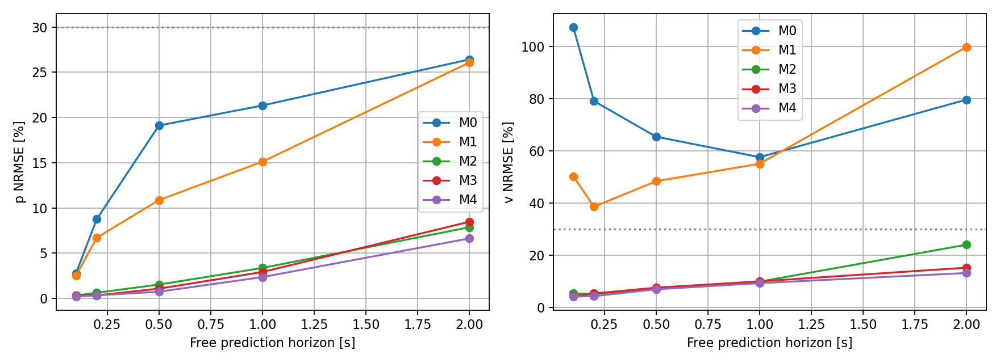
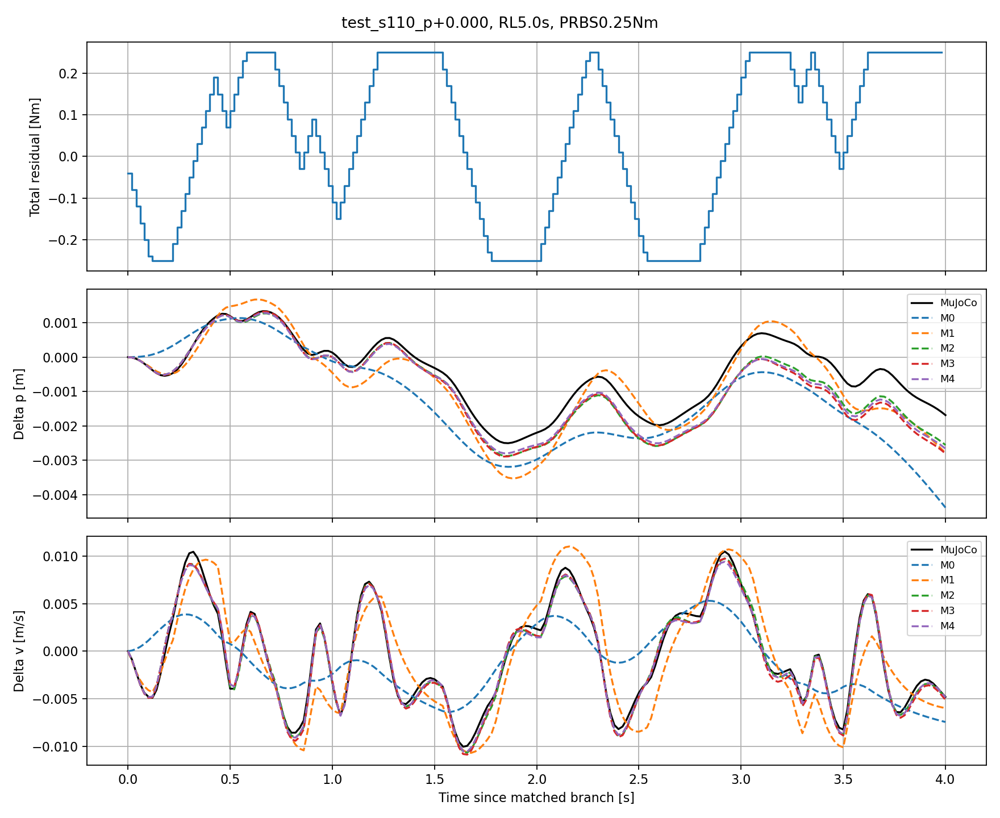
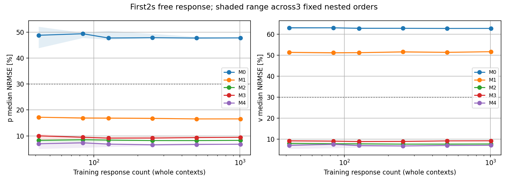

# model_60000 — 상태 구성과 데이터 양에 따른 FlashSAC 폐루프 식별

작성일: 2026-10-15 (Asia/Seoul)

Execution Domain: VALIDATION_SIM (모델 식별·학습곡선·무결성 검사: DESKTOP_DRY_RUN)

Policy Checkpoint: `lab/ddt_lab/logs/flash_sac/tita_flash_sac_115632_883848/model_60000/actor.pt`

Policy Checkpoint SHA256: `6d3cba9fa76eebe9fb2f40ef23d34115b8b95028ec788571531ffb33ce821a05`

ONNX SHA256: `f44f07ed44970e3ff565eae67fd9229adf0be5c02215591c52a691ffcbb71b2a`

Evidence Status: **PASS — M2/M3/M4의 확대 데이터 전체 집계 기준, action 시점·추가 상태 재귀 예측·수집 무결성. FAIL — M0/M1의 p/v 예측 기준. SUSPICIOUS — 일부 pulse tail의 장기 상대 오차.** 정지 affine 모델·평형 residual·LQR·online identification·실물 검증: NOT_TESTED.

Observed Metrics / Behavior / Log Summary:

**이 동작 영역에서 이전 실패의 주된 설명은 단순한 transition 수 부족보다 상태 표현의 부족이었다.** 기존 108개 train 응답을 그대로 재현하고 previous raw FlashSAC action을 상태에 넣자, 같은 324개 validation 응답의 2초 p/v NRMSE가 **32.62%/48.13% → 8.96%/9.09%**로 줄었다. 직접 B_v와의 차이도 **53.60% → 0.79%**였다.

독립적인 확대 실험에서는 1,008개 train 응답과 별도 504개 test 응답을 사용했다. M2(previous action 추가)는 **8.26%/7.68%**, M4(previous action+leg state)는 **6.80%/7.04%**의 2초 p/v NRMSE를 보였다. 직접 B_v 오차는 각각 **1.00%/0.60%**였다. 두 모델 모두 504개 test trace 각각의 첫 2초 p/v NRMSE가 30% 이하였다. 미래 action·다리 상태는 실측값으로 주입하지 않고 모델이 함께 예측했다.

같은 확대 데이터 pool에서 train을 42→1,008개 응답으로 늘려도 M0/M1의 속도 오차는 약 63%/51%에서 거의 정체됐다. M2~M4도 일찍 낮은 오차에 도달하고 이후 변화가 작았다. 따라서 **현재 nominal 영역에서는 상태를 보완하는 것이 같은 종류의 데이터 양만 늘리는 것보다 효과적**이었다. 이 결과는 정지 평형점이나 Online LQR의 실제 안정성까지 확인한 것은 아니다.

## 1. 범위와 모델 이름

이번 작업은 요청한 **1단계: 상태 구성과 데이터 양에 따른 A/B 식별 정확도 분석**이다. 이후 정지 동역학 → LQR → online identification은 연구 순서로 보존하며 이번에는 실행하지 않았다.

| 모델 | 상태 | 차원 |
|---|---|---:|
| M0 | p,v | 2 |
| M1 | p,v,pitch,pitch_rate | 4 |
| M2 | M1 + previous raw actor action 8개 | 12 |
| M3 | M1 + leg joint position 6개/velocity 6개 | 16 |
| M4 | M1 + previous action 8개 + leg position/velocity 12개 | 24 |

**이번 M0/M1은 이전 보고서의 M1/M2에 해당한다.** 새 M2~M4와 이름을 혼동하지 않는다. 다리 상태는 native 순서의 좌/우 leg_1..3이며 wheel joint position은 추가하지 않았다.

모든 상태는 대응 zero-residual 궤적과의 차이로 정의했다.

```text
delta_z[t] = z_with_residual[t] - matched_zero_residual[t]
delta_z[t+1] ≈ A * delta_z[t] + B * actual_total_residual[t]
```

Frozen deterministic actor, 원래 observation/action order·scale·clip, wheel velocity P/leg PD를 실행했다. Wheel torque에만 작은 prescribed residual을 더하고 기존 바퀴당 ±12 Nm saturation을 유지했다. Actor와 estimator는 같은 현재 시점의 clone-refreshed IMU를 받는다. 실제 physics cache는 수정하지 않았다. Command는 전 구간 0이다. F-1 feedback·RLS·정책 재학습은 없다.

식별 목표는 전체 선택 상태의 다음 값이며, 성공 지표는 요청한 세 가지인 **직접 B, p/v 시간 응답, 데이터 학습곡선**으로 제한했다. Pitch/leg/action 예측은 p/v 동역학을 닫기 위한 내부 상태이며 별도 제어 목표로 설정하지 않았다.

## 2. Previous action의 정확한 시점과 재귀 예측

```text
현재 모델 상태 z[t].previous_action = a[t-1]
현재 actor: a[t] = policy(observation[t], a[t-1])
현재 physics 입력: torque_FlashSAC(a[t]) + residual[t]
다음 모델 상태 z[t+1].previous_action = a[t]
```

모든 저장 trace에서 `previous_action[:-1] == history`와 `previous_action[1:] == action`을 배열 전체로 exact 검사했다. Residual Nm를 actor action 단위에 섞지 않았다.

현재 residual은 actor를 실행한 뒤 physics에 적용하므로 **다음 previous-action의 직접 B 행은 0**이다. 동일 상태에서 ±토크를 가한 직접 차분에서도 8개 action B 행이 정확히 0임을 확인했다. M2/M4의 해당 B 행만 이 인과 조건으로 고정하고, 그 상태의 A 행은 관측 상태로 회귀했다. p/v/leg B는 자유롭게 식별했다.

모든 모델에서 위치 translation 대칭에 따라 A 첫 열을 [1,0,...]로 고정했다. 나머지는 intercept 없는 RMS-scale least squares, rcond=1e-10이다. Test에 맞춘 regularization·gain tuning은 없다.

자유 예측은 시작 상태 하나와 미래 입력만 제공한다. 선택한 12/16/24개 상태 **전부**를 A/B로 전개하며, 미래 actor를 별도로 호출하거나 실측 action·leg state를 다시 넣지 않는다. [hidden_state_prediction_example.npz](flash_state_learning/expanded/hidden_state_prediction_example.npz)에 실제 24-state와 각 모델의 전체 미래 예측을 저장했다. 독립 matrix-power convolution 검사도 2/4/12/16/24-state 전체에서 통과했다.

## 3. 두 데이터 cohort와 독립성

### A. 기존 데이터 재현 — 상태 추가 효과 분리

기존 model_60000 데이터의 train 108개/10,800 transitions, validation 324개/32,400 transitions를 다시 실행하면서 action·leg state만 추가 기록했다. 기존 prefix 및 432개 응답의 sensor/GT/position/rpy·raw action·motor/Flash torque·observation/history·입력 배열이 **전부 exact 일치**했다. M0/M1 A/B도 이전 matrices와 수치 허용오차 내에서 재현했다.

따라서 아래 archive 비교의 개선은 초기 조건, 입력, 센서 시점 또는 checkpoint 변경으로 만든 결과가 아니다. 이 validation은 이미 이전 실험에서 관찰한 데이터이므로 별도의 blind test라고 부르지 않는다.

### B. 확대 데이터 — 새 held-out cohort와 학습곡선

| 구분 | 초기 조건 | Snapshot | 응답 길이 | 응답 수 | transitions |
|---|---|---|---:|---:|---:|
| Train | seeds100..107 × initial pitch −0.035/0/+0.035 | RL 4/8초 | 4초 | **1,008** | **201,600** |
| Test | seeds110..113 × 같은 pitch 범위 | RL 5/9초 | 4초 | **504** | **100,800** |

- 초기화와 startup은 기존 validated Runner를 재사용했다. 첫 RL 1초는 startup 위반을 별도로 기록하고 snapshot 영역에서 제외한다. 모든 수집 응답은 정상 failure guard를 통과했다.
- 새 cohort의 prefix에는 RL 1~3.88초에 seed별 최대 0.2 Nm의 작은 conditioning 입력을 넣었다. 4초까지 0으로 복귀하며 이후 snapshot/zero baseline 구간의 입력은 0이다. 같은 command=0에서 서로 다른 내부 상태를 확보하려는 입력이며 feedback 제어기가 아니다. Archive cohort prefix는 기존처럼 입력 0이다.
- Train은 random-phase sine, PRBS, 양/음 pulse·step의 0.1/0.25/0.5 Nm 입력을 사용한다. 추가 micro-PRBS는 0.01/0.02/0.04 Nm이며, 0.02 Nm에서는 ±전환이 기존 2 Nm/s slew 내에서 한 step에 가능하다.
- Test는 다른 seeds·snapshot 시각·sine 주파수/위상·PRBS block/sequence를 사용한다. Pulse/step의 함수 형태와 amplitude는 train에도 있다. **모든 test 파형이 학습에서 없던 종류였다고 주장하지 않는다.** Trajectory는 분리하고, 새로운 sine/PRBS/micro-PRBS 일반화도 따로 확인했다.
- Physics/control dt는 0.005/0.02초. 전체 actor wheel/leg 토크를 보존하고 residual 합산·바퀴당 saturation 이후의 실제 추가 합 토크를 입력으로 사용한다. 적용 차이 <1e-6 Nm, 합 amplitude ≤0.5 Nm, slew ≤2 Nm/s다.
- 전체 mjData, fresh sensor clone, raw history, estimator/GT 적분 이전 상태를 복제했다. Archive 36개/확대 72개 zero replay는 원래 prefix의 전체 상태·observation·action·motor/history와 정확히 일치한다.
- 직접 B는 각 snapshot에서 ±0.01/0.02/0.04 Nm 한 step 차분으로 측정했다. Archive 108쌍, 확대 216쌍이며 최초 actor action은 대응 zero branch와 같다.

### 데이터 양 비교 방법

확대 train의 **24개 초기 조건(context)**을 단위로 고정 permutation 3개(seeds701/702/703)를 만들었다. 각 순서에서 1/2/3/6/12/24개 context를 중첩해 **42/84/126/252/504/1,008개 응답**으로 늘렸다. 각 context는 두 snapshot과 21개 입력 조합을 포함한다. 연속 transition을 무작위로 나눠 서로 다른 시점의 같은 trajectory가 train/test에 들어가게 하지 않았다.

모든 후보 모델·학습 크기를 **test 배열을 읽기 전에** 계산하고 frozen file로 저장했다. 그 뒤 같은 504개 test에 평가했다. 각 순서의 부분 집합은 서로 관련돼 있고, 최대 크기는 같은 전체 데이터라 한 번만 fit했다. 그래프 음영은 데이터 선택 순서 3개 사이의 범위이며 신뢰구간이 아니다.

Archive와 확대 cohort는 입력·길이·prefix가 다르다. 두 cohort 사이의 개선을 데이터 양만의 효과로 해석하지 않는다. **학습량 효과는 확대 cohort 내부의 같은 프로토콜 곡선으로 판단한다.**

## 4. 직접 B와 p/v 예측

본 수집 전 manifest에 기록한 진단 기준은 p/v NRMSE 중앙값 ≤30%(0.1/0.5/1/2초 rolling 자유 예측 및 첫 2초 전체 응답), velocity B 상대 오차 ≤30%와 부호 일치다. 이는 완벽한 A/B를 요구하는 기준이나 LQR 안정성 증명이 아니다.

```text
response NRMSE = RMS(predicted_delta - measured_delta) / RMS(measured_delta)
```

분모 floor는 p=1e-7 m, v=1e-5 m/s다. 첫 2초는 branch의 같은 초기 상태에서 한 번 초기화한다. Rolling horizon은 각 trace 안에서 10 steps 간격의 시작 상태를 제공하고 해당 horizon 동안 전체 상태를 재귀 예측한다. 이전 보고서의 rolling stride=5와 다르며, **archive의 첫 2초 전체 지표와 A/B는 그대로 재현**한다. Endpoint-window와 전체 구간 RMS도 구분한다.

### 같은 기존 108개 train 응답에서 상태만 바꾼 결과

| 모델 | 첫 2초 p NRMSE | 첫 2초 v NRMSE | B_v (m/s)/Nm | 직접 B_v 오차 | 전체 진단 기준 |
|---|---:|---:|---:|---:|---|
| M0 | 74.42% | 69.21% | −0.002423793 | 110.86% | FAIL |
| M1 | 32.62% | 48.13% | +0.034284874 | 53.60% | FAIL |
| **M2** | **8.96%** | **9.09%** | **+0.022498003** | **0.79%** | **PASS** |
| M3 | 11.62% | 10.71% | +0.022845097 | 2.35% | FAIL: 2초 endpoint v=34.31% |
| M4 | 10.92% | 10.19% | +0.022319008 | 0.01% | FAIL: 2초 endpoint v=31.18% |

Archive 직접 B_v 중앙값은 +0.022321571이다. 이전 action 추가만으로 같은 데이터에서 부호·크기와 시간 응답이 동시에 개선됐다. M3/M4도 전체 응답은 크게 좋아졌지만 가장 긴 endpoint 기준은 통과하지 못했다.

### 확대 cohort: 1,008 train / 504 test

| 모델 | 첫 2초 p NRMSE | 첫 2초 v NRMSE | p RMSE mm | v RMSE mm/s | B_v | 직접 B_v 오차 | 기준 |
|---|---:|---:|---:|---:|---:|---:|---|
| M0 | 47.79% | 62.81% | 0.8012 | 2.2058 | −0.002024379 | 109.07% | FAIL |
| M1 | 16.55% | 51.71% | 0.2717 | 1.5427 | +0.026338396 | 18.00% | FAIL |
| **M2** | **8.26%** | **7.68%** | **0.1455** | **0.2301** | **+0.022543879** | **1.00%** | **PASS** |
| M3 | 9.45% | 9.21% | 0.1503 | 0.2693 | +0.022774236 | 2.03% | PASS |
| **M4** | **6.80%** | **7.04%** | **0.1173** | **0.2135** | **+0.022454718** | **0.60%** | **PASS** |

Test 직접 B_p/B_v는 +0.0002974515/+0.0223206401이다. 표의 RMSE/NRMSE는 각 trace 지표의 중앙값이다. M2/M4의 첫 2초 NRMSE 최대 p/v는 각각 **29.67%/15.75%**, **28.00%/16.58%**로, 이 구간의 504개 trace 모두 두 성분에서 30% 이하였다. 이 구간에서 signal floor에 걸린 trace도 없다.

| Horizon | M0 p/v % | M1 p/v % | M2 p/v % | M3 p/v % | M4 p/v % |
|---|---:|---:|---:|---:|---:|
| 0.1초 | 2.78 / 107.35 | 2.51 / 50.28 | 0.30 / 5.36 | 0.33 / 4.28 | 0.18 / 4.14 |
| 0.2초 | 8.76 / 79.02 | 6.70 / 38.57 | 0.61 / 5.19 | 0.32 / 5.36 | 0.32 / 4.34 |
| 0.5초 | 19.11 / 65.38 | 10.86 / 48.34 | 1.52 / 7.16 | 1.06 / 7.57 | 0.73 / 6.95 |
| 1.0초 | 21.33 / 57.55 | 15.11 / 55.03 | 3.35 / 9.89 | 2.91 / 9.99 | 2.34 / 9.32 |
| 2.0초 | 26.43 / 79.60 | 26.08 / 99.80 | **7.86 / 24.03** | 8.47 / 15.24 | **6.62 / 13.19** |

동일 frozen model의 예측을 GT delta p/v와 비교해도 첫 2초 오차는 M2 **8.07%/7.57%**, M4 **6.65%/6.89%**로 비슷하다. 별도 GT 모델을 학습한 것이 아니다.





## 5. 학습 데이터가 부족했는가?

확대 cohort 내부, 각 학습 크기의 고정 순서 3개에서 얻은 **test 첫 2초 NRMSE의 중앙값**이다. 전체 1,008개는 공통 데이터이므로 한 번 계산했다.

| Train 응답 수 | M0 p/v % | M1 p/v % | M2 p/v % | M3 p/v % | M4 p/v % |
|---|---:|---:|---:|---:|---:|
| 42 | 48.81 / 63.13 | 17.19 / 51.34 | 8.28 / 7.93 | 10.01 / 9.21 | 6.96 / 7.03 |
| 84 | 49.39 / 63.10 | 16.88 / 51.20 | 8.51 / 7.80 | 9.47 / 9.06 | 7.32 / 7.53 |
| 126 | 47.75 / 62.85 | 16.83 / 51.23 | 8.40 / 7.76 | 9.15 / 8.85 | 6.83 / 6.92 |
| 252 | 47.85 / 62.86 | 16.76 / 51.63 | 8.20 / 7.61 | 9.16 / 8.88 | 6.56 / 6.75 |
| 504 | 47.73 / 62.80 | 16.54 / 51.38 | 8.20 / 7.62 | 9.34 / 9.16 | 6.68 / 6.96 |
| 1,008 | 47.79 / 62.81 | 16.55 / 51.71 | 8.26 / 7.68 | 9.45 / 9.21 | 6.80 / 7.04 |



M0/M1은 데이터를 24배 늘려도 큰 폭의 오차 감소가 없고 velocity B도 M0는 반대 부호로 남았다. M2/M4는 작은 학습 집합부터 낮은 오차를 얻고, 더 많은 데이터에서 값이 조금 바뀌며 선택 순서에 대한 변동이 줄었다. 예를 들어 M4의 p 오차 범위는 42개에서 **4.96–7.30%**, 504개에서 **6.46–7.27%**였다. 데이터 증가가 평균 성능을 단조롭게 개선한 것은 아니다.

이는 **관찰한 영역에서 표본 수 부족이 M0/M1 실패의 주된 원인이 아니라는 증거**다. 다른 질량·마찰·명령·지형에 데이터가 충분하다는 뜻은 아니다. 동일한 nominal dynamics와 제한된 operating region, 관련된 snapshot/파형을 사용하는 실험이다. 초기 조건 24개를 독립적인 동역학 24개로 해석하지 않는다.

## 6. 후보 모델과 남은 한계

현재 가장 작은 통과 후보는 **M2: 4-state+previous action, 12차원**이다. M4는 24차원으로 더 크지만 2초 horizon 속도 오차를 **24.03%→13.19%**로 줄였다. 따라서 해석과 규모를 우선하면 M2, 긴 horizon 정확도를 우선하면 M4가 다음 정지 부근 모델 검증의 후보가 된다. 지금 runtime에 둘 중 하나를 연결하지 않았다.

정확도는 전체 집계와 모든 부분집합에서 같지 않다. 예를 들어 확대 test의 positive pulse tail에 대한 2초 rolling velocity NRMSE 중앙값은 **M2 116.23%, M4 52.54%**다. 해당 실제 velocity 응답 RMS는 **0.1674 mm/s**로 매우 작고, 예측 오차는 각각 **0.1937/0.0985 mm/s**였다. Micro-PRBS의 2초 p NRMSE도 M2 **53.62%**, M4 **41.13%**였으나 p RMSE는 **0.0538/0.0387 mm**다. 전체 기준 PASS를 모든 입력·거의 0인 상태의 정확도 보장으로 해석하지 않는다.

새로운 PRBS/sine의 첫 2초 p/v NRMSE 중앙값은 M2가 **10.52%/9.14%**, **8.34%/4.70%**, M4가 **10.60%/8.21%**, **7.31%/5.35%**였다. 학습에 있던 pulse/step 형태를 반복했기 때문에만 얻은 개선은 아니다. 세부 분포는 subgroup_metrics.json과 domain_tail_audit.json에 보존했다.

데이터상 sensor v 범위는 train **−0.00325~0.03927 m/s**, test **−0.00284~0.04077 m/s**이고 pitch는 약 **0.0641~0.0753 rad**다. Test zero-residual baseline v는 **0.01487~0.01538 m/s**로 움직인다. 순간적으로 v≈0을 지나더라도 **지속적인 정지 평형점의 유효성을 검증한 것은 아니다.** Affine offset c와 필요한 equilibrium residual도 아직 측정하지 않았다.

고차원 모델의 scaled condition number는 M2 약 **899**, M4 약 **3,174**이고 input innovation energy는 약 **1.51%/1.47%**로 낮다. 그럼에도 직접 B와 독립 예측 결과는 이번 조건에서 일치했다. Condition number나 eigenvalue 하나로 전체 동작점의 식별 신뢰성을 일반화하지 않는다. Roll/yaw·개별 wheel rate·contact 등의 영향과 비선형성은 이 국소 모델의 범위 밖에서 다시 확인해야 한다.

현재 확보한 것은 **다음 정지 부근 식별 단계로 가져갈 수 있는 후보 모델**이다. LQR용 완벽한 A/B를 요구하지는 않지만, 실제 gain 설계와 F-1 비교·안정성·mismatch·online 갱신의 효과는 분리해 검증해야 한다. 제어 목표 p=0,v=0은 그대로이며 모델 상태를 늘린 것이 pitch나 leg의 별도 제어 목표를 추가한 것은 아니다.

## 7. 검증·변경·재현

- 신규 `test/eval_flash_state_learning.py`, `test/analyze_flash_state_learning.py`, `test/test_flash_state_learning.py`, 이 보고서와 증거만 추가했다. 기존 제어·정책·설정·이전 보고서를 변경하지 않았다.
- 본 수집: archive 432 + 확대 1,512 = **1,944개 응답**, **324개 직접 B 차분 쌍**, **108개 zero replay**. 별도 smoke는 21개 응답/3개 차분 쌍/1개 replay이며 모델 학습에 포함하지 않았다.
- 수집 PASS: 원래 432개 전체 배열 exact 재현, 신규 실제 residual·bound/slew·leg 경로·history 시점 및 입력 0 replay 검사.
- 합성 수치 검사 **3개 PASS**: 2/4/12/16/24-state 알려진 matrices 복원과 action B 인과 조건, 독립 matrix-power convolution의 전체 hidden-state 예측, micro-PRBS/prefix 입력 제한과 snapshot 전 입력 종료.
- 모든 후보 fit은 test를 읽기 전에 frozen file로 저장했고 test 평가 후 hash가 일치했다. 기존 runtime·checkpoint·ONNX/config·재사용 collector source hash도 보존했다. Manifest/completion/analysis_integrity.json에 증거가 있다.
- agent-check.sh는 **전체 FAIL**이다. Python syntax **369개 PASS**, URDF XML **8개 PASS**지만, 기존 수정 파일 `my_flat_env_cfg.py`의 trailing whitespace 때문에 저장소 diff 검사가 실패했다. 이 파일은 수정하지 않았다. 이번 신규 파일의 diff와 기존 source 보존은 별도로 PASS다. 증거: agent_check.log, final_review.json. 브랜치: `agent/codex/dev_tita_gluon`.
- Hardware 실행, 재학습, 정지 affine 모델, LQR 제어 적용, online adaptation은 수행하지 않았다.

```bash
OPENBLAS_NUM_THREADS=1 MPLCONFIGDIR=/tmp/lqr_mpl /home/cocel/venvs/cosim_ros2_jazzy/bin/python test/test_flash_state_learning.py
OPENBLAS_NUM_THREADS=1 MPLCONFIGDIR=/tmp/lqr_mpl /home/cocel/venvs/cosim_ros2_jazzy/bin/python test/eval_flash_state_learning.py --stage archive --output docs/exp/2026-10-15/new_state_archive --workers 3
OPENBLAS_NUM_THREADS=1 MPLCONFIGDIR=/tmp/lqr_mpl /home/cocel/venvs/cosim_ros2_jazzy/bin/python test/analyze_flash_state_learning.py --root docs/exp/2026-10-15/new_state_archive
OPENBLAS_NUM_THREADS=1 MPLCONFIGDIR=/tmp/lqr_mpl /home/cocel/venvs/cosim_ros2_jazzy/bin/python test/eval_flash_state_learning.py --stage expanded --output docs/exp/2026-10-15/new_state_expanded --workers 3
OPENBLAS_NUM_THREADS=1 MPLCONFIGDIR=/tmp/lqr_mpl /home/cocel/venvs/cosim_ros2_jazzy/bin/python test/analyze_flash_state_learning.py --root docs/exp/2026-10-15/new_state_expanded
./scripts/agent-check.sh
```

주요 산출물: [확대 state_summary.json](flash_state_learning/expanded/state_summary.json), [학습곡선](flash_state_learning/expanded/learning_curve.json), [frozen A/B](flash_state_learning/expanded/state_models_frozen.json), [기존 데이터 비교](flash_state_learning/archive/state_summary.json), full_data_metrics.json, subgroup_metrics.json, domain_tail_audit.json, hidden_state_prediction_example.npz, 각 context NPZ·manifest·실행 로그. 모델은 평가 산출물이며 production runtime에 연결하지 않았다.
