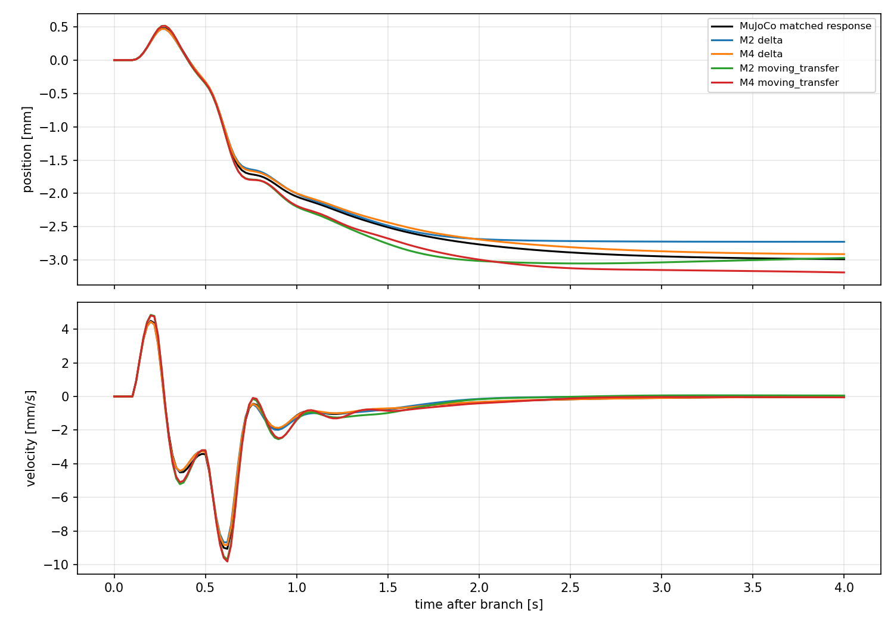
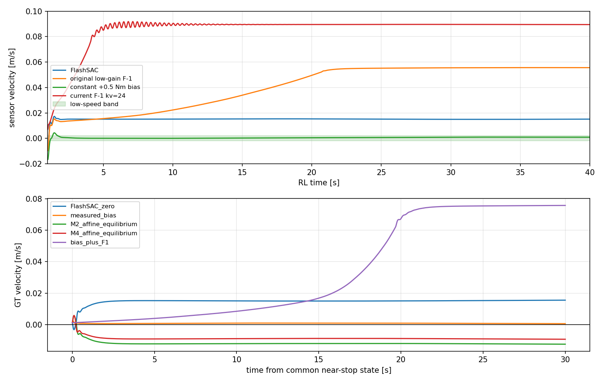

# model_60000 — 저속 영역 M2/M4 식별과 affine offset 검증

작성일: 2026-10-15 (Asia/Seoul)

Execution Domain: **VALIDATION_SIM** (식별·예측·무결성 분석: **DESKTOP_DRY_RUN**)

Policy Checkpoint: `lab/ddt_lab/logs/flash_sac/tita_flash_sac_115632_883848/model_60000/actor.pt`

Policy Checkpoint SHA256: `6d3cba9fa76eebe9fb2f40ef23d34115b8b95028ec788571531ffb33ce821a05`

ONNX SHA256: `f44f07ed44970e3ff565eae67fd9229adf0be5c02215591c52a691ffcbb71b2a`

Evidence Status: **PASS — 저속 영역의 M2/M4 국소 예측 및 수집 무결성. FAIL — 현재 F-1의 정지 유지, affine 모델에서 계산한 정지 평형 토크의 실제 검증.** LQR 설계·online identification·실기: **NOT_TESTED**.

Observed Metrics / Behavior / Log Summary:

**저속 영역에서도 M2의 12-state 표현으로 2초 residual 응답을 설명할 수 있었다. 하지만 기존 F-1만으로 그 영역을 유지할 수는 없었고, 짧은 구간의 정확한 예측이 정지 평형점의 정확성을 보장하지도 않았다.** 이번 실험은 위치·속도가 정확히 0인 정지 평형점의 검증 완료가 아니다.

- 일정한 residual bias를 유지한 폐루프에서 새 M2의 독립 테스트 2초 위치/속도 NRMSE 중앙값은 **2.71% / 3.61%**, M4는 **2.73% / 2.87%**였다.
- 기존 이동 영역 A/B를 그대로 적용하면 **11.33% / 13.45%**, **9.73% / 12.84%**였다. 특히 2초 rolling 속도 NRMSE는 **49.68% / 53.76%**로 사전 진단 기준을 넘었다.
- `model_60000`에서는 현재 F-1(`kp=2, kv=24`)과 과거 저강도 F-1(`kp=2, kv=0.5`) 모두 drift를 키웠다. 다른 체크포인트에서 얻은 F-1 성공을 이번 정책에 적용하지 않았다.
- 동작점 확보용 **+0.5 Nm 합 residual**은 속도를 약 1 mm/s 이하로 낮췄지만 완전 정지는 아니었다. 모델에서 계산한 평형 토크 **+0.922/+0.823 Nm**는 실제로 후진 drift를 만들었다.

## 1. 먼저 확인한 F-1의 적용 한계

Actor·IMU 동기화·명령 0·wheel/leg ActionAdapter·raw last_action은 이전 model_60000 실험과 같게 유지했다. 바퀴 토크만 기존 FlashSAC 출력에 더한다. 아래 acquisition 진단은 seed119/pitch0 한 조건이며 반복 모집단 통계가 아니다.

| 제어 입력 | 평가 구간 | sensor 평균 속도 m/s | residual 합 토크 Nm |
|---|---|---:|---:|
| FlashSAC, residual 0 | RL 35–40초 | +0.01506 | 0 |
| 과거 F-1: kp2/kv0.5, cap1, ramp1초 | RL 35–40초 | +0.05564 | −1.0, 포화 |
| 현재 F-1: kp2/kv24, cap2, ramp1.5초 | RL 118–120초 | +0.08917 | −2.0, 포화 |
| 일정 bias +0.25 | RL 35–40초 | +0.00802 | +0.25 |
| 일정 bias +0.5 | RL 35–40초 | +0.000967 | +0.5 |
| 일정 bias +1.0 | RL 35–40초 | −0.01455 | +1.0 |

현재 F-1은 production `ResidualWheelPD`를 그대로 호출했다. 과거 저강도 비교는 기존 `PositionVelocityResidual/DEFAULT_RESIDUAL`을 호출했다. Policy·제어 gain을 재학습하거나 튜닝하지 않았다. 원본 코드의 gain·ramp·cap을 변경하지 않았다.

일정 +0.5 Nm를 선택한 이유는 위 acquisition scan에서 이미 정한 저속 기준을 만족했기 때문이다. 이는 **동작점 확보용 prescribed bias**이며 새 정지 제어기의 성공 결과가 아니다. 원래 계획의 “F-1만으로 정지 영역 확보”는 실패했고, 이 변경을 명시한 뒤 본 수집을 시작했다.

즉시 입력에 대한 직접 B_v는 여전히 양수지만 장시간 일정 residual에 대한 속도 변화는 위 표처럼 다르다. 짧은 입력 효과와 FlashSAC가 이후 보상하는 효과를 구분해야 한다. 이 관측만으로 새 feedback 부호나 gain을 정하지 않았다.

## 2. 두 폐루프를 분리한 수집

동작점 확보: startup transform_up → RL, 합 +0.5 Nm까지 2 Nm/s로 증가, RL 20초부터 **+0.5 Nm 위에 기존 F-1**을 켰다. F-1의 위치 anchor는 이때 새로 잡히며 ramp1.5초를 그대로 사용했다.

분기 후보는 train RL22/24초, test RL23/25초다. **직전 2초 sensor 및 GT sagittal velocity RMS가 각각 ≤0.002 m/s**, startup 이후 failure guard 통과를 본 수집 manifest에 기록했다. GT는 이 진단의 시작점 판정·평가에만 사용하며 actor/F-1의 입력에는 넣지 않았다. 실기용 동작점 선택 방식으로 검증한 것은 아니다.

- 후보 30개 중 **18개 채택, 12개 제외**. 채택 sensor RMS 범위 **0.000778–0.001893 m/s**, 제외 범위 **0.002233–0.003230 m/s**. 예측 오차를 본 뒤 선택한 것이 아니다. 후속 후보의 제외 자체가 F-1의 정지 유지 실패 증거다.
- Train: seeds120–122 × pitch −0.035/0/+0.035, 9개 초기 조건의 12개 시작점.
- Test: seeds130–131 × 같은 pitch 범위, 6개 초기 조건의 6개 시작점. Seed를 분리했다.
- 18개 시작점에서 **frozen/feedback 두 군**을 같은 전체 mjData·fresh IMU·적분기·last_action·F-1 memory로 분기했다.

| 군 | 적용 residual 합 토크 | 식별 입력 | 모델 의미 |
|---|---|---|---|
| frozen | r₀ + w | absolute: 실제 총 residual, delta: 대응 zero 대비 입력 차이 | FlashSAC + 일정 bias 주변 |
| feedback | 0.5 + r_F1(t) + w | 실제 외부 probe w | FlashSAC + 기존 F-1 + 일정 bias 주변 |

`r₀`는 분기 시 현재 상태에서 F-1 update를 수행했을 때의 총 residual을 고정한 값이다. 따라서 첫 입력은 feedback 군의 첫 입력과 같고, 이후 F-1 반응만 달라진다. Constant +0.5와 r₀는 다르다. 전체 zero continuation의 평균 r₀는 **+0.4471 Nm**, feedback 군의 평균 총 residual은 **+0.4073 Nm**였으며 어느 쪽도 정지 평형 토크라고 부르지 않는다.

각 군/시작점에 4초 응답 13개: sine/PRBS/±pulse/±step × 합 amplitude0.1/0.25 Nm, microPRBS0.02 Nm. Probe slew는 2 Nm/s, physics/control dt=0.005/0.02초다. Train/test sine 주파수·PRBS block·seed를 분리했지만 pulse/step 형태와 amplitude는 양쪽에 있다. 임의의 미지 입력 전체에 일반화한 검증은 아니다.

본 수집은 **468개 응답**: train312개/62,400 transitions, test156개/31,200 transitions. 각 군 test는 78개다. 같은 시작점의 여러 응답은 서로 관련돼 있으므로 156개 독립 초기 조건으로 해석하지 않는다. 직접 B 차분 108쌍, exact zero replay 36개도 저장했다.

지속된 zero continuation도 속도가 서서히 증가했다. Frozen 기준 속도 범위는 **0.001224–0.003002 m/s**, feedback은 **0.001224–0.005122 m/s**였다. Probe 중 속도 범위는 각각 **−0.009756–+0.013724**, **−0.016495–+0.019511 m/s**다. 따라서 “분기 직전 저속 + 작은 토크에 대한 국소 응답” 실험이며, 응답 4초 전체가 정확한 정지 영역이라는 뜻은 아니다.

## 3. M2/M4 구조와 affine 항

상태 후보는 그대로 보존했다.

```text
M2: [p, v, pitch, pitch_rate, previous_raw_action(8)]             12 states
M4: [M2, leg_position(6), leg_velocity(6)]                      24 states

delta model: δz_next = A δz + B δu
affine model: zc_next = A zc + B uc + c
zc = z − z_ref, uc = u − u_ref        (reference는 train 평균)
```

p는 encoder/동기화 IMU sagittal path이고, 좌표 원점은 RL20초 F-1 anchor에 맞췄다. World 2D/yaw hold가 아니다. p 이외의 action·leg 자세를 0으로 놓아 목표 상태를 만들지 않았다.

Frozen 모델은 위치 translation symmetry인 A 첫 열 [1,0,…]를 유지했다. **Feedback 모델에는 p hold 자체가 들어 있으므로 첫 열도 식별**했다. 이는 동일 상태 구조에서 폐루프 차이를 반영한 제약 변경이다. 이를 FlashSAC-only A/B로 해석하면 안 된다. 두 모델 모두 현재 probe가 이미 계산된 actor action에 영향을 줄 수 없으므로 다음 previous_action의 B 8개 행은 0으로 고정했다.

Affine c는 위 centered 좌표의 offset이다. 절대 좌표에서는 `c_abs = z_ref − A z_ref − B u_ref + c`가 되며, centered c 자체가 고유한 물리 외란이나 곧바로 더할 feedforward torque는 아니다. Frozen centered c의 첫 두 값은 약 **[4.239e−5 m, 2.406e−6 m/s] / step**이었다.

각 군의 delta/affine × M2/M4 **8개 모델은 train만으로 계산·저장한 뒤 test 배열을 읽었다**. 이전 이동 영역 M2/M4도 변경 없이 비교했다. 모든 선택 상태를 재귀적으로 예측했으며 미래 측정 action/leg state를 주입하지 않았다.

## 4. 독립 테스트의 p/v 예측

기존 진단용 기준을 유지했다: 2초 전체 자유 응답 및 0.1/0.5/1/2초 rolling의 p/v NRMSE 중앙값 모두 ≤30%, 직접 B_v 상대 오차 ≤30%. 이는 LQR 안정성 보장이 아니다.

Delta 모델의 분모는 대응 zero branch를 뺀 실제 응답 RMS다. Affine 모델도 **절대 궤적 예측 오차를 같은 작은 응답 RMS로 나눴다**. 큰 절대 위치나 자세 offset으로 오차를 작아 보이게 하지 않았다. Rolling은 실제 시작 상태에서 한 번 초기화하고 horizon 뒤 endpoint들을 평가하며, 최초 2초 전체 RMS와 다른 지표다.

| 군 / 모델 | 2초 p NRMSE | 2초 v NRMSE | 2초 v RMSE mm/s | 2초 rolling v NRMSE | B_v 상대 오차 | 진단 |
|---|---:|---:|---:|---:|---:|---|
| frozen / 기존 이동 M2 | 11.33% | 13.45% | 0.3182 | 49.68% | 1.16% | FAIL |
| frozen / 기존 이동 M4 | 9.73% | 12.84% | 0.2995 | 53.76% | 0.76% | FAIL |
| frozen / 새 M2 delta | **2.71%** | **3.61%** | **0.0962** | 26.70% | 0.40% | PASS |
| frozen / 새 M4 delta | 2.73% | 2.87% | 0.0681 | **4.79%** | 0.12% | PASS |
| frozen / 새 M2 affine | 3.59% | 3.93% | 0.0863 | 19.16% | 0.69% | PASS |
| frozen / 새 M4 affine | 1.95% | 2.75% | 0.0599 | 7.57% | 0.12% | PASS |
| feedback / M2 delta | 3.38% | 4.39% | 0.1084 | 7.45% | 0.31% | PASS |
| feedback / M4 delta | 2.64% | 2.70% | 0.0752 | 5.42% | 0.09% | PASS |
| feedback / M2 affine | 5.12% | 5.94% | 0.1494 | 9.22% | 0.54% | PASS |
| feedback / M4 affine | 2.91% | 3.32% | 0.0899 | 6.37% | 0.09% | PASS |

각 응답 지표의 중앙값이다. RMSE 중앙값÷signal 중앙값이 NRMSE 중앙값과 같을 필요는 없다. 직접 B_v 중앙값은 양 군 모두 **+0.02228536 (m/s)/Nm**다. 첫 actor output이 같으므로 F-1의 후속 반응이 달라도 같은 상태의 즉시 B는 일치한다.

GT delta p/v로 같은 frozen matrices를 교차 평가한 2초 NRMSE는 frozen M2 **2.68%/3.68%**, M4 **2.90%/2.92%**였다. GT로 재학습한 결과는 아니다.

새 delta 모델의 scaled condition number는 frozen M2 **717**, M4 **4,466**, feedback M2 **944**, M4 **6,429**다. M2를 가벼운 주 후보로 유지할 수 있고, frozen의 긴 rolling 예측에서는 M4의 이점이 크다. 모든 개별 응답이 기준 안이라는 뜻이나 online 업데이트가 안정하다는 뜻은 아니다.



## 5. Affine offset과 장시간의 정상 입력을 따로 검증했다

Held-out의 probe 없는 baseline을 2초 절대 예측하면 frozen M2 affine의 p/v RMSE 중앙값은 **0.0231 mm / 0.0308 mm/s**, M4는 **0.0327 mm / 0.0334 mm/s**였다. 같은 A/B/reference를 유지하고 centered c만 0으로 만들면 p 오차가 약 **2.55/2.56 mm**로 증가했다. 짧은 baseline 진행을 나타내는 offset이 필요했다. 단, c=0으로 다시 학습한 모델과 비교한 것은 아니다.

다음으로 frozen affine 모델에서 v=0, p는 train reference로 고정하고 나머지 내부 상태와 일정 입력이 정상 상태를 이루는 선형 방정식을 풀었다. M2는 **+0.92189 Nm**, M4는 **+0.82281 Nm**를 반환했다. 그러나 내부 상태의 **8/10개 성분, 11/22개 성분**이 학습 범위 밖이었고, 두 입력도 본 수집의 frozen 입력 상한 약 +0.718 Nm를 넘었다. 작은 방정식 잔차만으로 채택할 수 없다.

이 값을 재조정하지 않고 새로운 seeds140/141·pitch0의 같은 저속 snapshot에서 **30초 MuJoCo 검증**을 수행했다. 입력 전환 slew는 2 Nm/s이며 10개 분기 모두 failure guard를 통과했다. 표는 두 seed의 평균으로, 속도는 마지막 5초의 GT 평균, 이동은 분기 후 30초의 GT sagittal path 변화다.

| 검증 입력 | 최종 GT 속도 m/s | 30초 이동 m | 판정 |
|---|---:|---:|---|
| residual 0 | +0.01543 | +0.4453 | FlashSAC drift |
| 일정 +0.5 Nm | **+0.000727** | **+0.0262** | 저속, 완전 정지는 아님 |
| M2 affine 평형값 +0.92189 Nm | −0.01228 | −0.3532 | 정상 응답 예측 FAIL |
| M4 affine 평형값 +0.82281 Nm | −0.00914 | −0.2610 | 정상 응답 예측 FAIL |
| +0.5 Nm + 현재 F-1 | +0.07560 | +1.0308 | 정상 완주했지만 hold FAIL |

**짧은 응답 예측은 PASS지만, 무한 시간의 평형점 외삽은 FAIL이었다.** 모든 내부 상태가 일정해진다는 선형 모델의 요구와 실제 속도가 작은 동작 상태는 같지 않다. 예를 들어 raw previous_action이나 leg 내부 운동은 속도가 작아도 반드시 일정하지는 않다. 이번 외삽 오차를 단일 원인으로 확정하지 않으며, 실측에서 실패한 평형 입력을 제어 설정에 채택하지 않았다.

Feedback 모델의 spectral radius는 delta M2/M4가 **1.00458/1.00254**, affine이 **1.00370/1.00286**이었다. 이는 해당 근사 모델의 값이며 비선형 로봇의 전역 안정성 판정은 아니지만, 장시간 F-1 drift 증가와는 일치한다. 좋은 예측 모델이 불충분한 제어 동작을 정확하게 예측할 가능성을 예측 오차와 구분해야 한다.



## 6. 이번 판단과 범위

M2/M4의 상태 구조를 보존하고 **일정 bias 주변의 M2를 다음 단계 주 후보, M4를 긴 horizon 비교 후보**로 유지할 수 있다. 이동 영역의 A/B를 그대로 쓰기보다 저속 영역에서 재식별한 편이 좋았다. F-1-on 모델은 다른 plant이며, 그 A/B로 FlashSAC-only residual LQR을 설계하면 안 된다.

다음에는 이번 저속 영역에서 더 긴 일정 입력에 대한 진행·내부 상태 변화를 검증하고, **어느 입력·상태 영역까지 정상 응답을 다룰 수 있는지**를 한정할 필요가 있다. 이번에는 2초 국소 예측과 30초 정상 응답 검증의 경계를 확인했다. 정확한 정지 평형, residual LQR을 통한 drift 개선, online 식별, mismatch, nonzero velocity command, hardware는 검증하지 않았다. F-1의 slew memory 등은 원시 로그에 보존했지만 M2/M4의 상태에 추가하지 않았으므로, 이번 PASS도 제한된 구간의 경험적 예측 결과다.

## 7. 실행·검사·재현

- 신규 코드 5개: `test/eval_flash_stop_local.py`, `test/analyze_flash_stop_local.py`, `test/validate_flash_stop_bias.py`, `test/test_flash_stop_local.py`, `test/audit_flash_stop_local.py`. 이 보고서와 증거도 추가했다. 기존 runtime·모델·설정·보고서는 수정하지 않았다.
- 수치 단위 검사 **3개 PASS**: affine 행렬 복원과 F-1의 위치 의존성, 독립 matrix-power convolution과 전체 상태 예측 일치, 큰 절대 위치로 NRMSE 오차를 숨기지 않는지 확인. `unit_tests.log`.
- 본 수집 468개 응답·108개 직접 B 차분 쌍·36개 exact replay, leg torque 보존·raw action history chain·snapshot/초기 입력 일치 **PASS**. actor/hold는 동기화 IMU를 사용하고 GT를 제어 입력에 넣지 않았다. Startup 첫 1초의 기존 저자세 limit 위반은 기록했으며 모델 수집은 22초 이후다. Scene의 floor 외 world 장애물은 이전 실험처럼 메모리에서만 비활성화했다.
- 원래 runtime/기존 collector/ONNX/checkpoint 등 **21개 파일 hash 보존 PASS**. 본 collector 실행 hash, frozen 모델을 만든 analysis source hash, test 전후 행렬 hash도 대조했다. `facts.json`, `final_review.json`, `full/source_integrity.json`, `full/analysis_integrity.json`.
- 최초 scan은 기존 residual constructor의 p_hold 인자 누락으로 FAIL이었다. 수정 후 채택 증거는 `acquisition_current` / `bias_scan` / `full` / `steady_validation`이다. 초기 `pilot`/`acquisition_scan*`/`smoke`는 본 학습·주 결과에 포함하지 않았다.
- `./scripts/agent-check.sh` **전체 FAIL**: 기존 변경 `my_flat_env_cfg.py`의 trailing whitespace. Python syntax **374개 PASS**, URDF XML **8개 PASS**. 신규 파일 diff 검사도 별도 PASS이며 `agent_check.log` / `final_review.json`에 기록했다. 다른 작업의 기존 변경은 수정하지 않았다.
- 브랜치: **`agent/codex/dev_tita_gluon`**. Commit/push·실기 조작·새 LQR gain 적용 없음.

```bash
MPLCONFIGDIR=/tmp/lqr_mpl /home/cocel/venvs/cosim_ros2_jazzy/bin/python test/test_flash_stop_local.py
MPLCONFIGDIR=/tmp/lqr_mpl /home/cocel/venvs/cosim_ros2_jazzy/bin/python test/eval_flash_stop_local.py --pilot --output docs/exp/2026-10-15/new_stop_local/acquisition_current
MPLCONFIGDIR=/tmp/lqr_mpl /home/cocel/venvs/cosim_ros2_jazzy/bin/python test/eval_flash_stop_local.py --scan --output docs/exp/2026-10-15/new_stop_local/bias_scan
MPLCONFIGDIR=/tmp/lqr_mpl /home/cocel/venvs/cosim_ros2_jazzy/bin/python test/eval_flash_stop_local.py --collect --workers 3 --output docs/exp/2026-10-15/new_stop_local/full
MPLCONFIGDIR=/tmp/lqr_mpl /home/cocel/venvs/cosim_ros2_jazzy/bin/python test/analyze_flash_stop_local.py --root docs/exp/2026-10-15/new_stop_local/full
MPLCONFIGDIR=/tmp/lqr_mpl /home/cocel/venvs/cosim_ros2_jazzy/bin/python test/validate_flash_stop_bias.py --models docs/exp/2026-10-15/new_stop_local/full/models_frozen.json --output docs/exp/2026-10-15/new_stop_local/steady_validation
./scripts/agent-check.sh
```

Audit script는 이번 고정 evidence 경로를 검사한다: `MPLCONFIGDIR=/tmp/lqr_mpl /home/cocel/venvs/cosim_ros2_jazzy/bin/python test/audit_flash_stop_local.py`.

산출물: [모델별 지표](flash_stop_local/full/summary.json), [frozen A/B 및 affine 모델](flash_stop_local/full/models_frozen.json), [동작 범위·GT 대조·무결성](flash_stop_local/facts.json), [30초 검증](flash_stop_local/steady_validation/summary.json), NPZ 원시 궤적·probe/FlashSAC/실제 motor torque·observation/history, 재현 manifest/log.
