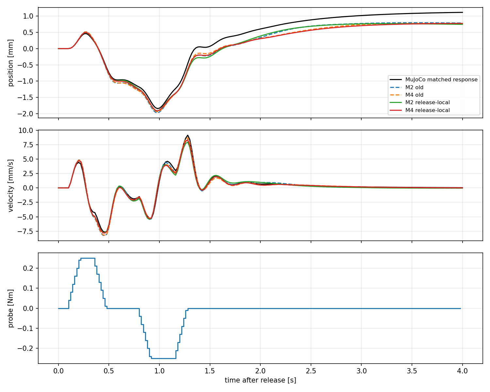
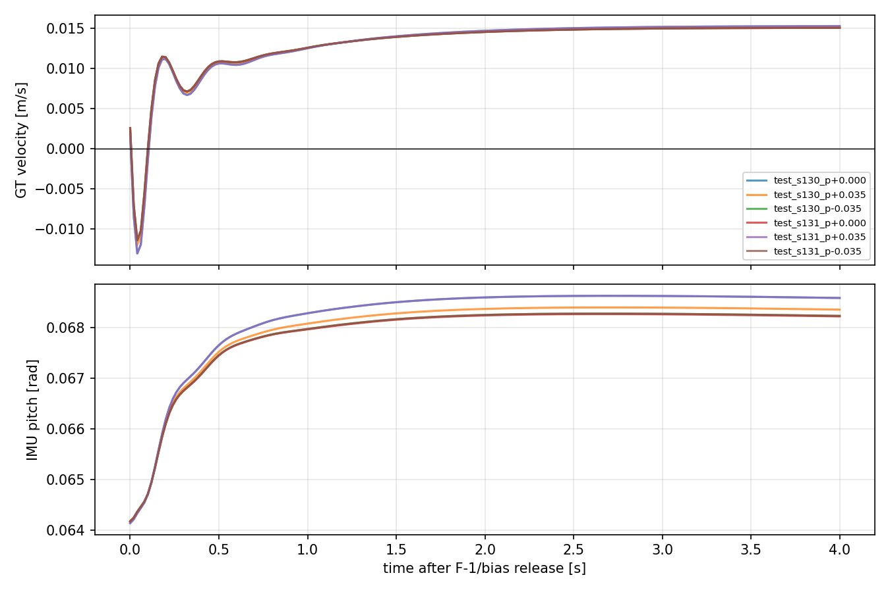

# model_60000 — F-1·bias 완전 해제 후 M2/M4 유효성 검증

작성일: 2026-10-15 (Asia/Seoul)

Execution Domain: **VALIDATION_SIM** (모델 검증·조건부 재식별·무결성 검사: **DESKTOP_DRY_RUN**)

Policy Checkpoint: `lab/ddt_lab/logs/flash_sac/tita_flash_sac_115632_883848/model_60000/actor.pt`

Policy Checkpoint SHA256: `6d3cba9fa76eebe9fb2f40ef23d34115b8b95028ec788571531ffb33ce821a05`

ONNX SHA256: `f44f07ed44970e3ff565eae67fd9229adf0be5c02215591c52a691ffcbb71b2a`

Evidence Status: **FAIL — 기존 M2/M4 및 재식별 M2의 사전 진단 기준. PASS — 재식별 M4의 전체 테스트 중앙값 기준·분기 경로·기존 소스 보존.** 개별 입력군 일부는 기준 밖이다. 지속 정지 평형·affine 재식별·LQR·online adaptation·실기: **NOT_TESTED**.

Observed Metrics / Behavior / Log Summary:

**요청한 FlashSAC Only 대 FlashSAC + probing torque 비교를 수행했다. Probing 중에는 양쪽 모두 F-1과 확보용 bias를 완전히 해제했다.** 기존 이동 영역 M2/M4를 먼저 검증·저장했고, 둘 다 2초 rolling 속도 NRMSE 30% 기준을 넘어선 뒤에만 별도 train 데이터로 같은 구조를 재식별했다.

결과는 **M4 재식별 모델을 이번 release 응답의 비교·예측용 후보로 사용**, M2는 긴 rolling 예측 기준 미충족이다. 다만 baseline은 보정을 해제한 뒤 다시 약 0.015 m/s로 움직였다. 이번 모델을 지속 정지 평형점의 `A_stop/B_stop`으로 해석하지 않는다.

## 1. 이전 실험과 이번 비교의 차이

[이전 저속 검증](flash_stop_local_summary.md)의 frozen 군에는 분기 시점 residual bias 약 +0.45 Nm가 계속 남아 있었다. 이번에는 그 토크도 제거했다.

```text
같은 전체 MuJoCo snapshot + sensor 적분기 + raw last_action
  ├─ FlashSAC Only:             residual = 0
  └─ FlashSAC + 지정된 probe:   residual = w(t)

양쪽 모두 F-1 update/apply 없음, 확보용 bias 없음, 해제 slew/ramp 꼬리 없음
delta_state = probe branch − zero branch
```

FlashSAC observation 33개·raw action 8개·wheel velocity PD·leg position PD는 그대로 실행한다. 현재 qpos/qvel 시점의 clone-refreshed IMU를 actor와 상태 측정에 사용한다. Wheel torque에만 probe를 추가하고 바퀴당 기존 ±12 Nm effort clipping을 유지한다. Leg torque는 매 physics substep 원래 ActionAdapter 출력과 같음을 검사한다. `last_action`에는 직전 전체 raw actor output을 넣고 residual Nm는 넣지 않는다. GT는 제어에 사용하지 않는다.

Baseline은 acquisition subclass의 경로뿐 아니라 **원래 `Runner.step(..., 0)`을 직접 호출한 독립 재실행**과 비교했다. 전체 state·observation·action/history·substep motor torque가 정확히 일치했다. Baseline motor torque와 FlashSAC torque도 정확히 같고 residual은 전 구간 0이었다. Probing 동안 F-1 update를 호출하면 즉시 실패하도록 막았다.

## 2. 저속 초기 상태와 데이터

이번 `model_60000`에서는 F-1 단독으로 저속 유지가 되지 않았으므로, 이전에 이미 확보한 **+0.5 Nm bias + 기존 F-1의 저속 상태**를 재사용했다. 새 gain을 튜닝하지 않았다. 확보용 도움은 prefix에만 존재하며 probing에는 남지 않는다.

- 이전 collection prefix를 실제 MuJoCo에서 다시 실행해 state·motor·observation·history까지 정확히 재현하고 전체 snapshot을 복제했다. 기존 로그를 재식별 데이터로 재활용한 것이 아니라, **probe가 다른 새 분기 응답을 수집**했다.
- 시작점은 이전에 기록한 직전 2초 sensor/GT 속도 RMS 각각 ≤0.002 m/s 기준으로 선택한 18개다. 이번 예측 오차를 보고 골라내지 않았다. 이 GT 기준은 진단용 초기 상태 선택이며 실기용 동작점 확보 방법으로 검증한 것은 아니다.
- Train: seeds120–122 × pitch −0.035/0/+0.035, 9개 초기 조건·12개 snapshot, RL22/24초.
- Test: seeds130–131 × 같은 pitch, 6개 초기 조건·6개 snapshot, RL23초.
- Test 분기 순간 sensor 속도는 **0.001722–0.002574 m/s**였다. 이전 2초 RMS 기준과 순간 속도 기준은 다르므로 순간 속도가 모두 0.002 이하라고 주장하지 않는다.
- 모든 prefix는 startup transform_up → RL을 사용한다. 처음 1초의 기존 저자세 전환은 모델 수집에서 제외하며, 분기와 모든 본 응답은 기존 finite/attitude/height/leg-limit failure guard를 통과했다.
- Scene의 floor 외 world 장애물 접촉은 기존 실험처럼 메모리에서만 비활성화했다. Physics/control dt=0.005/0.02초, velocity command=0, 외란 push·mismatch 없음.

| 구분 | snapshot 수 | 입력 | 응답 수 | transitions |
|---|---:|---|---:|---:|
| Train | 12 | sine/PRBS/±pulse/±step × 0.1/0.25 Nm + microPRBS0.02 Nm | 156 | 31,200 |
| Test | 6 | 위 검증 입력 + 학습에 없는 ±bipolar pulse × 0.1/0.25 Nm | 102 | 20,400 |

각 응답 4초, 합 probe 상한 0.25 Nm, slew2 Nm/s다. Sine 주파수·PRBS block·위상/입력 seed를 train/test에서 분리했다. Bipolar pulse는 양의 pulse 후 음의 pulse 또는 그 반대이며 테스트에만 넣었다. 기존 step/pulse 형태와 amplitude는 train/test에 공통이므로 모든 입력 형태가 미지였다는 검증은 아니다.

총 **258개 응답**, 직접 B 측정 **54개 ±차분 쌍**, 원래 FlashSAC와의 exact zero replay **18개**. Smoke17개 응답은 본 통계·학습에서 제외했다. 같은 snapshot의 여러 입력은 서로 관련돼 있으며 독립 초기 조건 102개로 해석하지 않는다.

## 3. 기존 A/B부터 검증한 순서

1. 기존 `flash_state_learning/expanded/state_models_frozen.json`의 full-train M2/M4를 그대로 사용했다. 수집 전 hash를 저장하고 이후 보존을 확인했다.
2. Test102개에서 직접 B·입력 방향·0.1–2초 예측을 계산하고 `old_validation.json`에 **새 모델 없이** 결과를 저장했다.
3. 기존 두 모델의 기준 실패를 확인한 후 train156개만으로 같은 M2/M4를 재식별했다. Q/R·regularization·상태 차원·모델 구조를 탐색하지 않았다.
4. 새 matrices를 별도 파일에 고정한 뒤 같은 held-out 데이터에서 비교했다. **Test는 이전 모델의 실패 판단에 이미 사용됐지만 새 계수의 회귀에는 사용하지 않았다.** 이를 최종 모델 선택까지 완전히 독립적인 추가 confirmation set이라고 부르지 않는다.

```text
M2: [p, v, pitch, pitch_rate, previous_raw_action(8)]                  12-state
M4: [M2, leg_position(6), leg_velocity(6)]                           24-state

delta_z_next = A delta_z + B actual_probe
```

p는 encoder/동기화 IMU sagittal path이며 world 2D position이 아니다. 위치 translation symmetry의 A 첫 열 [1,0,…]와 현재 torque가 이미 계산된 다음 previous_action에 직접 영향을 줄 수 없다는 B 8개 행=0 제약을 유지했다. Intercept/affine 항은 추가하지 않았다. 미래 측정 action/leg state를 재주입하지 않고 **선택한 모든 상태를 재귀적으로 예측**했다.

진단 기준은 이전 실험과 같은 **전체 테스트 응답별 지표의 중앙값**이다: 최초2초 전체 자유 응답과 rolling0.1/0.5/1/2초의 p/v NRMSE 모두 ≤30%, 직접 B_v의 부호 일치 및 상대 오차 ≤30%. 이는 실기나 LQR 안정성 조건이 아니다. NRMSE 분모는 matched residual 응답 RMS이며 floor p=1e−7 m/v=1e−5 m/s다.

## 4. 직접 B와 입력 방향

| 모델/측정 | B_p m/Nm | B_v (m/s)/Nm | 직접 B_v 대비 오차 |
|---|---:|---:|---:|
| 직접 B 중앙값 | 0.0002969945 | **0.0222872443** | 기준 |
| 기존 M2 | 0.0003004417 | 0.0225438793 | 1.151% |
| 기존 M4 | 0.0002992631 | 0.0224547181 | 0.751% |
| Release 재식별 M2 | 0.0003002457 | 0.0225299415 | 1.089% |
| Release 재식별 M4 | 0.0002985474 | 0.0223996872 | **0.505%** |

**모든 모델에서 첫 유효 입력 직후 속도 변화 방향이 102/102개 일치**했다. 그 첫 변화의 크기 상대 오차 중앙값은 기존 M2/M4 **1.090%/0.690%**, 재식별 M2/M4 **1.027%/0.443%**였다. 즉시 B가 크게 틀리거나 반대 부호인 상황은 아니다.

나중에 실제 응답이 입력 방향의 반대로 바뀌는 현상은 첫 방향과 분리해 전체 궤적에서 평가했다. 하나의 최종 부호만으로 모델을 판정하지 않았다.

## 5. p/v 자유 예측 결과

| 모델 | 최초2초 p NRMSE | 최초2초 v NRMSE | 최초2초 v RMSE mm/s | 2초 rolling v NRMSE | 사전 중앙값 기준 |
|---|---:|---:|---:|---:|---|
| 기존 M2 | 14.64% | 11.40% | 0.2694 | 36.84% | FAIL |
| 기존 M4 | 13.61% | 11.27% | 0.2750 | 34.68% | FAIL |
| Release 재식별 M2 | 11.75% | 9.77% | 0.2286 | 43.31% | FAIL |
| Release 재식별 M4 | **11.19%** | **9.27%** | **0.2048** | **16.26%** | **PASS** |

| Rolling horizon | 기존 M2 p/v NRMSE | 기존 M4 p/v | 재식별 M2 p/v | 재식별 M4 p/v |
|---|---:|---:|---:|---:|
| 0.1초 | 0.96 / 10.85% | 0.79 / 8.50% | 0.60 / 7.81% | 0.40 / 4.71% |
| 0.5초 | 2.94 / 10.61% | 2.76 / 13.83% | 2.76 / 10.76% | 1.02 / 7.55% |
| 1.0초 | 5.19 / 11.39% | 9.79 / 15.64% | 5.25 / 12.49% | 3.27 / 9.30% |
| 2.0초 | 10.93 / 36.84% | 22.90 / 34.68% | 10.84 / 43.31% | 8.03 / 16.26% |

최초2초는 branch 시작에서 한 번 초기화한 뒤 2초 전체의 RMS다. Rolling은 4초 trace에서 시작점을 0.2초씩 이동하고 실제 시작 상태에서 해당 horizon의 endpoint를 예측한다. 두 집계는 같지 않다. RMSE 중앙값÷signal 중앙값도 NRMSE 중앙값과 같을 필요는 없다.

GT delta p/v로 같은 matrices를 대조한 최초2초 NRMSE는 재식별 M2 **11.55%/9.72%**, M4 **10.95%/9.22%**였다. GT로 재학습하지 않았다. 재식별 모델의 scaled condition number는 M2 **583**, M4 **2,467**이다.



### 중앙값 PASS의 한계

M4 PASS는 모든 입력/개별 응답에서 상대 오차가 작다는 뜻이 아니다. 최초2초 p/v 모두 ≤30%인 응답은 기존/재식별 M2 **97/102개**, 기존/재식별 M4 **100/102개**다. 재식별 M4의 최대 개별 p NRMSE는 **39.83%**였다.

입력군별 2초 rolling에서는 재식별 M4도 positive pulse 속도 NRMSE **36.71%**, negative bipolar pulse p/v **33.77%/31.84%**로 기준 밖이었다. Positive pulse의 실제 tail 속도 signal RMS 중앙값은 약 **0.104 mm/s**, 예측 오차는 **0.0291 mm/s**였다. Negative bipolar의 속도 오차도 약 **0.0493 mm/s**다. 작은 응답에서 높은 상대 오차와 작은 절대 오차를 함께 기록했다. 개별 입력군 전체 통과를 추가 성공 기준으로 바꾼 것은 아니며, 기존 중앙값 기준을 유지했다.

M2는 최초2초 예측이 개선됐어도 긴 rolling 예측은 악화됐다. 더 잘 학습됐다는 단일 점수로 요약하지 않는다. 원시 입력/응답과 전체 지표는 JSON/NPZ에 남겼다.

## 6. 확보 상태는 정지 평형점이 아니었다

양쪽에서 bias/F-1을 끄자 baseline은 초기에 속도가 한 번 음수로 변한 뒤, 4초 trace의 마지막 1초 GT 평균이 **0.01500–0.01521 m/s**가 됐다. 4초 sagittal 이동은 약 **+0.0523 m**였다. 따라서:

- 실험은 **저속 초기 상태에서 원래 FlashSAC로 돌아가는 과도 궤적 주변의 residual 응답 검증**이다.
- 지속 v≈0 영역을 유지하는 plant의 식별이나 정지 평형점 확보 완료가 아니다.
- 이전 bias 고정 조건의 2초 NRMSE 약3%와 이번 약10%를 같은 시스템의 반복 결과로 비교하지 않는다. Baseline torque와 지나가는 동작 영역이 다르다.
- 재식별 M4는 이번 release 응답 예측 후보다. Runtime 제어 설정으로 연결하거나 `A_stop/B_stop`으로 확정하지 않았다.



요청한 판정표에 따르면 **기존 모델은 전체 기준 실패, 같은 구조의 재식별 M4는 통과**에 해당한다. M4를 다음 비교용 모델로 보존하고 M2도 제한점을 포함한 비교 모델로 남긴다. 두 모델 모두 실패한 경우가 아니므로 새로운 상태나 모델 구조를 추가하지 않았다.

## 7. 변경·검사·재현

- 신규 코드 `test/eval_flash_stop_release.py`, `test/analyze_flash_stop_release.py`, `test/test_flash_stop_release.py`와 이 보고서/증거만 추가했다. 기존 runtime·정책·설정·이전 실험 소스/모델/보고서는 수정하지 않았다. 브랜치 **`agent/codex/dev_tita_gluon`**. Commit/push 없음.
- 수치 단위 검사 **2개 PASS**: held-out bipolar probe의 양방향/bound/slew/종료0, 알려진 독립 동역학의 평가 PASS와 입력 방향을 뒤집었을 때 FAIL.
- 본 수집 **258개 응답·54개 직접 B 차분 쌍·18개 원래 FlashSAC exact replay PASS**. 모든 초기 state·첫 observation/action 일치, leg 경로/전체 raw history 보존, probe 합산 오차 <1e−6 Nm. Probing 중 F-1 update 0회, bias0, baseline residual0.
- 기존 파일 hash 보존, 실행 collector hash, 기존 모델의 검증 후 hash, 기존 판정의 재식별 전후 hash, 새 matrices의 평가 전후 hash 보존은 `integrity.json`/`final_review.json`에 기록했다. 새 모델 계수는 train 전용이며 기존 모델 검증 기록을 덮어쓰지 않았다.
- `./scripts/agent-check.sh` **전체 FAIL**: 기존 `my_flat_env_cfg.py`의 trailing whitespace 6곳. Python syntax **377개 PASS**, URDF XML **8개 PASS**이며 신규 파일 diff 검사는 별도 PASS다. `agent_check.log`/`final_review.json`에 기록했다. 해당 기존 변경은 수정하지 않았다.
- 이번 범위는 **Step2 A/B 유효성 검증 및 조건부 동일 구조 재식별**이다. 일정 torque의 정상상태 scan·평형점 탐색·affine 재식별·LQR·Q/R tuning·online adaptation·실기는 수행하지 않았다.

```bash
MPLCONFIGDIR=/tmp/lqr_mpl /home/cocel/venvs/cosim_ros2_jazzy/bin/python test/test_flash_stop_release.py
MPLCONFIGDIR=/tmp/lqr_mpl /home/cocel/venvs/cosim_ros2_jazzy/bin/python test/eval_flash_stop_release.py --workers 3 --output docs/exp/2026-10-15/new_stop_release/full
MPLCONFIGDIR=/tmp/lqr_mpl /home/cocel/venvs/cosim_ros2_jazzy/bin/python test/analyze_flash_stop_release.py --root docs/exp/2026-10-15/new_stop_release/full --stage old
MPLCONFIGDIR=/tmp/lqr_mpl /home/cocel/venvs/cosim_ros2_jazzy/bin/python test/analyze_flash_stop_release.py --root docs/exp/2026-10-15/new_stop_release/full --stage conditional
./scripts/agent-check.sh
```

산출물: [기존 모델 판정](flash_stop_release/full/old_validation.json), [조건부 재식별·최종 판정](flash_stop_release/full/decision.json), [새 matrices](flash_stop_release/full/conditional_models_frozen.json), [분기·baseline 무결성](flash_stop_release/full/integrity.json), [개별 응답·입력군별 한계](flash_stop_release/full/additional_facts.json), manifest·수집/분석 로그·전체 NPZ.
