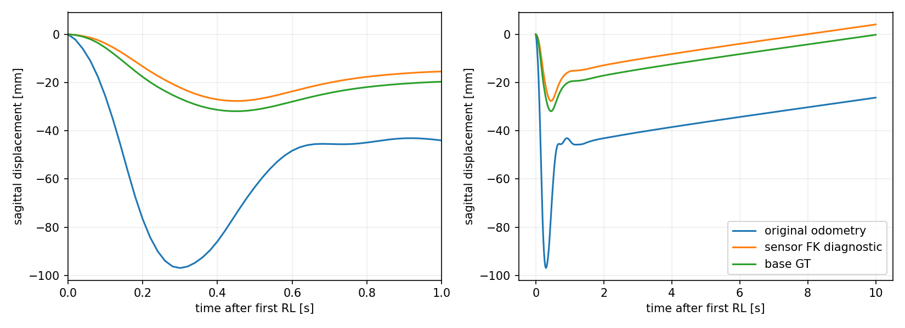
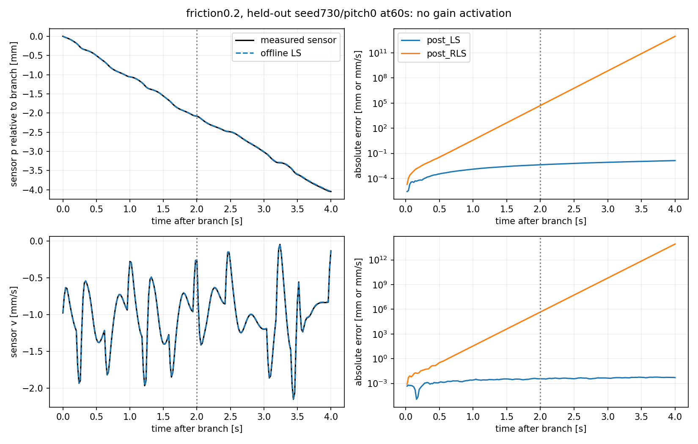

# model_60000 — Phase A/B/C 진단 결과

작성일: 2026-10-16 (Asia/Seoul)

Execution Domain: **VALIDATION_SIM** (분석·수치 감사: **DESKTOP_DRY_RUN**)

Policy Checkpoint SHA256: `6d3cba9fa76eebe9fb2f40ef23d34115b8b95028ec788571531ffb33ce821a05`

Evidence Status: **PASS — 원래 궤적 재현·기준점 분해·입력/정보량 진단. PASS — friction0.2의 Offline M4 식별. FAIL — 같은 데이터의 RLS 예측 및 나머지5환경의 사전 Offline 예측 기준.** 새 estimator/controller 적용·Phase D/E/F·실기: **NOT_TESTED**.

Observed Metrics / Behavior / Log Summary:

초기25mm 안팎 차이의 큰 부분은 **leg 기구학과 자세 변화에 따른 wheel midpoint↔base origin 이동**이었다. 센서 FK로 이 항을 오프라인에서 빼면 큰 차이가 줄었지만 약4mm 잔여 오차가 남았다. 기존 폐루프 로그의 포화 제거는 정보량 문제를 자동으로 해결하지 않았다. 별도 bounded 입력 자료에서는 **friction0.2 Offline LS PASS / RLS FAIL**이 재현돼, 이 조건은 M4 차원을 늘리기 전에 현재 식별 방법을 검토할 명확한 사례다.

[동결 계획](run_01/plan.json)과 [전체 자동 집계·조건별 표](run_01/REPORT.md)를 함께 확인한다. 계획·과학 기준·수집source5개는 수집 전에 hash로 동결했고 결과에 맞춰 변경하지 않았다. 마지막 RLS 목적함수 감사는 모델을 대체하지 않는 별도 사후 수치 진단이다.

## A — Cold-start 위치 추정

6개 안전한 단일 조건×3개 초기조건에서 Flash/Fixed **36개10초 궤적**, 각 조건의 transform_up **18개 startup**을 원래 자료와 exact 비교했다. 원래 state/observation/raw action history와 모든 physics-substep wheel/leg torque가 재현됐다. 계측은 원래 physics/estimator를 변경하지 않았다.

센서만 사용하는 진단식은 다음과 같다.

```text
d(q) = URDF FK로 구한 base origin→wheel midpoint
p_base_diagnostic = p_encoder − Σ [(R_IMU*d)_next − (R_IMU*d)_now]·f_mid
v_base_diagnostic = v_encoder − [(omega_IMU × R_IMU*d) + R_IMU*J_leg(q)*dq]·f
```

GT는 이 결과를 비교할 때만 사용했다. 경로의 offset 증분을 leg·roll/pitch·yaw로 정확히 분해했다. 이산 경로의 yaw 항과 순간 속도의 world-z angular velocity 항은 같은 수치라고 놓지 않았다.

Nominal Fixed, 첫1초,3개 초기조건의 지표 중앙값:

| 지표 | 기존 odometry | 센서 FK 진단 보정 |
|---|---:|---:|
| 1초 시점 sensor−base 위치 차이 | −24.34mm | +4.25mm |
| 0–1초 위치 오차RMSE | 38.41mm | 3.99mm |
| 0–1초 최대 위치 오차 | 71.14mm | 4.60mm |
| 0–1초 속도 오차RMS | 177.17mm/s | 14.28mm/s |

같은 nominal의1초 transport 성분 중앙값은 leg **−23.92mm**, roll/pitch **−4.72mm**, yaw **+0.00296mm**였다. 항별 중앙값의 합과 총차이 중앙값은 일반적으로 같지 않다. 개별 trial에서는 정확한 항등식으로 닫히며 raw NPZ에 보존했다. 예를 들어 seed601/pitch0의 기존차이−24.3753mm는 transport 약−28.6331mm와 rolling 잔여차+4.2578mm의 합이다.

이 cold-start의 큰 이동에서는 yaw보다 leg와 tilt가 지배적이었다. 이전900초 정착 상태의 느린 yaw 영향이 없다는 뜻은 아니다. FK offset과 MuJoCo 실제 두 점의 최대 차이는 **0.152µm**, 순간 transport 속도 오차 최대는 **0.342µm/s**였다.



원래 runtime odometry는 RL 진입에서 처음 초기화된다. transform_up의 별도 센서 재구성은 기존 RL 경로에 이어 붙이지 않았고, 그 이동을25mm 차이에 중복 더하지 않았다. 보정 후 약4mm는 원래 encoder와wheel midpoint의 차이 등을 포함한다. 이를 전부 slip이라고 특정하지 않았으며 온라인 estimator의 정지 정확도 개선 실험도 아니다.

## B — Residual 전달과 정보량

기존 shadow/primary/composite의 **120개 실제 궤적**을 사용했다. 필터는 all-after1s, 포화 제외-after1s, 원래 deployed eligibility의3종이다. 마지막 필터로 재생한 RLS의 A/B/c와 사용 transition 수가 저장된 모델과 **120/120 정확히 일치**했다.

`raw feedback + probe + bias` → absolute band/ramp/slew 뒤 requested → native clipping 뒤 알려진 `actual_u`를 구분했다. `actual_u`는 motor gain/lag 전 software 명령이다. 저장된 physical motor torque는 FlashSAC를 포함한 전체 토크여서 이를 독립된 물리 residual로 간주하지 않았다.

KOnly primary의6조건 중앙값 예시:

| Target·필터 | 표본 수 | scaled condition | 입력 innovation |
|---|---:|---:|---:|
| Nominal, 전체1초이후 | 8,950 | 457,079 | 0.119% |
| Nominal, 포화 제외 | 3,749 | 809,283 | 0.411% |
| Gain0.8, 전체1초이후 | 8,950 | 330,297 | 0.151% |
| Gain0.8, 포화 제외 | 4,385.5 | 760,048 | 0.202% |
| Friction0.2, 전체1초이후 | 8,950 | 353,884 | 0.247% |
| Friction0.2, 포화 제외 | 6,654 | 1,350,287 | 0.520% |

위 예시의 rank는25였지만 정보량 기준인 innovation≥1%에는 미달했다. 표본 수 중앙값은 정수가 아닐 수 있다. 포화를 빼면 입력과 상태의 독립 정보도 줄어들어 condition이 악화될 수 있었다.

Friction0.2에서만 기존 matched Direct B가 있어 실제 정확도를 비교할 수 있었다. 위 KOnly군 B 상대오차 중앙값은 전체 데이터 약 **1.07%**, 포화 제외 약 **2.85%**였다. 둘 다30% 이내이며 필터가 B 정확도를 개선했다는 결과는 아니다. 다른 환경의 기존 endpoint B 정확도는Direct B 부재로NOT_TESTED다. Direct B가 가깝다고 A의 자유 예측이 맞는 것은 아니다.

별도 계획은 [PROBING_BUDGET_PLAN](PROBING_BUDGET_PLAN.md)에 남겼다. 이번 C는 원래 band 안에서0.01Nm를 사용했으며 band를 넓히지 않았다. C의 post 학습은 rank25, condition약42만–83만, innovation약36–37%로 정보 gate를 모두 통과했다. 따라서 지금 결과로 토크 예산 확대가 반드시 필요하다고 결론 내리지 않는다.

## C — 고정 Target의 Offline M4와 RLS

Nominal, gain0.8/1.2, friction0.2/0.8, lag0.02의6조건에서 새 Target을 **첫 physics 이전**에 설정했다. 원래 FlashSAC/native PD 위에 bias와 guarded0.01Nm 식별 입력만 적용했고 새 LQR/운용점 갱신은 없다.

- 학습: seed720/721/722와 pitch−0.035/0/+0.035의3개 시작조건×6환경, **18개60초 stream 정상 완료**.
- 검증: 학습과 다른 seed730/731×3pitch×6환경, **36개60초 stream 정상 완료**.
- 각 검증 stream의10/60초 snapshot72개에서 **576개 새4초 probe·72개 baseline·Direct B72쌍**을 수집했다.
- Offline LS와 RLS는 동일한 학습 transition을 사용했다. RLS는 같은 nominal prior·forgetting0.9995·P0=100에서 순서대로 재생했다. 이는3개 학습 rollout을 이어 읽은 **진단용 RLS replay**이며, 기존 controller가 단일 배포에서 그 모델을 채택했다는 결과가 아니다.
- 1–60초와10–60초 학습, full A/B/c와 post A고정B/c의 **36개 모델을 test 전에 동결**했다. 위치 목표와 nominal 회귀 중심을 바꾸지 않았다. 모델432건 비교는 동일한72개 응답 묶음을 재사용한 것이며432개 독립 물리 실험이 아니다.

주 판정은10–60초 학습 모델의 독립60초 snapshot6개다. paired 및absolute 다중step 예측, baseline2/4초, Direct B를 모두 요구했다. 정보 gate와 예측 gate는 별도로 보존했다.

| Target | Offline full LS | 같은 데이터의 full RLS |
|---|---:|---:|
| Nominal | FAIL,0/6 | FAIL,0/6 |
| Motor gain0.8 | FAIL,0/6 | FAIL,0/6 |
| Motor gain1.2 | FAIL,0/6 | FAIL,0/6 |
| **Friction0.2** | **PASS,6/6** | **FAIL,0/6** |
| Friction0.8 | FAIL,0/6 | FAIL,0/6 |
| Motor lag0.02 | FAIL,0/6 | FAIL,0/6 |

Friction0.2 Offline full LS의2초rolling p/v NRMSE 중앙값은 **0.237/1.618%**, absolute 최초2초는 **2.330/1.316%**, Direct B 오차 **0.00315%**였다. Baseline2초 p/v RMSE는 **0.00207mm/0.00240mm/s**였다.10초 snapshot도6/6 통과했으며1–60초 학습 LS 역시두 시각을 모두 통과했다. 이들은 같은6개 시작조건의 관련 검증이다.

다른5환경의 Offline full LS는2초rolling v NRMSE가약 **53.9–130.6%**로 기준 밖이었다. Direct B 오차는 작아도 충분하지 않았다. A고정B/c 모델은 어느 환경에서도 전체 예측 기준을 통과하지 못했다. 안전성 prerequisite가 실패한 mass/CoM/lag0.05의 새 C 수집은NOT_TESTED다.



그림은 friction0.2의 seed730/pitch0,60초 snapshot의 설명용 사례다. 왼쪽은 GT가 아닌 실제 **센서 상태**와Offline LS의 비교, 오른쪽은 RLS의 자유 예측 발산이다. 실제 로봇이 발산하거나 넘어졌다는 뜻이 아니다. 주 판정은 전체6개 조건의 수치다. 이 설명용 그림과 A의 전체 구간 오차 집계는 수집 뒤 저장된 배열에서 파생했으며 모델 선택·gate 변경에 사용하지 않았다.

### RLS 재귀 수식이 잘못 계산된 것인가?

고정된forgetting/prior의 정확한 목적함수를 독립적으로 구성해 weighted augmented LS를SVD로 풀었다. 이 사후 수치 감사에서 RLS와 계수 상대 차이는 약 **3e−12–2.3e−10**, 모델rho도 일치했다. P의최소고유값도 양수였다. 따라서 이번 차이를 단순 재귀 연산/roundoff 오류로 설명할 근거는 약하다.

동일 목적함수의 배치해도 RLS와 같은 불안정한 자유 예측 모델을 만들었다. 이는 현재 **prior·regularization·forgetting 및 conditioning의 조합**을 우선 검토할 근거이며, 어느 항이 주원인인지 분리한 실험은 아니다. Plain Offline LS와 RLS가 서로 다른 비용을 푼다는 점을 유지하고, RLS 일반이 원리적으로 실패한다고 결론 내리지 않는다. 이 감사의 모델은 기존 frozen 모델을 대체하지 않았고 제어에도 사용하지 않았다. [수치 감사](run_01/RLS_objective_audit.json)

## 다음 판단과 범위

1. Friction0.2는 원래24-state로 독립 예측이 가능했다. 이 조건에서 먼저 RLS 추정기 설계를 개선하고 같은 고정 검증으로 재평가할 근거가 생겼다.
2. 다른5환경은 Offline/RLS 모두FAIL이므로 정보량 기준PASS만으로 모델 가정을 신뢰하지 않는다. 약한 상태 방향·동작 영역·contact/lag 및 affine 가정을 분리해야 한다. 상태 차원 확대가 유일한 해법이라는 증거는 아니다.
3. A의 센서 FK 보정은 C의 상태에 주입하지 않았다. C는 계속기존 raw p/v다. 향후 보정을 채택하면 그 상태 정의에 맞춰 식별·검증을 새로 해야 한다.
4. 원래 모델·gain·Q/R·runtime·실험 자료를 보존했다. Offline Target 모델을 실제 online controller에 정답으로 주지 않았다. 새 K 적용·Phase D/E/F·Sim2Real·하드웨어는수행하지 않았다.

## 변경·검사·재현

신규 source6개: `test/flash_cold_start_abc.py`, `test/diagnose_flash_cold_start_ab.py`, `test/collect_flash_target_offline_id.py`, `test/analyze_flash_cold_start_abc.py`, `test/test_flash_cold_start_abc.py`, `test/audit_flash_target_rls_objective.py`. 처음5개는 수집 전 동결, 마지막은 사후 목적함수 수치 감사다.

새 독립 검사 **6개PASS**, 기존 RLS 검사 **2개PASS**. 전체agent-check와 변경diff·기존보호hash는 [완료 감사](run_01/completion_audit.json), [agent-check](run_01/agent_check.log), [task.diff](task.diff)에 기록한다. 기존my_flat_env_cfg.py의 trailing whitespace6곳은이번 작업에서 수정하지 않았다. 브랜치 `agent/codex/dev_tita_gluon`. Commit/push·production/runtime 변경 없음.

새 출력 폴더에서 source를 동결한 뒤A/B/C를 재수집할 수 있다. 기존root는 덮어쓰지 않는다.

```bash
export MPLCONFIGDIR=/tmp/lqr_mpl OPENBLAS_NUM_THREADS=1 OMP_NUM_THREADS=1
/home/cocel/venvs/cosim_ros2_jazzy/bin/python test/test_flash_cold_start_abc.py
git status --short > /tmp/phase_abc_status_before.txt
/home/cocel/venvs/cosim_ros2_jazzy/bin/python test/flash_cold_start_abc.py --init docs/exp/2026-10-16/new_cold_start_abc
/home/cocel/venvs/cosim_ros2_jazzy/bin/python test/diagnose_flash_cold_start_ab.py --root docs/exp/2026-10-16/new_cold_start_abc --stage A --workers 3
/home/cocel/venvs/cosim_ros2_jazzy/bin/python test/diagnose_flash_cold_start_ab.py --root docs/exp/2026-10-16/new_cold_start_abc --stage B --workers 3
/home/cocel/venvs/cosim_ros2_jazzy/bin/python test/collect_flash_target_offline_id.py --root docs/exp/2026-10-16/new_cold_start_abc --stage train --workers 3
/home/cocel/venvs/cosim_ros2_jazzy/bin/python test/collect_flash_target_offline_id.py --root docs/exp/2026-10-16/new_cold_start_abc --stage test --workers 3
/home/cocel/venvs/cosim_ros2_jazzy/bin/python test/collect_flash_target_offline_id.py --root docs/exp/2026-10-16/new_cold_start_abc --stage analyze
/home/cocel/venvs/cosim_ros2_jazzy/bin/python test/analyze_flash_cold_start_abc.py --root docs/exp/2026-10-16/new_cold_start_abc
/home/cocel/venvs/cosim_ros2_jazzy/bin/python test/audit_flash_target_rls_objective.py --root docs/exp/2026-10-16/new_cold_start_abc
./scripts/agent-check.sh
```

산출물: [A상세](run_01/A_results.json), [전체전환 위치/속도오차](run_01/A_correction_metrics.json), [B상세·필터별RLS](run_01/B_results.json), [C모델](run_01/C_models_frozen.json), [C독립검증](run_01/C_comparison.json), [RLS목적함수교차검사](run_01/RLS_objective_audit.json), [기계집계보고서](run_01/REPORT.md), 전체stream/probe NPZ와source snapshot·로그.
