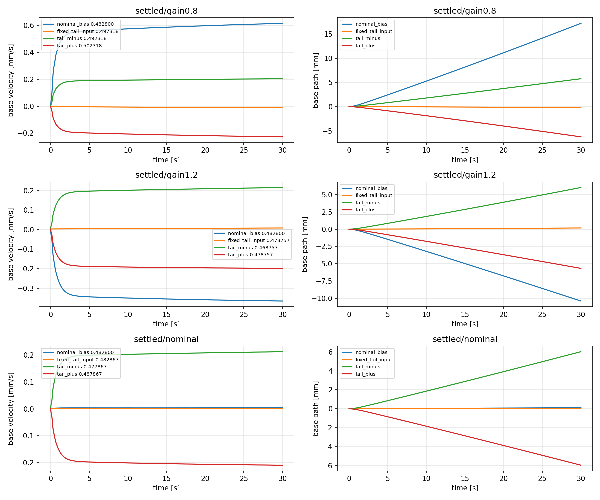
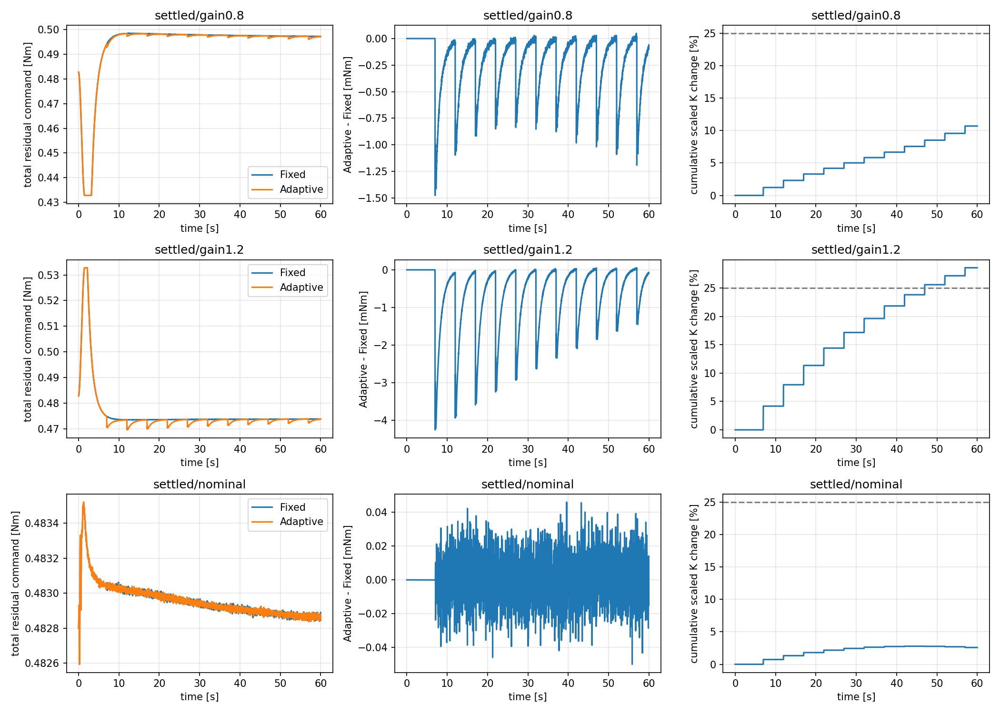

# model_60000 — Adaptive M4의 유지 입력·포화·온라인 모델 원인 분리

작성일: 2026-10-16 (Asia/Seoul)

Execution Domain: **VALIDATION_SIM** (로그 복원·수치 분석·무결성 검사: **DESKTOP_DRY_RUN**)

Policy Checkpoint: `lab/ddt_lab/logs/flash_sac/tita_flash_sac_115632_883848/model_60000/actor.pt`

Policy Checkpoint SHA256: `6d3cba9fa76eebe9fb2f40ef23d34115b8b95028ec788571531ffb33ce821a05`

ONNX SHA256: `f44f07ed44970e3ff565eae67fd9229adf0be5c02215591c52a691ffcbb71b2a`

Evidence Status: **PASS — 기존 K의 정확 복원, 갱신 모델의 새 입력 예측, 유한시간 유지 입력 차이 확인. FAIL — 기존 gain0.8 Adaptive의 제어 개선. SUSPICIOUS — gain 변경 25% 제한의 설명과 구현 차이.** Bias/reference 보정 제어기의 개선 효과·진정한 평형·실기: **NOT_TESTED**.

Observed Metrics / Behavior / Log Summary:

**gain0.8의 성능 악화는 온라인 A/B의 예측 실패보다, 고정된 bias·내부 상태 reference와 갱신 K의 조합이 잔류 위치 오차를 바꾸는 설명에 더 잘 맞았다.** 새 입력에서 갱신 모델은 예측 기준을 통과했으며, 10초 이후에는 Fixed/Adaptive 모두 보정 포화가 없었다. 같은 실제 Fixed 상태에 마지막 Adaptive K만 대입하면 필요한 위치 오차 증가량이 약 **+0.358 mm**, 실제 후반 증가량은 **+0.348 mm**였다.

별도로 일정 입력을 실제 적용했을 때, gain0.8의 nominal bias **0.4828 Nm**는 30초 동안 약 **+17.47 mm** 이동시켰고 기존 Fixed 후반 입력 약 **0.49752 Nm**는 약 **−0.20 mm**였다. 유지 입력의 변화는 확인했지만, **bias만 바꾸면 Adaptive 악화가 해결된다는 제어 실험은 하지 않았다.** 모든 내부 reference가 가능한 운용 상태와 일치하는지도 함께 검토해야 한다.

## 1. 범위와 비교 조건

이전 [M4 mismatch·Adaptive 결과](m4_mismatch_adaptive_summary.md)의 cold-start 비교 로그를 보존한 채 분석했다. Nominal/gain0.8/gain1.2 각각 같은 test seed261의 pitch −0.035/0/+0.035, 총9조건이다. 기존 mismatch 60초와 공통 식별 prefix 60초 이후의 Fixed/Adaptive 60초를 대상으로 한다. 동역학 변경 직후부터 즉시 적응하는 실험이나 초기 drift 진입 실험으로 해석하지 않는다.

- FlashSAC model_60000, 현재 시점의 clone-refreshed IMU, 기존 33개 observation·전체 raw action history·wheel velocity PD·leg position PD를 유지했다.
- M4는 기존24-state `[p,v,pitch,pitch_rate,previous_action(8),leg_q(6),leg_dq(6)]` 그대로다. 상태 확장·재학습·새 Q/R·제어기 구현은 없다.
- 주 물리 평가점은 **base_link 원점**, wheel midpoint는 보조다. 센서 p/v는 기존 encoder/IMU rolling odometry이며 GT로 보정하거나 제어하지 않는다.
- 기존 bias는 합 **+0.4828 Nm**, LQR 추가 보정은 합 **±0.05 Nm**, ramp1.5초·slew2 Nm/s다. Physics/control dt=0.005/0.02초다.
- 여기서 residual Nm는 **motor gain 적용 전의 합 추가 명령**이다. Gain은 FlashSAC와 residual을 합친 전체 wheel 입력에 적용된다. 따라서 필요한 residual을 단순히 `0.4828/0.8`로 계산할 수 없다.

RLS 후보는 당시 데이터 순서를 그대로 재생해 복원했다. 9조건의 각11회, 총99회 채택과 저장된 모든 K가 **최대 차이0.0**으로 일치했다. 새 probing 데이터로 재회귀하지 않았다. 저장된 K는 step 종료 후 값이므로 다음 transition부터 적용하도록 시간 정렬했다.

이하 표는 별도 명시가 없으면 조건별3개 pitch trial 요약값의 중앙값이다. 같은 snapshot의 반복 응답은 관련돼 있으며 독립 초기 조건 수로 부풀리지 않는다.

## 2. 유지 토크와 affine defect

### 같은 상태에서 일정 입력만 바꾼 실제 응답

각 Fixed 60초 종료 snapshot을 복제해 외부 LQR/F-1을 끄고 FlashSAC 위의 residual을 30초 동안 일정하게 유지했다. 입력은 nominal bias, 해당 trial의 Fixed 마지막5초 평균 입력, 그 입력±0.005 Nm의4개다. 모두 기존 residual 범위 안이며 새 feedback·RLS update는 없다.

| Motor gain | 일정 residual 명령 Nm | 30초 base sagittal 이동 mm | 마지막10초 평균 base 속도 mm/s |
|---|---:|---:|---:|
| 0.8 | 0.482800 | +17.475 | +0.61647 |
| 0.8 | Fixed 후반 입력, 중앙값0.497525 | −0.198 | −0.00926 |
| 1.2 | 0.482800 | −10.097 | −0.35481 |
| 1.2 | Fixed 후반 입력, 중앙값0.474079 | +0.101 | +0.00297 |
| nominal | 0.482800 | +0.455 | +0.01505 |
| nominal | Fixed 후반 입력, 중앙값0.483168 | +0.019 | −0.00007 |

±0.005 Nm 양쪽에서는 속도 부호가 반전됐다. 마지막10초 평균으로 보간한 zero crossing 중앙값은 gain0.8 **0.497309 Nm**, gain1.2 **0.474147 Nm**였다. 이 보간값을 새로운 제어 입력으로 적용하지는 않았다.

이 판정은 유한시간에 한정된다. 30초 안에도 속도의 느린 변화가 남고 yaw 회전도 지속됐다. 정적 평형 토크나 무한시간 정지를 확인한 것이 아니다. 일정 입력은 그 시점의 위치를 유지할 후보이며 원래 목표 위치로 복귀시키는 제어도 아니다.



### 같은 모델에서 K와 reference의 영향을 분리

최종 채택에 사용된55초 후보 모델에서 다음을 계산했다. 실제 계산은 중심 좌표를 사용해 큰 내부 상태값의 상쇄오차를 줄였다.

```text
d = (A−I) z_ref + B r_ref + c
e_next = (A−BK)e + d
e_algebraic = solve(I−A+BK, d)
```

gain0.8 nominal reference의 one-step defect는 p 약 **−0.06949 mm**, v 약 **−5.24870 mm/s**였다. 이는20 ms 한 step의 상태 defect이며 가속도나 실제 현재 상태의 속도가 아니다. nominal hidden reference는 과거 관측23개 비위치 좌표 중19개만 좌표별 범위 안이었다. 따라서 reference에서의 defect만으로 물리 원인을 확정하지 않는다.

동일한 갱신 A/B/c에서 K만 바꾼 대수적 예측은 다음과 같다.

| 조건 | Fixed K의 sensor 위치 오차 예측 mm | 채택 K의 예측 mm | 두 K가 요구한 입력 Nm |
|---|---:|---:|---:|
| gain0.8 | +9.865 | +10.231 | 둘 다0.497504 |
| gain1.2 | −6.263 | −4.792 | 둘 다0.474128 |

위치 translation 대칭이 있는 이 모델에서는 같은 유지 입력이 서로 다른 K에서 서로 다른 위치 오차로 만들어질 수 있다. `d≠0`이라는 사실만으로 모든 제어기의 위치 오차가 반드시 남는다고 일반화하지 않으며, 여기서는 실제 모델과 로그로 위치 성분을 확인했다. 행렬의 raw condition number는 gain0.8 약4.06e6이므로 이 무한시간 대수 해를 독립적인 물리 평형 검증으로 보지 않는다.

실제 Fixed 마지막5초 상태에 Adaptive 최종 K만 대입하는 counterfactual도 계산했다. gain0.8에서 raw torque가 **−0.007242 Nm** 바뀌며, hidden state를 같은 값에 두면 이를 상쇄하는 위치 오차 변화는 **+0.3580 mm**다. 실제 paired 후반 sensor 위치 변화는 **+0.3476 mm**였다. gain1.2에서는 예측 **+1.4691 mm**, 실측 **+1.4048 mm**로 음의 위치 오차를 줄이는 방향이었다. 이는 같은 상태에서의 대수 비교이며 K만 바꾼 별도 물리 개입 실험은 아니다.

gain0.8의 후반 feedback은 대략 다음처럼 상쇄된다.

| 마지막5초 | Fixed | Adaptive |
|---|---:|---:|
| sensor 위치 오차 평균 mm | +9.878 | +10.227 |
| p feedback Nm | +0.19502 | +0.20679 |
| hidden-state feedback Nm | −0.18030 | −0.19217 |
| 실제 합 residual 명령 Nm | 0.497525 | 0.497474 |

따라서 문제를 scalar bias 하나만으로 축약할 수 없다. 유지 입력과 함께 비영 action/leg 등의 기준 상태도 일관돼야 한다. 실제 후반 상태/입력을 모델에 넣으면 p/v defect는 각각 약6.39e−8 m/7.29e−7 m/s로 reference에서보다 작았다.

24개 defect를 입력 하나로 최소화한 one-step 입력은 gain0.8 약0.7653 Nm, gain1.2 약0.3465 Nm로 기존 허용 범위 밖이었다. **이는 평형 입력이 아니며 적용하지 않았다.** 잔여 defect도 남으므로 이 값을 feedforward로 쓰지 않는다.

## 3. 실제 토크·포화·K 변화

| 조건 | Raw 보정 초과율, 전체60초 | 실제 보정 cap 도달률 | 10초 이후 두 포화율 | Adaptive−Fixed residual RMS Nm | 최종 K의 nominal 대비 누적 변화 |
|---|---:|---:|---:|---:|---:|
| gain0.8 | 5.33% | 2.83% | 모두0% | 0.000242 | 7.61% |
| gain1.2 | 3.63% | 1.13% | 모두0% | 0.000973 | 28.77% |
| nominal | 0% | 0% | 모두0% | 0.0000128 | 6.41% |

최초 gain 채택 전7초의 실제 motor torque는 두 군이 정확히 같았다. 이후에는 실제 residual 입력이 달랐으며 gain0.8의 차이는10초 이후에도 RMS0.000212 Nm였다. 동일 Fixed 상태에 각 시점 Adaptive K를 대입하면10초 이후 raw/limited 차이 RMS가 모두0.005268 Nm였다. Limiter가 K 효과를 전부 지운 상황이 아니다. 실제 폐루프에서는 상태도 반응하므로 두 rollout 간 입력 차이는 이 counterfactual보다 작다.

실제 physics substep의 전체 wheel torque 차이 RMS는 gain0.8 **0.0000276 Nm/바퀴**, gain1.2 **0.0001160 Nm/바퀴**였다. FlashSAC wheel PD 반응과 motor gain까지 포함한 값이며 위 합 residual 차이와 같은 물리량이 아니다.



그림은 pitch0 한 trial이며 표는3개 trial 중앙값이라 누적 K 변화 수치가 다를 수 있다. 회색25% 선은 nominal 대비 비교선이지 현재 구현의 누적 제한선이 아니다.

### 추가 발견: 25% 제한의 기준

기존 `test/m4_adaptive_stages.py`의 `checked_gain`은 변경량을 **직전 채택 K**에 대해 계산한다. 이전 설명처럼 nominal K 대비 누적25%를 제한하지 않는다. 실제 최대 단일 갱신은 gain0.8 약1.22%, gain1.2 약4.19%였지만 gain1.2 누적 변화는28.77%에 도달했다.

이를 **SUSPICIOUS — 설명/구현 불일치**로 기록한다. 기존 코드·판정·로그는 수정하지 않았다. gain0.8 누적 변화는7.61%이므로 nominal25% 초과가 이번 악화의 설명은 아니다. 향후 의도한 제한 기준을 별도로 정해야 한다.

## 4. 실제 채택 모델의 독립 입력 예측

9개 기존 Adaptive 궤적을 정확히 재현하고7/32/60초에 전체 MuJoCo 상태·센서 적분기·raw history·motor 상태를 복제했다. 각 점에서 외부 LQR을 양쪽 모두 끄고 직전 residual 명령을 일정하게 유지했다.

```text
baseline = FlashSAC + snapshot의 고정 residual
probe    = FlashSAC + 같은 residual + 새 w(t)
```

점마다 새 sine/PRBS·±pulse·±step·±bipolar pulse8종, amplitude0.01 Nm, 길이4초를 사용했다. 총 **216개 probe 응답·27개 baseline·27개 직접 B ±차분 쌍**이다. 비교 모델은 nominal, 공통 prefix 종료 RLS, 해당 snapshot의 K 생성에 실제 사용된 후보, 60초의 최신 RLS다. 채택 모델은 각각5/30/55초 생성 후보이며, 최신 RLS60초와 구분했다.

모든24상태를 재귀 예측하고 미래 action/leg를 주입하지 않았다. 새 입력으로 모델을 업데이트하지 않았다. 기존 최초2초와 rolling0.1/0.5/1/2초 p/v NRMSE 중앙값≤30%, 직접B_v 부호·상대오차≤30%를 유지한다. 분모는 matched residual 응답 RMS이며 floor p=1e−7 m/v=1e−5 m/s다.

**gain0.8, 60초 snapshot의 새 응답:** 각 trial의8개 응답 요약을 먼저 계산한 뒤3개 trial 중앙값이다.

| 모델 | 최초2초 p/v NRMSE | 2초 rolling p/v NRMSE | rolling v RMSE mm/s | 직접 B_v 오차 | 통과 snapshot |
|---|---:|---:|---:|---:|---:|
| nominal | 7.19 / 21.30% | 11.54 / 31.97% | 0.01006 | 21.49% | 1/3 |
| prefix RLS | 4.55 / 3.42% | 3.50 / 5.74% | 0.002094 | 0.019% | 3/3 |
| 실제 채택55초 후보 | 4.64 / 3.45% | 4.00 / 4.93% | 0.001633 | 0.065% | 3/3 |
| 최신 RLS60초 | 4.66 / 3.46% | 4.04 / 4.90% | 0.001597 | 0.064% | 3/3 |

gain0.8의 실제 채택 모델은7/32/60초 전체 **9/9 snapshot**에서 기준을 통과했다. nominal/gain1.2의 채택 모델도 각각9/9 통과했다. 최신 RLS는 각 조건60초3/3 통과다. 계수 자체의 완전한 복원이나 모든 내부 상태 예측이 정확하다는 판정은 아니며, 작은 입력의 p/v 기준이다.

gain1.2의 채택 모델은2초 rolling p/v 약1.06/3.99%, B_v 오차0.132%였다. Prefix의 속도3.42%보다 약간 나빠도 Fixed 대비 제어는 개선됐다. 예측 지표와 제어 성능의 순위가 반드시 같지 않다는 점도 유지한다.

## 5. IAE만의 악화인가?

기존 Q/R로 실제 로그의 유한시간 비용을 계산했다. 상태는 기존 sensor p/v 오차, 입력은 실제 residual에서 bias를 뺀 추가 보정이며 전체 motor 노력 비용이 아니다.

```text
J_60 = dt * sum[250000*(e_p²+v²) + 400*(actual_residual−0.4828)²]
```

| 조건 | Fixed J_60 | Adaptive J_60 | J 변화 | Base IAE 변화 |
|---|---:|---:|---:|---:|
| gain0.8 | 1373.910 | 1433.841 | **+4.36%** | **+2.13%** |
| gain1.2 | 555.013 | 425.821 | **−23.28%** | **−13.05%** |

gain0.8에서는 비용과 물리 IAE가 모두 악화됐다. 따라서 ‘제어는 좋아졌는데 IAE만 나빠졌다’는 설명은 지지되지 않는다. Affine forcing·제한·시간변화 K가 있는 실제 rollout의 유한시간 계산이며, 무한시간 최적성이나 Q/R 재튜닝 결과는 아니다.

## 6. 판단과 남은 한계

1. **유지 입력/reference 문제를 지지:** mismatch에서 nominal 입력만 유지하면 이동했고, 기존 Fixed 후반 입력은 훨씬 작은 이동을 만들었다. 실제 K 변화가 잔류 위치 오차를 늘리거나 줄이는 방향은 모델 및 같은 상태 counterfactual과 일치했다.
2. **지속 포화 가설은 비지지:** 이번 후반 비교에는 포화가 없고 실제 입력도 달랐다. 이전 초기 drift 진입의 약60% 포화율을 이 실험에 그대로 적용할 수 없다.
3. **온라인 식별 실패가 주 설명이라는 증거는 부족:** 실제 채택 모델은 새 입력의 p/v 예측을 개선했다. 그래도 작은 응답 검증이 gain 민감도·전체 유효 범위·실제 최적 제어를 보장하지 않는다.

가장 직접적인 다음 검증 후보는 **유효한 유지 입력과 비영 reference를 일관되게 정했을 때 같은 K의 잔류 오차가 어떻게 바뀌는지**다. 이번에는 그 보정 제어기를 만들거나 적용하지 않았다. Bias만 바꾸는 해법, affine defect를 제거하는 해법, 온라인 gain 적응의 이득 중 어느 것이 충분한지는 아직 분리된 제어 실험이 필요하다.

30초 일정 입력은 장시간 평형 검증이 아니고 yaw hold도 없다. 모델의 대수적 평형 해는 민감하며 일부 reference 좌표는 관측 범위 밖이다. 동일 test seed의 제한된 조건이며 질량·lag·마찰·새 초기 조건·실물로 일반화하지 않는다. Online A/B가 encoder/IMU와 GT의 물리량 차이를 자동으로 해결한다는 가정도 하지 않는다.

## 7. 변경·검사·재현

- 신규 코드3개: `test/diagnose_m4_adaptive_causes.py`, `test/analyze_m4_adaptive_causes.py`, `test/test_m4_adaptive_causes.py`. 본 보고서와 날짜 폴더의 증거만 추가했다. 기존 runtime·RLS/Adaptive 구현·Q/R·gain·bias·이전 보고서는 변경하지 않았다.
- 기존9조건의 mismatch/prefix/Fixed/Adaptive 궤적을 실제 MuJoCo에서 재현하고 state·observation·raw action/history·모든 physics-substep motor torque를 exact 비교했다. 99회 gain 채택도 로그와 정확히 일치했다.
- 새 probe216개·baseline27개·직접B27쌍·30초 일정 입력36개를 수행했다. 동일 초기 snapshot, 원래 leg 경로, wheel-only 합산 및 제한을 검사했고 모든 실행 guard를 통과했다. 새로운 gain 채택·controller tuning은 없다.
- 독립 수치 검사 **3개 PASS**: affine forcing과 서로 다른 K의 대수/rollout 오차, after-step K 정렬 및 포화 masking, 알려진24-state 응답의 검증과 B 부호 반전 FAIL. `unit_tests.log`.
- 실행 전 계획·모델 고정 hash·기존 보호1593파일 및 이전 runtime/policy 보호 hash를 확인한다. 최종 diff와 감사는 `final_review.json`/`task.diff`에 기록한다.
- `./scripts/agent-check.sh` **전체 FAIL**: 기존 `my_flat_env_cfg.py`의 trailing whitespace6곳이다. Python syntax **420개 PASS**, URDF XML **8개 PASS**, 실험 로그 경로/존재 검사 PASS다. 해당 기존 변경은 수정하지 않았다. 증거: `agent_check.log`.
- 브랜치 **`agent/codex/dev_tita_gluon`**. Commit/push·hardware·새 controller·bias/reference 적용 변경 없음.

```bash
MPLCONFIGDIR=/tmp/lqr_mpl OPENBLAS_NUM_THREADS=1 OMP_NUM_THREADS=1 /home/cocel/venvs/cosim_ros2_jazzy/bin/python test/test_m4_adaptive_causes.py
MPLCONFIGDIR=/tmp/lqr_mpl OPENBLAS_NUM_THREADS=1 OMP_NUM_THREADS=1 /home/cocel/venvs/cosim_ros2_jazzy/bin/python test/diagnose_m4_adaptive_causes.py --stage logs --root docs/exp/2026-10-16/new_m4_cause_diagnostics --workers 3
MPLCONFIGDIR=/tmp/lqr_mpl OPENBLAS_NUM_THREADS=1 OMP_NUM_THREADS=1 /home/cocel/venvs/cosim_ros2_jazzy/bin/python test/diagnose_m4_adaptive_causes.py --stage sim --root docs/exp/2026-10-16/new_m4_cause_diagnostics --workers 3
MPLCONFIGDIR=/tmp/lqr_mpl OPENBLAS_NUM_THREADS=1 OMP_NUM_THREADS=1 /home/cocel/venvs/cosim_ros2_jazzy/bin/python test/analyze_m4_adaptive_causes.py --root docs/exp/2026-10-16/new_m4_cause_diagnostics
./scripts/agent-check.sh
```

수집에는 미생성 출력 폴더를 사용한다. 기존 로그·snapshot·source가 필요하며 이전 결과를 덮어쓰지 않는다. 현재 결과의 집계·감사는 기존 evidence root를 대상으로 같은 analyzer에 `--report docs/exp/2026-10-16/m4_adaptive_cause_diagnostics_summary.md`를 추가해 수행했다. 최종 감사에는 수집 시작 시 저장한 `tracked_diff_before.sha256`도 필요하다.

산출물: [집계·전체 수치](m4_adaptive_cause_diagnostics/summary.json), [실행 전 계획](m4_adaptive_cause_diagnostics/plan.json), [로그별 진단](m4_adaptive_cause_diagnostics/log_results.json), [실제 분기 검증](m4_adaptive_cause_diagnostics/physical_results.json), [최종 감사](m4_adaptive_cause_diagnostics/final_review.json), 조건별 recovered_models/log_diagnostics/results JSON과 baseline/probe/hold NPZ.
