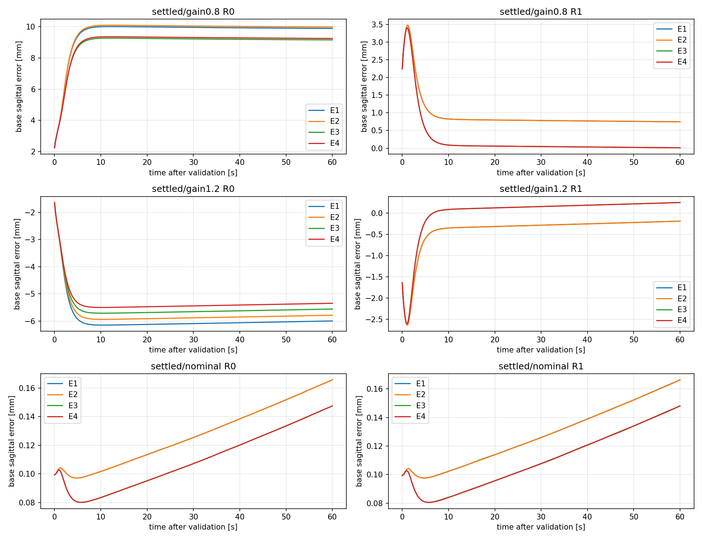
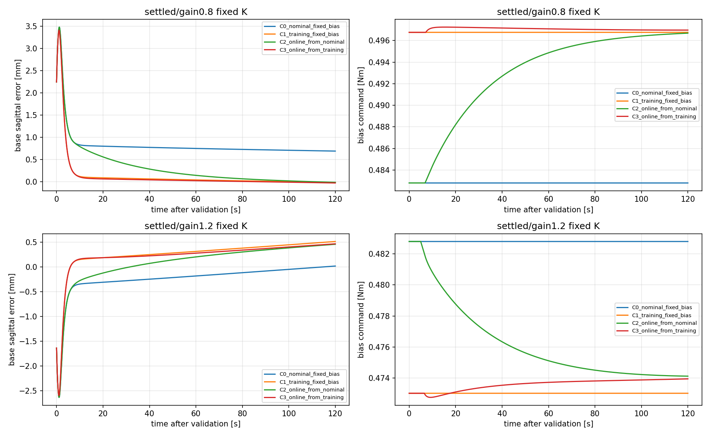

# model_60000 — Bias × K 분리, 내부 Reference 및 Online Bias 검증

작성일: 2026-10-16 (Asia/Seoul)

Execution Domain: **VALIDATION_SIM** (준비·분석·검사: **DESKTOP_DRY_RUN**)

Policy Checkpoint: `lab/ddt_lab/logs/flash_sac/tita_flash_sac_115632_883848/model_60000/actor.pt`

Policy Checkpoint SHA256: `6d3cba9fa76eebe9fb2f40ef23d34115b8b95028ec788571531ffb33ce821a05`

ONNX SHA256: `f44f07ed44970e3ff565eae67fd9229adf0be5c02215591c52a691ffcbb71b2a`

Evidence Status: **PASS — A/B 수집·K 검증, mismatch의 bias/reference 보정 효과, C의 gain1.2에서 학습 bias 고정 대비 추가 개선. FAIL — 동결 식별 K의 추가 개선 기준, C의 전조건 우월성.** 첫 준비 절차의 gain0.8 후보 검증 FAIL은 보존했다. Online RLS+Bias+gain 동시 갱신·주행 중 mismatch·실기: **NOT_TESTED**.

Observed Metrics / Behavior / Log Summary:

**Bias와 내부 reference를 일관되게 바꾸는 효과가 K만 바꾸는 효과보다 컸다.** gain0.8의 Fixed K에서 후반 base RMSE는 기존 R0/bias의9.905 mm에서 bias 보정만으로9.168 mm, R1까지 적용하면0.0261 mm로 줄었다. 다만 A/B의 조건별 bias는 이전 진단에서 얻은 원인 분리용 값이다.

**온라인 bias의 이득은 조건·비교군에 따라 달랐다.** 학습 구간 bias 고정 대비 gain1.2는 IAE9.70%·후반RMSE10.86% 개선됐지만, gain0.8은 IAE가 감소해도 후반RMSE가 증가했다. gain1.2에서는 nominal bias 고정군보다도 GT 오차가 컸다. 전조건의 온라인 제어 우월성이나 K 갱신의 추가 이득을 입증한 결과는 아니다. 정책·기존 runtime·이전 모델·이전 보고서는 보존했다.

## 비교 설계

Nominal, motor gain0.8/1.2 × seed261의3개 pitch perturbation, 총9조건이다. 기존 mismatch60초 및 공통 식별60초 로그를 재현한다. 모든 모델·reference·bias 초기값은 평가 전에 고정한다. 주 물리 평가점은 base_link 원점이며 wheel midpoint는 보조 지표다. 제어 p/v는 기존 encoder/동기화 IMU이며 GT로 보정하지 않는다.

| 군 | Bias | K |
|---|---|---|
| E1 | 0.4828 Nm | 기존 Fixed |
| E2 | 0.4828 Nm | 공통 식별 후 동결 |
| E3 | 이전 진단의 조건별 유한시간 유지 입력 | 기존 Fixed |
| E4 | 같은 조건별 입력 | 같은 식별 후 동결 K |

A는 nominal reference R0에서 비교한다. B는 같은4군의 내부22상태만 공통 식별 마지막10초 평균 R1으로 바꾼다. **p_target은 모든 군·A/B/C에서 같고 v_target=0도 고정**한다. 지속 yaw 회전이 있는 유한시간 기준이며 정적 평형점이라고 가정하지 않는다.

E3/E4의 bias는 이전 평가 진단에서 얻은 값이므로 원인 분리용이다. 실제 온라인 성능의 근거로 쓰지 않는다. C의 초기값은 nominal 또는 평가 이전 공통 구간의 실제 residual 평균만 사용한다.

입력은 모든 군에서 합 residual **0.4328–0.5328 Nm**, feedback cap±0.05 Nm, ramp1.5초, 합 명령 slew2 Nm/s, 기존 바퀴당±12 Nm를 동일하게 적용한다. Bias를 바꿔도 절대 범위를 이동시키지 않는다. Motor gain은 policy+residual 전체 wheel 입력에 적용한다.

## K 검증과 준비 절차의 변경 기록

첫 준비는58초 RLS 학습·마지막2초 검증으로 사전 기록했다. gain0.8의 속도 RMSE0.0237–0.0245 mm/s가 기존0.020 mm/s 기준을 넘었고3개 후보가 거부됐다. 제어 비교 전 실패이며 이 결과를 `m4_bias_reference_abc/`에 보존했다. 당시 collector source도 보관했다.

새 준비는 별도 `m4_bias_reference_abc_v2/`에 계획을 저장한 뒤 공통60초로 모델을 동결하고, 추가2초를 동일한 Fixed 입력으로 검증한다. 추가 구간은 이전 M4 archive와 exact replay한다. 이 구간을 새 모델 학습에 넣지 않는다. **목표는 추가2초 전에 정하고, 그때 발생한 이동도 이후 물리·센서 오차에 포함**한다. 검증 후 목표를 현재 위치로 다시 잡지 않는다.

Gain은 같은 Q/R, 한 번의0.1 blend로 계산한다. 다음 조건을 모두 요구한다: 다음2초 p/v RMSE≤0.02 mm/0.02 mm/s, RLS 정보량 기준, nominal/식별 모델의 rho<1, 현재 상태의 raw jump≤0.005 Nm, **직전 K 대비25%와 immutable nominal K 대비 누적25% 둘 다**. Scaling은 nominal state_std로 고정한다. 이번에는 한 번만 채택하므로 두 상대 변화 값이 같지만 의미를 구분해 저장한다. 평가 중 RLS·K 갱신은 없다.

## C의 사전 조건과 갱신 규칙

C는 조건별로 A/B에서 고정 K의 bias 효과 및 E3의 R1 효과가 확인될 때만 진행한다. 효과 기준은3/3 정상 완료, base IAE·마지막5초 RMSE 중앙값 모두 비교군의95% 이하, paired IAE2/3 이상 개선, pitch/wheel torque 제한이다. 이는 이번 원인 분리용 운영 기준이며 사용자 정량 사양이나 실기 안정성 정리는 아니다.

C에서는 R1과 K를 동결하고120초씩 다음4개를 비교한다. Fixed K와 식별 K에서 각각 실행한다.

1. C0: nominal bias 고정.
2. C1: 평가 이전 식별 구간의 마지막10초 평균 residual을 bias로 고정.
3. C2: nominal bias에서 온라인 갱신 시작.
4. C3: C1과 같은 초기 bias에서 온라인 갱신 시작.

온라인 갱신은 최근5초 실제 residual 평균과 현재 bias의 차이를 time constant30초로 천천히 흡수하며, 변화율은0.0005 Nm/s 이하다. 기존 feedback이 요구하는 지속 입력을 bias로 넘기는 방식이다. 센서 속도 RMS≤1 mm/s, pitch 표준편차≤2 mrad, 절대 입력 포화 없음, 유한값인 창에서만 갱신한다. 제어 p 오차는 기존 feedback을 통해 적용 입력 이력에 반영된다. GT·motor gain label·미래 평가 데이터는 갱신에 들어가지 않는다.

C2/C0는 nominal 초기값으로부터의 회복을, C3/C1은 같은 학습 초기값에서 온라인 갱신의 추가 이득을 구분한다. C 성공은 후자의 IAE/RMSE5% 이상 개선 및 paired/stability 기준으로 판단하며, 단순한 사전 calibration 효과와 혼동하지 않는다. D의 Online RLS+Bias+gain 갱신, 주행 중 gain 변경, mass/lag/friction 및 실기는 이번 범위가 아니다.

## A 결과 — R0에서 Bias와 K 분리

각 표의 값은3개 pitch trial 지표의 중앙값이며 IAE 단위는 mm·s, RMSE는 mm다. 모든 군을60초 완료한72개 A/B episode만 동일 horizon으로 집계했다. E2/E4의 K는 평가 중 고정돼 있어 이전의 여러 차례 gain 갱신 결과와 직접 동일시하지 않는다.

| 조건 | E1 IAE / 후반RMSE | E2 IAE / 후반RMSE | E3 IAE / 후반RMSE | E4 IAE / 후반RMSE |
|---|---:|---:|---:|---:|
| gain0.8 | 578.531 / 9.9046 | 583.501 / 9.9939 | 535.842 / 9.1684 | 540.938 / 9.2605 |
| gain1.2 | 355.614 / 5.9924 | 343.588 / 5.7827 | 330.492 / 5.5542 | 318.374 / 5.3429 |
| nominal | 8.189 / 0.17674 | 8.189 / 0.17675 | 7.143 / 0.15848 | 7.141 / 0.15846 |

E3/E1은 gain0.8 IAE **7.38%**, gain1.2 **7.06%** 감소로 bias 보정만의 효과가 있었다. 그러나 큰 잔류 오차는 남았다. E4/E3은 gain0.8 IAE **0.95% 증가**, gain1.2 **3.67% 감소**였다. gain1.2에서 작은 개선은 관측됐지만 사전5% 기준을 통과하지 못했다. 모든 gain 변경이 나쁘다거나 추가 이득이 정확히0이라는 결론은 아니다.

## B 결과 — 같은 목표에서 R1의 효과

| 조건 | 군 | R0 IAE / 후반RMSE | R1 IAE / 후반RMSE | R1 sensor 후반 평균 오차 mm |
|---|---|---:|---:|---:|
| gain0.8 | E1 | 578.531 / 9.9046 | 55.722 / 0.76220 | +0.73631 |
| gain0.8 | E3 | 535.842 / 9.1684 | 13.781 / 0.02608 | +0.00024 |
| gain0.8 | E4 | 540.938 / 9.2605 | 13.782 / 0.02650 | +0.00066 |
| gain1.2 | E1 | 355.614 / 5.9924 | 22.834 / 0.18107 | −0.44466 |
| gain1.2 | E3 | 330.492 / 5.5542 | 16.664 / 0.25734 | −0.00635 |
| gain1.2 | E4 | 318.374 / 5.3429 | 16.634 / 0.25662 | −0.00707 |

R1은 mismatch에서 같은 bias·K의 큰 위치 잔류 오차를 줄였다. 하지만 **sensor 오차 감소와 base GT 오차 감소가 항상 함께 일어나지는 않았다.** gain1.2의 R1에서 E3는 E1보다 IAE27.0% 감소, sensor 오차도 감소했으나 후반 base RMSE는42.1% 증가했다. R1의 E4/E3 추가 이득은 사전 기준 미달이다.

Nominal에서 R1의 E3 IAE 감소는 R0 대비 약0.37%로 사전5% 미달이었다. C 진입은 bias 효과와 E3의 R1 효과를 둘 다 요구하므로 **gain0.8/1.2만 허용**, nominal C는 **NOT_TESTED — reference prerequisite failed**로 남긴다. 기준을 결과에 맞춰 완화하지 않았다.



## C 결과 — 센서·과거 토크만 이용한 느린 Bias 갱신

6조건 ×2개 동결 K ×4군, 총 **48개120초 episode 모두 정상 완료**했다. 아래는 Fixed K의3개 trial 중앙값이다. 각 행의 sensor/GT RMSE도 각각 trial 지표의 중앙값이며 두 값을 빼서 평균 경로 차이를 계산하지 않는다.

| 조건 | 군 | Base IAE mm·s | 후반 Base RMSE mm | 후반 Sensor RMSE mm | 최종 bias Nm |
|---|---|---:|---:|---:|---:|
| gain0.8 | C0 nominal 고정 | 99.670 | 0.70562 | 0.74268 | 0.482800 |
| gain0.8 | C1 학습 bias 고정 | 17.446 | 0.00383 | 0.04023 | 0.496668 |
| gain0.8 | C2 nominal→online | 38.712 | 0.00743 | 0.02996 | 0.496894 |
| gain0.8 | C3 학습 bias→online | 15.199 | 0.02339 | 0.01364 | 0.497175 |
| gain1.2 | C0 nominal 고정 | 27.804 | 0.00459 | 0.45352 | 0.482800 |
| gain1.2 | C1 학습 bias 고정 | 44.345 | 0.49421 | 0.04277 | 0.473012 |
| gain1.2 | C2 nominal→online | 35.378 | 0.43045 | 0.02113 | 0.474225 |
| gain1.2 | C3 학습 bias→online | 40.043 | 0.44057 | 0.01094 | 0.474050 |

### 같은 학습 초기값에서 온라인 갱신이 추가 이득을 주는가?

- **gain0.8 C3/C1: FAIL.** Fixed K IAE12.88% 감소, 후반GT RMSE는약6.11배였다. 식별 K도 IAE12.94% 감소, RMSE약5.36배로 같은 판정이다. 절대 RMSE는0.004→0.023 mm 수준이며 상대 배율과 함께 본다.
- **gain1.2 C3/C1: PASS.** Fixed K IAE9.70%, 후반GT RMSE10.86% 감소,3/3 paired IAE 개선 및 자세·wheel torque 조건을 통과했다. 식별 K에서도 IAE9.75%·RMSE10.91% 감소로 통과했다.

그러나 **gain1.2의 C3가 C0보다 우월한 것은 아니다.** C0는 sensor 위치 오차가 크지만 base GT 후반 오차가 작았다. C3는 sensor 오차를 줄이는 동안 그 물리 지점의 GT 오차를 증가시켰다. 따라서 C3/C1의 부분 PASS를 ‘nominal bias나 모든 Fixed 제어기보다 좋은 온라인 제어’로 확대하지 않는다.

### Nominal bias에서 회복할 수 있는가?

gain0.8의 C2/C0는 Fixed K에서 IAE61.16%·후반RMSE98.95% 감소로 통과했다. 반면 gain1.2는 IAE27.24% 증가, 후반RMSE도 증가해 실패했다. 식별 K에서도 같은 방향이다. 같은 갱신 규칙이 두 mismatch 모두에서 물리 위치 목표를 개선하지는 못했다.

온라인 갱신은 trial당 약5,641–5,751회 채택됐다. 평가 중 K·R1은 전 구간 고정이며 RLS update는0회다. Bias 변화율0.0005 Nm/s와 원래 절대 입력 범위를 지켰다. 갱신 전 상태/입력만으로 저장된 bias 이력을 다시 계산해 전 구간 일치를 확인했다.



### Sensor와 Base GT의 차이를 함께 해석해야 한다

C3의 마지막5초 평균 sensor path−base path는 gain0.8 약 **+0.03698 mm**, gain1.2 약 **−0.45144 mm**였다. Sensor 오차를0에 가깝게 만드는 것과 base GT를0으로 유지하는 것이 동일하지 않다. 특히 gain1.2의 C0에서 sensor 잔류 오차와 이 차이가 상쇄돼 물리 오차가 작았고, C3의 sensor 개선이 그 상쇄를 없앤 상황과 맞는다.

이 비교는 같은 물리 기준점·같은 목표에서 계산했다. 목표를 drift한 위치로 옮기지 않았다. 다만 기존 rolling odometry를 base GT로 변환하거나 slip/접촉 편향을 제거한 실험은 아니다. 새로운 원인을 단일 항으로 확정하지 않으며 이전 [odometry 진단](../2026-10-15/flash_odometry_diagnostics_summary.md)의 기준점/접촉 한계와 구분 없이 ‘bias 추정이 실제 정지 입력을 완벽히 식별했다’고 주장하지 않는다. 학습한 값은 전체 feedback과 조합되는 **bias 성분**이며, 외부 LQR을 껐을 때의 참 유지 토크와 자동으로 같지 않다.

## 판단·범위·검증

이번 질문에 대한 답은 **유지 입력과 내부 reference의 일관성이 중요하다는 것은 실증했지만, 이들을 갱신하면 항상 K만 바꾸는 것보다 온라인 물리 위치 유지가 좋아진다는 주장은 아직 미완성**이다. A/B는 명확한 기전 증거를 제공했고 C는 조건부 추가 이득과 실패를 모두 보였다. 식별 K의 추가 효과도 이번 작은 blend/범위에서 사전5% 기준을 만족하지 못했다. 완전한 미블렌드 gain이나 다른 Q/R을 검증한 결과가 아니다.

기존 정착 운용점과 사전 mismatch·식별 prefix 이후의 유한시간 결과다. 주행 중 동역학 급변, 초기 drift 진입, yaw/world XY hold, 장시간 평형, 질량·마찰·lag, 새 seed 일반화, 실기는 수행하지 않았다. 특히 yaw는 계속 움직이며 R1의 평균 내부 상태가 정확한 정적 평형이라는 가정은 없다. Online RLS+Bias+gain을 동시에 연결하는 D는 이번 범위에서 실행하지 않았다.

- 신규 소스3개: `test/eval_m4_bias_reference.py`, `test/analyze_m4_bias_reference.py`, `test/test_m4_bias_reference.py`. 본 보고서·날짜 폴더의 증거만 추가했다. Runtime/기존 Adaptive guard·Q/R·정책·기존 보고서는 수정하지 않았다.
- 본 평가 **A/B72회 + C48회 =120회 정상 완료**. V2 준비의9개 mismatch60초·공통 식별60초·추가 검증2초는 기존 archive와 exact replay했다. 첫 V1은 수치 준비만 수행했으며 본 평가에 합산하지 않는다.
- 모든 군의 전체 snapshot을 동일하게 복원하고 첫 observation/action/history를 검사했다. 검증 전의 p_target과 검증 중 이동 offset을 보존했고, A/B/C 및R0/R1 사이 target 일치를 독립 감사했다. Wheel midpoint 결과도 각 trial에 있다.
- 합 residual의 요청 범위와2 Nm/s slew, feedback±0.05 Nm, 실제 physical wheel±12 Nm, 기존 leg torque 경로, 전체 raw last_action 보존을 검사했다. `max_planar_from_original_goal`은 검증 전 원점을 기준으로 별도 계산했다. Collector의 `max_planar_drift`는 평가 시작점 기준 보조 반경이며 둘을 혼용하지 않는다.
- 단위 검사 **4개 PASS**: bias가 바뀌어도 절대 band/ramp/slew 보존, 직전 대비와 nominal 누적 gain guard 차이, 과거 입력만 사용하는 bias와 갱신 거부 조건, 미완료 trial의 효과 gate 통과 금지. 실제120개 rollout의 목표·동결K·causal bias·입력 이력 감사도 PASS다.
- 초기 analyzer의1e−9 Nm bound 검사는 float32 actuator torque의 합산 반올림으로 실패했다. 요청값의 엄격한 bound는 유지하고 실제 재구성 torque만 collector와 같은1e−6 Nm 수치 허용오차로 검사했다. 물리 데이터·제어·성능 기준은 변경하지 않았다. 초기 로그를 보존했다.
- 기존 보호 **2,589개 파일 hash**와 tracked diff 보존은 최종 감사에서 확인한다. 실행 source 및 첫 준비 source도 보관했다. Branch: **`agent/codex/dev_tita_gluon`**. Commit/push·hardware 없음.
- `./scripts/agent-check.sh` **전체 FAIL**: 기존 `my_flat_env_cfg.py`의 trailing whitespace6곳이다. Python syntax **423개 PASS**, URDF XML **8개 PASS**, 실험 로그 경로/존재 검사 PASS다. 해당 기존 파일은 수정하지 않았다. 신규 소스·보고서 diff 검사는 별도 PASS다.

## 재현과 산출물

```bash
MPLCONFIGDIR=/tmp/lqr_mpl OPENBLAS_NUM_THREADS=1 OMP_NUM_THREADS=1 /home/cocel/venvs/cosim_ros2_jazzy/bin/python test/test_m4_bias_reference.py
MPLCONFIGDIR=/tmp/lqr_mpl OPENBLAS_NUM_THREADS=1 OMP_NUM_THREADS=1 /home/cocel/venvs/cosim_ros2_jazzy/bin/python test/eval_m4_bias_reference.py --stage prepare --root docs/exp/2026-10-16/new_bias_reference_abc --workers 3
MPLCONFIGDIR=/tmp/lqr_mpl OPENBLAS_NUM_THREADS=1 OMP_NUM_THREADS=1 /home/cocel/venvs/cosim_ros2_jazzy/bin/python test/eval_m4_bias_reference.py --stage ab --root docs/exp/2026-10-16/new_bias_reference_abc --workers 3
MPLCONFIGDIR=/tmp/lqr_mpl OPENBLAS_NUM_THREADS=1 OMP_NUM_THREADS=1 /home/cocel/venvs/cosim_ros2_jazzy/bin/python test/eval_m4_bias_reference.py --stage c --root docs/exp/2026-10-16/new_bias_reference_abc --workers 3
MPLCONFIGDIR=/tmp/lqr_mpl OPENBLAS_NUM_THREADS=1 OMP_NUM_THREADS=1 /home/cocel/venvs/cosim_ros2_jazzy/bin/python test/analyze_m4_bias_reference.py --root docs/exp/2026-10-16/new_bias_reference_abc
./scripts/agent-check.sh
```

출력은 미생성 폴더를 사용한다. 기존 archive/snapshot이 필요하며 이전 결과를 덮어쓰지 않는다. C는 A/B gate를 만족한 조건만 실행하고 나머지는 NOT_TESTED로 기록한다. 현재 최종 감사는 같은 analyzer에 본 보고서 경로의 `--report`를 지정해 수행한다.

산출물: [새 사전 계획](m4_bias_reference_abc_v2/plan.json), [첫 준비 기록](m4_bias_reference_abc/prepared_results.json), [전체 수치·C 판정](m4_bias_reference_abc_v2/summary.json), [A/B 조건별 판정](m4_bias_reference_abc_v2/ab_decision.json), [실제 이력 감사](m4_bias_reference_abc_v2/integrity.json), [최종 소스·보존 감사](m4_bias_reference_abc_v2/final_review.json), 각 조건 frozen/model/snapshot 및120개 NPZ와 실행 로그.
