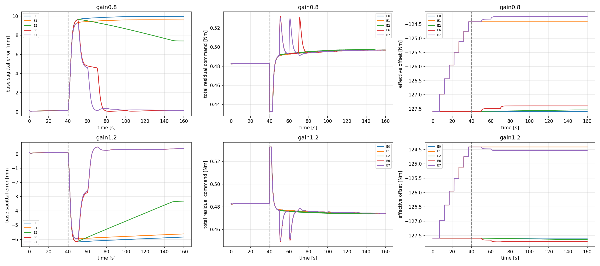

# model_60000 — 독립 factorial 및 Online Dynamics / Operating-Point Adaptation

작성일: 2026-10-16 (Asia/Seoul)

Execution Domain: **VALIDATION_SIM** (수치·인과성·증거 분석: **DESKTOP_DRY_RUN**)

Policy Checkpoint: `lab/ddt_lab/logs/flash_sac/tita_flash_sac_115632_883848/model_60000/actor.pt`

Policy Checkpoint SHA256: `6d3cba9fa76eebe9fb2f40ef23d34115b8b95028ec788571531ffb33ce821a05`

ONNX SHA256: `f44f07ed44970e3ff565eae67fd9229adf0be5c02215591c52a691ffcbb71b2a`

Evidence Status: **PASS — 독립 factorial·제한된 Bias/Reference 복원 효과·원래 목표/입력 예산·인과성 검사. FAIL — 변경 동역학의 온라인 모델 정확도와 변경 후 K 갱신을 포함한 Full Joint Adaptive LQR 입증.** B2의 실시간 bias 갱신 효과는 NOT_TESTED(실제 채택0회). 질량·마찰·lag 확장·실기: NOT_TESTED.

Observed Metrics / Behavior / Log Summary:

**새 seed의 고정 factorial, 실시간 갱신, 예고 없는 motor gain 변경까지 수행했다.** Gain 변경 후120초의 base 위치 IAE는 Bias+Reference(E6)가 Fixed 대비 gain0.8에서 **82.7%**, gain1.2에서 **82.7%** 감소했고 두 조건 각각 **6/6회** 원래 위치·속도 허용 범위로 복귀했다. Bias-only는 오차를 줄였지만 복귀하지 못했다.

그러나 **Full(E7)의 개선을 변경 동역학에 맞춘 K 적응 성공으로 해석할 수 없다.** Gain 변경 전 nominal 구간에서 K가7회 갱신됐고, 변경 뒤에는 K-enabled24개 episode 모두 새 K 채택이0회였다. 마지막 raw RLS 모델은 독립 입력 검증0/24 통과였다. 안정적인 마지막 K를 유지한 상태에서 Bias·내부 reference를 조정해 복원한 결과다.

본 root는 `m4_joint_operating_adaptation_v3/`, 갑작스러운 변경의 주5군 비교는 그 아래 `guarded_shock/`다. 기존 결과·스모크·재현 중복을 주 통계에 합산하지 않는다. 모든 표는 별도 표시가 없으면 조건별6개 초기 상태의 trial 지표 중앙값이며 모집단 유의성 주장이 아니다.

## 설계와 인과성

- M4의24상태와 기존 model_60000 actor·wheel/leg PD·raw last_action을 유지한다. Actor와 계측은 현재 상태의 clone-refreshed IMU를 사용하며 원본 physics cache를 변경하지 않는다.
- 학습은 기존 seed260의3개 pitch × nominal/gain0.8/gain1.2, **9개 공통 Fixed+probing 60초 stream**을 실제 MuJoCo에서 exact replay하고 nominal RLS prior부터 새로 계산한다. 이전 mismatch-trained 계수나 평가 미래를 초기값으로 넣지 않는다.
- 평가는 학습과 다른 **seed420/421 ×3개 pitch**, 새 nominal900초 정착 snapshot6개에서 시작한다. 각 snapshot을3환경에 동일 복제해 총18개 평가 context를 만든다. 조건별6개 초기 상태이며 같은 snapshot의 arm 반복은 독립 표본으로 해석하지 않는다.
- 새 평가의 공통60초 Fixed+probe 구간에서 목표를 정하고 **그 이후 목표를 재설정하지 않는다.** Prefix의 이동은 평가 p/GT 오차에 남는다. 독립 입력 검증을 보고 train 계수·bias·reference를 재튜닝하지 않는다.
- 물리 주 평가는 base_link origin의 heading-projected sagittal path이며 wheel midpoint와 yaw도 보조로 기록한다. 제어·RLS·bias/reference 추정은 기존 센서24상태와 실제 적용 residual만 사용한다. GT나 motor gain label은 estimator API에 전달하지 않는다.

## A0/A1 — 추정기와 재현

기존 nominal/gain0.8/gain1.2의 대표 pitch0에서 mismatch·공통prefix·Fixed·Adaptive 전체 observation/action/history와 모든 physics-substep torque를 exact replay한다. 이후 각 학습 stream에서 다음을 별도로 추정한다.

1. **K:** RLS의 A/B/c → 같은 Q/R의 DARE →0.1 blend. 위치 성능으로 K를 직접 최적화하지 않는다. 직전 대비25%와 immutable nominal 대비 누적25%를 모두 검사한다.
2. **B1 bias:** 최근5초 위치 오차의 느린 적분 보상. gain0.5 Nm/(m·s), 최대0.0005 Nm/s,1초 cadence다. 이는 유지 토크의 유일한 물리 식별값이라고 주장하지 않는다.
3. **B2 bias:** 갱신 모델에서2초의 폐루프 p/v 및 입력 변화 비용을 계산한다. 후보는 현 bias±0.001 Nm 안이며 온라인 갱신은1초당0.0005 Nm 이하로 제한한다. Shadow 후보와 공통 구간 endpoint 후보를 구분하고, 모델 및 후보의 실제20초 일정 입력 응답을 train seed에서 검증한다. 미래 test GT를 사용하지 않는다.
4. **내부 reference:** 충분한20초 저속 센서 창의 pitch/rate·previous action·leg q/dq 평균에서 후보를 만든다. p_target과 v_target=0은 고정한다. 후보는 관측 min/max 안이며 nominal 대비 성분 한도를 적용한다. 온라인에서는10초마다 새 목표를 만들고, 검증된 nominal/reference에서 후보까지 점진적으로 보간한다. 중간 reference가 관측 min/max 안이라고 허위 주장하지 않고, 검증된 시작점과 관측 후보를 잇는 경로라는 점을 구분한다.

학습 시 Fixed 제어 입력은 동일하게 유지하고 B1/B2/reference/K 후보는 shadow로 만든다. 이후 train snapshot에서 외부 LQR을 끈 일정 토크 응답을 측정한다. LQR의 잔류 위치 오차가 만든 입력을 곧바로 정확한 평형 토크라고 부르지 않는다. B2의 제안값·모델 검증 실패·실제 채택 여부는 각각 보존한다.

## A2 — 동결된 E0–E7

| 군 | K | Bias | 내부 reference |
|---|---|---|---|
| E0 | Fixed | Fixed | Fixed |
| E1 | 추정 후 고정 | Fixed | Fixed |
| E2 | Fixed | 추정 후 고정 | Fixed |
| E3 | Fixed | Fixed | 추정 후 고정 |
| E4 | 추정 후 고정 | 추정 후 고정 | Fixed |
| E5 | 추정 후 고정 | Fixed | 추정 후 고정 |
| E6 | Fixed | 추정 후 고정 | 추정 후 고정 |
| E7 | 추정 후 고정 | 추정 후 고정 | 추정 후 고정 |

Bias가 없는4군은 공유하고, bias가 있는4군은 B1/B2를 각각 비교한다. Context당12개 arm, 각60초다. 모든 arm은 같은 전체 MuJoCo·estimator·motor 상태·actor history를 복원한다. K가 같으면 bias와 `K·z_ref`는 입력의 상수항에서 합쳐지므로 **`effective_offset = bias + K·z_ref`를 모든 control step 기록**한다.

평가 snapshot의 새4초 sine/PRBS/±pulse/±step/±bipolar8종, amplitude0.01 Nm 및 직접 B 차분으로 frozen 모델의 독립 입력 응답을 확인한다. 최초2초 및 rolling0.1/0.5/1/2초 p/v NRMSE 중앙값≤30%, 직접B_v 오차≤30%를 유지한다. 미래 action/leg를 재주입하지 않는다. 실패한 모델의 K/B2 arm은 별도 NOT_TESTED로 남기며 다른 arm을 중단하지 않는다.

## B1 — 실시간 공동 갱신

A2의 효과가 확인된 arm을 조건별로 실행하며, 안정적인 K-only/Bias-only/E6/E7은 명시적인 비교군으로 보존한다. 모든 온라인 파라미터는 nominal에서 시작하고, 공통 과거 센서 prefix로만 RLS를 warm-start한다. 평가 중 동작은 다음과 같다.

- RLS: 매20 ms transition. 모델 중심 좌표는 nominal로 고정한다.
- K:5초마다 후보 모델을 저장하고 다음2초 실제 센서 p/v 예측 오차를 검증한다. DARE, rho, 정보량, support 및 변경량 제한을 검사한다.
- Bias:1초마다 충분한 과거 창에서 B1/B2 갱신. B2는 실제 후속 모델 검증이 유효할 때만 후보를 낸다.
- Reference:10초마다 관측 기반 후보,20 ms의 제한된 보간으로 부드럽게 적용. 빠른 운동·자세 변동·joint margin 위반에서는 갱신하지 않는다.
- Joint gate: 한 번의 raw 입력 변화≤0.005 Nm, K 단독 jump≤0.003 Nm. 실패 시 직전 파라미터를 유지하며 이벤트와 이유를 기록한다.

모든 군은 **합 residual0.4328–0.5328 Nm, 합 slew2 Nm/s, 기존 wheel±12 Nm**를 공유한다. Bias가 움직여도 허용 band를 넓히지 않는다. 별도 feedback cap을 추가하지 않고 `clip(bias−K·error)`에 공통 band를 적용한 뒤1.5초 활성화 ramp와 slew를 적용한다. 포화·큰 상태 오차·비정상 상태·정보량 부족에서 갱신을 중단한다. 마지막 모델은 별도 독립 probing으로 재검증한다.

성능 gate는 조건별6/6 완료·pitch/wheel 제한, Fixed 대비 base IAE 중앙값5% 이상 감소·후반RMSE≤120%·paired4/6 이상 개선이다. 이 threshold는 이번 진단의 사전 운영 기준이며 사용자 사양이나 안정성 정리가 아니다. 각 arm의 안정성과 성능을 따로 기록해 하나의 실패가 다른 군을 막지 않게 한다.

## C1 — 운용 중 비공개 gain 변경

B1에서 효과가 확인된 조건에만160초 시험을 허용한다. nominal40초 후 simulator wrapper만 gain을0.8 또는1.2로 바꾼다. Estimator는 변경 시각·값을 전달받지 않는다. 변경 뒤120초와 변경 직후부터의 전체 오차를 계산한다. 목표·센서 적분기·이전 action·RLS·motor 상태를 reset하지 않는다.

처음의 엄격한 admission은 최종 RLS 검증 실패 때문에 K-only/Full을 제외해 E0/E2/E6의36회를 실행했다. 이를 보존한 뒤, **모든6조건에서 물리적으로 안정한 제어기는 후보 gain 검사·마지막 K 유지 기능을 그대로 둔 비교군으로 실행**하는 보충 프로토콜을 고정했다. 원래 모델·성능 FAIL을 PASS로 바꾸지 않고, 실제 gain 채택 guard도 완화하지 않았다. 이렇게 Fixed E0, K-only E1, Bias-only E2, Bias+Ref E6, Full E7의60회를 별도로 수집했다. 공통36회는 원래 자료와 state/action/substep motor까지 exact 일치하며 합산하지 않는다.

Base IAE·최대 planar drift·후반 속도RMS·pitch/wheel torque·yaw·wheel-midpoint와 모델/K 변화를 기록했다. Recovery는 **base 위치±1 mm 및 속도±0.2 mm/s를5초 연속 유지**한 최초 시각이며, 변경 직후부터 측정한다. 미복귀는 null이다. 같은 controller를 다른 미래 gain 조건에서 실행한30쌍의 첫40초 상태·행동·토크·파라미터가 exact 일치했다. 서로 다른 controller는 nominal40초 동안 반응이 달라질 수 있으므로 변경 순간까지 같은 상태라고 주장하지 않는다. 변경 전 위치 유지 기준은60/60 통과했다.

## A2 결과 — 추정 후 고정한 세 요소

B1의8군은 모두6/6 완료했다. 셀은 **base IAE(mm·s) / 마지막5초 위치RMSE(mm)**다. 평가60초 동안 K·bias·reference가 고정됐음을 배열로 검사했다.

| 군 | Nominal | Gain0.8 | Gain1.2 |
|---|---:|---:|---:|
| E0 Fixed | 8.131 / 0.1705 | 590.391 / 9.8256 | 363.997 / 5.9715 |
| E1 K-only | 8.114 / 0.1702 | 595.412 / 9.9108 | 293.479 / 4.7386 |
| E2 Bias-only | 7.123 / 0.1477 | 548.136 / 9.0899 | 291.149 / 4.6805 |
| E3 Reference-only | 9.384 / 0.1929 | 87.595 / 0.7023 | **34.770 / 0.1364** |
| E4 K+Bias | 7.106 / 0.1473 | 553.311 / 9.1778 | 219.188 / 3.4159 |
| E5 K+Reference | 9.363 / 0.1925 | 87.563 / 0.7012 | 35.472 / 0.1487 |
| E6 Bias+Reference | 8.368 / 0.1701 | **54.422 / 0.0336** | 77.852 / 1.1549 |
| E7 Full | 8.349 / 0.1698 | 54.251 / 0.0319 | 78.821 / 1.1740 |

Gain0.8でK-onlyのIAEはFixedより0.85%増えた。内部referenceを実測平均に変えると大幅に改善し、Biasを併用するとさらに減少した。ただしE7のE6に対するIAE改善は **0.31%**にとどまる。Gain1.2ではE7はE6より **1.25%悪化**し、Reference-onlyがB1の結合群より良かった。NominalのE7はE6より0.23%小さいがFixedより約2.68%大きい。**Fullが一貫して最良という結果ではなく、K追加の5%以上のIAE改善も得られなかった。**

### B1/B2と「維持トルク」の意味

学習streamのB1候補はgain0.8で0.4973 Nm、gain1.2で0.4573–0.4598 Nmだった。外部LQRを外した20秒一定入力の最後5秒sensor平均速度は、それぞれ約−0.0040～−0.0047 mm/s、**+0.578～+0.672 mm/s**だった。したがってB1の値を条件に対応する真の平衡維持入力と呼べない。固定reference下の位置オフセットを積分して得た補償項であり、referenceを同時に変更すると補償が過剰になる場合もある。Gain1.2でE3がE6より良い結果もこの制約と併記する。

B2の固定factorialはnominal/gain1.2の全群、gain0.8のpitch0で実施した。Gain0.8のpitch±0.035ではtrainのbaseline absolute予測検査が不通過で、4群×4contextの **16armをNOT_TESTED** とした。全216予定中 **200episode正常完了**であり、不実施を失敗の短時間driftや成功数に含めない。

| B2固定群のbase IAE mm·s | Nominal,6条件 | Gain0.8,2条件のみ | Gain1.2,6条件 |
|---|---:|---:|---:|
| E2 | 7.007 | 587.692 | 349.173 |
| E4 | 6.989 | 598.714 | 278.180 |
| E6 | 8.251 | 85.787 | 26.514 |
| E7 | 8.233 | 85.734 | 26.623 |

Gain0.8の2条件中央値をB1全6条件との同等比較に使わない。Gain1.2ではB2のE6がB1のE6より良かったが、B2のE7はE6を上回らなかった。B2の2秒予測は**一定bias候補に既存LQRを組み合わせた有限時間予測**であり、24状態の静的平衡逆算ではない。別途、outer LQRを外した実際の一定入力20秒応答も保存した。

## B1結果 — 実時間更新の効果とモデルFAIL

条件別に許可された群を120秒評価し、**162/162episode正常完了**した。以下はB1の主要比較で、セルはIAE / 後半位置RMSE、単位は上と同じだ。

| 群 | Nominal | Gain0.8 | Gain1.2 |
|---|---:|---:|---:|
| Fixed | 21.020 / 0.2495 | 1178.435 / 9.7749 | 716.171 / 5.7865 |
| K-only | 20.949 / 0.2482 | 1178.435 / 9.7749 | 716.171 / 5.7865 |
| Bias-only | 19.614 / 0.2337 | 1006.845 / 7.2374 | 545.220 / 3.2543 |
| Reference-only | 조건gate로 미선택 | 273.800 / 0.6339 | **110.095 / 0.0407** |
| Bias+Reference | 19.576 / 0.2361 | **215.459 / 0.0644** | 128.428 / 0.4733 |
| Full | 19.579 / 0.2362 | **215.459 / 0.0644** | 128.428 / 0.4733 |

Gain0.8/1.2のFullはKを一度も更新できず、E6とsensor/state/action/実入力まで12組すべてexact一致した。K-onlyもFixedと同じ軌跡だった。NominalではK-enabled群が各23回更新した。この相違を「K適応は不要」と一般化しない。**Mismatchでは今回の識別・gain採択条件が成立せず、K適応を実行できていない。**

各episode終了モデルを別の小入力8種で検証した。Gain0.8/1.2のraw RLSは不安定な自由予測を示し、代表する非位置A部分のスペクトル半径中央値は約 **1.235 / 1.234**だった。これは推定モデルの予測発散であり、実ロボットの転倒を意味しない。Bの即時係数が比較的近くてもAの長期予測は保証されなかった。情報行列のrank/P検査を通るだけでは十分でなく、2秒予測gateがK採択を止めた。

以前のseed260学習はmismatch後にsettleした過去区間を再生していたのに対し、新seedの共通prefixはgain変更直後の過渡を含む。代表3条件をオフラインで再計算し、prefixの飽和/範囲外transitionを除くとgain0.8のrhoが1.281→1.171、gain1.2が1.229→1.155に下がったが、依然1を超えた。フィルタだけが解決策、あるいはreference変更だけが原因とは結論しない。この診断で制御モデルを再チューニングしていない。

オンラインB2は選択された30episodeで**bias実変更0回**だった。そのE6/E7の改善があってもreferenceなど他の成分の結果であり、モデルベースbias適応の成功ではない。実装は直近に完了した2秒モデル検証フラグを最新RLS候補に用いるため、同じ行列snapshotを検証して使うKの処理とは異なる。この近似を記録し、B2の一般的な採択保証を主張しない。今回の0回採択はこの実装上の制限を解消した証拠でもない。

## C1結果 — Gain変更直後から120秒

全60episode正常完了。主評価は**変更後の全120秒**で、待機時間や最初の悪化区間を除外しない。位置はprefix開始時からの元の目標、yawは自由だ。

| Gain変更 | 群 | Base IAE mm·s | 最大planar drift mm | 最後5秒位置RMSE mm | 復帰,6条件 | 復帰時間中央値 s |
|---|---|---:|---:|---:|---:|---:|
| 1→0.8 | Fixed | 1157.048 | 10.822 | 9.9515 | 0/6 | 未復帰 |
| | K-only | 1119.777 | 10.504 | 9.6202 | 0/6 | 未復帰 |
| | Bias-only | 1005.145 | 10.560 | 7.4123 | 0/6 | 未復帰 |
| | Bias+Reference | 199.865 | 10.541 | **0.1169** | **6/6** | 36.12 |
| | Full | **160.122** | **10.245** | 0.1476 | **6/6** | **26.08** |
| 1→1.2 | Fixed | 706.596 | 7.247 | 5.8484 | 0/6 | 未復帰 |
| | K-only | 682.235 | 7.068 | 5.6350 | 0/6 | 未復帰 |
| | Bias-only | 551.392 | 6.314 | 3.3161 | 0/6 | 未復帰 |
| | Bias+Reference | 122.373 | 5.677 | 0.3949 | **6/6** | 25.56 |
| | Full | **119.498** | **5.488** | **0.3940** | **6/6** | 25.50 |

E6のIAE減少はFixed比82.73%/82.68%、E7は86.16%/83.09%だった。E7はE6よりgain0.8でIAEを約19.89%減らし復帰を約10.04秒早めたが、後半RMSEはE6より大きい。Gain1.2のE7追加IAE改善は約2.35%だった。最大planar driftの改善はIAEほど大きくなく、とくにgain0.8では変更直後の約1 cmの逸脱が残った。

同じ条件順の最後5秒base速度RMS(mm/s)は、E6 **0.000868 / 0.003376**、E7 **0.001813 / 0.003408**。変更後pitch RMSは5群全体の中央値範囲がgain0.8で0.000116–0.000165 rad、gain1.2で0.000085–0.000117 rad、wheel torque RMSは約0.10692–0.10702 / 0.10449–0.10456 Nm/輪だった。物理的balancing・入力制限の比較基準は全群で通過した。Yawとwheel-midpoint指標はraw JSON/NPZに保存し、yaw hold成功とはしない。



### 何が適応したのか

E1/E7は24episodeすべて、**変更前7回、変更後0回のK更新**だった。従ってこのFull-vs-E6差には変更前nominalで得たKと、その後の異なるBias/Reference・状態履歴が含まれる。変更後の動特性をRLSで学びKを作り直して復帰した、とは結論できない。

最後のraw RLSを同じphysical trajectoryからexact再生し、外部LQRを外した同じ一定入力baselineと新しい8入力を分岐した。**24/24の元のstate/action/substep torque再現はPASS、最後のRLSの独立p/v予測は0/24 PASS**だった。代表的な非位置rho範囲はgain0.8で約1.124–1.150、gain1.2で約1.419–1.434。変更後の新しい候補を棄却したことと整合する。

一方、**実際に採択済みKを生成した過去モデル**も同じ独立入力で別に検証した。主解析の680件とC1の168件のモデル評価はすべて基準内だった。これらは同じ応答上で複数時点モデルを比較した評価数であり、848個の独立MuJoCo入力応答ではない。主解析102行中60行はgain採択がなく、対応するモデル評価もない。最後に採択したモデル、最新raw RLS、実際に使われたKを混同しない。

`shock_decision.json`の`performance`は物理的改善の判定である。一般的な`model_gate`フィールドを最終RLSが独立検証に通った証明として使わず、別ファイル`shock_model_validation.json`の0/24と、変更後の実K採択数を合わせて判断する。

## 研究上の判定

| 問い | 今回の結果 |
|---|---|
| K-onlyの残留誤差をBias/内部Referenceで減らせるか | **PASS、限定条件**。内部referenceの寄与が大きく、bias-onlyは不十分だった |
| BiasとReferenceを併用すれば常に最良か | **FAIL**。gain1.2ではreference-onlyが良い比較もあった |
| FullはBias+Referenceに常に追加効果を出すか | **FAIL**。固定factorialで一貫した追加改善なし |
| 隠れたgain変更後に元の位置へ復帰できるか | **PASS、E6/E7とも各6/6**。最大逸脱と残留誤差は残る |
| 変化後のA/B/cを正確に学び、新Kに更新して改善したか | **FAIL / 未実証**。rawモデル検証失敗・変更後K採択0回 |

今回裏付けたのは、限られたMuJoCo運用点での **観測に基づく内部運用点・低速補償の効果**だ。Biasと`K·z_ref`は入力上合わさるため、各値を独立した物理定数として識別したとはしない。記録した`effective_offset`は大きい内部項との相殺を含み、実際のmotor/residualトルクではない。pを`p−p_hold`に変換した局所座標と元encoder座標の両方でoffset式を監査した。

固定nominal座標でのRLS中心、最初のp_hold、v_target=0をすべて保持した。GTをbias/reference/RLSに入れず、低速を確保した後に目標位置をdrift先へ移す処理もない。900秒定着、平面・zero-command・motor gain2条件の結果であり、初期停止の一般化・world XY/yaw保持・長期保証・別接触条件・実機を立証しない。**Dynamics IdentificationとOperating-Point Adaptationを分けて評価する必要が残る。**

## 제한과 변경 기록

첫 스모크 도중 collector 검증 코드를 수정해 소스 동결 검사가 거부했다. 물리 결과를 본 통계에 포함하지 않고 당시 source hash와 실행 버전을 보존했다. 수정 후 두 번째 스모크의 legacy/train은 PASS다. 첫 전체 실행의 입력 수식 감사에서 별도 feedback cap이 합 토크 예산을 좁히는 경우를 발견했다. 해당 프로세스는 tool에서 SIGINT/exit130을 확인해 중단했고 자료를 예비로 보존했다. 전용 검사로 이 차이를 재현한 뒤 공유 예산 수식을 수정했다. V2에서 새 seed의 정착6개와 학습9개는 완료됐지만 지표 집계의 NumPy 배열 선택 오류로 첫 factorial 집계가 중단됐다. 이 실행의 terminal ERROR를 확인한 뒤 원본을 보존했다. 제어·학습 함수 AST와 estimator source 및84개 artifact hash가 일치함을 검사해 완료 자료만 V3으로 복사했다. 실패한 factorial 자료는 재사용하지 않았으며, 새 평가와 조건부 후속 단계는 V3으로 수행한다.

요청한 현재 범위는 Phase A와 조건부 B/C다. 마찰·질량·lag 확장과 Sim2Real은 후속 gate에 남기며, 특히 이전 전도/큰 drift 조건에 Full Adaptive를 직접 적용하지 않는다. Hardware·정책 재학습·기존 runtime 변경·commit/push는 수행하지 않는다.

## 변경·검증·재현

- 신규7개: `test/m4_joint_adaptation.py`, `test/eval_m4_joint_pipeline.py`, `test/analyze_joint_operating_results.py`, `test/run_joint_guarded_shock.py`, `test/test_m4_joint_adaptation.py`, `test/test_joint_shared_budget.py`, `test/test_joint_shock_admission.py`. 보고서와 증거를 추가했으며 ROS/runtime·정책·기존실험은 보존했다.
- 본 제어 평가는 **200 factorial +162 online +60 abrupt =422/422 정상 완료**다. B2의16개 prerequisite skip, 엄격 admission의36개 중복, 스모크는 제외했다. 새 nominal900초 정착6개, 공통 학습9개, 기존3조건 exact replay를 별도로 기록했다.
- 독립 물리 모델 검증은factorial18/18, online42/144, abrupt 마지막raw RLS0/24 통과였다. 총186개 snapshot-model 비교에서 **새4초 probing1488응답·186 baseline·직접B186쌍**을 수집했다. 모델FAIL은 수집/안전성FAIL과 다르며, 채택K의 과거 모델848건 재평가는 같은 데이터를 사용했다.
- 모든422개 제어 자료의 목표·합 토크/기존wheel clipping·원래leg torque·raw action history·offset 식을 검사했다. 192개 비고정online/shock episode의 K/bias/reference 이력을 과거 센서부터 인과적으로 다시 계산해 exact 일치했다. 관측된 최대 nominal 대비K 변화는 **22.38%**로 새 누적25% 제한 안이었다. 기존설명과 다른 직전K 기준 제한을 누적 제한으로 오인하지 않는다.
- 단위 검사 **14개 PASS**: offset 비식별성, 관측 기반reference와 고정p/v, 회귀 중심 보존, 유한시간bias, 공통토크 예산·slew, recovery 시간,24상태support, 군별gate, wheel 지표시간축, bias변경 시 band 공유, 비교군admission이 원래modelFAIL을 바꾸지 않는지 검사했다. 증거: `unit_tests_final.log`.
- `./scripts/agent-check.sh` **전체FAIL**: 작업 전부터 있던 `my_flat_env_cfg.py`의 trailing whitespace6곳이다. Python syntax **430개PASS**, URDF **8개PASS**, 실험 경로/존재 검사PASS다. 기존파일은 수정하지 않았다. 이번7개Python/보고서의diff 검사는 별도 수행했다.
- 기존보호2789파일, 정책·실행core source·동결값hash, 작업 전tracked diff 보존, seed분리, 원래목표, frozen factorial, 숨겨진gain30쌍, 요구사항별완료감사는 `completion_audit.json`/`task.diff`에 기록한다. 연구성능 전체PASS와 구분한다.
- 브랜치 **`agent/codex/dev_tita_gluon`**. Commit/push·hardware·정책재학습·Q/R탐색 없음. 질량/마찰/lag의Full적응과Sim2Real은 후속조건 미충족으로NOT_TESTED다.

재현은 새출력폴더를 사용한다. V3의완료자료 재사용은 `recovery.json`의 명시적 terminal-error 감사에 한정됐으며, 아래 완전재수집에는 필요하지 않다.

```bash
export MPLCONFIGDIR=/tmp/lqr_mpl OPENBLAS_NUM_THREADS=1 OMP_NUM_THREADS=1
PYTHONPATH=test /home/cocel/venvs/cosim_ros2_jazzy/bin/python -m unittest test_m4_joint_adaptation test_joint_shared_budget test_joint_shock_admission
/home/cocel/venvs/cosim_ros2_jazzy/bin/python test/eval_m4_joint_pipeline.py --stage all --root docs/exp/2026-10-16/new_joint_run --workers 3
/home/cocel/venvs/cosim_ros2_jazzy/bin/python test/analyze_joint_operating_results.py --root docs/exp/2026-10-16/new_joint_run --causal-replay --validate-shock --gain-source-validation --workers 3
/home/cocel/venvs/cosim_ros2_jazzy/bin/python test/run_joint_guarded_shock.py --source docs/exp/2026-10-16/new_joint_run --output docs/exp/2026-10-16/new_joint_run/guarded_shock --workers 3
/home/cocel/venvs/cosim_ros2_jazzy/bin/python test/run_joint_guarded_shock.py --source docs/exp/2026-10-16/new_joint_run --output docs/exp/2026-10-16/new_joint_run/guarded_shock --compare-shared
/home/cocel/venvs/cosim_ros2_jazzy/bin/python test/analyze_joint_operating_results.py --root docs/exp/2026-10-16/new_joint_run/guarded_shock --causal-replay --validate-shock --gain-source-validation --workers 3
./scripts/agent-check.sh
```

수집은기존폴더 덮어쓰기를거부한다. `--validate-shock`는 새검증폴더를 생성하므로 완료한root에 반복하지 않는다. 분석코드의완료감사는 별도 `audit(root, report)` 함수이며 재분기없이 저장된증거를 검사한다.

산출물: [사전계획](m4_joint_operating_adaptation_v3/plan.json), [원요청snapshot](m4_joint_operating_adaptation_v3/objective.source.txt), [6단계실행상태](m4_joint_operating_adaptation_v3/pipeline_state.json), [factorial/online전체수치](m4_joint_operating_adaptation_v3/summary.json), [factorial판정](m4_joint_operating_adaptation_v3/factorial_decision.json), [online판정](m4_joint_operating_adaptation_v3/online_decision.json), [5군abrupt전체수치](m4_joint_operating_adaptation_v3/guarded_shock/summary.json), [abrupt실제K인과검사](m4_joint_operating_adaptation_v3/guarded_shock/analysis_integrity.json), [마지막RLS독립검증](m4_joint_operating_adaptation_v3/guarded_shock/shock_model_validation.json), [실제채택K의모델검증](m4_joint_operating_adaptation_v3/guarded_shock/gain_source_model_validation.json), [숨겨진미래gain검사](m4_joint_operating_adaptation_v3/guarded_shock/prechange_blindness.json), [원래36군exact비교](m4_joint_operating_adaptation_v3/guarded_shock/shared_comparator_replay.json), [E6/E7일치](m4_joint_operating_adaptation_v3/inactive_gain_equivalence.json), [prefix필터진단](m4_joint_operating_adaptation_v3/warm_prefix_filter_diagnosis.json), [완료감사](m4_joint_operating_adaptation_v3/completion_audit.json), [연구한계수치](m4_joint_operating_adaptation_v3/scientific_completion_facts.json), [최종검사로그](m4_joint_operating_adaptation_v3/agent_check.log), 전체NPZ·model/update JSON·source snapshot.
