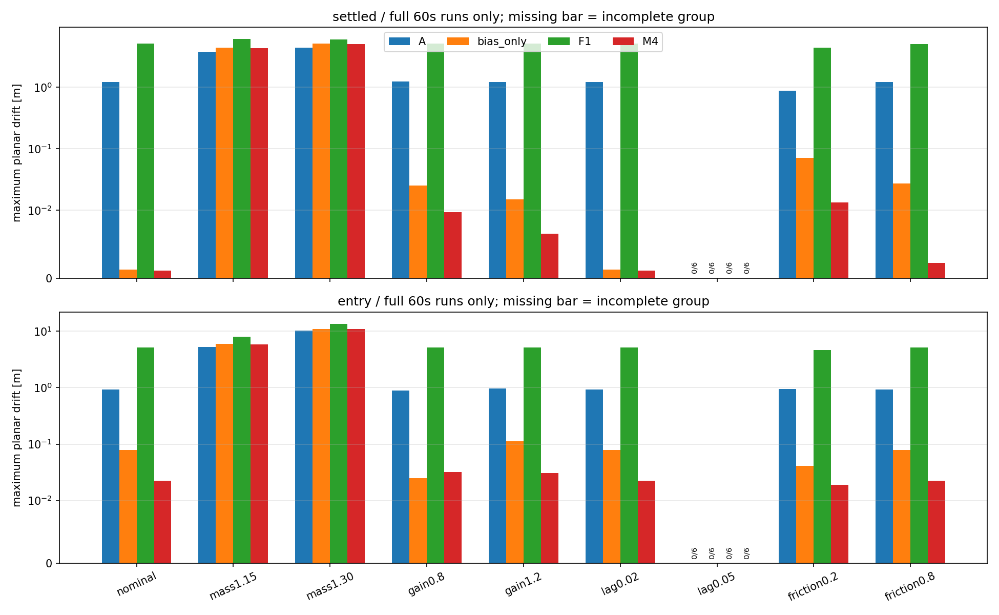
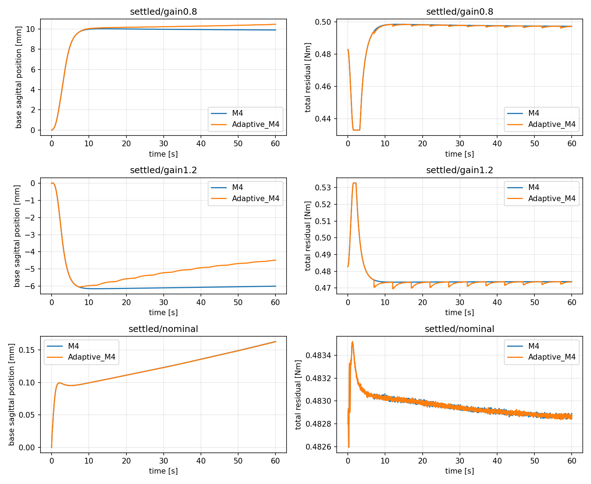

# model_60000 — M4 전용 Dynamics Mismatch·Shadow RLS·조건부 Adaptive LQR

작성일: 2026-10-16 (Asia/Seoul)

Execution Domain: **VALIDATION_SIM** (분석·수치 검사·증거 감사: **DESKTOP_DRY_RUN**)

Policy Checkpoint: `lab/ddt_lab/logs/flash_sac/tita_flash_sac_115632_883848/model_60000/actor.pt`

Policy Checkpoint SHA256: `6d3cba9fa76eebe9fb2f40ef23d34115b8b95028ec788571531ffb33ce821a05`

ONNX SHA256: `f44f07ed44970e3ff565eae67fd9229adf0be5c02215591c52a691ffcbb71b2a`

Evidence Status: **PASS — 수집·분기 무결성, motor gain1.2의 nominal-prior Adaptive 개선. FAIL — Fixed의 전체 mismatch 기준, Shadow의 전체 조건 기준, Adaptive gain0.8/nominal의 개선 기준.** 미허용 조건의 Adaptive·실기·초기 진입 Adaptive·장시간 일반화는 **NOT_TESTED**다.

Observed Metrics / Behavior / Log Summary:

**Nominal A/B에서 시작한 온라인 RLS + Adaptive M4가 motor gain1.2에서 Fixed 대비 base 위치 IAE를13.05% 줄였다.** 3/3쌍 모두 개선됐고 매 trial gain을11회 채택했다. 반면 gain0.8에서는2.13% 악화됐다. 질량 증가에서는 Fixed M4가 넘어지지 않아도 수 m 이동했고, motor lag50ms에서는 네 제어기 모두 실패했다. **특정 motor mismatch에서 모델 식별→gain 갱신→물리 제어 개선은 연결됐지만, 전반적인 Adaptive 강건성은 입증되지 않았다.**

## 1. M4 전용 후속 분기와 변경하지 않은 기준

[기존 M4/M5 파이프라인](../2026-10-15/flash_overnight_pipeline_summary.md)의 Stage 4 전체 FAIL과 M5 개별 FAIL을 그대로 보존했다. M4 개별 Stage 4의 실제 6조건 지표를 다시 계산하고 기존 Stage 1–4의 artifact·입력 hash를 확인한 뒤, 사용자 요청에 따라 **새 M4 전용 분기**만 허용했다. M5는 비교 기록으로 남기고 이번 제어에 적용하지 않았다. M6 없음.

주 물리 평가점은 **base_link 원점**, wheel midpoint는 보조 지표다. 두 점의 world 이동을 중간 horizontal heading에 투영해 누적한 sagittal path를 각각 기록했다. 센서 p/v는 기존 encoder/동기화 IMU rolling odometry이며, base GT로 바꾸거나 보정하지 않았다. GT는 물리 평가와 직접 B 검증에만 사용한다. Yaw hold나 world XY hold는 목표에 포함하지 않았다.

FlashSAC의 동기화 IMU·33개 observation·전체 8개 raw last_action·wheel velocity PD·leg position PD는 그대로다. Residual은 원래 wheel torque에만 더한다. Physics/control dt=0.005/0.02초, zero command, nominal 평면, push 없음. Floor 외 장애물은 메모리에서만 비활성화한다. 정책·runtime·기존 모델/보고서를 수정하지 않았다.

| 군 | FlashSAC 위에 적용하는 residual |
|---|---|
| A | 없음 |
| Bias Only | 합 +0.4828 Nm |
| F-1 | 현재 runtime 그대로: kp=2, kv=24, cap=2 Nm, ramp=1.5초, slew=2 Nm/s; bias 없음 |
| Fixed M4 | bias + 24-state −K e, 보정 cap=0.05 Nm, ramp=1.5초, slew=2 Nm/s |

M4의 K·비영 내부 기준 상태·bias·Q/R은 기존 frozen 파일 그대로다. Q_p=Q_v=250000, 나머지 비용 0, R=400. 전체 24-state feedback을 사용한다. F-1은 이전 model_100000/kv=0.5 결과와 다른 checkpoint·설정이므로 이전 34% 개선 수치와 직접 비교하지 않는다.

기존 Stage 5의 수치 기준은 **모든 M4와 대응 Bias trial 완료, 각 M4의 base IAE ≤ 대응 Bias IAE**다. 이를 완화하지 않았다. 다만 이것은 절대 정지 성능 기준이 아니다. 성능 FAIL도 정상 완료했다면 제어를 바꾸지 않는 Shadow 진단은 허용하고, gain 적용은 해당 조건의 독립 Shadow 검증 PASS가 있어야 한다.

## 2. Dynamics Mismatch — 432회

Nominal을 포함한 9조건 × 6초기 조건 × 2진입 방식 × 4군, 각 최대60초다.

- `settled`: 기존 seeds260/261 × pitch −0.035/0/+0.035, bias 전환 후1000초 snapshot. 이 정착된 nominal 상태에서 mismatch를 적용한다.
- `entry`: 기존 seeds270/271 × 같은 pitch, 원래 FlashSAC 8초 후 같은 상태를 네 군에 복제한다. 이 상태는 기존 국소 식별 범위 밖이었다는 사실을 유지한다.
- Mass는 모든 non-world robot body의 질량·관성을 함께 ×1.15/×1.30으로 변경한다. CoM 위치는 이동하지 않는다. 원래 qpos/qvel과 estimator 상태는 보존한다.
- Motor gain0.8/1.2와 lag0.02/0.05초는 합산·effort clipping 뒤 wheel에만 physics substep마다 적용한다. Lag는 5 ms 기준의 정확한 1차 지연 계수를 사용한다.
- Friction0.2/0.8은 floor와 wheel geom의 sliding friction을 모두 바꾸고 **실제 contact friction**을 확인한다. Wheel geom 하나만 바꿔 contact가 유지되는 오류를 피했다.

**384/432회 완료, 실패48회는 전부 lag0.05 조건의 attitude_limit**였다. 실패 시각은2.92–19.52초다. 실패 전 작은 drift를 60초 성공으로 비교하지 않는다.

### 초기 drift 진입: 최대 planar drift 중앙값, m

각 값은 같은6조건의 정상60초 완료 trial 중앙값이다. Lag0.05는 각 군0/6이므로 N/A다.

| 조건 | A | Bias Only | F-1 | Fixed M4 | M4 마지막5초 base 속도 RMS mm/s |
|---|---:|---:|---:|---:|---:|
| nominal | 0.93421 | 0.07947 | 5.19352 | **0.02220** | 0.1373 |
| mass1.15 | 5.23805 | 5.98657 | 8.04483 | **5.91215** | 99.7244 |
| mass1.30 | 10.20273 | 11.08058 | 13.48775 | **10.99297** | 188.7976 |
| gain0.8 | 0.88251 | 0.02509 | 5.16120 | 0.03169 | 0.2675 |
| gain1.2 | 0.96872 | 0.11319 | 5.21591 | 0.03043 | 0.2818 |
| lag0.02 | 0.93421 | 0.07947 | 5.22074 | 0.02220 | 0.1371 |
| lag0.05 | N/A | N/A | N/A | N/A | N/A |
| friction0.2 | 0.94419 | 0.04088 | 4.69399 | 0.01916 | 0.0358 |
| friction0.8 | 0.93386 | 0.07857 | 5.18894 | 0.02252 | 0.1368 |

질량 조건에서 M4의 IAE가 Bias보다 작아도 위치 유지 성공으로 해석하지 않는다. A보다 큰 최대 drift도 관측했다. Gain0.8은 원래 Stage5 비교 기준에서도 FAIL이다. Gain0.8/1.2의 마지막 속도도 기존 nominal Stage4의0.2mm/s 기준보다 크다. 서로 다른 판정을 하나의 PASS로 합치지 않는다.

### 정착 snapshot에서의 mismatch: 최대 planar drift 중앙값, m

| 조건 | A | Bias Only | F-1 | Fixed M4 | M4 마지막5초 base 속도 RMS mm/s |
|---|---:|---:|---:|---:|---:|
| nominal | 1.20887 | 0.00127 | 5.04782 | 0.00112 | 0.00123 |
| mass1.15 | 3.76889 | 4.34412 | 6.00850 | 4.28445 | 84.4407 |
| mass1.30 | 4.40026 | 5.08816 | 5.93402 | 5.02509 | 104.8515 |
| gain0.8 | 1.21822 | 0.02492 | 5.04824 | 0.00969 | 0.00196 |
| gain1.2 | 1.20256 | 0.01499 | 5.04964 | 0.00653 | 0.00298 |
| lag0.02 | 1.20895 | 0.00127 | 5.06768 | 0.00112 | 0.00123 |
| lag0.05 | N/A | N/A | N/A | N/A | N/A |
| friction0.2 | 0.87704 | 0.06986 | 4.38202 | 0.01322 | 0.14606 |
| friction0.8 | 1.20220 | 0.02698 | 5.03162 | 0.00227 | 0.01929 |



원래 Stage5 비교 기준에서는 settled8/9조건, entry7/9조건이 PASS였다. Mass 조건은 그 상대 기준을 통과해도 절대 위치 유지는 실패했다. 전체 조건의 base/wheel-midpoint IAE, pitch, 실제 physics wheel torque RMS, failure, train support 비율은 [집계](m4_followup_pipeline/run_final/comparison_summary.json)와 [전체 trial](m4_followup_pipeline/run_final/mismatch/metrics.json)에 저장했다. 같은 snapshot의 여러 분기를 독립 모집단 표본으로 다루지 않는다.

기존 helper의 pitch RMS 기준도 보존했다. M4/Adaptive는 고정 nominal pitch reference, A/Bias/F-1은 분기 시작 pitch 기준이다. 이번 Adaptive의 pitch 비교는 같은 기준의 Fixed와만 판정했으며 서로 다른 그룹의 pitch RMS 숫자를 같은 기준으로 오해하지 않는다.

## 3. Shadow RLS — 상태 추정과 구분한 모델 검증

초기 Shadow 대상은 Fixed M4가6/6 정상 완료한 **settled의8조건**이다. Entry 영역의 온라인 적응은 이번 대상에서 제외했다. Lag0.05는 안정 완료 조건이 없어 Shadow를 실행하지 않는다. Mass 조건은 확보 시점이 nominal 정착 상태여도 mismatch 후 빠르게 이동하므로 ‘정상 정지 영역’이라고 부르지 않는다.

조건마다 train=seed260의3pitch, test=seed261의 같은 pitch로 나누고3모델을 각각 초기화·학습한다. Train/test는 MuJoCo 초기 조건을 분리하고, 이전60초 Fixed M4를 state/action/history/전체 substep torque까지 exact 재생한 뒤 시작한다. Motor lag 내부 상태도 snapshot에 포함한다.

Train60초 동안 Fixed M4를 유지하고 지정 PRBS 최대0.02Nm를 기존 보정 cap0.05/ramp/slew 안에서 더한다. RLS는 동기화 sensor state와 실제 추가 command만 순서대로 사용하며 GT·mismatch 라벨·counterfactual delta를 학습 입력으로 넣지 않는다. Unknown gain/lag 뒤의 물리 torque로 입력을 치환하지 않고, 알려진 command에 대한 plant를 식별한다.

```text
z = [p,v,pitch,pitch_rate,previous_raw_action(8),leg_q(6),leg_dq(6)]
z_next = A z + B r + c
```

위치 translation의 A첫 열=[1,0,...]와 previous-action의 B8행=0을 고정한다. Full A/B/c RLS가 주 후보이며 A고정 B/c-only도 사전 지정 비교로 남긴다. Forgetting0.9995, prior covariance100, state 단위 scale floor를 고정하고 test 결과로 조정하지 않는다. A 전체를 갱신해야 하는지는 이 비교 결과로 검토한다.

학습 후 행렬을 freeze하고 독립 test 상태에서 외부 LQR을 양쪽 분기 모두 해제한다. 직전 실제 residual command를 일정하게 유지하는 baseline과 그 위에 새 sine/PRBS/±pulse/±step/±bipolar를 더하는 분기를4초 비교한다. 전체24state를 재귀 예측하고 미래 action/leg 실측값을 넣지 않는다. Probe도 bias 주변±0.05Nm 안으로 clip하고 실제 du로 평가한다. Direct B는 같은 상태의±0.01Nm로 측정한다.

판정은 기존대로 최초2초와 rolling0.1/0.5/1/2초의 p/v response NRMSE 중앙값≤30%, direct B_v 부호 일치와 상대 오차≤30%다. Full update 정보량으로 rank25, RMS-scaled condition≤1e6, input innovation≥1%, 양의 finite covariance, samples≥250도 요구한다. 조건별3모델 모두 PASS인 경우에만 Adaptive를 허용한다. 이는 이번 사전 운영 기준이며 안정성 정리가 아니다.

### 독립 Shadow 결과

24개60초 학습 stream, 학습 비활성화 exact replay24개, 과거60초 M4 재현48개, 새4초 probe192개·baseline24개·direct B±차분24쌍을 기록했다. 이들은 서로 다른 종류의 증거이므로 독립 trial 수로 합치지 않는다. 조건당3개 모델의 test는 학습과 다른 seed의 같은 pitch를 사용한다.

| 조건 | 원래 모델 예측 PASS | Full RLS 예측 PASS | B/c-only 예측 PASS | Full 정보량 PASS | Full rolling2초 v NRMSE 중앙값 | Full B_v 상대오차 중앙값 |
|---|---:|---:|---:|---:|---:|---:|
| nominal | 3/3 | 3/3 | 3/3 | 3/3 | 6.84% | 0.00082% |
| gain0.8 | 3/3 | 3/3 | 0/3 | 3/3 | 6.56% | 0.02545% |
| gain1.2 | 3/3 | 3/3 | 1/3 | 3/3 | 2.76% | 0.05557% |
| lag0.02 | 0/3 | 0/3 | 0/3 | 3/3 | 162.61% | 4.64503% |
| friction0.2 | 0/3 | 0/3 | 0/3 | 3/3 | 4.66×10⁸% | 1.70047% |
| friction0.8 | 3/3 | 0/3 | 0/3 | 3/3 | 150.42% | 0.08185% |
| mass1.15 | 0/3 | 0/3 | 0/3 | 0/3 | 70.74% | 31.01557% |
| mass1.30 | 0/3 | 0/3 | 0/3 | 0/3 | 174.17% | 21.96248% |

예측 PASS는 B 기준까지 포함하며 정보량 기준과 별도다. **nominal/gain0.8/gain1.2만 최종 Shadow gate를 통과했다.** Top-level Shadow의 PASS는 이 세 조건의 후속 실험 허용을 뜻하며 전체8조건의 식별 성공은 아니다. 전체 식별 상태는 FAIL이다.

Gain0.8의 rolling2초 v NRMSE는 원래 모델27.66%→RLS6.56%, gain1.2는9.31%→2.76%로 개선됐다. 다만 원래 모델도 이 조건에서 이미 기존30% 기준을 통과했으므로 ‘기존 모델 실패를 RLS가 복구했다’고 주장하지 않는다.

Friction0.8은 원래 모델이 통과했는데 full RLS가 악화시켰다. Full A의 실제 spectral radius는 friction0.8 약1.0276, friction0.2 약1.162, lag0.02 약1.0104였다. 위치 translation 고유값1을 포함한 실제 추정 행렬에서 다시 계산한 값이다. B 오차가 작고 P가 유한해도 A의 후속 동역학이 잘못되면 재귀 예측은 실패한다. 이번 결과만으로 누락 상태·비선형성·RLS 수치 민감도의 기여를 하나로 확정하지 않는다.

Mass1.15의 input innovation은 약0.020–0.023%, condition number는 약703만–728만이었다. 보정 제한에 걸린 구간에서는 탐색 입력이 충분히 전달되지 않았다. 같은 제한을 쓴 test의 positive pulse/step 중 실제 du=0인 응답도 모델당2개였으며, 이 응답의 작은 오차를 유효한 토크 예측 증거로 해석하지 않는다. 정보량과 예측 gate가 모두 실패해 Adaptive는 차단됐다.

이번 B/c-only가 일반적으로 더 낫다는 근거도 없다. 전체 A 갱신의 위험은 확인했지만, 단순히 A를 고정하는 대안도 nominal 외 대부분 실패했다. 센서 noise 주입·forgetting/P 탐색·장시간 RLS 강건성은 NOT_TESTED다. Online 식별이 odometry 기준점 차이를 보정한다는 가정은 사용하지 않았다.

[Shadow 전체 지표](m4_followup_pipeline/run_final/shadow_comparison.json)의 `actual_full_A_rho`와 각 결과의 `information`을 사용한다. Frozen model dict에 복사된 기존 nominal fit의 `spectral_radius/rank` 등 legacy metadata는 현재 RLS 통계가 아니다. 행렬 자체·예측·gate는 새 값으로 계산됐으며 raw frozen 증거를 수정하지 않았다.

### 조건부 Adaptive 비교

Shadow를 통과한3조건만 대상으로, 새 sensor stream에서 RLS를 갱신하고 이후2초의 실제 센서 응답으로 후보 모델을 확인한 뒤 gain을 채택한다. 미래 실측 내부 상태를 모델에 재주입하지 않는다. 검증 실패 시 직전 채택 gain을 유지한다.

- 후보는5초마다 생성하고, 그 이후2초의 센서 p/v 예측 RMSE가 각각0.02mm/0.02mm/s 이내여야 한다. 정보량 조건도 요구한다.
- 같은 Q/R로 DARE를 계산하고 고정0.1 blend만 사용한다. Nominal/새 모델 모두ρ(A−BK)<1, state scale을 반영한 nominal 대비 gain 변화≤25%, 현재 오차에서 raw torque 변화≤0.005Nm인 후보만 채택한다. 실패 후보를 통과시키기 위한 추가 blend 탐색은 하지 않는다.
- Bias0.4828Nm, 비영 operating reference, 보정 cap0.05Nm/ramp1.5초/slew2Nm/s는 고정한다. Affine offset은 모델 예측에는 사용하지만 r_eq나 reference를 온라인으로 외삽하지 않는다. 따라서 이번 비교는 **gain 적응의 효과**이며 bias 적응의 효과가 아니다.
- 같은 test seed261의3pitch에서 공통60초 Fixed+probe 식별 prefix를 지난 동일 전체 상태를 A/Bias/F-1/Fixed/Adaptive에 복제한 뒤60초 비교한다. 평가 중 추가 probing은 없다. Mismatch 발생 직후부터의 cold 정책 전환이나60초보다 빠른 적응은 검증하지 않았다.

사전 제어 성공 기준은3/3 정상 완료, 각 trial의 실제 gain 채택, median base IAE≤Fixed의90%, paired IAE 개선≥2/3이다. Pitch RMS≤max(1.25×Fixed,0.002rad), wheel torque RMS≤1.25×Fixed, 마지막5초 base 속도RMS≤max(1.1×Fixed,0.2mm/s)도 요구한다. 새 Adaptive 비교를 위한 운영 기준이며 기존 Stage1–5 기준을 변경한 것이 아니다.

초기화는 별도 실험으로 구분했다. Warm은 독립 Shadow 학습 모델을 prior로 사용한다. **Cold는 원래 nominal A/B/c에서 시작해 새 sensor stream만으로 RLS를 갱신한다.** Cold에서도 Shadow 조건별 PASS는 적용 허가로 사용하지만 학습 계수 자체를 가져오지 않는다. 초기화 비교의 조건·Q/R·gain guard·성공 기준은 동일하다.

| 초기화 | 조건 | 실제 gain 채택/각 trial | Adaptive/Fixed base IAE 중앙값 비율 | paired IAE 개선 | 사전 제어 기준 |
|---|---|---:|---:|---:|---|
| Warm | gain0.8 | 10회 | 1.00948 (+0.95%) | 0/3 | FAIL |
| Warm | gain1.2 | 11회 | **0.85026 (−14.97%)** | **3/3** | **PASS** |
| Warm | nominal | 11회 | 0.99997 (−0.003%) | 2/3 | FAIL |
| **Cold** | **gain0.8** | **11회** | **1.02127 (+2.13%)** | **0/3** | **FAIL** |
| **Cold** | **gain1.2** | **11회** | **0.86949 (−13.05%)** | **3/3** | **PASS** |
| Cold | nominal | 11회 | 0.99928 (−0.072%) | 3/3 | FAIL |

Warm의5군×3조건×3pitch=45회는 모두 정상 완료했다. Cold는 공통 prefix와 A/Bias/F-1/Fixed36개 분기를 hash/exact 확인해 재사용하며 Adaptive9개만 새로 실행한다. 이 재사용 자료를 독립 표본으로 늘려 합산하지 않는다. Engineering smoke/pilot도 본 통계에서 제외한다.

Warm gain1.2의 마지막5초 속도RMS 중앙값은 Fixed0.00315→Adaptive0.02478mm/s로 증가했다. 선언한0.2mm/s 한도 이내이지만 모든 정지 지표가 개선된 것은 아니다. Warm nominal의 미세한 IAE 차이는 의미 있는 Adaptive 우위로 판정하지 않는다.

Cold의 새 Adaptive9회도 모두 정상 완료했다. Gain1.2의 주요 물리 지표는 다음과 같다. 같은 초기 조건3개의 trial별 지표 중앙값이며, IAE 감소율을 최대 drift 감소율로 바꿔 부르지 않는다.

| Gain1.2, cold 비교 | Fixed M4 | Adaptive M4 |
|---|---:|---:|
| Base 위치 IAE mm·s | 346.466 | **301.250** |
| 최대 planar drift mm | 6.4052 | **6.0406** |
| 마지막5초 base 속도RMS mm/s | 0.003147 | **0.021833** |
| Pitch 기준오차RMS rad | 0.00013035 | 0.00013130 |
| Wheel torque RMS Nm/바퀴 | 0.103789 | 0.103808 |

최대 drift는약5.69% 감소했고, pitch RMS는약0.73%, wheel torque RMS는약0.018% 증가했다. 마지막 속도RMS는 더 커졌지만 선언한0.2mm/s 한도 안이었다. **위치 IAE·최대 drift 개선과 잔류 속도 악화를 함께 기록한다.** Nominal의0.072% IAE 차이는 성공 기준10%에 못 미치며 의미 있는 우위로 판정하지 않는다.



이번 평가의 목표 위치는 공통 식별 prefix가 끝난 시점에 다시 설정했다. Nominal 정착 snapshot에 mismatch를 적용하고 Fixed60초+공통 식별60초를 지난 뒤의 비교다. 기존 초기 진입60초의2.22cm와 이 표의mm 지표는 시작 상태·목표 위치가 다르므로 직접 비교하지 않는다. Mismatch가 갑자기 바뀐 순간의 Adaptive 복구 시간, 대규모 mass 변화의 제어 회복, yaw/XY hold는 미검증이다.

이 결과는 motor gain1.2라는 제한된 결정론적 조건에서 **nominal-prior 온라인 모델 학습과 검증된 gain 적용이 실제 위치 IAE를 개선한 증거**다. Gain0.8·질량·마찰·lag까지 일반화하지 않는다. Bias·내부 reference를 고정했으므로 gain 적응만으로 모든 mismatch의 잔류 위치 오차를 없앤다는 결론도 내리지 않는다.

## 4. 구현·기록의 구분

- 최초 collector는 lag50ms에서 wheel이 포화될 때 actual residual==request라는 기존 assert로 중단됐다. 물리 실패와 collector 실패를 구분해 최초 FAIL을 보존했다. 포화 후 actual/request를 모두 기록하는 collector로만 보완했으며 제어식과 성공 기준은 바꾸지 않았다.
- 완료된96jobs/384episodes는 hash 확인 후 그대로 재사용하고, 미완료 lag12jobs/48episodes만 보완했다. 최초 실행과 보완을 독립 시행으로 합산하지 않는다.
- Nominal에서 A/Bias/M4 기존 archive를 exact 재현했다. 각 trial의 leg torque는 원래 ActionAdapter 출력과 같고 raw history를 유지한다. Wheel effort clipping은 항상±12Nm/바퀴다.
- Shadow 학습을 끈 동일 command 재생에서도 state/observation/action/history/motor가 exact 일치하는지 확인한다. Shadow는 제어 gain을 갱신하지 않는다.
- 기존 보고서·M4/M5 행렬·gain·Q/R을 보존한다. 신규 코드는 test/, 증거는 본 날짜 docs/exp/ 아래에만 추가한다.

신규15개 test 소스는 M4 collector/제어 계측, Shadow/Adaptive·초기화 비교, coordinator/분석/감사와 수치·흐름 검사로 구성한다. 실제 runtime에는 연결하지 않았다. 전체 파일 목록과 실행 source hash는 [최종 감사](m4_followup_pipeline/final_review.json)의`source_sha256`, review 가능한 패치는`m4_followup_pipeline/task.diff`에 기록한다.

단위·흐름 검사 **9개 PASS**: 기존 M4 개별 gate 재계산·M5/전체FAIL 보존, 미완료/성능FAIL과Shadow 허가 구분, 증거 변조 거부·실패 재실행 금지, 알려진 affine plant 복원과 자유 예측·인과 제약, excitation 부족 거부·partial A고정, DARE 일치·gain/torque jump 거부, ShadowFAIL 후 Adaptive 차단. 실제 실행 로그는`unit_gates_final.log`, `unit_shadow_final.log`, `unit_adaptive_final.log`, `unit_flow_final.log`다.

Epoch 재시작 경계는 별도로 기록한다. Shadow mass 두 조건에서는 이전 포화 보정0.05Nm를0으로 초기화하면서 첫 command 차이가0.05Nm였다. Epoch 내부에는2Nm/s slew를 적용했지만 이 경계는20ms당0.04Nm 한도를 넘으므로 **연속 handoff 제한의 PASS로 주장하지 않는다: SUSPICIOUS**. 해당 모델은 정보량·예측에서 모두FAIL이고 gain 적용 대상이 아니다. Adaptive 허용3조건의 Shadow handoff는 모두0.04Nm 미만이었다. 보고한 정보량은 누적 regressor 진단이며 forgetting 가중의 지속 excitation 증명도 아니다.

[최종 감사](m4_followup_pipeline/final_review.json) **PASS**: 이전1294파일 hash, runtime·checkpoint·config 보존, 기존 tracked diff hash 보존,432개 mismatch의 초기 observation/action·raw history·leg 경로, 실제contact 마찰, 단계별 source/artifact hash를 확인했다. Leg torque 최대 차이는0.0이고, 포화 episode36개도 actual/request를 모두 기록했다. Cold9쌍의 prefix와 비교군 hash/exact 검증도PASS다. Handoff의 별도 한계는 [경계 진단](m4_followup_pipeline/run_final/shadow_handoff_diagnostics.json)에 남긴다.

`./scripts/agent-check.sh`는 **전체FAIL**이다. Python syntax **417개PASS**, URDF XML **8개PASS**지만, 기존 `my_flat_env_cfg.py`의 trailing whitespace6곳으로 diff 검사가 실패했다. 해당 기존 변경을 수정하지 않았다. 로그: `m4_followup_pipeline/agent_check_final.log`. 신규 파일 diff와 기존 변경 보존은 별도로 확인했다.

## 5. 재현

새 출력 폴더에서 M4 전용 전체 단계를 실행한다. 성능 FAIL은 그대로 기록하고 안정 완료 조건에만 Shadow 진단을 허용한다. Shadow 실패 조건에는 gain을 적용하지 않는다.

```bash
MPLCONFIGDIR=/tmp/lqr_mpl OPENBLAS_NUM_THREADS=1 OMP_NUM_THREADS=1 /home/cocel/venvs/cosim_ros2_jazzy/bin/python test/run_m4_pipeline.py --root docs/exp/2026-10-16/new_m4_pipeline --workers 3
MPLCONFIGDIR=/tmp/lqr_mpl /home/cocel/venvs/cosim_ros2_jazzy/bin/python test/analyze_m4_followup.py --root docs/exp/2026-10-16/new_m4_pipeline
./scripts/agent-check.sh
```

실패한 stage를 자동 재실행·덮어쓰기하지 않는다. `--resume`은 기존 hash-bound evidence를 검증한다. 이번 주 mismatch·warm 증거는 `m4_followup_pipeline/run_final`, 주 Adaptive cold 증거는 `m4_followup_pipeline/cold_adaptive`, Shadow 원자료는 `m4_followup_pipeline/shadow_run`, 최초 collector FAIL은 `m4_followup_pipeline/run`에 나눠 보존한다. 새 통합 실행은 warm을 보존한 뒤`<root>/cold_adaptive`도 자동 검증한다.

주 산출물: [M4 후속 허가](m4_followup_pipeline/run_final/00_authorization.json), [mismatch 판정](m4_followup_pipeline/run_final/01_mismatch.json), [조건별 Shadow 판정](m4_followup_pipeline/run_final/02_shadow.json), [warm 제어 판정](m4_followup_pipeline/run_final/03_adaptive.json), [nominal-prior cold 제어 판정](m4_followup_pipeline/cold_adaptive/03_adaptive.json), [cold 물리 지표](m4_followup_pipeline/cold_adaptive/adaptive_comparison.json), 개별 모델·P/정보량·gain 채택/거부 로그·전체 NPZ.

Hardware·Sim2Real·policy 재학습·nonzero command·yaw 제어·CoM 이동·bias/Q/R 재조정은 수행하지 않았다. Branch: **agent/codex/dev_tita_gluon**. Commit/push 없음.
