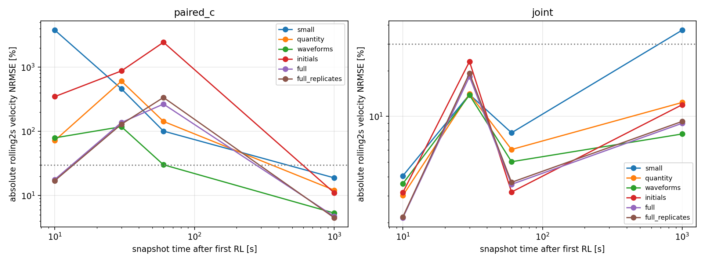
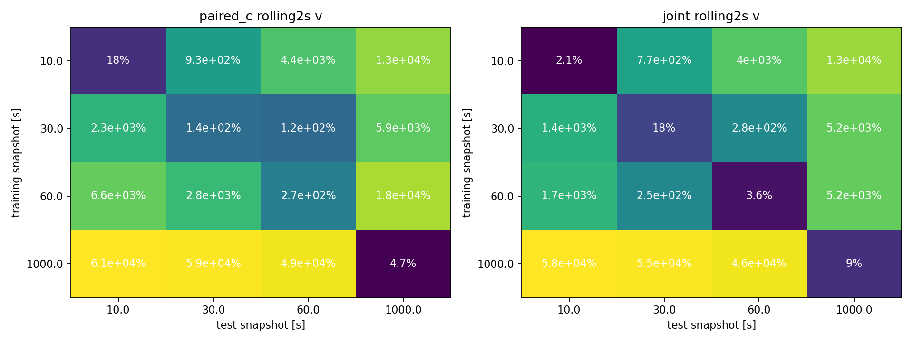

# Nominal M4 — fixed method/region/data diagnostics

Execution Domain: **DESKTOP_DRY_RUN**; collection: **VALIDATION_SIM**

Policy Checkpoint SHA256: `6d3cba9fa76eebe9fb2f40ef23d34115b8b95028ec788571531ffb33ce821a05`

Evidence Status: Per-row PASS/FAIL/NOT_TESTED below. No new controller or RLS tuning.

Observed Metrics / Behavior / Log Summary: Matched held-out starts; all24 states recursively predicted. Related branches are not independent starts.

| Train/test time s | Profile | Method | First2 p/v % | Rolling2 p/v % | Baseline | Contexts | Overall |
|---|---|---|---|---|---|---|---|
|10.0|small|paired_c|381.5/192|583.6/3795|0/6|0/6|FAIL|
|10.0|small|joint|0.4538/0.704|0.5988/4.055|6/6|6/6|PASS|
|10.0|quantity|paired_c|13.6/3.836|15.3/72.16|0/6|0/6|FAIL|
|10.0|quantity|joint|0.3465/0.6295|0.5452/3.008|6/6|6/6|PASS|
|10.0|waveforms|paired_c|10.23/3.518|12.9/79.34|0/6|0/6|FAIL|
|10.0|waveforms|joint|0.3376/0.6489|0.6378/3.603|6/6|6/6|PASS|
|10.0|initials|paired_c|15.77/19|67.52/349.1|0/6|0/6|FAIL|
|10.0|initials|joint|0.484/0.924|0.3882/3.148|6/6|6/6|PASS|
|10.0|full|paired_c|1.797/1.367|5.211/17.81|4/6|4/6|FAIL|
|10.0|full|joint|0.3651/0.8763|0.3689/2.148|6/6|6/6|PASS|
|10.0|full_replicates|paired_c|1.603/1.299|3.735/17.09|4/6|4/6|FAIL|
|10.0|full_replicates|joint|0.3707/0.882|0.3726/2.174|6/6|6/6|PASS|
|30.0|small|paired_c|44.94/23.41|68.23/460.6|0/6|0/6|FAIL|
|30.0|small|joint|0.9921/1.077|4.58/13.94|6/6|3/6|PASS|
|30.0|quantity|paired_c|40.92/32.02|67.71/607.7|0/6|0/6|FAIL|
|30.0|quantity|joint|0.9653/1.127|4.985/14.07|6/6|3/6|PASS|
|30.0|waveforms|paired_c|9.44/8.56|8.132/118.5|0/6|0/6|FAIL|
|30.0|waveforms|joint|1.331/1.484|5.623/13.82|6/6|3/6|PASS|
|30.0|initials|paired_c|56.28/14.77|238.7/877|0/6|0/6|FAIL|
|30.0|initials|joint|2.377/1.827|3.23/22.99|4/6|4/6|FAIL|
|30.0|full|paired_c|5.753/3.904|35.15/137.7|0/6|0/6|FAIL|
|30.0|full|joint|1.484/1.369|3.055/18.28|6/6|6/6|PASS|
|30.0|full_replicates|paired_c|5.089/3.777|32.05/129.6|0/6|0/6|FAIL|
|30.0|full_replicates|joint|1.472/1.364|3.041/19.22|6/6|6/6|PASS|
|60.0|small|paired_c|79.24/22.5|74.69/101.2|0/6|0/6|FAIL|
|60.0|small|joint|0.8871/0.8644|1.887/7.795|6/6|6/6|PASS|
|60.0|quantity|paired_c|69.43/18.06|71.17/143.2|0/6|0/6|FAIL|
|60.0|quantity|joint|0.8852/0.8617|1.663/6.048|6/6|6/6|PASS|
|60.0|waveforms|paired_c|21.27/5.552|22.35/30.2|0/6|0/6|FAIL|
|60.0|waveforms|joint|0.7817/0.8249|1.519/5.025|6/6|6/6|PASS|
|60.0|initials|paired_c|221/68.85|733.3/2452|0/6|0/6|FAIL|
|60.0|initials|joint|1.349/0.7704|0.737/3.172|6/6|6/6|PASS|
|60.0|full|paired_c|9.914/4.018|23.06/266.8|0/6|0/6|FAIL|
|60.0|full|joint|1.247/0.7367|0.882/3.564|6/6|6/6|PASS|
|60.0|full_replicates|paired_c|11.11/4.282|33.23/338.3|0/6|0/6|FAIL|
|60.0|full_replicates|joint|1.238/0.7604|0.8917/3.675|6/6|6/6|PASS|
|1000.0|small|paired_c|2.47/3.009|3.691/18.9|6/6|6/6|PASS|
|1000.0|small|joint|1.727/2.702|4.503/37.02|6/6|0/6|FAIL|
|1000.0|quantity|paired_c|1.928/2.503|2.776/12.16|6/6|6/6|PASS|
|1000.0|quantity|joint|1.975/2.578|3.189/12.35|6/6|6/6|PASS|
|1000.0|waveforms|paired_c|2.512/2.524|2.573/5.34|6/6|6/6|PASS|
|1000.0|waveforms|joint|1.761/2.457|2.755/7.656|6/6|6/6|PASS|
|1000.0|initials|paired_c|2.03/2.442|2.496/11.06|6/6|6/6|PASS|
|1000.0|initials|joint|1.953/2.558|2.842/11.93|6/6|6/6|PASS|
|1000.0|full|paired_c|2.126/2.581|2.516/4.73|6/6|6/6|PASS|
|1000.0|full|joint|1.68/2.631|2.708/9.007|6/6|6/6|PASS|
|1000.0|full_replicates|paired_c|2.161/2.515|2.432/4.516|6/6|6/6|PASS|
|1000.0|full_replicates|joint|1.753/2.604|2.688/9.266|6/6|6/6|PASS|

All frozen auxiliary numeric-cutoff and stream models, context distributions and baseline RMSE are in [comparison.json](comparison.json).
Constant-bias continuous-stream fits cannot identify B; they are diagnostics and never count as successful input identification.
Training profiles: small2; quantity6 same2families repeated; waveforms6; initials6 across3starts; full78; full_replicates102 responses per time.
Absolute joint fits also use each matched baseline once. Paired fits use the same raw pairs, then baseline one-step defects for c. These objectives differ; transition counts are logged.
Calibration baseline anchors are an offline coordinate translation, not a physical/controller goal reset.
No post-outcome threshold or source changes, controller, K, odometry replacement, hardware or policy retraining.
