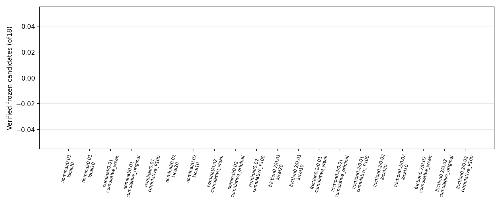

# Online Local M4 — A/B numerical tables

Execution Domain: **DESKTOP_DRY_RUN** (B collection: **VALIDATION_SIM**)

Policy Checkpoint SHA256: `6d3cba9fa76eebe9fb2f40ef23d34115b8b95028ec788571531ffb33ce821a05`

Evidence Status: Numerical and physical model gates are reported separately. No success inferred from workflow completion.

Observed Metrics / Behavior / Log Summary: A uses existing branches; B uses one causal physical time line per episode.

| A cohort | Setting | Predicting contexts PASS/total |
|---|---|---|
|nominal10|A1_plain|6/6|
|nominal10|A2_weighted_batch|6/6|
|nominal10|A3_recursive|6/6|
|nominal10|A4_lambda1_P100|0/6|
|nominal10|A4_lambda1_P1e8|6/6|
|nominal10|A4_lambda1_P1e8_zero|6/6|
|nominal30|A1_plain|6/6|
|nominal30|A2_weighted_batch|0/6|
|nominal30|A3_recursive|0/6|
|nominal30|A4_lambda1_P100|0/6|
|nominal30|A4_lambda1_P1e8|6/6|
|nominal30|A4_lambda1_P1e8_zero|6/6|
|nominal60|A1_plain|6/6|
|nominal60|A2_weighted_batch|0/6|
|nominal60|A3_recursive|0/6|
|nominal60|A4_lambda1_P100|0/6|
|nominal60|A4_lambda1_P1e8|6/6|
|nominal60|A4_lambda1_P1e8_zero|6/6|
|nominal1000|A1_plain|6/6|
|nominal1000|A2_weighted_batch|6/6|
|nominal1000|A3_recursive|6/6|
|nominal1000|A4_lambda1_P100|6/6|
|nominal1000|A4_lambda1_P1e8|6/6|
|nominal1000|A4_lambda1_P1e8_zero|6/6|
|friction0.2post|A1_plain|6/6|
|friction0.2post|A2_weighted_batch|0/6|
|friction0.2post|A3_recursive|0/6|
|friction0.2post|A4_lambda1_P100|0/6|
|friction0.2post|A4_lambda1_P1e8|6/6|
|friction0.2post|A4_lambda1_P1e8_zero|6/6|

| B split/domain/amplitude | Method | Candidate PASS | Episode with PASS | Prediction PASS | Information PASS |
|---|---|---|---|---|---|
|development/nominal/0.01|local20|0/9|0/3|0|0|
|development/nominal/0.01|local10|0/9|0/3|0|0|
|development/nominal/0.01|cumulative_weak|0/9|0/3|0|0|
|development/nominal/0.01|cumulative_original|0/9|0/3|0|0|
|development/nominal/0.01|cumulative_P100|0/9|0/3|0|0|
|development/nominal/0.02|local20|0/9|0/3|0|0|
|development/nominal/0.02|local10|0/9|0/3|0|0|
|development/nominal/0.02|cumulative_weak|0/9|0/3|0|0|
|development/nominal/0.02|cumulative_original|0/9|0/3|0|0|
|development/nominal/0.02|cumulative_P100|0/9|0/3|0|0|
|development/friction0.2/0.01|local20|0/9|0/3|0|2|
|development/friction0.2/0.01|local10|0/9|0/3|0|0|
|development/friction0.2/0.01|cumulative_weak|0/9|0/3|0|0|
|development/friction0.2/0.01|cumulative_original|0/9|0/3|0|0|
|development/friction0.2/0.01|cumulative_P100|0/9|0/3|0|0|
|development/friction0.2/0.02|local20|0/9|0/3|0|3|
|development/friction0.2/0.02|local10|0/9|0/3|1|1|
|development/friction0.2/0.02|cumulative_weak|0/9|0/3|0|3|
|development/friction0.2/0.02|cumulative_original|0/9|0/3|0|3|
|development/friction0.2/0.02|cumulative_P100|0/9|0/3|0|3|
|test/nominal/0.01|local20|0/18|0/6|0|0|
|test/nominal/0.01|local10|0/18|0/6|0|0|
|test/nominal/0.01|cumulative_weak|0/18|0/6|0|0|
|test/nominal/0.01|cumulative_original|0/18|0/6|0|0|
|test/nominal/0.01|cumulative_P100|0/18|0/6|0|0|
|test/nominal/0.02|local20|0/18|0/6|0|0|
|test/nominal/0.02|local10|0/18|0/6|0|0|
|test/nominal/0.02|cumulative_weak|0/18|0/6|0|0|
|test/nominal/0.02|cumulative_original|0/18|0/6|0|0|
|test/nominal/0.02|cumulative_P100|0/18|0/6|0|0|
|test/friction0.2/0.01|local20|0/18|0/6|0|3|
|test/friction0.2/0.01|local10|0/18|0/6|0|1|
|test/friction0.2/0.01|cumulative_weak|0/18|0/6|0|0|
|test/friction0.2/0.01|cumulative_original|0/18|0/6|0|0|
|test/friction0.2/0.01|cumulative_P100|0/18|0/6|0|0|
|test/friction0.2/0.02|local20|0/18|0/6|2|6|
|test/friction0.2/0.02|local10|0/18|0/6|2|3|
|test/friction0.2/0.02|cumulative_weak|0/18|0/6|0|6|
|test/friction0.2/0.02|cumulative_original|0/18|0/6|0|6|
|test/friction0.2/0.02|cumulative_P100|0/18|0/6|0|6|

C admission: {"nominal": {"C_permitted": false, "chosen_from_dev": null, "reason": "no predeclared setting/amplitude passes all3 development rollouts", "C_status": "NOT_TESTED"}, "friction0.2": {"C_permitted": false, "chosen_from_dev": null, "reason": "no predeclared setting/amplitude passes all3 development rollouts", "C_status": "NOT_TESTED"}}

Numerical same-objective SVD refinement is predefined. Raw recursive models/discrepancies remain in each candidate file.
Full4s subsequent validation is never training data for any candidate or later fit. Conditional B is not offline Direct B.
No elapsed time/domain labels, GT or snapshots are inputs to the regression features; time only indexes window membership and predeclared validation.
