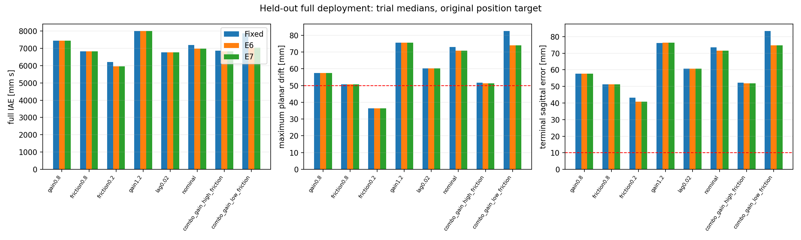

# TITA FlashSAC — Static Target-Domain Adaptation MORNING_REPORT

작성일: 2026-10-16 (Asia/Seoul)

Execution Domain: **VALIDATION_SIM** (분석·무결성: **DESKTOP_DRY_RUN**)

Policy Checkpoint SHA256: `6d3cba9fa76eebe9fb2f40ef23d34115b8b95028ec788571531ffb33ce821a05`

Evidence Status: **FAIL — 새로운 Target K 채택과 추가 제어 이득을 포함한 Full Joint 검증.** **NOT_TESTED — 실제 새 K를 활성화한 제어 성능 비교.** 단계별 안전성·식별·제어 성능은 아래에 분리한다. Workflow 완료는 연구 성능 PASS가 아니다.

현재 실행 상태: **COMPLETE**. RUNNING이면 완료된 단계만의 중간 집계다.

Observed Metrics / Behavior / Log Summary:

첫 startup physics 이전에 Target을 설정하고 종료까지 고정했다. RLS/제어는 sensor와 software clipping 뒤 알려진 residual만 사용했다. 동역학 라벨/값 및 GT는 learner에 전달하지 않았다. Actor는 frozen model_60000이며 prior A/B/c/K는 **nominal MuJoCo offline calibration**이다. Isaac-only source identification이나 실기 성공으로 해석하지 않는다.

## 주요 답변

- Fixed의180초 balancing/수치 guard 완료6/6 환경: gain0.8, friction0.8, friction0.2, gain1.2, lag0.02, nominal, combo_gain_high_friction, combo_gain_low_friction. 위치 유지 성공과는 별개다.
- E6의 원래 base-link 위치 절대 유지6/6 환경: 없음.
- E6의 Fixed 대비 최대 full-IAE 감소: 10.507%. 조건별 사전10%/paired4쌍 기준은 상세 표를 따른다.
- E7의 실제 새 Target K 채택: 0회. 채택이0이면 K 적응 활성 비교는NOT_TESTED이며 E6/E7의 같은 물리 결과를 K의 추가 이득으로 읽지 않는다.
- 실제 bias/reference 첫 갱신 시간과5초 연속 복귀 시간은 아래에 구분했다. 새 A/B/c를 정확히 학습해 K로 채택하는 데 필요한 시간은 기준 미충족 시 미확정이다.
- 질량/CoM은 큰 drift,50ms lag는 자세 guard로 후속 적응을 중단했다. 미끄럼·reference·입력 예산 중 단일 원인을 확정하지 않았다.

## Phase 0 — residual 없는 원래 정책

새 Target의 FlashSAC-only 전체 pilot33회를 먼저 종료한 뒤 Safety/Shadow를 시작했다. 아래 drift는 정상60초 완료 trial의 중앙값이며 실패한 짧은 trial을 좋은 drift로 집계하지 않는다.

| Target | 완료/3 | 최대 planar drift m | 실패 |
|---|---:|---:|---|
| gain0.8 | 3/3 | 0.81992 | {} |
| mass1.15 | 3/3 | 5.3096 | {} |
| mass1.30 | 3/3 | 9.647 | {} |
| friction0.2 | 3/3 | 0.9246 | {} |
| friction0.8 | 3/3 | 0.88368 | {} |
| gain1.2 | 3/3 | 0.93522 | {} |
| com+0.005 | 3/3 | 1.9651 | {} |
| lag0.05 | 0/3 | N/A | {'attitude_limit': 3} |
| lag0.02 | 3/3 | 0.87444 | {} |
| com-0.005 | 3/3 | 0.051509 | {} |
| nominal | 3/3 | 0.89333 | {} |

## Fixed pilot — balancing과 위치 유지의 구분

각 Target의3개 개발 시작조건에서60초를 평가했다. 후속 단계 admission은3/3 완료·후반속도≤50mm/s·종료위치≤250mm다. 이는180초 절대 hold 기준보다 느슨한 운용 가능성 gate이며 위치 유지 PASS가 아니다.

| Target | 완료/3 | 종료 위치 절댓값 mm | 후반 속도 RMS mm/s | 입력 포화 % | 후속 |
|---|---:|---:|---:|---:|---|
| mass1.30 | 3/3 | 10517 | 174.99 | 100 | NOT_TESTED |
| mass1.15 | 3/3 | 5913 | 99.364 | 100 | NOT_TESTED |
| gain0.8 | 3/3 | 53.673 | 0.61846 | 90.7 | 허용 |
| friction0.8 | 3/3 | 48.095 | 0.056442 | 85.367 | 허용 |
| friction0.2 | 3/3 | 39.106 | 0.035666 | 78.133 | 허용 |
| com+0.005 | 3/3 | 885.49 | 13.924 | 99.667 | NOT_TESTED |
| gain1.2 | 3/3 | 53.361 | 0.11353 | 95.867 | 허용 |
| lag0.05 | 0/3 | N/A | N/A | N/A | NOT_TESTED |
| lag0.02 | 3/3 | 43.497 | 0.31414 | 91.967 | 허용 |
| com-0.005 | 3/3 | 810.86 | 11.837 | 100 | NOT_TESTED |
| nominal | 3/3 | 42.258 | 0.15165 | 75.233 | 허용 |

## Held-out deployment —0–180초, 최초 목표 고정

Calibration0–60초의 이동/입력도 full IAE에 포함한다. 같은 Target의6개 시작조건이며 seed610/611×3pitch의 관련 반복이다. 완료율과 절대 위치 유지(최대planar≤0.05m, 종료sagittal≤0.01m, 마지막5초speedRMS≤0.2mm/s)를 별도로 기록한다.

| Target | 군 | 완료/6 | 절대 유지/6 | Full IAE mm·s | 최대 drift mm | 후반속도 mm/s | 새 K 수 |
|---|---|---:|---:|---:|---:|---:|---:|
| gain0.8 | Flash | 6/6 | 0/6 | 2.4076e+05 | 2868.4 | 18.504 | 0 |
| gain0.8 | Bias | 6/6 | 0/6 | 5048.4 | 75.306 | 2.2084 | 0 |
| gain0.8 | Fixed | 6/6 | 0/6 | 7448.8 | 57.493 | 0.62832 | 0 |
| gain0.8 | BiasOnline | 6/6 | 0/6 | 7448.5 | 57.493 | 0.62833 | 0 |
| gain0.8 | RefOnline | 6/6 | 0/6 | 7448.5 | 57.493 | 0.62833 | 0 |
| gain0.8 | E6 | 6/6 | 0/6 | 7448.5 | 57.493 | 0.62833 | 0 |
| gain0.8 | KOnly | 6/6 | 0/6 | 7448.5 | 57.493 | 0.62833 | 0 |
| gain0.8 | E7 | 6/6 | 0/6 | 7448.5 | 57.493 | 0.62833 | 0 |
| friction0.8 | Flash | 6/6 | 0/6 | 2.5345e+05 | 2963.6 | 18.674 | 0 |
| friction0.8 | Bias | 6/6 | 0/6 | 12234 | 186.76 | 2.396 | 0 |
| friction0.8 | Fixed | 6/6 | 0/6 | 6821.6 | 50.759 | 0.78807 | 0 |
| friction0.8 | BiasOnline | 6/6 | 0/6 | 6822 | 50.759 | 0.78806 | 0 |
| friction0.8 | RefOnline | 6/6 | 0/6 | 6822 | 50.759 | 0.78806 | 0 |
| friction0.8 | E6 | 6/6 | 0/6 | 6822 | 50.759 | 0.78806 | 0 |
| friction0.8 | KOnly | 6/6 | 0/6 | 6822 | 50.759 | 0.78806 | 0 |
| friction0.8 | E7 | 6/6 | 0/6 | 6822 | 50.759 | 0.78806 | 0 |
| friction0.2 | Flash | 6/6 | 0/6 | 2.7288e+05 | 1460.3 | 17.107 | 0 |
| friction0.2 | Bias | 6/6 | 0/6 | 15956 | 76.656 | 0.9404 | 0 |
| friction0.2 | Fixed | 6/6 | 0/6 | 6202.6 | 36.334 | 0.035224 | 0 |
| friction0.2 | BiasOnline | 6/6 | 0/6 | 6196.5 | 36.387 | 0.035229 | 0 |
| friction0.2 | RefOnline | 6/6 | 0/6 | 5930.8 | 36.387 | 0.035259 | 0 |
| friction0.2 | E6 | 6/6 | 0/6 | 5952 | 36.387 | 0.035259 | 0 |
| friction0.2 | KOnly | 6/6 | 0/6 | 6202.6 | 36.387 | 0.035233 | 0 |
| friction0.2 | E7 | 6/6 | 0/6 | 5952 | 36.387 | 0.035259 | 0 |
| gain1.2 | Flash | 6/6 | 0/6 | 2.6549e+05 | 3079.7 | 18.921 | 0 |
| gain1.2 | Bias | 6/6 | 0/6 | 23261 | 299.64 | 2.9149 | 0 |
| gain1.2 | Fixed | 6/6 | 0/6 | 8004.9 | 75.527 | 1.368 | 0 |
| gain1.2 | BiasOnline | 6/6 | 0/6 | 8002.3 | 75.587 | 1.368 | 0 |
| gain1.2 | RefOnline | 6/6 | 0/6 | 8002.3 | 75.587 | 1.368 | 0 |
| gain1.2 | E6 | 6/6 | 0/6 | 8002.3 | 75.587 | 1.368 | 0 |
| gain1.2 | KOnly | 6/6 | 0/6 | 8002.3 | 75.587 | 1.368 | 0 |
| gain1.2 | E7 | 6/6 | 0/6 | 8002.3 | 75.587 | 1.368 | 0 |
| lag0.02 | Flash | 6/6 | 0/6 | 2.5293e+05 | 2976.8 | 18.787 | 0 |
| lag0.02 | Bias | 6/6 | 0/6 | 12089 | 195.14 | 2.6324 | 0 |
| lag0.02 | Fixed | 6/6 | 0/6 | 6772.4 | 60.148 | 1.0322 | 0 |
| lag0.02 | BiasOnline | 6/6 | 0/6 | 6772 | 60.148 | 1.0322 | 0 |
| lag0.02 | RefOnline | 6/6 | 0/6 | 6772 | 60.148 | 1.0322 | 0 |
| lag0.02 | E6 | 6/6 | 0/6 | 6772 | 60.148 | 1.0322 | 0 |
| lag0.02 | KOnly | 6/6 | 0/6 | 6772 | 60.148 | 1.0322 | 0 |
| lag0.02 | E7 | 6/6 | 0/6 | 6772 | 60.148 | 1.0322 | 0 |
| nominal | Flash | 6/6 | 0/6 | 2.5763e+05 | 3019.5 | 18.84 | 0 |
| nominal | Bias | 6/6 | 0/6 | 15138 | 232.58 | 2.7701 | 0 |
| nominal | Fixed | 6/6 | 0/6 | 7191.8 | 72.913 | 1.265 | 0 |
| nominal | BiasOnline | 6/6 | 0/6 | 7151 | 72.492 | 1.2649 | 0 |
| nominal | RefOnline | 6/6 | 0/6 | 6983.2 | 70.868 | 1.2647 | 0 |
| nominal | E6 | 6/6 | 0/6 | 6981.9 | 70.856 | 1.2647 | 0 |
| nominal | KOnly | 6/6 | 0/6 | 7193.6 | 72.913 | 1.265 | 0 |
| nominal | E7 | 6/6 | 0/6 | 6981.9 | 70.856 | 1.2647 | 0 |
| combo_gain_high_friction | Flash | 6/6 | 0/6 | 2.5843e+05 | 3005.6 | 18.77 | 0 |
| combo_gain_high_friction | Bias | 6/6 | 0/6 | 16745 | 230.19 | 2.5329 | 0 |
| combo_gain_high_friction | Fixed | 6/6 | 0/6 | 6853.9 | 51.733 | 0.91385 | 0 |
| combo_gain_high_friction | BiasOnline | 6/6 | 0/6 | 6851.6 | 51.696 | 0.91383 | 0 |
| combo_gain_high_friction | RefOnline | 6/6 | 0/6 | 6823.6 | 51.33 | 0.91382 | 0 |
| combo_gain_high_friction | E6 | 6/6 | 0/6 | 6822.7 | 51.317 | 0.91381 | 0 |
| combo_gain_high_friction | KOnly | 6/6 | 0/6 | 6854.5 | 51.733 | 0.91383 | 0 |
| combo_gain_high_friction | E7 | 6/6 | 0/6 | 6822.7 | 51.317 | 0.91381 | 0 |
| combo_gain_low_friction | Flash | 6/6 | 0/6 | 2.5439e+05 | 3002.5 | 18.817 | 0 |
| combo_gain_low_friction | Bias | 6/6 | 0/6 | 10711 | 203.21 | 2.6804 | 0 |
| combo_gain_low_friction | Fixed | 6/6 | 0/6 | 7873.5 | 82.555 | 1.255 | 0 |
| combo_gain_low_friction | BiasOnline | 6/6 | 0/6 | 7757.5 | 81.222 | 1.255 | 0 |
| combo_gain_low_friction | RefOnline | 6/6 | 0/6 | 7036.5 | 73.773 | 1.2546 | 0 |
| combo_gain_low_friction | E6 | 6/6 | 0/6 | 7046.2 | 73.862 | 1.2546 | 0 |
| combo_gain_low_friction | KOnly | 6/6 | 0/6 | 7875.1 | 82.555 | 1.255 | 0 |
| combo_gain_low_friction | E7 | 6/6 | 0/6 | 7046.2 | 73.862 | 1.2546 | 0 |

## E6 / E7의 추가 이득

| Target | Fixed/Flash IAE 비 | E6/Fixed IAE 비 | E6 paired 개선 | E6 상대 gate | E7/E6 IAE 비 | E7 새 K |
|---|---:|---:|---:|---|---:|---:|
| gain0.8 | 0.030938 | 0.99996 | 2/6 | FAIL | 1 | 0 |
| friction0.8 | 0.026915 | 1.0001 | 1/6 | FAIL | 1 | 0 |
| friction0.2 | 0.022731 | 0.95959 | 5/6 | FAIL | 1 | 0 |
| gain1.2 | 0.030152 | 0.99968 | 3/6 | FAIL | 1 | 0 |
| lag0.02 | 0.026776 | 0.99994 | 1/6 | FAIL | 1 | 0 |
| nominal | 0.027916 | 0.97082 | 5/6 | FAIL | 1 | 0 |
| combo_gain_high_friction | 0.026522 | 0.99544 | 3/6 | FAIL | 1 | 0 |
| combo_gain_low_friction | 0.03095 | 0.89493 | 6/6 | PASS | 1 | 0 |

E6의6/6 절대 유지 환경: 없음. 새 K 채택과 E6/Fixed 대비 사전 추가 성능 기준을 함께 만족한 환경: 없음.

## 초기60초와 후속120초

| Target | 군 | 0–60초 IAE mm·s | 60–180초 IAE mm·s | 포화 시간 % | probing 에너지 Nm²·s | 복귀 수/6 |
|---|---|---:|---:|---:|---:|---:|
| gain0.8 | Fixed | 1427.8 | 6020.9 | 51.178 | 0 | 0/6 |
| gain0.8 | BiasOnline | 1427.7 | 6020.8 | 51.272 | 0.000422 | 0/6 |
| gain0.8 | RefOnline | 1427.7 | 6020.8 | 51.272 | 0.000422 | 0/6 |
| gain0.8 | E6 | 1427.7 | 6020.8 | 51.272 | 0.000422 | 0/6 |
| gain0.8 | E7 | 1427.7 | 6020.8 | 51.272 | 0.000422 | 0/6 |
| friction0.8 | Fixed | 1963.6 | 4855.2 | 56.322 | 0 | 0/6 |
| friction0.8 | BiasOnline | 1963.7 | 4855.2 | 56.578 | 0.000375 | 0/6 |
| friction0.8 | RefOnline | 1963.7 | 4855.2 | 56.578 | 0.000375 | 0/6 |
| friction0.8 | E6 | 1963.7 | 4855.2 | 56.578 | 0.000375 | 0/6 |
| friction0.8 | E7 | 1963.7 | 4855.2 | 56.578 | 0.000375 | 0/6 |
| friction0.2 | Fixed | 1276.6 | 4925.9 | 26.044 | 0 | 0/6 |
| friction0.2 | BiasOnline | 1277 | 4919 | 26.044 | 0.00115 | 0/6 |
| friction0.2 | RefOnline | 1277 | 4653.6 | 26.044 | 0.00115 | 0/6 |
| friction0.2 | E6 | 1277 | 4674.5 | 26.044 | 0.00115 | 0/6 |
| friction0.2 | E7 | 1277 | 4674.5 | 26.044 | 0.00115 | 0/6 |
| gain1.2 | Fixed | 2341 | 5672.9 | 98.533 | 0 | 0/6 |
| gain1.2 | BiasOnline | 2338.1 | 5668.2 | 98.7 | 0.000162 | 0/6 |
| gain1.2 | RefOnline | 2338.1 | 5668.2 | 98.7 | 0.000162 | 0/6 |
| gain1.2 | E6 | 2338.1 | 5668.2 | 98.7 | 0.000162 | 0/6 |
| gain1.2 | E7 | 2338.1 | 5668.2 | 98.7 | 0.000162 | 0/6 |
| lag0.02 | Fixed | 1844.8 | 4927.6 | 58.033 | 0 | 0/6 |
| lag0.02 | BiasOnline | 1844.4 | 4927.5 | 58.344 | 0.000212 | 0/6 |
| lag0.02 | RefOnline | 1844.4 | 4927.5 | 58.344 | 0.000212 | 0/6 |
| lag0.02 | E6 | 1844.4 | 4927.5 | 58.344 | 0.000212 | 0/6 |
| lag0.02 | E7 | 1844.4 | 4927.5 | 58.344 | 0.000212 | 0/6 |
| nominal | Fixed | 1973.1 | 5218.7 | 57.161 | 0 | 0/6 |
| nominal | BiasOnline | 1974.9 | 5176.1 | 58.35 | 0.00074 | 0/6 |
| nominal | RefOnline | 1974.9 | 5008.3 | 58.606 | 0.00074 | 0/6 |
| nominal | E6 | 1974.9 | 5007 | 58.622 | 0.00074 | 0/6 |
| nominal | E7 | 1974.9 | 5007 | 58.622 | 0.00074 | 0/6 |
| combo_gain_high_friction | Fixed | 2109.4 | 4744.5 | 71.65 | 0 | 0/6 |
| combo_gain_high_friction | BiasOnline | 2110 | 4741.6 | 71.606 | 0.000437 | 0/6 |
| combo_gain_high_friction | RefOnline | 2110 | 4713.6 | 71.656 | 0.000437 | 0/6 |
| combo_gain_high_friction | E6 | 2110 | 4712.7 | 71.656 | 0.000437 | 0/6 |
| combo_gain_high_friction | E7 | 2110 | 4712.7 | 71.656 | 0.000437 | 0/6 |
| combo_gain_low_friction | Fixed | 1942.6 | 5930.8 | 53.394 | 0 | 0/6 |
| combo_gain_low_friction | BiasOnline | 1944.4 | 5813.1 | 54.622 | 0.002116 | 0/6 |
| combo_gain_low_friction | RefOnline | 1944.4 | 5092.1 | 55.539 | 0.002116 | 0/6 |
| combo_gain_low_friction | E6 | 1944.4 | 5101.8 | 55.55 | 0.002116 | 0/6 |
| combo_gain_low_friction | E7 | 1944.4 | 5101.8 | 55.55 | 0.002116 | 0/6 |




## 식별·채택 시간과 제한

온라인 후보 모델은 nominal prior에서 단일 실제 rollout으로 학습한다. 동결된 후보의 후속4초 센서 검증과 조건부 B 회귀는 offline matched-state Direct B와 다른 측정이다. 사용자가 이 분리를 승인했으며 offline 물리 분기 결과/GT는 online learner에 들어가지 않는다. 정보량·예측 실패 또는 domain Shadow 실패에서는 새 K를 적용하지 않는다. 새 K가0회면 A/B 기반 K 적응 성공이라고 부르지 않는다.

| Stage / Target / 군 | 첫 K 채택 s, 중앙값 | 채택 합 | 독립 full 모델 PASS / 시행 |
|---|---:|---:|---:|
| 02_shadow / friction0.8 / KOnly | N/A | 0 | 0/0 |
| 02_shadow / gain0.8 / KOnly | N/A | 0 | 0/0 |
| 02_shadow / lag0.02 / KOnly | N/A | 0 | 0/0 |
| 02_shadow / friction0.2 / KOnly | N/A | 0 | 0/3 |
| 02_shadow / nominal / KOnly | N/A | 0 | 0/0 |
| 02_shadow / gain1.2 / KOnly | N/A | 0 | 0/0 |
| 03_primary / gain0.8 / BiasOnline | N/A | 0 | 0/0 |
| 03_primary / gain0.8 / RefOnline | N/A | 0 | 0/0 |
| 03_primary / gain0.8 / E6 | N/A | 0 | 0/0 |
| 03_primary / gain0.8 / KOnly | N/A | 0 | 0/0 |
| 03_primary / gain0.8 / E7 | N/A | 0 | 0/0 |
| 03_primary / friction0.8 / BiasOnline | N/A | 0 | 0/0 |
| 03_primary / friction0.8 / RefOnline | N/A | 0 | 0/0 |
| 03_primary / friction0.8 / E6 | N/A | 0 | 0/0 |
| 03_primary / friction0.8 / KOnly | N/A | 0 | 0/0 |
| 03_primary / friction0.8 / E7 | N/A | 0 | 0/0 |
| 03_primary / friction0.2 / BiasOnline | N/A | 0 | 0/6 |
| 03_primary / friction0.2 / RefOnline | N/A | 0 | 0/6 |
| 03_primary / friction0.2 / E6 | N/A | 0 | 0/6 |
| 03_primary / friction0.2 / KOnly | N/A | 0 | 0/6 |
| 03_primary / friction0.2 / E7 | N/A | 0 | 0/6 |
| 03_primary / gain1.2 / BiasOnline | N/A | 0 | 0/0 |
| 03_primary / gain1.2 / RefOnline | N/A | 0 | 0/0 |
| 03_primary / gain1.2 / E6 | N/A | 0 | 0/0 |
| 03_primary / gain1.2 / KOnly | N/A | 0 | 0/0 |
| 03_primary / gain1.2 / E7 | N/A | 0 | 0/0 |
| 03_primary / lag0.02 / BiasOnline | N/A | 0 | 0/0 |
| 03_primary / lag0.02 / RefOnline | N/A | 0 | 0/0 |
| 03_primary / lag0.02 / E6 | N/A | 0 | 0/0 |
| 03_primary / lag0.02 / KOnly | N/A | 0 | 0/0 |
| 03_primary / lag0.02 / E7 | N/A | 0 | 0/0 |
| 03_primary / nominal / BiasOnline | N/A | 0 | 0/0 |
| 03_primary / nominal / RefOnline | N/A | 0 | 0/0 |
| 03_primary / nominal / E6 | N/A | 0 | 0/0 |
| 03_primary / nominal / KOnly | N/A | 0 | 0/0 |
| 03_primary / nominal / E7 | N/A | 0 | 0/0 |
| 05_composite_shadow / combo_gain_high_friction / KOnly | N/A | 0 | 0/0 |
| 05_composite_shadow / combo_gain_low_friction / KOnly | N/A | 0 | 0/0 |
| 06_composite_primary / combo_gain_high_friction / BiasOnline | N/A | 0 | 0/0 |
| 06_composite_primary / combo_gain_high_friction / RefOnline | N/A | 0 | 0/0 |
| 06_composite_primary / combo_gain_high_friction / E6 | N/A | 0 | 0/0 |
| 06_composite_primary / combo_gain_high_friction / KOnly | N/A | 0 | 0/0 |
| 06_composite_primary / combo_gain_high_friction / E7 | N/A | 0 | 0/0 |
| 06_composite_primary / combo_gain_low_friction / BiasOnline | N/A | 0 | 0/0 |
| 06_composite_primary / combo_gain_low_friction / RefOnline | N/A | 0 | 0/0 |
| 06_composite_primary / combo_gain_low_friction / E6 | N/A | 0 | 0/0 |
| 06_composite_primary / combo_gain_low_friction / KOnly | N/A | 0 | 0/0 |
| 06_composite_primary / combo_gain_low_friction / E7 | N/A | 0 | 0/0 |

| Stage / Target / 군 | 사용 transition 중앙값 | scaled condition | 입력 innovation % | 비위치 A rho |
|---|---:|---:|---:|---:|
| 02_shadow / friction0.8 / KOnly | 485 | 3.379e+06 | 1.4663 | 1.3316 |
| 02_shadow / gain0.8 / KOnly | 230 | 9.1063e+05 | 3.8291 | 1.4912 |
| 02_shadow / lag0.02 / KOnly | 251 | 2.5396e+06 | 1.5607 | 1.5885 |
| 02_shadow / friction0.2 / KOnly | 655 | 9.8689e+05 | 3.9172 | 1.005 |
| 02_shadow / nominal / KOnly | 636 | 6.3318e+05 | 1.6855 | 1.4735 |
| 02_shadow / gain1.2 / KOnly | 122 | 3.5885e+06 | 1.7883 | 1.5101 |
| 03_primary / gain0.8 / E7 | 4385.5 | 7.6005e+05 | 0.20229 | 1.9026 |
| 03_primary / friction0.8 / E7 | 3908 | 1.2799e+06 | 0.16406 | 1.7338 |
| 03_primary / friction0.2 / E7 | 6655 | 1.1354e+06 | 0.54181 | 1.1356 |
| 03_primary / gain1.2 / E7 | 117 | 3.5499e+06 | 2.251 | 1.5294 |
| 03_primary / lag0.02 / E7 | 3749 | 1.7006e+06 | 0.10307 | 1.9396 |
| 03_primary / nominal / E7 | 3724 | 7.7068e+05 | 0.40376 | 1.7631 |
| 05_composite_shadow / combo_gain_high_friction / KOnly | 506 | 3.1522e+06 | 1.679 | 1.3691 |
| 05_composite_shadow / combo_gain_low_friction / KOnly | 1248 | 4.0455e+05 | 4.5912 | 1.6779 |
| 06_composite_primary / combo_gain_high_friction / E7 | 2551 | 8.3284e+05 | 0.2728 | 1.6153 |
| 06_composite_primary / combo_gain_low_friction / E7 | 4000.5 | 5.3281e+05 | 1.0327 | 1.9778 |

180초는9000 transition이지만 포화/범위/안전 gate로 실제 RLS 사용량은 더 작을 수 있다. 추정 A의rho>1은 모델 자유 예측의 문제이며 실제 MuJoCo 전도를 뜻하지 않는다. 정보량 gate 통과와 독립 예측 통과도 별개의 판정이다.

### 같은 입력 응답에서의 모델 비교

다음은 실제 수행한 독립 입력 검증만 집계했다. 같은 응답에 여러 모델을 적용했다.NRMSE는 paired 응답의2초rolling으로 A/B를 검사한다. c를 포함한 absolute baseline 자유 예측 RMSE도 별도로 측정했다. 이 RMSE는 기존 PASS/FAIL gate를 사후 변경하지 않는 추가 진단이다. 온라인 후보 검증은 원래부터 c를 포함한 absolute 후속 예측이다. Direct B는 같은 snapshot의±토크 차분이다. A고정B/c shadow는 실제 제어에 사용하지 않았다.

| Stage / Target | 모델 | PASS/시행 | rolling2초 p/v NRMSE % | Direct B 상대오차 % | absolute baseline2초 p/v RMSE mm,mm/s |
|---|---|---:|---:|---:|---:|
| 02_shadow / friction0.2 | full | 0/3 | 116.28 / 1603.4 | 1.904 | 0.86514 / 0.50489 |
| 02_shadow / friction0.2 | partial | 0/3 | 295.51 / 1495.5 | 52.644 | 4.3927 / 5.0726 |
| 02_shadow / friction0.2 | nominal | 0/3 | 112.79 / 355.13 | 0.42706 | 14.778 / 7.932 |
| 03_primary / friction0.2 | full | 0/30 | 1059.2 / 82791 | 2.9696 | 9.5392 / 58.013 |
| 03_primary / friction0.2 | partial | 0/30 | 488.71 / 2583.8 | 59.93 | 8.6644 / 9.8111 |
| 03_primary / friction0.2 | nominal | 0/30 | 118.48 / 355.75 | 0.42721 | 14.82 / 7.9505 |

`0/0`은 안전한 독립 probing을 하지 못한 NOT_TESTED다. 예측 FAIL 수와 합치지 않는다. 60초 Shadow gate가 불통과이면 뒤의 모델이 나아져도 이번 primary에서 K 권한을 사후 열지 않는다.

| Stage / Target / 군 | Bias 실제 변화 trial | 첫 Bias 적용 s | Reference 실제 변화 trial | 첫 Reference 적용 s |
|---|---:|---:|---:|---:|
| 03_primary / gain0.8 / BiasOnline | 0/6 | N/A | 0/6 | N/A |
| 03_primary / gain0.8 / RefOnline | 0/6 | N/A | 0/6 | N/A |
| 03_primary / gain0.8 / E6 | 0/6 | N/A | 0/6 | N/A |
| 03_primary / gain0.8 / E7 | 0/6 | N/A | 0/6 | N/A |
| 03_primary / friction0.8 / BiasOnline | 0/6 | N/A | 0/6 | N/A |
| 03_primary / friction0.8 / RefOnline | 0/6 | N/A | 0/6 | N/A |
| 03_primary / friction0.8 / E6 | 0/6 | N/A | 0/6 | N/A |
| 03_primary / friction0.8 / E7 | 0/6 | N/A | 0/6 | N/A |
| 03_primary / friction0.2 / BiasOnline | 3/6 | 65 | 0/6 | N/A |
| 03_primary / friction0.2 / RefOnline | 0/6 | N/A | 3/6 | 80 |
| 03_primary / friction0.2 / E6 | 3/6 | 65 | 3/6 | 80 |
| 03_primary / friction0.2 / E7 | 3/6 | 65 | 3/6 | 80 |
| 03_primary / gain1.2 / BiasOnline | 0/6 | N/A | 0/6 | N/A |
| 03_primary / gain1.2 / RefOnline | 0/6 | N/A | 0/6 | N/A |
| 03_primary / gain1.2 / E6 | 0/6 | N/A | 0/6 | N/A |
| 03_primary / gain1.2 / E7 | 0/6 | N/A | 0/6 | N/A |
| 03_primary / lag0.02 / BiasOnline | 0/6 | N/A | 0/6 | N/A |
| 03_primary / lag0.02 / RefOnline | 0/6 | N/A | 0/6 | N/A |
| 03_primary / lag0.02 / E6 | 0/6 | N/A | 0/6 | N/A |
| 03_primary / lag0.02 / E7 | 0/6 | N/A | 0/6 | N/A |
| 03_primary / nominal / BiasOnline | 4/6 | 68 | 0/6 | N/A |
| 03_primary / nominal / RefOnline | 0/6 | N/A | 5/6 | 67.46 |
| 03_primary / nominal / E6 | 3/6 | 78 | 5/6 | 67.46 |
| 03_primary / nominal / E7 | 3/6 | 78 | 5/6 | 67.46 |
| 06_composite_primary / combo_gain_high_friction / BiasOnline | 3/6 | 102 | 0/6 | N/A |
| 06_composite_primary / combo_gain_high_friction / RefOnline | 0/6 | N/A | 3/6 | 101.88 |
| 06_composite_primary / combo_gain_high_friction / E6 | 3/6 | 102 | 3/6 | 101.88 |
| 06_composite_primary / combo_gain_high_friction / E7 | 3/6 | 102 | 3/6 | 101.88 |
| 06_composite_primary / combo_gain_low_friction / BiasOnline | 6/6 | 64 | 0/6 | N/A |
| 06_composite_primary / combo_gain_low_friction / RefOnline | 0/6 | N/A | 6/6 | 63.91 |
| 06_composite_primary / combo_gain_low_friction / E6 | 6/6 | 64 | 6/6 | 63.91 |
| 06_composite_primary / combo_gain_low_friction / E7 | 6/6 | 64 | 6/6 | 63.91 |

첫 갱신은 데이터 확보 시간이며 적응 완료 시간이 아니다. 실제 복귀는 처음 목표의±1mm 및 속도±0.2mm/s를5초 연속 유지한 경우만 센다. 반환 시각과 미복귀(null)는 trial JSON에 남긴다. 시간은 최초 zero-command RL 진입부터이며 그 이전110개 transform_up 제어step도 Target에서 실행하고 startup 증거에 보존했다.

## 실패·미실험과 원인 분리


### 배포 직후 센서 경로와 base-link 경로

기존 rolling odometry는 base-link 원점 이동량과 동일한 관측량이 아니다. 특히 초기 자세/leg 전환 중 기준점 이동이 크면 센서 목표 복원이 최초 base-link 위치 복원을 뜻하지 않는다. 아래는 E6의 같은 궤적에서 두 경로의 차이를 직접 계산한 값이며 slip·기구학·좌표 transport의 유일한 인과 분해는 아니다. 목표 재설정·GT 피드백·odometry 보정은 하지 않았다.

| Target | sensor−base,1초 mm | 5초 mm | 60초 mm | 180초 mm |
|---|---:|---:|---:|---:|
| gain0.8 | -23.858 | -25.918 | -26.015 | -26.031 |
| friction0.8 | -24.417 | -26.028 | -25.969 | -25.947 |
| friction0.2 | -30.693 | -32.813 | -34.644 | -38.864 |
| gain1.2 | -24.458 | -26.188 | -26.291 | -26.3 |
| lag0.02 | -26.036 | -25.726 | -25.841 | -25.841 |
| nominal | -24.343 | -26.086 | -26.254 | -26.236 |
| combo_gain_high_friction | -24.672 | -26.31 | -26.131 | -26.104 |
| combo_gain_low_friction | -24.601 | -26.454 | -26.513 | -26.496 |
- com+0.005: Target pilot에서 **FAIL/NOT_TESTED 후속 적응** — Fixed pilot failure or outside operational envelope. Shadow probing과 held-out adaptive를 강행하지 않았다.
- com-0.005: Target pilot에서 **FAIL/NOT_TESTED 후속 적응** — Fixed pilot failure or outside operational envelope. Shadow probing과 held-out adaptive를 강행하지 않았다.
- lag0.05: Target pilot에서 **FAIL/NOT_TESTED 후속 적응** — Fixed pilot failure or outside operational envelope. Shadow probing과 held-out adaptive를 강행하지 않았다.
- mass1.15: Target pilot에서 **FAIL/NOT_TESTED 후속 적응** — Fixed pilot failure or outside operational envelope. Shadow probing과 held-out adaptive를 강행하지 않았다.
- mass1.30: Target pilot에서 **FAIL/NOT_TESTED 후속 적응** — Fixed pilot failure or outside operational envelope. Shadow probing과 held-out adaptive를 강행하지 않았다.
- combo_com_gain: NOT_TESTED — unsafe single-factor prerequisite.
- combo_mass_friction: NOT_TESTED — unsafe single-factor prerequisite.

질량/CoM/lag/friction 실패의 원인을 한 가지로 확정하지 않는다. 물리 guard·센서 support·입력 포화·독립 full/partial 예측·K 채택을 각각 raw 자료에 보존했다. 질량/CoM의 큰 drift와 lag50ms의 자세 guard 실패는 서로 다른 실패다. 마찰 변화가 접촉 slip을 통해 영향을 줄 수 있어도 이번 static 시험은 slip 항등식 분해를 새로 수행하지 않았으므로 단일 원인을 확정하지 않는다. 추가 상태·Q/R·토크 예산을 결과에 맞춰 바꾸지 않았다. 동일180초의 E6/E7 차이가 없고 K도0이면 유지 입력/내부reference 보정의 효과와 dynamics/gain adaptation의 미실증을 구분해야 한다.

## 검증·재현·Sim2Real에 남은 일

- Pipeline 상태: `COMPLETE`. 저장된 제어 trial 수 525; 시작 실패도 포함한다.
- 첫 RL1초의 의도된 crouch 높이/leg 위반은 별도 기록하고 그 이후와 구분했다. Startup finite/tilt/최저높이 guard는 처음부터 적용했다.
- RLS 후보 full A/B/c와 A-frozen B/c, B2 finite-horizon은 각각 shadow 기록을 남겼다. B2 active 적용0회다.
- 온라인 군은 같은 seed PRBS를 안전 gate가 허용하는 동안만 사용한다. Fixed에는 probing이 없으므로 실제 probe 에너지·drift 차이를 전체 비용에 포함했다. KOnly의 새 K가0인데 차이가 생겨도 K 적응 효과로 부르지 않는다. 새 K0회의 E6/E7은 전체 NPZ 배열 exact 비교를 수행했다.
- Flash/Bias baseline의 K/reference 저장값은 비교용 nominal metadata이며 그 K가 실제 적용된 것이 아니다. 해당 baseline의 offset placeholder는 제어 효과 분석에서 제외한다.
- Source-domain prior provenance, 시작부터의 배포·독립 held-out seed·물성 불변·공통 토크/goal/history/leg 경로를 검사했다.
- Online support는 nominal 중심의 사전 operational half-width다. 원래 국소 train min/max와 같은 범위가 아니므로 원 train 비위치 좌표 범위 내 비율도 analysis_integrity.json에 별도로 계산했다. 넓은 operational gate 통과를 원 식별 영역의 유효성 증명으로 해석하지 않는다.
- 재사용한 B1/Reference의 실채택에도 quiet window와 RLS 정보량 gate가 걸린다. 따라서 갱신0회의 결과는 이 guard를 포함한 방법의 결과이며 Bias/Reference 자체가 원리적으로 무효라는 증거가 아니다. B2는 전체 shadow이며 실채택0회다.
- 이전 nominal 진입 시험은 FlashSAC8초 뒤에, 국소 시험은900초 이상 정착 뒤에 시작했다. 이번 최초 목표는 Target transform_up 뒤 첫 RL step에서 정하며 초기 전환을 포함한다. 서로 다른 시작점/seed/시간축이므로 이전 PASS를 이번 cold-start의 보장으로 사용하거나 이전 결과를 수정하지 않는다.
- 단일 mismatch 수준은 개발에서 이미 고려한 값이며 제어기는 그 값/라벨을 받지 않는다. 보간 복합값과 평가 초기조건을 분리했지만, 모든 파라미터 공간의 미지 환경 일반화를 입증한 것은 아니다.
- run_04는 완료한 Phase0/Safety/Shadow 뒤 관련 없는 tracked 설정의 외부 변경 감사에서 중단됐다. 보호된 실행 입력은 그대로였고 verify 함수만 수정했다. run_05의 recovery.json은 모든 physics/learner/scoring AST와 완료 자료453파일 hash 일치를 기록한다. 외부 변경은 되돌리지 않았다.
- 실기 전에는 source-only prior 대조, 관측 odometry/GT 차이, 접촉/센서 noise·delay, 장시간·더 넓은 초기조건·실기 인터페이스/안전성 검증이 필요하다. Hardware/ROS 배포 없음.
- Branch: `agent/codex/dev_tita_gluon`; commit/push·policy 재학습 없음. agent-check와 최종 diff/이전 hash 감사는 상위 날짜 경로의 최종 로그를 참조한다.

증거: [동결 계획](plan.json), [domain manifest](domain_manifest.json), [전체 집계](summary.json), [trial metrics](metrics.json), [CSV](metrics.csv), [학습/거부/채택 요약](learning_summary.json), [원시 episode 감사](analysis_integrity.json), [실행 로그](run.log).

독립 검증 상세: [Direct B 및 자유 예측](independent_model_checks.json), [과학 판정](scientific_decision.json), [복구 감사](recovery.json).
물성/인과성 감사: [실제 시작 접촉의 마찰](contact_setting_audit.json), [과거 센서/명령만으로 추정기 복원](causal_replay_audit.json).
각 domain의 trial 분포와 전체/초기/후속 지표는 `domain_metrics/`에 보존했다. 같은 초기 snapshot의 arm 반복을 독립 표본으로 세지 않는다.

다음 별도 실험에서는 초기 leg 자세 전환의 기준점 transport와 관측 경로를 먼저 검증하고, B1의 운용점 보상 신뢰도와 full A 식별 신뢰도를 분리할 수 있는지 사전에 정해야 한다. 새로운 excitation/토크 예산이 필요하면 이번 결과를 유지한 독립 budget 연구로 수행한다. 실패 모델을 투영·튜닝해서 이번 gate를 소급 통과시키지 않았다.
새 Target K의 정확한 식별·채택에 필요한 데이터 시간은 이번60+120초 예산에서 충족하지 못한 경우 미확정이다. 단순 첫 bias/ref 갱신 시각을 그 시간으로 대체하지 않는다.

## 변경 파일과 검사

신규 실험 코드6개: `test/static_target_domain.py`, `test/static_target_learner.py`, `test/run_static_target_adaptation.py`, `test/test_static_target_adaptation.py`, `test/analyze_static_target_adaptation.py`, `test/audit_static_target_adaptation.py`. production/runtime·훈련 설정·기존 정책/모델/보고서는 이번 코드에서 변경하지 않았다. 수집4개 source는 계획에 동결했고 파생 분석/인과성 감사 source hash는 완료 감사에 별도로 남긴다.

- [신규 불변조건 검사12개](unit_tests_final.log): 실제 실행 로그 참조.
- [기존 RLS 알려진 affine/무excitation 검사2개](rls_unit_tests.log): 실제 실행 로그 참조.
- [Nominal23개 배열×M4/Flash exact replay](00_exact_replay.json), [전체 센서/명령 인과성 감사](causal_replay_audit.json).
- [agent-check](../agent_check.log): 기존 학습 설정의 trailing whitespace 때문에 전체 FAIL일 수 있다. Python/URDF 결과와 이번 변경의 검사는 별도로 확인한다.
- [최종 변경/보호 hash/완료 감사](completion_audit.json). Hardware/commit/push 없음.

재현은 미생성 출력 폴더에 **이 실행의 승인된 계획**을 복사한 뒤 시작한다. 기본 새 계획 생성 경로는 승인 전의 엄격한 K 불허 기본값을 보존하므로, 같은 프로토콜의 재현에는 아래처럼 동결 plan을 사용한다. 이미 완료한 출력에 coordinator를 덮어쓰지 않는다.

```bash
export MPLCONFIGDIR=/tmp/lqr_mpl OPENBLAS_NUM_THREADS=1 OMP_NUM_THREADS=1
mkdir docs/exp/2026-10-16/new_static_target_run
cp docs/exp/2026-10-16/static_target_adaptation/run_05/{plan.json,plan.sha256,domain_manifest.json} docs/exp/2026-10-16/new_static_target_run/
/home/cocel/venvs/cosim_ros2_jazzy/bin/python test/run_static_target_adaptation.py --root docs/exp/2026-10-16/new_static_target_run --resume
/home/cocel/venvs/cosim_ros2_jazzy/bin/python test/analyze_static_target_adaptation.py --root docs/exp/2026-10-16/new_static_target_run
/home/cocel/venvs/cosim_ros2_jazzy/bin/python test/audit_static_target_adaptation.py --root docs/exp/2026-10-16/new_static_target_run --workers 3
./scripts/agent-check.sh
```

실제 agent-check 최종 줄: **FAIL**. [TEST-FAST] Syntax Check Results: 437 passed, 0 failed. [TEST-FAST] XML Parse Check: 8 URDF files OK.
기존 `my_flat_env_cfg.py`의 trailing whitespace6곳은 이번 작업에서 수정하지 않았다. 전체 FAIL과 신규 실험 검사PASS를 합쳐 전체PASS라고 표시하지 않는다.

[c를 포함한 absolute 자유 예측의 별도 재귀 수치 교차검사](absolute_diagnostic_check.log)도 실행했다.
