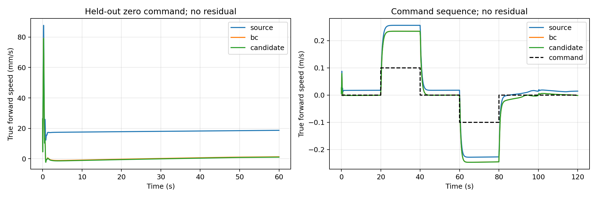

# FlashSAC 파인튜닝 안정화 및 명목 정지 개선

Execution Domain: VALIDATION_SIM; DESKTOP_DRY_RUN for source/unit checks.

Policy Checkpoint SHA256 (source actor.pt): `6d3cba9fa76eebe9fb2f40ef23d34115b8b95028ec788571531ffb33ce821a05`

Evidence Status: PASS for nominal flat-floor acceptance and finite execution; SUSPICIOUS for mass-shift generalization; NOT_TESTED on hardware.

Branch: `agent/codex/dev_tita_gluon`. Commit/push/deployment 없음.

## 변경한 학습 방법

기존의 작은 replay에서 모든 actor 가중치와 BatchNorm 통계를 동시에 바꾸는 경로를
시범 데이터와 제한된 actor 업데이트를 사용하는 경로로 바꿨다.

1. 원래 actor와 기존 sensor-feedback `VelocityBias` 법칙으로 MuJoCo 시범 3,000개(60초)를 수집한다.
2. actor의 표현 가중치, 표준편차, BatchNorm 통계를 고정하고 `predictor.mean_bias` 8개만 학습한다.
3. BC 500회로 시범 행동을 학습하고 `model_0`에 BC-only 정책을 보관한다.
4. 새 리워드에 맞춰 FlashSAC critic을 시범 데이터로 1,000회 준비한다.
5. 새 online replay 256개 이후, critic에 시범/온라인 데이터를 50/50으로 공급한다.
6. actor는 시범 행동의 BC 손실에 작은 Q 개선 항을 추가한다. `L = MSE(tanh(mu), a_demo) - 1e-5 * min(Q1,Q2)`.

온라인 gradient update는 transition당 1회, actor update는 critic 2회당 1회다.
BC learning rate 1e-4, online learning rate 1e-5, batch 64, 1-step return이다.
critic/target critic은 기존 FlashSAC distributional TD/EMA kernel을 재사용한다.
actor는 deterministic BC-constrained update로 바뀌며 temperature는 고정한다.
따라서 **표준 FlashSAC, RLPD, Cal-QL의 완전한 재현은 아니다**.

과거 Isaac replay가 복구된 것은 아니다. 현재 MuJoCo에서 새로 만든 시범을 prior replay로 쓴다.
`min_buffer=256`은 online buffer의 문턱이며, 전체 신규 수집량을 256개라고 해석하면 안 된다.
이번 검증의 총 수집량은 시범 3,000개 + online 2,000개다.
각 실행은 actor warm start이며 optimizer/critic/replay의 exact resume은 구현하지 않았다.

시범 행동의 보정값은 normalized action으로 환산한 후 물리에 적용하고, 같은 action을
replay와 다음 observation의 last_action에도 반영한다. 최종 student 평가/ONNX 실행에는
teacher, `--velocity_bias`, PD residual, LQR이 들어가지 않는다.
원래 actor의 33차원 입력과 기존 export 형식을 유지한다.

## 원인 확인과 센서 리워드

추가 회귀 테스트에서 optimizer를 전혀 실행하지 않고 `training=True` actor forward만
수행해도 BatchNorm 통계와 추론 출력이 바뀌는 것을 재현했다. 이는 앞선 성능 붕괴에
기여할 수 있는 기전이며, 앞선 실험의 유일한 원인이라고 확정한 것은 아니다.
새 업데이트의 실제 state_dict 차이가 output mean bias 하나뿐인 것도 검사한다.

리워드 항/가중치는 유지하되 전후 속도의 정의를 바로잡았다. 기존 rolling axle 속도에서
IMU 회전 및 encoder/URDF FK에 따른 wheel/base 상대 운동을 빼 base 속도를 추정한다.
별도 kinematic MjData의 root translation은 항상 0이고 orientation/joints는 센서값만 넣는다.
실제 plant의 root 위치/선속도는 이 추정, reward, critic에 사용하지 않는다.
해석 FK 보정은 finite-difference FK와도 비교한다.
reward/critic version은 `sensor_reward_v2_fk` / `encoder_imu_base_fk`로 구분한다.
시범 종료 후 reward normalizer의 episode return도 초기화한다.

여전히 no-slip 가정과 정확한 IMU/encoder frame 및 기구학이 필요하다.
미끄럼/공중 wheelspin에서 실제 바닥 속도가 관측된다고 주장하지 않는다.
보상에는 velocity/yaw tracking, tilt, body angular motion, action change 및 tilt 종료 penalty만 사용한다.
GT 속도/위치는 진단과 최종 평가에만 사용한다.

## 참고한 연구와 적용 범위

- [RLPD — Efficient Online Reinforcement Learning with Offline Data](https://arxiv.org/html/2302.02948v3):
  시범/온라인 minibatch의 50/50 sampling을 적용했다. 논문의 LayerNorm/large-Q-ensemble 등
  전체 구성을 구현한 것은 아니다. 기존 actor의 BN 통계를 별도로 보존한다.
- [Adaptive Behavior Cloning Regularization](https://arxiv.org/abs/2210.13846):
  distribution shift 중 기존 유용한 행동을 보존하는 BC 제약을 참고했다.
  이 구현의 BC/Q 가중치는 고정값이며 논문의 adaptive schedule/ensemble을 재현하지 않는다.
- [AWAC](https://arxiv.org/abs/2006.09359): 시범과 온라인 상호작용을 결합하는 actor 학습의 참고다.
  여기서는 advantage-weighted likelihood를 구현하지 않았다.
- [Cal-QL](https://arxiv.org/abs/2303.05479): Q 초기화/scale 문제를 고려해 바뀐 objective에 대해
  critic을 다시 준비했다. calibrated/conservative Q loss를 구현하지 않았다.

## 실험 경과와 평가 프로토콜

원본과 full-actor BC, output-bias-only BC를 각각 비교했다. pilot은 명목/zero command 한 조건이며
hyperparameter 선택용이다. bias-only 500 updates에서 60초 GT forward RMS는 약
`0.01782 -> 0.00445 m/s`였다. 이 단계의 개선은 BC 효과이고 RL 효과로 부르지 않는다.

첫 teacher pilot은 MuJoCo 3.3.7에 없는 `mj_copyData` API로 실패했다.
기존 runtime을 수정하지 않고 순수 `VelocityBias` 법칙과 새 센서 FK로 teacher를 구성했다.
첫 결합 실행의 bool TD mask 오류도 float mask로 수정했고 회귀 테스트를 추가했다.
실패 로그는 `finetune_improvement/pilot_{full,head}.log` 및
`anchored_initial_bool_failure.log`에 보관한다.

초기 결합 후보 `sim2sim_finetune_015601_261468/model_2000`는 3,000 prior +
500 BC + 1,000 critic warmup + 2,000 online transitions를 완료했다.
원본/BC-only/student 각각 3개 초기 상태, command sequence, mass+15%를 평가했다.
그 결과는 `finetune_improvement/heldout/`에 보관한다.

다만 비교 그림을 확인하다 기본 scene의 x=1.2m 이후 box/stairs가 명령 응답과 drift baseline을
가로막는 것을 발견했다. 이 첫 결과를 flat-floor locomotion의 최종 근거로 사용하지 않는다.
최종 평가는 양쪽 모두 world-body의 non-plane collision을 끄고 평면만 남긴다.
학습 시범은 원점 근처에서 수집되어 장애물을 통과하지 않는다.

최종 학습은 시범/온라인 경계에서 return normalizer를 초기화하도록 수정한 후 다시 수행한다.
최종 후보와 BC-only를 다음 고정 조건에서 비교한다.

- Nominal 정지 60초: seed 101/102/103, 초기 pitch -0.015/0/+0.015 rad, joint rate noise std 0.001 rad/s.
- 명령 120초(seed 104): 20초씩 정지 / +0.1m/s / 정지 / -0.1m/s / yaw +0.2rad/s / 정지.
- 별도 탐색 조건(seed 105): mass/inertia +15%, 60초. 명목 성공 판정과 구분한다.
- 명목 기준: 모두 낙상 없이 완료, 마지막 20초 GT speed RMS 중앙값이 원본의 50% 이하.
- 명령 기준: forward RMSE <= 원본*1.1 + 0.002m/s, yaw RMSE <= 원본*1.1 + 0.01rad/s.

위 조건/기준은 각 campaign의 `protocol.json`에 실행 전에 저장한다. 세 초기 상태는 학습에 사용하지 않는다.
명목 기준 통과가 command tracking 향상이나 domain-randomization 성공을 뜻하지 않는다.
BC-only와 online 후보 차이는 추가 BC+Q update/online 수집을 모두 포함하므로 Q 항의 단독 인과 효과가 아니다.

## 결과와 재현

최종 후보는 `docs/exp/2026-10-17/sim2sim_finetune_020019_724127/model_2000`이다.
Actor SHA256: `86ae7466db5680d41038d230cee0fec347c100a7139060b21dc40af96bc57baf`.
실제 학습 source snapshot SHA256: `90f89e7fa5541b889857e2846b7ada630fdd199671d4797bc4cd04808ed7baf3`.
`finetune_improvement/final_training_implementation.py`에 해당 파일을 보관했다.

총 500 BC update, 1,000 critic warmup, 1,745 online critic update, 872 online actor update를
완료했고 학습 중 낙상은 없었다. 결과 JSON과 원시 replay를 학습 run 폴더에 저장했다.
최종 actor의 state_dict를 원본과 직접 비교해 `predictor.mean_bias` 8개만 변경됐으며
모든 나머지 가중치/BatchNorm buffer가 bitwise 동일함을 확인했다
(`finetune_improvement/parameter_integrity.json`).

최종 flat-floor paired 평가 15개 실행이 모두 낙상 없이 완료됐다. 명목 세 초기 상태의
마지막 20초 GT forward speed RMS 중앙값은 **18.49 -> 0.84 mm/s**, 약 95.5% 감소했다.

| 지표 | 원본 | BC-only model_0 | BC + online model_2000 |
| --- | ---: | ---: | ---: |
| 명목 60초 전체 forward RMS 중앙값 (mm/s) | 18.65 | 4.46 | 4.44 |
| 명목 마지막 20초 forward RMS 중앙값 (mm/s) | 18.49 | 1.07 | 0.84 |
| 명목 최대 XY 이동량, 3조건 범위 (mm) | 1064.7–1123.9 | 31.0–76.7 | 19.0–62.3 |
| 명령 sequence forward RMSE (m/s) | 0.082904 | 0.080893 | 0.080890 |
| 명령 sequence yaw RMSE (rad/s) | 0.052687 | 0.047287 | 0.047258 |
| 질량/관성 +15%, 마지막 20초 forward RMS (m/s) | 0.086332 | 0.099876 | 0.100038 |

명목/명령 acceptance는 PASS다. 다만 command +0.1m/s에 약 +0.23m/s로 반응하는
기존 속도 gain 오차는 남아 있어 정확한 command calibration을 달성했다고 말할 수 없다.
질량 +15%는 명백히 악화됐고 SUSPICIOUS로 남긴다. 이번 작은 bias adaptation은
명목 환경의 balance point를 맞추는 방법이지, 질량 변화 전반을 보상하는 상태 피드백 정책을
새로 학습한 결과가 아니다. 실기·다른 물리 조건으로 일반화하는 성공을 주장하지 않는다.

개선의 주효과는 시범 BC에서 이미 나왔다. 추가 online update는 tail RMS를 조금 낮췄지만,
일부 초기 상태의 최대 이동량은 BC-only보다 커졌다. 따라서 RL만의 효과나 모든 지표의
일관된 우월성을 주장하지 않는다. Q 항 단독 기여는 동일 update-count의 BC-only 대조가
없으므로 NOT_TESTED다.



최종 protocol, 모든 trial JSON/trace는 `finetune_improvement/heldout_flat/`에 있다.
ONNX parity는 256개 입력에서 최대 absolute action error `4.1723e-6`으로 PASS다.
로그: `finetune_improvement/final_export.log`.

기존 ROS/MuJoCo CLI에서도 residual 없이 final checkpoint를 2,000-step 재생하는
통합 검증은 PASS다. final base height 0.33655m, viewer thread 종료 확인,
residual 세 모드 모두 false다. 세부 결과는 `finetune_improvement/final_runtime.log`에 기록한다.
앞선 후보의 동일 CLI 비교에서는 원본과 후보 모두 정상 완료했고 final base height는
약 0.336m였다. 이 짧은 integration을 추가 성능 평가로 간주하지 않는다.

검증 interpreter는 `~/isaac/env_isaaclab/bin/python`(Torch/gymnasium)이고,
MuJoCo 의존성은 이전 작업에서 설치한 `/tmp/tita_finetune_deps`를 PYTHONPATH로 사용했다.
기존 Python 환경은 변경하지 않았다. `/tmp`가 지워지면 같은 interpreter에 필요한
MuJoCo/NumPy/PyYAML/Torch/gymnasium 의존성을 다시 준비해야 한다.

```bash
PYTHONPATH=/tmp/tita_finetune_deps \
  ~/isaac/env_isaaclab/bin/python \
  sim2sim/sim2sim_ros2_jazzy/launch/sim2sim_finetune.py \
  --steps 2000 --save_every 2000
```

생성된 최종 정책의 기존 실행기 재생(별도 residual flag 없이):

```bash
python3 sim2sim/sim2sim_ros2_jazzy/launch/sim2sim.launch.py \
  --ckpt docs/exp/2026-10-17/sim2sim_finetune_020019_724127/model_2000
```

`test/test_sim2sim_finetune.py`는 실제 MuJoCo/gradient update를 포함한 10개 테스트로
replay/timeout/termination, 정규화, FK, prior masks/mixing, output-bias-only 변경을 확인한다.
실행 출력은 `finetune_improvement/unit_tests.log`에 있다.
최종 agent-check 출력은 `finetune_improvement/agent_check.log`에 기록한다.
실제 전체 결과는 FAIL이다. 본 작업 이전부터 있던
`lab/ddt_lab/ddt_lab/tasks/manager_based/locomotion/robots/tita/my_flat_env_cfg.py`
431/437/443/449/455/461행의 trailing whitespace 때문이다. 이 사용자 변경은 수정하지 않았다.
동일 check의 Python 구문 480/480, URDF XML 8/8 및 실험 폴더 형식 검사는 PASS다.
task-specific diff에는 whitespace 오류가 출력되지 않았다.

변경 파일은 기존 작업에서 만든 `launch/sim2sim_finetune.py`, `test/test_sim2sim_finetune.py`,
신규 연구 스크립트 `test/improve_flash_finetune.py`, `test/validate_finetune_improvement.py`,
그리고 이 dated experiment 기록/정책/로그다. task 시작 source snapshot과 수정 diff를 보관한다.
기존 playback/hardware/controller source 및 사용자의 다른 변경은 수정하지 않았다.
Git status의 기존 tracked 항목은 보존됐다. 동시에 다른 작업에서 생성된
`test/compare_velocity_bias_m4.py`, `test/test_velocity_bias_m4_comparison.py`도 건드리지 않았다.

실기: NOT_TESTED. 시뮬레이션 teacher의 feedback 부호/범위가 실기에서 검증된 것은 아니다.
실기 제어 주기, reset, operator 승인 및 센서 정렬은 별도 구현/검증이 필요하다.
