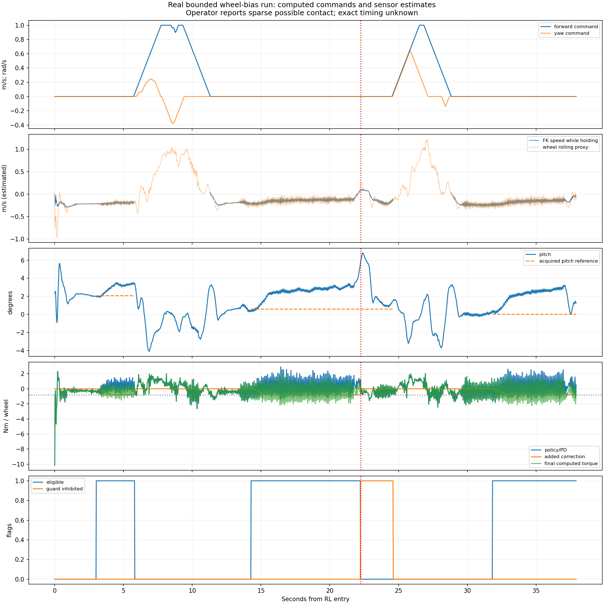

# 14:49:09 실기 bounded velocity-bias 분석

Execution Domains: ROBOT_READ_ONLY (지정된 종료 로그 조회·복사·hash 확인), DESKTOP_DRY_RUN (atomic frame 분석·배포된 C++ 수학 재생)

Evidence Status: **PASS** — 복사·소프트웨어 재구성·0.8 Nm 제한 검증. **FAIL** — 사용자 관측 및 음의 속도 추정이 지속되어 이번 실행은 zero-command 정지 목표를 충족하지 못했다. **SUSPICIOUS** — 자세/정책 반응과 남은 drift의 동역학 해석. 실제 지면 속도·외력·실측 모터 토크는 **NOT_TESTED**.

Policy Checkpoint SHA256: `6d3cba9fa76eebe9fb2f40ef23d34115b8b95028ec788571531ffb33ce821a05`

ONNX SHA256: `f44f07ed44970e3ff565eae67fd9229adf0be5c02215591c52a691ffcbb71b2a`

Installed node SHA256: `fd3f0285acfe42a60bb998e9d3824f4ff669bb326e934c9527e9893f9f26be95` — 직전 0.8 Nm 배포와 일치.

Branch: `agent/codex/dev_tita_gluon`

대상: `flashsac_60000_144909_757895477_output_true`. 사용자 관측은 ‘여전히 뒤로 물러난다’다. 사용자는 손 접촉이 **거의 없고 조금 있었을 수 있다**고 추가 설명했다. 정확한 시각은 없으므로 `sparse_possible` operator annotation으로 반영했다. 이동 명령은 로그에서 구분하지만 센서만으로 손 접촉을 확정하지 않는다. 모든 중립 구간이 외력 없는 완전한 자유 drift라고 가정하지 않는다.

## 확인된 결과

**보정은 정상적으로 작동했고 대부분 −0.8 Nm/wheel 상한에 도달했다. 그 상태에서도 음의 속도가 남았으며, 한 hold에서는 pitch-deviation guard가 보정을 차단했다.** 이를 단순 미활성화·잘못된 설치·예상하지 못한 소프트웨어 단위 변환으로 설명할 필요는 없다. 반면 실제 plant에서 어느 정도 residual이면 정지하는지는 이번 자료만으로 정하지 못한다.

Bag atomic frame 5,166개 중 RL 1,897개, 첫 RL sample부터 마지막까지 37.920초다. 전체 9개 bias diagnostic을 현재 배포 소스로 재생했을 때 **최대오차가 모든 항목에서 0**이다. Acquisition, ramp, integral, command reset, guard latch가 기록과 일치한다. Raw action/offset에서 최종 계산 토크를 재구성한 최대오차는 **8.88e−16 Nm**다. 최종 두 추가 토크 diagnostic도 재구성에 맞으며 전체 최대 추가량은 **0.7999999999999999 Nm/wheel**다.

## 중립 hold를 분리한 비교

조이스틱 전진/yaw 명령이 정확히 0인 frame만 대표 보정 후 수치에 사용했다. 보정 후 구간은 eligible 시작에서 2초가 지난 뒤다. 1차 구간은 그 직후 명령 조정이 시작되어 대표 길이가 0.70초로 짧다. 표의 ‘추정 시’ 값은 실제 C++가 저장한 1–3초 시간 가중 평균이다.

| Hold | Eligible 구간 (RL 이후) | 추정 시 drift | 대표 보정 후 속도 평균 | 대표 피치 평균 | 추가 토크 평균 / wheel | 대표 구간 상한 비율 |
|---|---|---:|---:|---:|---:|---:|
| 1차 | 3.020–5.800초 | −0.2291 m/s | −0.1919 m/s | 3.311° | −0.8000 Nm | 100% |
| 2차 | 14.280–22.220초 | −0.1975 m/s | −0.1233 m/s | 2.898° | −0.7996 Nm | 98.3% |
| 3차 | 31.840–37.920초 | −0.2394 m/s | −0.1416 m/s | 2.343° | −0.8000 Nm | 100% |

각 대표 구간은 5.020–5.720초 / 16.300–22.220초 / 33.860–37.920초다. 속도 표준편차는 각각 0.0202 / 0.0446 / 0.0384 m/s다. Wheel rolling proxy 평균도 −0.1897 / −0.1227 / −0.1481 m/s로 음의 경향이 맞는다. 두 관측은 같은 엔코더를 공유하므로 서로의 일치가 실제 바닥 속도 검증을 대신하지 않는다.

추정 시보다 음의 속도 크기가 줄어든 수치는 보이지만, 초기 settling·이전 이동명령·외력 여부가 달라 동일 조건의 제어기 ON/OFF 인과 효과나 개선율로 계산하지 않았다. 이번 실행은 실기 정지 실패이며, 과거 큰 bias의 12–14° 정착 자세가 그대로 재현된 결과도 아니다.

### 드문 접촉 가능성을 반영한 민감도 확인

센서만으로 손 접촉 시각을 정답처럼 분류하지 않았다. 대신 순간적인 변화가 있는 **guard onset 전후 각 1초와 RL 종료 직전 1초**를 대표 보정 후 구간에서 추가 제외했다. 이는 사건 주변 제외 분석이며 손 접촉 검출기가 아니다. 움직임 명령이 정확히 0이고 보정 시작 2초 이후라는 기존 조건도 유지했다.

| Hold | 추가 제외 후 사용 구간 | 평균 FK/IMU 속도 추정 | 피치 평균 | −0.8 Nm 상한 비율 |
|---|---|---:|---:|---:|
| 1차 | 5.020–5.720초 (짧음) | −0.1919 m/s | 3.311° | 100% |
| 2차 | 16.300–21.220초 | **−0.1336 m/s** | 2.759° | **100%** |
| 3차 | 33.860–36.900초 | **−0.1494 m/s** | 2.584° | **100%** |

2차·3차의 남은 구간에서는 추정속도 순간값도 전부 음수였다. 따라서 사건 주변의 짧은 접촉 가능성을 제외해도 ‘보정 상한에 도달한 상태에서 후진 속도가 수초간 남는다’는 관측은 유지된다. 제외하지 않은 다른 시각의 접촉 가능성까지 제거하거나 실제 지면 속도를 검증한 것은 아니다. [annotation_analysis.log](flashsac_144909_bounded_bias_review/annotation_analysis.log)의 `disturbance_sensitivity`에 저장했다.

**PASS:** annotation 반영 후 전체 수학 재구성 및 제외 분석을 재실행했다. 후속 `./scripts/agent-check.sh`도 syntax 511/511·URDF 8/8 PASS, 기존 공백 오류로 전체 FAIL이다. [annotation_agent_check.log](flashsac_144909_bounded_bias_review/annotation_agent_check.log). 변경은 분석 script·보고서·관련 artifact에 한정되며 controller 변경이나 배포는 없다.

## 보정이 풀리고 다시 획득된 이유

- RL+**5.820–11.260초**: forward/yaw movement command로 neutral hold 이탈. Forward command 최대1.0 m/s. 보정 reset 후 중립 복귀 +11.280초, 3초 획득을 거쳐 **+14.280초**에 다시 eligible.
- RL+**22.240초**: pitch-deviation guard 발동. 아래 표 참조. 같은 hold에서 보정을 0으로 유지.
- RL+**24.620–28.800초**: 다시 movement command로 hold 이탈. Forward 최대1.0 m/s, yaw 최대+0.645 rad/s. 중립 복귀 +28.820초, **+31.840초**에 다시 eligible.
- RL 종료의 estop은 약 +37.938초다. +22.240초의 residual-only guard와 별도다.

따라서 acquisition 메시지가 세 번 나온 것은 명령에 따른 hold 재진입으로 설명된다. 동일 hold에서 임의로 drift 추정을 재시작한 현상이 아니다.

## Guard의 정확한 원인

| RL+22.240초 항목 | 값 |
|---|---:|
| 2차 획득 pitch 기준 | **0.586°** |
| 당시 pitch | **5.755°** |
| 기준 대비 pitch 편차 | **+5.169°** |
| 당시 roll | 1.116° |
| 당시 FK 속도 추정 | +0.1028 m/s |
| 직전 추가 토크 | 좌/우 각각 −0.7503 Nm |
| 발동 frame 추가 토크 | 좌/우 모두 **0 Nm** |

조건 중 **pitch deviation >5°**만 해당한다. 절대 tilt 17.19° 제한이나 속도 1 m/s 제한은 원인이 아니다. 직전 속도가 이미 양으로 바뀌면서 적분이 조금 풀려 추가 토크가 −0.8에서 −0.7503 Nm로 변한 뒤 guard가 차단했다. 차단 후 +24.600초까지 latch가 유지됐다. 이 사실은 guard가 정상 작동했다는 의미이며, pitch가 급변한 물리 원인이 보정 자체·외력 중 무엇인지는 확정하지 않았다. 사용자의 드문 접촉 가능성 설명만으로 해당 순간을 손 접촉으로 라벨링하지 않았다.

## 왜 0.8 Nm에서도 후진이 남는가

대표 보정 후 계산 토크를 나누면 다음과 같다. 모든 값은 좌우 평균, wheel당이다.

| Hold | 정책·PD 항 | 추가 bias 항 | 최종 command |
|---|---:|---:|---:|
| 1차 | +0.458 Nm | −0.800 Nm | −0.342 Nm |
| 2차 | +0.422 Nm | −0.800 Nm | −0.377 Nm |
| 3차 | +0.435 Nm | −0.800 Nm | −0.365 Nm |

정책·PD 항은 **기록된 corrected state와 raw action에서 bias를 빼고 adapter를 평가한 값**이다. 별도 무보정 로봇의 궤적 예측이 아니다. 양의 정책·PD 항이 음의 보정 일부를 상쇄하고 있고, bias 적분은 이미 상한에 도달해 더 증가할 수 없다. 더 기다리거나 Ki만 올려도 현재 amplitude cap을 넘을 수 없으므로 이 제한/구조에서 남는 drift를 자동으로 해결하지는 못한다.

앞선 조이스틱 상쇄의 약 −0.83 Nm는 **같은 센서·action history에서 command 입력을 제거한 단일 정책 재추론 차이**였고 다리 목표도 함께 바뀌었다. 이번에 실제 휠 후단으로 −0.8 Nm를 넣는 것과 같은 제어 입력이 아니다. 그 수치를 필요한 최적 wheel-only residual이라고 해석할 수 없다는 한계가 이번 실험에서도 중요하다. 임의로 cap을 높이면 같은 방식으로 정책 반대 출력과 pitch가 함께 달라질 수 있어, 남은 속도만으로 다음 최적 cap을 역산하지 않는다.

다음 비교 후보로는 앞서 operator가 약 +0.14 m/s 입력으로 낮은 피치에서 상쇄한 경로를 따라 **정책 입력 command_x trim**을 검증하는 것이 근거가 있다. 사용자가 요청한 것은 이번 로그 분석이므로 이 작업에서 gain·cap·guard·controller를 바꾸거나 추가 배포하지 않았다.

## 검증과 변경 범위

- **PASS:** summary/console/bag-console/metadata.yaml/DB3 원격·로컬 SHA256 5개 일치. [copy_verification.log](flashsac_144909_bounded_bias_review/copy_verification.log).
- **PASS:** read-only SQLite quick_check, sequence 연속·monotonic time 및 모든 RL sensors_valid/policy_valid/output_enabled/torque_sent/teacher_action_valid 검사. 최신 source는 기록된 설치 binary hash의 배포 버전과 일치한다.
- **PASS:** 전체 RL 1,897개에서 C++ diagnostics 재생 9항목 오차0, 토크 재구성 최대8.88e−16 Nm, 추가량 상한 검증. Pure-math fixture는 `g++ -std=c++17 -O2 -Wall -Wextra -Werror -pedantic`로 빌드했다. 실제 SDK·ROS node·CAN 송신은 사용하지 않았다.
- **PASS:** 분석 script 실행 및 plot 확인. 첫 실행은 JSON의 중복 `start_s` key 때문에 결과 출력 단계에서 실패했고 key 수정 후 전체 재실행했다. 원본 데이터는 변경하지 않았다.
- **PASS:** 필수 `./scripts/agent-check.sh` 중 Python syntax **511/511**, URDF **8/8**. **FAIL:** 전체 결과는 기존 `my_flat_env_cfg.py`의 431/437/443/449/455/461행 trailing whitespace 때문이며 해당 파일은 수정하지 않았다. [agent_check.log](flashsac_144909_bounded_bias_review/agent_check.log).
- 변경 파일은 신규 [분석 script](../../../../test/sim2real/analyze_bounded_bias_run.py), 이 보고서, `flashsac_144909_bounded_bias_review/`의 원본 복사·hash·[metrics.json](flashsac_144909_bounded_bias_review/metrics.json)·signals.npz·plot·검사 로그다. 제어기/설정/정책 수정, 로봇 실행·배포·서비스 변경, commit/push 없음. Task diff와 시작/종료 status를 확인했다.

일부 계산 토크의 빠른 변동은 남아 있으나 이번 분석에서 주파수/위상 동역학을 다시 식별하지 않았다. 50Hz snapshot/transport 접수 flag로 2ms 제어 deadline·모터 ACK·실측 토크를 검증할 수도 없다. Console 종료의 Ctrl-C/exit130, teleop exit−7, SIGTERM/SIGKILL은 별도 종료 현상이며 중립 구간의 후진 원인으로 해석하지 않는다.
