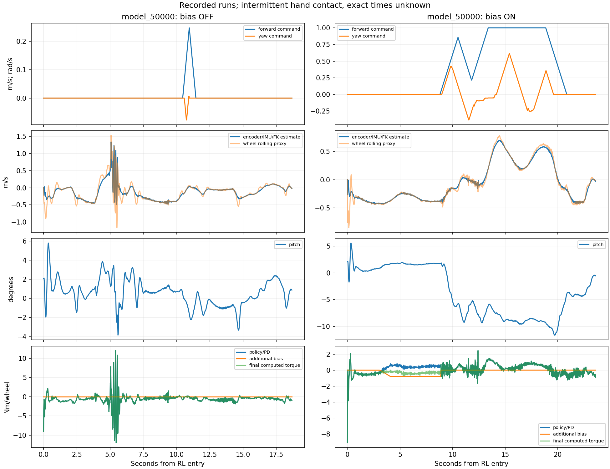

# FlashSAC model_50000 실기 bias OFF/ON 분석

Execution Domains: ROBOT_READ_ONLY (지정된 종료 로그·bag 복사·hash 확인), DESKTOP_DRY_RUN (atomic frame·정책 추론·observer/PD/bias 수학 재생). 새로운 로봇 실행 없음.

Evidence Status: PASS — 원본 복사 hash·기록된 observation/action/torque와 ON bias 수학 재구성. FAIL — 사용자 관측 및 보정 중 지속적인 후진으로 이번 ON 실행은 정지 목표 미충족. SUSPICIOUS — 외력 혼재에 따른 정책 간 실기 순위와 물리적 원인. 실제 지면 속도·접촉 시각·적용 모터 Nm는 NOT_TESTED.

Policy Checkpoint SHA256: `d5b7c981c4c4cd5375fd5513ec12f02c7abada4ca21df8727729faf1d0e31e7c`

ONNX SHA256: `0128f5783513e86a2d0cfbc67ed5d02260d017356909fa01ccf0635c03248873`

Config SHA256: `08bf0628ddcfc1bbd964573b56cc64f7b9889476f247098ba5e53b324ed7b6e8`

Branch: `agent/codex/dev_tita_gluon`

## 대상과 해석

첨부에는 앞서 분석한 60000/14:49 실행 외에 다음 두 50000 실행이 들어 있다. 이번 분석은 새 두 실행을 대상으로 한다. 사용자가 중간중간 손 접촉을 보고했지만 시각은 모른다. neutral command를 외력 없는 자유주행으로 라벨링하지 않았다.

| 실행 | bias | atomic 전체 / RL frame | 마지막 RL sample |
|---|---|---:|---:|
| `flashsac_50000_151553_996165550_output_true` | OFF | 2,851 / 935 | RL+18.672초 |
| `flashsac_50000_151713_717257849_output_true` | ON | 2,618 / 1,181 | RL+23.600초 |

두 summary의 checkpoint/ONNX/config와 node hash는 직전 50000 배포와 일치한다. 새 75000 선택 이후에도 별도 보존한 50000 bundle로 분석했으므로 현재 기본 정책을 잘못 사용한 분석이 아니다.

## 확인된 현상

**50000에서도 빠른 후진이 기록됐고, ON에서는 −0.8 Nm 제한 중 후진이 남았다.** 소프트웨어가 다른 정책을 실행하거나 bias를 적용하지 않은 오류는 재구성 결과로 지지되지 않는다. 기존 시뮬의 낮은 nominal drift 순위가 이번 실기에 그대로 전이하지 않았다.

| 조건·구간 | 평균 전후 추정속도 | 평균 pitch | 추가 토크 / wheel |
|---|---:|---:|---:|
| OFF, RL+8–10초, neutral 100 frame | **−0.3996 m/s** | 0.835° | 0 Nm |
| ON, RL+1–3초 실제 acquisition 평균 | **−0.3831 m/s** | 기준 0.556° | 0 Nm |
| ON, RL+5.000–8.800초, neutral 191 frame | **−0.3244 m/s** | 1.663° | **−0.800 Nm** |

OFF 8–10초는 고정된 2초 간격 전체 통계 중 하나이며, 결과를 본 뒤 후진 지속의 예로 인용했다. 전 구간 대표값이나 외력 없음이 검증된 구간으로 해석하지 않는다. ON 5–8.8초의 속도 범위는 −0.3879~−0.2261 m/s로 모든 sample이 음수이며 보정 상한 비율은 100%다. wheel rolling proxy 평균도 −0.3256 m/s로 같은 방향이다. 두 추정은 encoder를 공유하므로 외부 속도 검증을 대신하지 않는다.

앞선 60000 순수 drift에서 RL+5–10초는 −0.2025 m/s였다. 이번 OFF 8–10초 및 ON 초기 추정에서 더 빠른 후진이 관측된 것은 사용자 관측과 맞는다. 다만 접촉·명령·초기 자세가 달라 엄격한 동일 조건 정책 성능비나 인과적 개선율을 계산하지 않는다. OFF 5–10초 전체 평균은 **−0.1896 m/s**이며 중간의 양의 속도 급변이 포함된다. 평균 하나만으로 이번 OFF 전체가 이전보다 항상 두 배 빠르다고 주장하지 않는다.

OFF에서는 RL+4–6초에 추정 속도·wheel 속도·계산 torque가 급변하고 최종 토크가 일부 sample에서 ±12 Nm에 도달한다. 손 접촉/해제·미끄럼·정책 반응 중 원인을 센서만으로 확정하지 않았다. 모든 접촉 시각을 자동 제거했다고 주장하지 않는다.

## ON 구간의 토크·재획득

ON의 RL+5–8.8초, 휠당 좌우 평균:

- 기록된 상태에서 정책·PD 항 **+0.4248 Nm**.
- 추가 bias 항 **−0.8000 Nm**.
- 합산 최종 계산 command **−0.3752 Nm**.

이 구조는 직전 60000의 0.8 Nm 실험과 비슷하게 정책·PD가 bias 일부를 상쇄한다. 더 빠른 drift인데도 보정 cap은 같아서 적분이 더 커질 수 없다. 이 자료로 필요한 최적 cap을 역산하거나 더 큰 cap의 안정성을 주장하지 않는다.

첫 eligibility는 RL+3.000초, 마지막은 +8.880초다. 정확히 0이 아닌 조이스틱 명령은 +8.820–20.840초이며 movement hold 이탈 후 bias가 0으로 reset됐다. Forward command 최대 1.0m/s, yaw 약 −0.383~+0.617rad/s다. 이후 중립으로 돌아와도 마지막 RL sample까지 약 2.74초라 3초 재획득을 완료하지 못했다. 마지막에 작은 속도가 보이는 것을 bias로 정지한 결과로 해석하지 않는다. **pitch-deviation guard 이벤트는 없었다.** 기록된 bias 해제는 명령 이탈로 설명된다.

## 검증·재현

- **PASS:** 두 종료 기록의 summary/console/bag-console/metadata/DB3 원격·로컬 hash 10개 일치. [원본 hash](flashsac_50000_real_review/source.sha256), [복사 검사](flashsac_50000_real_review/copy_verification.log).
- **PASS:** read-only SQLite quick_check, atomic sequence 연속·monotonic time, 한 번의 RL 전이, 유효 sensor/policy/output/torque_sent/teacher flags를 검사했다.
- **PASS:** 총 RL **2,116 frame**의 50000 ONNX 추론 최대 action 오차 OFF **1.989e−6**, ON **3.725e−6**. 센서·명령·직전 raw action에서 observation 재구성 최대오차 OFF **1.490e−8**, ON **5.960e−8**.
- **PASS:** PD+offset torque 재구성 최대오차 두 실행 모두 **8.882e−16 Nm**. ON의 9개 bias diagnostic C++ 재생 최대오차 모두 **0**, 추가량 제한 ≤0.8 Nm, guard/reacquisition 상태 재생 일치. C++ fixture는 strict warning으로 빌드했으며 node·CAN·SDK는 사용하지 않았다.
- OFF 속도는 기록된 센서로 C++ observer를 수동 실행해 계산했다. ON/OFF 모두 평가용 observer는 명령 구간도 연속 계산했고, 보고된 통계는 neutral 진입 후 2초가 지난 sample로 한정한다. 이는 가상 보정의 실제 성능을 예측하는 실행이 아니다. 실제 ON diagnostics는 별도로 원래 command로 정확히 재생했다.
- 신규 [분석 script](../../../../test/sim2real/analyze_policy_drift_pair.py), [metrics](flashsac_50000_real_review/metrics.json), [전체 실행 로그](flashsac_50000_real_review/analysis.log), signals NPZ 및 아래 plot을 저장했다. 첫 성공 실행 뒤 모든 고정 2초 구간 통계를 추가해 전체 분석을 재실행했다.
- 필수 agent-check 결과는 [75000 교체 검증 로그](flashsac_75000_deployment/agent_check.log). 구문·URDF PASS, 기존 `my_flat_env_cfg.py` 공백 오류로 전체 FAIL이다. 분석을 위해 controller나 bias law를 변경하지 않았다. 같은 사용자 요청의 정책 교체는 [별도 75000 배포 기록](flashsac_75000_deployment.md)에 구분했다.

