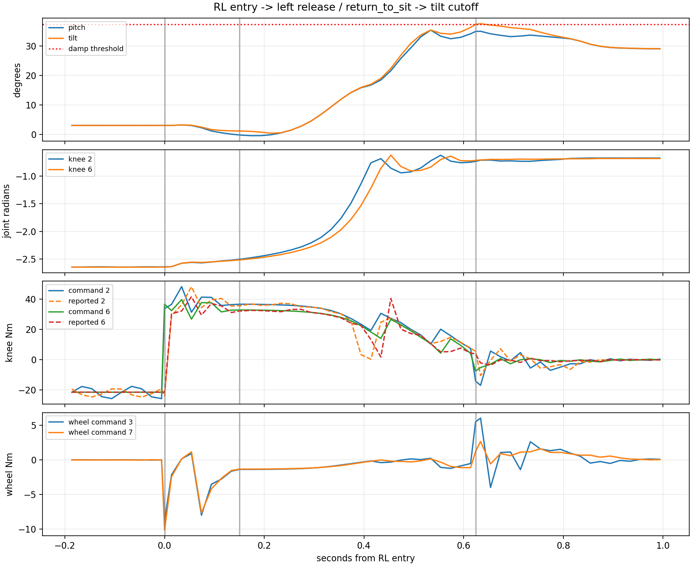

# 60000 immediate fall / early RL exit audit

- Execution domains: `ROBOT_READ_ONLY` (copy existing logs and inspect hashes), `DESKTOP_DRY_RUN` (offline analysis only).
- Evidence: **PASS** policy/hash/PD reconstruction and bag integrity checks; **SUSPICIOUS** physical fall mechanism and source of left-release input.
- Checkpoint SHA256: `6d3cba9fa76eebe9fb2f40ef23d34115b8b95028ec788571531ffb33ce821a05`.
- ONNX SHA256: `f44f07ed44970e3ff565eae67fd9229adf0be5c02215591c52a691ffcbb71b2a`.
- Branch: `agent/codex/dev_tita_gluon`; no commit or deployment in this analysis.
- Run: `flashsac_60000_173848_866246050_output_true`, 2026-10-17 17:38 KST.

## Recent changes actually deployed

The motor-feedback task added SDK torque-cache reads and diagnostic messages plus bag recording. The subsequent 60000 restore changed only the public launch's bundle selection/pinned hashes, the runner's bundle path/run identifier/checkpoint annotation, and README. The motor-feedback-enabled node binary remained SHA256 `f086fa22038124386825752711c83fd20b1ef220cdbad7eaae002463d42b3c73` across the 75000-to-60000 restore. Policy, action conversion, joint PD gains, effort limits, button handling and state-machine code were not modified by those two tasks.

This run's summary, current installed hashes and original earlier 60000 run summary all identify the same ONNX/config hashes. The config SHA256 is `d429ad9e60c25137d4bb5e2f26cb50a469fbcecf3a28af0076918a49eb7c035d`. Velocity bias was false; logged wheel-bias offsets are zero throughout. The earlier controller binary differs because later bounded-bias and feedback logging features were added; it is not claimed to be the same complete binary as the earlier 14:11 run. A source comparison against the pre-bounded-bias snapshot shows no changes to the joystick handler.

## Recorded timeline

Times below use controller message headers relative to the first RL frame. Joystick source and bag receive times are distinguished in analysis.json.

| RL-relative time | Observed event | Body tilt |
| --- | --- | --- |
| 0.000 s | RL enters; successful policy inference | 3.074 deg |
| +0.147890 s source / +0.148530 s received | Left axes[4] changes -1 to +1; right axes[6] remains +1 | Not a simultaneous synchronized IMU sample |
| +0.150317 s | `return_to_sit`; RL inference stops | 1.211 deg |
| +0.623988 s | `damp`, sensor-valid but tilt exceeds 0.65 rad | 37.270 deg |
| +5.833991 s | Latched software stop | 26.620 deg |

The existing mapping is left -1 = down/RL request, left +1 = released/return-to-sit request. A release while in RL explicitly requests `ReturnToSit`. This transition occurred before the recorded large tilt. Sensor faults or the tilt guard directly request `Damp`; they do not produce `ReturnToSit`.

Only eight RL policy samples exist, spanning about 0.134 s before the exit at 0.150 s. This is not a sustained RL zero-command drift trial. Logged joystick translation/yaw commands are zero around the transition. Button telemetry alone does not determine whether the user released/toggled it intentionally, reacted to an initial movement, or the switch/receiver changed the signal. A question about the operator action was sent; the initial interpretation leaves it unconfirmed.

The return handoff removes ongoing policy inference and blends from the last RL torque toward sit PD over two seconds. In this run positive knee command torque persists early in the return (about 33-37 Nm at entry), knee angles subsequently extend from roughly -2.5 rad toward -0.7 rad, and large tilt develops. This sequence makes the early exit/handoff a strong investigation target. It does not prove that the initial RL movement was stable or establish a unique physical cause without knowing operator actions and external contact. No button/state-machine fix was deployed during this audit.

## Offline verification and new feedback

- SQLite quick_check **PASS**; database SHA256 unchanged after reading: `d9281b13c22818dd57a1e11a0685005ec286059eef6b7ac3f5a91476cb7f1a2c` (also checked against robot source).
- 2,632 TrainingSample messages, consecutive sequence IDs and increasing controller steady time.
- 2,631 motor feedback messages, all valid. Sequence 4 is absent from the feedback topic during initial recorder discovery; early RL frames are joined. All joined header/control tick/steady times agree.
- ONNX replay of all eight stored RL observations matches logged actions: maximum absolute error `9.5367431640625e-07`.
- Reconstructed baseline PD torque matches all eight logged RL commands: maximum absolute error `7.152557373046875e-06` Nm. Both checks **PASS**. This verifies computation on recorded inputs, not physical stability.
- In the -0.2 to +1.0 s window, logged sensor-invalid and unsuccessful torque-transport counts are both zero. Sample interval median 19.997431 ms, maximum 20.383895 ms. State-transition extra samples are included.
- Sample-time to feedback-read-completion median 0.007552 ms, maximum 0.233931 ms in that window. This includes code between the sample timestamp and read completion, not an isolated SDK benchmark. It is not CAN cache age and does not capture every 500 Hz scheduling interval.
- Firmware-reported knee torque follows the positive knee command during the return, with delay/transient differences. This is not an independent physical torque calibration or an identified actuator gain.

## Files and validation

Added only offline analyzer `test/sim2real/analyze_173848_rl_exit.py`, this report and artifacts under [flashsac_60000_173848_fall_review/](flashsac_60000_173848_fall_review/). Relevant artifacts: analysis.json, analysis.log, early_frames.csv, remote_sha256.txt, source snapshot diff and copied bag/console/summary. Existing control and training code remain untouched in this audit.

Run command: source ROS Jazzy and the desktop generated-message overlay, then `/home/cocel/venvs/cosim_ros2_jazzy/bin/python test/sim2real/analyze_173848_rl_exit.py`. Offline checks above **PASS**. Repository `./scripts/agent-check.sh` is recorded in the artifact directory; its known unrelated whitespace issue is not changed here. No robot commands beyond read-only inspection and file copying were performed.
