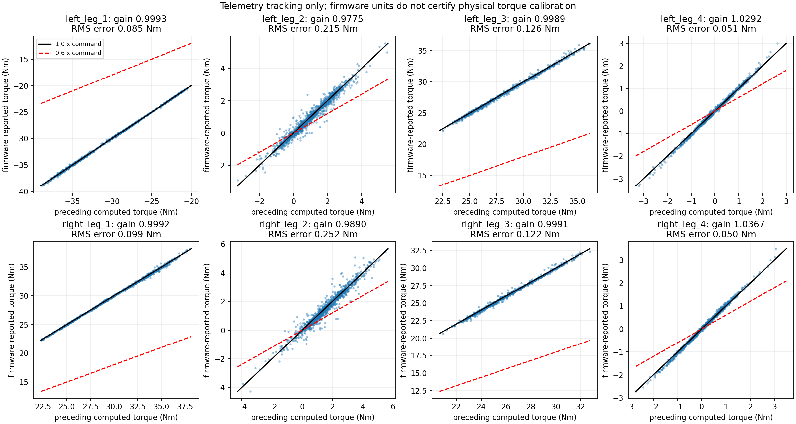
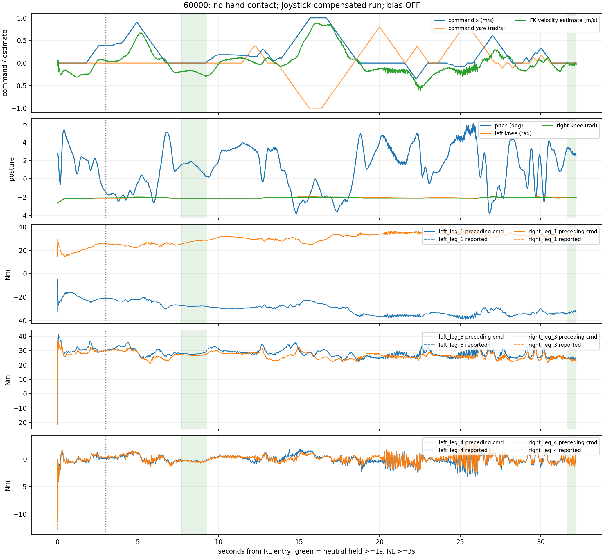

# FlashSAC 60000 실기 명령–모터 피드백 토크 분석 및 재학습 근거

## 결론

**이번 실제 RL 부하에서도 큰 토크를 받는 hip·무릎의 펌웨어 보고 토크는 명령과 거의 1:1이었다. 기존 real-to-sim 식별값 `leg_gain=0.60`을 ‘실제 모터 출력이 40% 부족하다고 측정한 값’으로 사용하면 안 된다.**

초기 3초를 제외한 1,460개 RL sample에서 hip·무릎 4개 축의 reported/command gain은 **0.9989–0.9993**, 두 값의 차이 RMS는 **0.085–0.126 Nm**였다. 명령이 천천히 변하는 구간으로 제한해도 같은 결과다. 다만 feedback이 전류와 Kt/기어비를 이용한 내부 추정값이면, 명령과 같은 교정 오차를 공유할 수 있다. **물리 출력이 정확히 1.0배라는 외부 교정도 이번에 한 것은 아니다.**

손 접촉 없이 진행했고, 사용자는 조이스틱 명령으로 정지를 유지하려 했다고 설명했다. 약 32.2초 RL 동안 전진·후진·회전 명령이 섞였다. 이 run의 RL+5–10초 전체를 기존 자유 drift 실험처럼 zero-command 데이터로 취급하면 안 된다. 짧은 중립 구간에서는 **약 −0.207 m/s의 후진 속도 추정**이 다시 관찰돼 기존 drift 증상은 남아 있다.

이 결과에 따른 재학습 방향은 **‘0.6을 확정 모터 상수로 고정’보다 ‘실기 증상을 재현하는 유효 동역학 오차와 부하·자세·명령 응답을 함께 다루기’**다. 기존 0.6 모델은 강건성 시험 후보로 보존하고 nominal 1.0 모델도 유지한다.

## 메타데이터와 출처

- Execution Domains: `ROBOT_READ_ONLY` — 기존 로그 복사·해시 조회; `DESKTOP_DRY_RUN` — rosbag 분석, 고정 정책/PD/FK 재계산. 로봇 제어·배포·학습 없음.
- Evidence Status: 분석·해시·재계산 **PASS**; 물리 토크 교정, 개별 원인 식별, 재학습 효과 **NOT_TESTED**. sim 등가 계수의 물리적 해석은 **SUSPICIOUS**.
- 일시: 2026-10-17 17:44 KST.
- Run: `flashsac_60000_174421_440893411_output_true`.
- 사용자 주석: **손 접촉 없음. 조이스틱 커맨드를 주어 정지 유지 시도.** 이전 17:38 실행은 사용자가 자신의 실수로 설명했고, 이번 수용 데이터에 합치지 않았다.
- 체크포인트: `lab/ddt_lab/logs/flash_sac/tita_flash_sac_115632_883848/model_60000`.
- Checkpoint SHA256: `6d3cba9fa76eebe9fb2f40ef23d34115b8b95028ec788571531ffb33ce821a05`.
- ONNX SHA256: `f44f07ed44970e3ff565eae67fd9229adf0be5c02215591c52a691ffcbb71b2a`.
- Config SHA256: `d429ad9e60c25137d4bb5e2f26cb50a469fbcecf3a28af0076918a49eb7c035d`.
- 실행 node SHA256: `f086fa22038124386825752711c83fd20b1ef220cdbad7eaae002463d42b3c73`.
- Bag SHA256: `0988f6b9dcc05cebdf7f85ce940be26cd4bf32c490e2e738a69e189f51db2118` (원격 원본과 로컬 일치).
- `velocity_bias=false`; 기록 wheel velocity bias는 모두 0. 추가 residual 보정 없이 기본 정책/PD가 만든 토크다.
- Branch: `agent/codex/dev_tita_gluon`. Commit/push 없음.

## 데이터 품질과 구간 분리

전체 TrainingSample 2,939개, RL 1,611개, MotorFeedback 2,938개다. Feedback sequence 1 한 개가 초기 recorder discovery 때 빠졌고 **RL 구간에는 누락·invalid feedback이 없다**. 모든 join의 sequence/header/control tick/steady time이 일치한다. RL에서 sensor/policy/output/transport/teacher-action validity 실패는 모두 0이다.

상태 순서: `idle → transform_up → sit → rl → estop`. RL+32.202초에 estop으로 전환됐고 중간 `return_to_sit`나 `damp`는 없었다. RL 최대 body tilt는 약 6.1°다. RL 샘플 간격은 평균 19.988 ms, 최대 20.583 ms였고 30 ms 초과가 없었다. 이것은 50 Hz 기록 품질 확인이며 모든 500 Hz 제어 deadline의 검증은 아니다.

Ctrl+C 종료 과정에서 teleop process exit −11이 기록됐다. 이는 RL 종료/estop 이후이며 이번 분석에서 해당 종료 오류의 원인을 조사하지 않았다. RL 중 유효성/전송 실패로 기록된 사건은 없다. 종료 오류를 정상 종료라고 표기하거나 RL 중 torque 경로 실패의 증거로 혼용하지 않는다.

분석용 초기 제외는 **RL+3초**로 정했다. 제어 코드의 타이밍을 바꾼 것이 아니다. 기본 토크 집계는 RL+3.010–32.190초의 1,460개 sample이다. 명령 범위는 x −0.353~+1.000 m/s, yaw −1.000~+0.884 rad/s다. 각 축 절댓값 최대는 x/y/yaw = 1/0/1이다.

중립 분류는 `|command_x|≤0.02`, `|command_y|≤0.02`, `|command_yaw|≤0.03`; 중립 진입 후 **1초 이상** 지난 sample만 별도 요약했다. 이는 정착이 증명된 것이 아니라 이전 명령 영향 완화를 위한 필터다. 0.5/1/2초 필터 민감도도 `metrics.json`에 저장했다.

## 토크 비교의 시간 기준

`TrainingSample.computed_torque`는 이번 tick에서 계산·송신한 명령이다. 반면 피드백은 **이번 inference/송신 전** SDK cache에서 읽는다. 따라서 주 비교는 `MotorFeedback.previous_computed_torque` — 직전 500 Hz tick에서 보낸 명령 — 와 `reported_torque`다. 이전 50 Hz 로그의 토크와도 다르다.

`previous_torque_sent=true`, feedback valid, 유한값인 sample만 비교했다. `previous_command_monotonic_ns`는 SDK 송신 함수가 반환된 시간이며, motor ACK/CAN 수신 시각이 아니다. 해당 반환부터 feedback read 완료까지 평균 1.218 ms가 있었지만 이것을 모터 물리 지연으로 해석하면 안 된다.

원점을 지나는 설명용 gain은 `Σ(command × reported) / Σ(command²)`다. 통계적 신뢰구간이나 물리 교정 상수로 쓰지 않는다. 같은 sample의 **현재** 명령과 비교하면 과도에서 오차가 커진다. 예를 들어 왼 무릎 RMS는 현재 명령 기준 0.873 Nm, 직전 500 Hz 명령 기준 0.126 Nm다. 휠도 약 0.70 Nm에서 0.05 Nm로 줄었다. 모든 기준과 과거 1/2/3개 로그 shift의 결과는 `lag_sensitivity.csv`에 있다. 20 ms shift 비교로 sub-ms 지연을 식별하지 않았다.

## 관절별 결과 — 초기 3초 제외

Native order는 왼 leg_1/2/3/4, 오른 leg_1/2/3/4이며 leg_4가 휠이다. Gain은 직전 명령 기준이고 평균은 부호를 유지했다. 모든 행 n=1,460.

| 관절(index) | 평균 명령 Nm | 평균 보고 Nm | 보고/명령 gain | 차이 RMS Nm | 절대 오차 p95 Nm |
|---|---:|---:|---:|---:|---:|
| 왼 hip/leg_1 (0) | −30.489 | −30.467 | 0.9993 | 0.085 | 0.170 |
| 왼 leg_2 (1) | +0.980 | +0.952 | 0.9775 | 0.215 | 0.441 |
| 왼 무릎/leg_3 (2) | +28.041 | +28.008 | 0.9989 | 0.126 | 0.275 |
| 왼 휠 (3) | −0.038 | −0.037 | 1.0292 | 0.051 | 0.100 |
| 오른 hip/leg_1 (4) | +30.725 | +30.701 | 0.9992 | 0.099 | 0.180 |
| 오른 leg_2 (5) | +1.527 | +1.501 | 0.9890 | 0.252 | 0.470 |
| 오른 무릎/leg_3 (6) | +26.350 | +26.324 | 0.9991 | 0.122 | 0.258 |
| 오른 휠 (7) | +0.040 | +0.040 | 1.0367 | 0.050 | 0.104 |

Leg_2는 평균 부하가 작고 명령 범위/지연의 영향이 상대적으로 커서 0.9775/0.9890을 곧바로 gain 결함으로 읽지 않는다. 휠 역시 정·역방향 혼합, 낮은 토크, 추정/지연 영향이 있어 1.03을 새 물리 gain으로 채택하지 않는다. 좌우 무릎 평균 토크 차이 약 1.69 Nm도 명령부터 존재하며, feedback에서 갑자기 생긴 비대칭이 아니다.



### 느린 명령 구간으로 다시 확인

조건: RL≥3초, 현재를 포함한 중심 5개 기록(약 80 ms span)이 모두 유효, 그 구간의 직전 명령 범위 ≤1 Nm, `|command|>3 Nm`. 이 조건은 관절별 적용이며 접촉/완전 정적 상태를 뜻하지 않는다.

| 관절 | n | gain | 차이 RMS Nm |
|---|---:|---:|---:|
| 왼 hip | 999 | 0.9993 | 0.062 |
| 왼 leg_2 | 14 | 0.9986 | 0.118 |
| 왼 무릎 | 710 | 0.9991 | 0.074 |
| 오른 hip | 1,075 | 0.9992 | 0.070 |
| 오른 leg_2 | 30 | 1.0106 | 0.219 |
| 오른 무릎 | 918 | 0.9990 | 0.070 |

Leg_2 sample 수는 작고 시간상 인접해 독립 표본이 아니다. 휠에는 이 높은 토크 조건을 만족하는 sample이 없으므로 같은 정적 gain 결론을 내리지 않는다. 3-frame/0.5 Nm, 5-frame/2 Nm, 11-frame/0.5 Nm 조건도 CSV에 저장했다. 부하가 큰 네 축의 약 1.0 결과가 유지된다.

가정 `reported=0.6×command`의 같은 구간 RMS 오차는 큰 네 축에서 약 **10.6–12.0 Nm**다. 실제 명령과의 오차 0.06–0.07 Nm에 비해 매우 크다. **이 firmware telemetry의 경로에 0.6 감쇠가 있다는 가설을 지지하지 않는다.** 실제 output Nm의 교정 오류까지 배제하는 비교는 아니다.

### 포화와 초기 과도

다리 제한은 ±60 Nm, 휠은 ±12 Nm다. 50 Hz에 기록된 현재 명령 및 기록된 직전 500 Hz 명령 중 99% limit 이상 sample은 없었다. RL 전체 다리 명령 최대는 약 42.20 Nm, 휠 최대는 약 10.85 Nm다. 모든 중간 500 Hz 명령을 저장한 것이 아니므로 포화가 한 번도 없었다고 확대하지 않는다.

초기 RL+0.009994초에는 휠 보고값이 왼 −11.296 / 오른 **−12.948 Nm**였고, 같은 snapshot의 직전 명령은 −9.092 / −10.484 Nm였다. 현재 명령은 이미 −3.191 / −3.428 Nm였다. 이 과도에서 firmware 수치는 software clip 범위와 정확히 같지 않다. 캐시 지연·과도 응답·단위 교정 중 어느 원인인지는 식별하지 않았다. 초기 peak를 정상 정지 보정토크나 물리 gain 추정으로 쓰지 않는다. Startup은 재학습/수용시험에서 별도 평가해야 한다.

## 정지·drift와 조이스틱 해석

속도는 encoder/IMU/FK로 재구성했고 외부 바닥 이동 측정이 아니다. 명령 이력이 바뀌는 이 run에서 장기 zero-command drift, 최적 보정 command, 필요한 상수 보정토크를 하나로 추정할 수 없다.

| 중립 1초 경과 후 구간 | sample / span | FK 속도 평균±표준편차 m/s | 평균 pitch | 무릎 q 좌/우 rad | 무릎 명령 좌/우 Nm |
|---|---:|---:|---:|---:|---:|
| RL+7.710–9.250초 | 78 / 1.540초 | **−0.207±0.038** | 1.33° | −2.112 / −2.121 | 27.85 / 26.89 |
| RL+31.670–32.190초 | 27 / 0.520초 | −0.026±0.018 | 2.95° | −2.054 / −2.075 | 24.58 / 23.64 |

첫 구간의 휠 명령 평균은 좌/우 −0.386/−0.429 Nm, 보고값은 −0.377/−0.428 Nm다. 이 값에 반대 부호를 더하면 정지가 보장된다는 뜻은 아니다. 기존 정책이 보정에 반응해 자세와 목표를 바꾸므로 별도 폐루프 검증이 필요하다.

두 구간을 합친 속도 평균 −0.161 m/s는 서로 다른 자세·명령 이력을 섞는다. 두 번째 짧은 구간을 첫 번째와 비교해 drift가 87% 개선됐다고 주장하면 안 된다. 중립 2초 경과 조건으로 더 제한하면 28개 sample만 남고 평균 −0.252 m/s다. 장기 정지 성공을 주장할 데이터는 없다.

예를 들어 RL+10.010–10.130초 7개 sample은 command_x≈+0.182 m/s, yaw≈0에서 FK 속도≈+0.0015 m/s였다. 그러나 0.12초에 불과하고 이전 명령 영향이 있어 이를 최적 상수 보정값으로 선정하지 않았다. 사용자의 ‘커맨드로 정지 유지 시도’ 설명과 조이스틱 응답 분석용으로 사용한다.

**RL+5–10초 전체**의 평균 command_x는 +0.168 m/s이며 속도 표준편차는 0.276 m/s다. 기존 free-drift run의 같은 시간창 목표를 이 데이터에 그대로 적용하지 않는다.



## 기존 real-to-sim 식별과 재학습에 미치는 영향

기존 [grid 보고서](real2sim_leg_wheel_grid.md)의 0.60은 무릎 자세·명령 토크·drift 등의 특징을 맞추는 **MuJoCo 유효 계수**다. 당시 bag에는 모터 보고 토크가 없었다. 이번 자료가 보완한 것은 동일한 실제 부하 상태에서의 **명령→펌웨어 보고값**이며, 그 관계는 약 1이다. 두 결과의 측정 대상을 구분해야 한다.

| 주장/결정 | 이번 자료가 제공하는 근거 |
|---|---|
| SDK/펌웨어 보고 경로에서 다리만 0.6배 | 큰 부하 축과 느린 명령 구간 모두 지지하지 않음 |
| 실제 물리 토크 상수가 정확하다 | 외부 교정이 없어 확정 불가 |
| 등가 leg_gain=0.6인 sim이 drift를 재현한다 | 기존 grid 결과는 유지하되 실제 부품 상수로 표현하지 않음 |
| IMU 오프셋/CoM/관절 마찰의 개별 값 | 이번 torque feedback만으로 식별 불가 |
| 질량은 원인이 될 수 없다 | 총질량이 비슷해도 링크별 질량·관성·CoM 오차는 남음 |
| DR을 크게 넓히면 반드시 해결 | 재학습 및 보류 실험 검증 전에는 미확정 |

Claude에게 권장하는 진행은 다음과 같다. 아래는 **후속 작업 제안**이며 이번 작업에서 실행하지 않았다.

1. **정책·관측·토크 경로를 그대로 재현한다.** 60000 export/config/부호/native 순서, q wrap, scale/offset/clip 순서, PD, startup을 보존하고 실제 학습 당시 설정(`model_60000/ddt.json` 등)과 현재 config를 구별한다.
2. **명령과 보고값을 별도 기록한다.** Sim 식별에서 계산 torque와 실제 적용 torque를 혼용하지 않는다. Firmware 값을 물리 torque ground truth로 고정해서도 안 된다. 외부 부하 교정 없는 실제 gain은 잠재 불확실성으로 남긴다.
3. **기존 0.6 설정을 stress case로 보존하고 gain=1.0도 포함한다.** [0.5, 1.05]처럼 넓은 축을 사용하더라도 ‘실측 범위’가 아닌 강건성 탐색 범위로 표기하고 nominal 성능과 비교한다. 낮은 gain과 마찰로 동일 오차를 중복 보상하지 않는지 확인한다.
4. **학습 simulator에서 gain·마찰의 실제 의미/단위를 먼저 확인한다.** Kp/Kd scaling과 최종 output torque scaling은 saturation·feedforward·actuator delay가 있으면 동일하지 않을 수 있다. MuJoCo frictionloss 수치를 Isaac actuator friction 설정에 단위 확인 없이 복사하지 않는다. 로컬 설치 코드/짧은 simulator 검증으로 적용 위치와 단위를 확인한다.
5. **이번 run은 보류 검증에 우선 사용한다.** 기존 free-drift 60000을 fitting에 썼다면 이번 command sequence와 짧은 중립 구간을 통째로 holdout으로 두고 command 응답·무릎 자세·명령 토크를 검사한다. 새 fitting에 사용하면 다른 run을 검증으로 남긴다. 한 run의 인접 frame을 무작위 train/validation split 하지 않는다.
6. **정지 목적과 원래 command 추종을 함께 평가한다.** 조이스틱 +0.18인데 실제 속도≈0인 frame을 command=0으로 단순 재라벨해 성공 teacher로 사용하지 않는다. Actor observation에 원래 command·previous action이 들어 있다. 우선 domain-matched simulation에서 zero-command reward와 원래 command tracking을 학습하고 데이터의 인과적 의미를 보존한다.
7. **수용시험을 분리한다.** Startup 전이, nominal zero-command, 기존 A/B/C(IMU/CoM 대안 포함) zero-command, 전진/후진/회전 응답을 각각 평가한다. 제안 정지 기준 `|v|≤0.03 m/s` 등은 미리 정해 보고하고 추후 실제 재시험 전에는 성공으로 간주하지 않는다. 토크 RMS·peak·pitch 진동도 drift와 함께 비교한다.

명령/피드백이 일치했다는 이유만으로 즉시 모터 교정 또는 제어 gain을 변경하지 않는다. 실제 Nm, 마찰, 접촉/슬립, 링크 관성·CoM 및 센서 프레임의 역할을 이 run만으로 분리하지 못했다.

## Claude 전달 파일과 데이터 사용법

복사해서 전달할 짧은 작업 지시는 [Claude handoff](flashsac_60000_motor_feedback_claude_handoff.md)에 정리했다. Claude에게 보고서와 함께 같은 repo의 아래 파일을 참조하도록 한다. 외부 메시지 전송은 수행하지 않았다.

- 원본 bag/summary/console: [artifact directory](flashsac_60000_174421_torque_review/).
- `metrics.json`: 구간/관절별 정확한 수치, 필터 민감도, 한계.
- `joint_torque_metrics.csv`: all/초기 제외/중립/명령 안정도별 비교.
- `lag_sensitivity.csv`: 현재/직전/이전 로그 명령을 잘못 섞지 않기 위한 비교.
- `signals.npz`: 전체 frame 배열과 마스크. pickle 없이 `np.load` 가능.
- `joined_frames.csv`: 사람이 읽을 수 있는 단일 frame join. 원본 uint64 ID/시간은 정수 문자열 유지.
- `inputs.sha256`, `remote_sha256.txt`: 재현 입력과 원본/실행 파일 provenance.
- 기존 [모터 경로 감사](motor_torque_path_audit.md), [real2sim grid](real2sim_leg_wheel_grid.md), [feedback schema 설명](motor_feedback_logging.md).

`signals.npz`의 `t`는 RL 진입 기준 초, `ros_timestamp_ns`/`monotonic_ns`는 int64, `sequence_id`/`control_tick`은 uint64다. `q,dq,torque,reported_torque,previous_computed_torque`는 native 순서이고 `quat`는 wxyz다. `command`는 m/s,m/s,rad/s, `action`/`teacher_action`은 exported actor 단위, `observation`은 기록된 33차원(비-RL은 NaN)이다. 정규화 actor를 학습할 때 export gains를 확인한다. `velocity`는 재구성 FK 추정값으로 ground truth가 아니다. `reported_torque` 누락/invalid는 NaN이다.

토크 추종 기본 선택은 `post3`, 정지 후보 선택은 `neutral_settled1`이며 두 마스크는 다른 의미다. 직접 BC를 검토한다면 `rl & sensors_valid & policy_valid & output_enabled & torque_sent & teacher_action_valid`도 확인해야 하고, 이것만으로 좋은 제어 teacher임이 증명되는 것은 아니다.

## 검증·변경 범위

- 신규 분석기: `test/sim2real/analyze_motor_feedback_run.py`. 보고서 2개와 위 artifact만 추가했다. 기존 control·학습 config·정책·배포는 변경하지 않았다.
- **PASS** SQLite quick_check, 원격/로컬 bag SHA256 일치 및 분석 전후 불변, 정수 ID join, flags/유한값 확인.
- **PASS** 1,611 RL frame의 ONNX 재실행 최대 오차 `2.94e-06`, PD 토크 재계산 최대 오차 `4.30e-06 Nm`.
- **PASS** 독립 Python FK와 기존 pure C++ math 비교 최대 속도 오차 `2.92e-08 m/s`. C++ replay에서 zero command를 넣은 것은 estimator를 계속 계산하기 위한 오프라인 shadow이며 로봇/학습 데이터의 command를 바꾸지 않았다.
- **PASS** export NPZ/CSV의 길이·정수 시간/ID·마스크 의미·원본 및 입력 해시를 별도로 확인했다. 새 분석 코드/보고서의 공백 오류도 없다.
- 필수 `./scripts/agent-check.sh`는 **FAIL**이며 artifact의 `agent_check.log`에 저장했다. Python 구문 **522/522 PASS**, URDF **8/8 PASS**. 원인은 기존 `my_flat_env_cfg.py`의 trailing whitespace(431/437/443/449/455/461)이며 수정하지 않았다. 재학습·실기 재배포·물리 토크 교정은 **NOT_TESTED**.

재현 명령 (`DESKTOP_DRY_RUN`):

```bash
source /opt/ros/jazzy/setup.bash
source test/sim2real/training_logging_work/install/share/tita_controller/local_setup.bash
MPLCONFIGDIR=/tmp/tita_feedback_report_plot \
  /home/cocel/venvs/cosim_ros2_jazzy/bin/python test/sim2real/analyze_motor_feedback_run.py \
  --bag docs/exp/2026-10-17/flashsac_60000_174421_torque_review/flashsac_60000_174421_440893411_output_true_bag \
  --output docs/exp/2026-10-17/flashsac_60000_174421_torque_review --contact none
```
