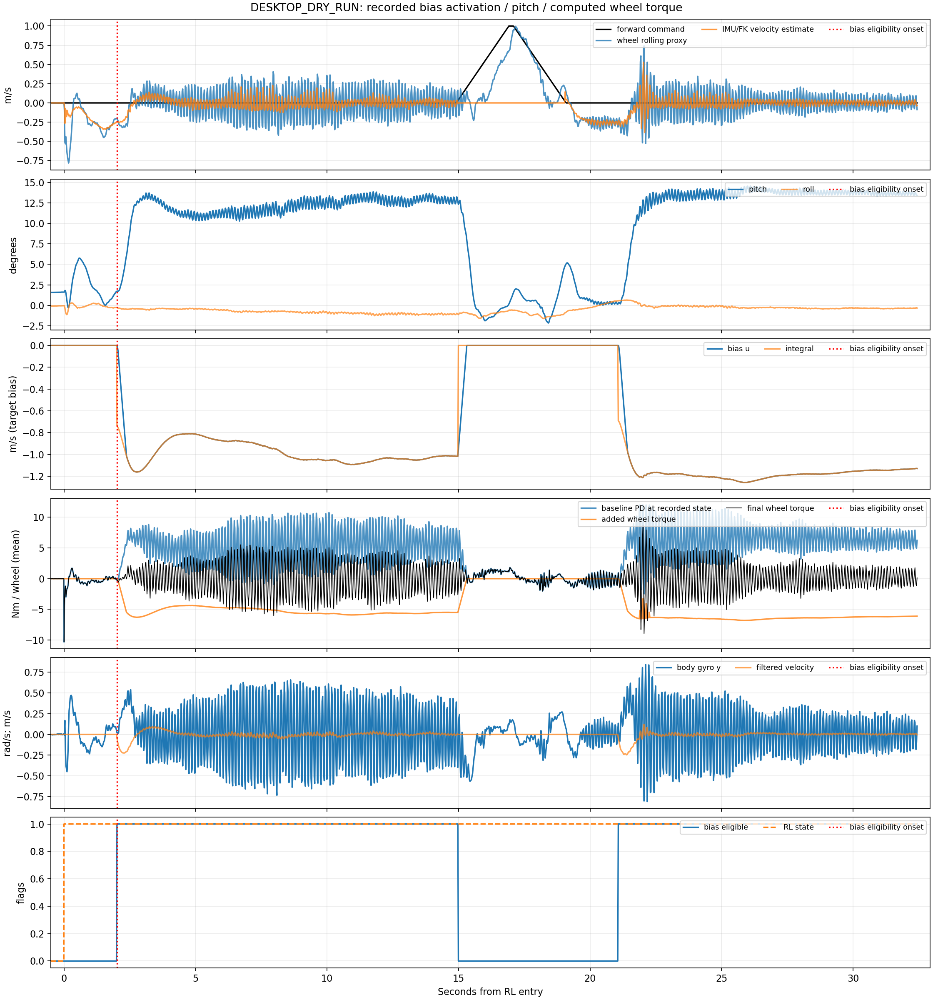
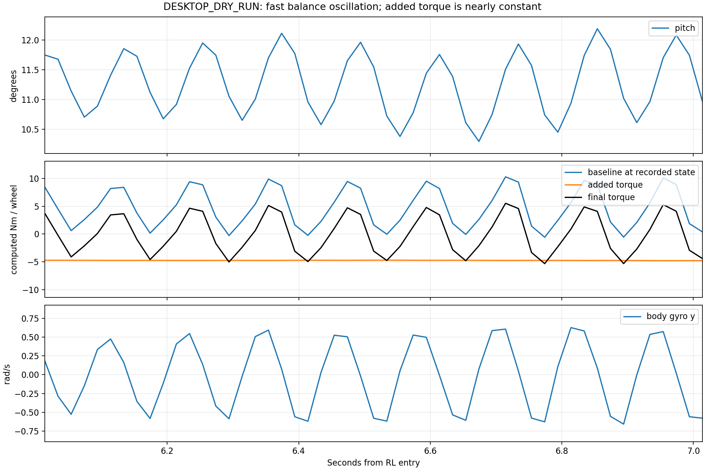

# Real FlashSAC velocity-bias stop and pitch oscillation diagnosis

- Execution Domains: ROBOT_READ_ONLY (retrieve completed logs and hashes), DESKTOP_DRY_RUN (atomic-frame analysis and plots).
- Evidence Status: PASS for recording/copy integrity, sample timing and action/teacher/torque reconstruction; SUSPICIOUS for bias-induced posture shift and balance oscillation; NOT_TESTED for modified controller performance or a measured plant transfer function.
- Policy checkpoint SHA256: `6d3cba9fa76eebe9fb2f40ef23d34115b8b95028ec788571531ffb33ce821a05`.
- ONNX SHA256: `f44f07ed44970e3ff565eae67fd9229adf0be5c02215591c52a691ffcbb71b2a`.
- Config SHA256: `d429ad9e60c25137d4bb5e2f26cb50a469fbcecf3a28af0076918a49eb7c035d`.
- Branch: `agent/codex/dev_tita_gluon`.
- Run: `flashsac_60000_133338_353802215_output_true`, 2026-10-17 13:33:38 KST.
- Operator observation: robot stopped drifting but vibrated; vibration started after approximately two seconds at zero command. External push/support changes were not explicitly labelled.

## Finding

The data strongly support the operator's hypothesis: the wheel-target correction
substantially shifts the mean pitch, and rapid pitch/wheel-torque oscillation
appears in that shifted operating condition. This run demonstrates stopping
with a posture cost, rather than stopping while preserving the previous posture.

Bias becomes eligible at RL+2.014 s. During the following 0.6 s, correction
grows from zero to about -1.145 m/s and pitch moves from +1.72 to +11.30 degrees.
The robot subsequently remains at about +12 degrees in the first neutral episode
and +13.7 degrees in the second. The sign follows the recorded IMU convention;
it has not been independently labelled as physical forward/backward lean.

There is a useful within-run repetition. The operator commands motion at roughly
RL+15 to +19 s, causing the bias to unwind/reset. Pitch returns near zero.
After command returns to zero, another two-second acquisition ends at
RL+21.074 s, the correction builds again, and pitch returns to roughly +14 degrees.
Commanded motion itself also changes posture, so this is strong observational
evidence, not an isolated switch-only causal experiment.

All table rows use zero-command samples. The pre-bias interval is RL+0.5 to
+2.0 s and contains startup settling; it is shorter than the other rows.
Each settled episode discards its first two seconds and last second.

| Interval | Mean pitch | Estimated forward velocity | Mean bias | Baseline wheel torque | Added wheel torque | Final wheel torque |
| --- | ---: | ---: | ---: | ---: | ---: | ---: |
| Before first bias | +2.36 deg | -0.236 m/s | 0 | -0.31 Nm | 0 | -0.31 Nm |
| First settled bias episode | +12.08 deg | -0.0046 m/s | -0.974 m/s | +5.27 Nm | -5.26 Nm | +0.010 Nm |
| Second settled bias episode | +13.73 deg | +0.0011 m/s | -1.191 m/s | +6.55 Nm | -6.44 Nm | +0.115 Nm |

Wheel torque columns are the left/right mean per wheel. Baseline is the
unbiased adapter evaluated at the *recorded corrected-trajectory state and
raw action*, not a prediction of a separate uncorrected robot trajectory.
Both terms are combined in the SBC and only the final torque vector is sent
to CAN. No two independent motor commands are being applied.
Velocity is an IMU/encoder/FK estimate, not externally measured translation.
The wheel-rolling proxies also approach zero in these intervals, consistent
with the operator's observation of stopping.



## The fast oscillation is carried by the baseline balance response

The first settled episode has a 6–10 Hz peak at 8.35 Hz, the second at 8.51 Hz.
This peak appears in pitch, body gyro y, baseline wheel torque and final wheel
torque. Band-limited RMS values use a Hann-windowed, resampled periodogram;
they describe the selected intervals, not a stationary-system identification.

| 6–10 Hz RMS quantity | First episode | Second episode |
| --- | ---: | ---: |
| Pitch | 0.500 deg | 0.262 deg |
| Gyro y | 0.435 rad/s | 0.234 rad/s |
| Added wheel torque | 0.00525 Nm | 0.00247 Nm |
| Baseline wheel torque | 3.277 Nm | 1.760 Nm |
| Final wheel torque | 3.272 Nm | 1.758 Nm |

The added torque is nearly constant on the fast-oscillation timescale, while
the existing policy/PD response supplies almost all of the 8 Hz torque component.
Thus a rapidly alternating bias integral is not supported as the immediate
8 Hz forcing signal. A large slow correction changes the balance equilibrium;
the existing closed loop then oscillates around that operating condition.
The second episode's amplitude decreases toward the end, so a permanent
constant-amplitude limit cycle has not been established.
These are frequencies observed in approximately 50 Hz snapshots; higher-rate
measurement would be needed to rule out aliasing from motion above 25 Hz.

Likely contributors to that altered closed-loop response include the large
pitch shift, action-history/model mismatch from an offset added after policy
inference, and existing actuator/observation delays or gain mismatch.
This single trajectory cannot separate those mechanisms or quantify their
stability margins. In particular, it does not establish that a specific delay,
motor stiffness, encoder noise or policy network layer is the root cause.



## Why the present bias law can create this result

For this checkpoint, wheel Kd is 0.5 and wheel radius is 0.0925 m:

```text
wheel_velocity_offset = sign * u / 0.0925             # rad/s
added_PD_torque        = 0.5 * wheel_velocity_offset  # Nm, before final clip
                      = sign * 5.4054 * u
```

A modest-looking -1 m/s target bias therefore introduces about -5.4 Nm per
wheel. The configured 3 m/s² slew allows roughly 16.2 Nm/s of correction
change before final effort clipping. Both wheel signs are consistent with
the recorded offsets and torque reconstruction in this run.

At first eligibility, the seed `3 * v_hat` initializes the integral to about
-0.739 m/s from estimated velocity -0.245 m/s. At the second eligibility,
the corresponding values are -0.691 and -0.229 m/s. The integral gain 4 then
adds further correction while the robot is still decelerating. This produces
a substantial target offset within well under one second. As velocity approaches
zero, the integral retains the offset; it does not automatically return pitch
to the original posture. The frozen policy reacts to the changed state with
opposing wheel targets, resulting in the large cancelling DC terms above.

The eligibility condition only constrains absolute roll/pitch to 0.3 rad
(about 17.2 degrees). The observed maximum pitch, 14.56 degrees, remains
inside that guard. There is no separate requirement to preserve the original
pitch or inhibit integration at, for example, a large change from the
pre-bias posture. The law optimizes the velocity proxy while allowing this
posture displacement.

Bias peaks at magnitude 1.258 m/s, below its 2 m/s bound. Final wheel commands
peak at 9.104 / 11.531 Nm and never reach the 12 Nm limit in recorded RL frames.
The configured maximum bound and final motor saturation are therefore not
the trigger shown by this recording. Lowering a cap below the actual correction
would change behavior, but could also leave residual drift; merely retaining
the same cap while changing its units does not address the equilibrium shift.

## What the recording rules out and leaves open

- All 3,003 captured TrainingSample frames have continuous sequence IDs within the recorded span. RL lasts 32.434 s.
- Snapshot intervals average 19.980 ms across the recording, including extra state-transition frames; maximum 20.673 ms. No interval exceeds 30 ms. This verifies the observed approximately 50 Hz publication, not every 2 ms motor-loop deadline.
- Every RL frame has sensors_valid, policy_valid, output_enabled, torque_sent and teacher_action_valid true. No CAN_TX error appears in the console. Transport acceptance does not establish motor acknowledgement.
- Recomputed corrected torque matches recorded torque within 4.30e-6 Nm; teacher action reconstruction within 2.39e-7; added-torque diagnostics also match. Software bias units and left/right distribution match the intended adapter.
- The SQLite database passes quick_check, is finalized, and both database/metadata hashes match the SBC originals. Source and policy hashes match the deployed version.
- The data do not establish measured ground speed, external-force magnitude, calibrated applied motor torque, high-rate CAN latency or the exact origin of the 8 Hz dynamics.

The initial log retrieval was interrupted when the operator powered down.
After the operator restored SBC access, retrieval and source/hash checks were
read-only. No controller, robot service, MCU request or CAN command was run
for this analysis. The already-known SIGKILL during SDK shutdown appears
after the RL segment and does not explain the in-run oscillation.

## Next change to evaluate

The first goal should be preserving posture while acquiring the stop correction.
Reducing/removing the large seed kick and acquiring the integral more slowly
is a reasonable initial experiment. Changing Ki alone leaves the existing
seed and its retained offset, so it cannot by itself guarantee the original
posture is recovered. A pitch-deviation/rate condition can suspend or unwind
the integral before a large lean develops, but that guard must be evaluated
with the tradeoff that drift may return.

The longer-term controller should account for pitch and velocity together,
or place the compensation at an interface where the policy can coordinate
the resulting posture. A wheel-only velocity-integral objective has no
explicit posture-restoration objective. Do not infer from this run that an
extra low-pass filter or frequency notch will restore the mean pitch: the
large slow bias would still remain.

Any parameter/control change should first be compared in sim2sim with neutral
drift, pitch deviation, gyro RMS, wheel-torque RMS and command-release/re-entry
transients, then separately approved for deployment. No tuning or controller
change was made in this analysis task.

For later learning, teacher_action_valid certifies a mathematical target, not
a good posture. These high-pitch episodes should not automatically become
positive teacher examples without task/posture/oscillation quality filtering.

## Files, executed checks and scope

- New analysis script: `test/sim2real/analyze_velocity_bias_oscillation.py`.
- New report: this file.
- Data, plots and evidence: `docs/exp/2026-10-17/flashsac_bias_oscillation_review/`.
- Existing production sources/configuration and robot files were not modified.
- PASS: full offline script on 3,003 atomic frames, SQLite quick_check, monotonic-time checks and numerical reconstruction assertions. [Analysis log](flashsac_bias_oscillation_review/analysis.log), [metrics](flashsac_bias_oscillation_review/metrics.json), [copy integrity](flashsac_bias_oscillation_review/copy_integrity.json).
- Repository completion: [agent_check.log](flashsac_bias_oscillation_review/agent_check.log). Existing unrelated my_flat_env_cfg.py trailing-whitespace failures remain; fast syntax/URDF checks are reported separately in that log.
- Final scope/hash checks: `flashsac_bias_oscillation_review/completion_integrity.json`.

Reproduce with the desktop generated-message overlay:

```bash
source /opt/ros/jazzy/setup.bash
source test/sim2real/training_logging_work/install/share/tita_controller/local_setup.bash
MPLCONFIGDIR=/tmp/tita_oscillation_matplotlib python3 test/sim2real/analyze_velocity_bias_oscillation.py \
  docs/exp/2026-10-17/flashsac_bias_oscillation_review/flashsac_60000_133338_353802215_output_true_bag \
  --config sim2real/tita_ws/src/tita_controller/policies/flashsac_60000/config.json \
  --output docs/exp/2026-10-17/flashsac_bias_oscillation_review
```
