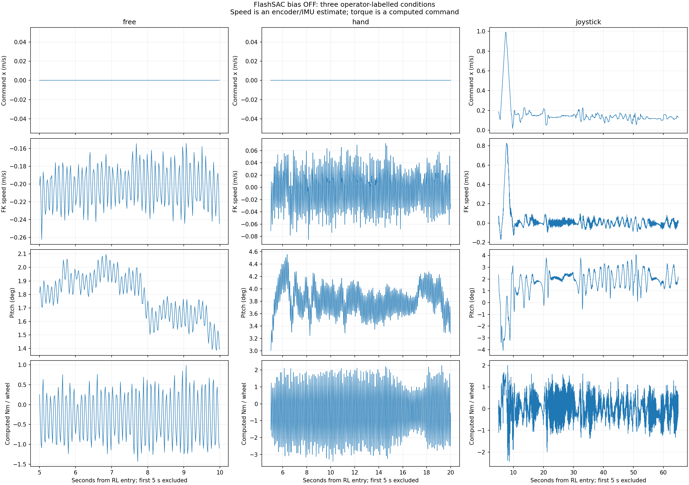
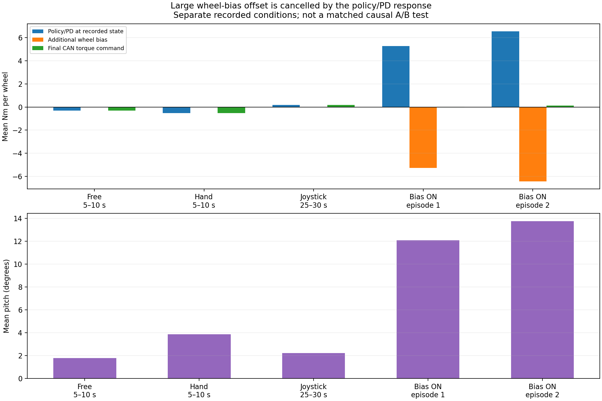

# 자유 drift / 손 지지 / 조이스틱 상쇄 비교와 큰 wheel-bias 토크의 원인

Execution Domains: ROBOT_READ_ONLY (완료된 지정 실행의 로그 조회·복사·hash 확인), DESKTOP_DRY_RUN (atomic frame 분석, 기존 C++ 수학 fixture, 동일 ONNX 재추론)

Evidence Status: **PASS** — 로그 무결성·명령/정책/토크 경로와 초기 seed·적분의 수학적 재구성. **SUSPICIOUS** — 큰 후단 보정이 정책의 평형 자세를 이동시키고 반대 정책 출력을 키운다는 동역학 해석. 실제 지면 속도, 모터 실측 토크, 원래 sim-to-real drift의 물리 원인과 새 제어기의 성능은 **NOT_TESTED**.

Policy Checkpoint SHA256: `6d3cba9fa76eebe9fb2f40ef23d34115b8b95028ec788571531ffb33ce821a05`

ONNX SHA256: `f44f07ed44970e3ff565eae67fd9229adf0be5c02215591c52a691ffcbb71b2a`

Config SHA256: `d429ad9e60c25137d4bb5e2f26cb50a469fbcecf3a28af0076918a49eb7c035d`

Branch: `agent/codex/dev_tita_gluon`

## 결론

큰 보정 목표가 생성되는 경로는 확인됐다. **RL+2초의 큰 음의 추정속도를 `3*v`로 seed → 감속 중 Ki=4 적분으로 추가 누적 → 속도가 0 부근에 와도 그 적분값 유지 → 정책 출력 뒤에서 휠에만 큰 offset 추가**다. 그 결과 bias-ON 기록에서는 큰 음의 보정과 큰 양의 정책·PD 토크가 거의 상쇄되는 자세로 이동했다. 소프트웨어 단위 변환·좌우 토크 분배의 수치 재구성에는 불일치가 없다.

조이스틱 상쇄에서는 정책 입력에 약 +0.14 m/s 명령을 주면 피치 약 2°와 작은 평균 휠 계산 토크로 추정속도가 0 부근이 된다. 따라서 기록된 −5~−6 Nm 보정 전체를 실기 drift에 필요한 순수한 정상 제동 토크라고 해석할 수 없다. 상당 부분이 보정으로 달라진 상태에서 정책·PD가 만드는 반대 항과 상쇄된다. 이는 계산 명령 기준이며 실제 모터 토크·마찰력 실측 결과가 아니다.

## 1. 대상과 구간 선택

| 조건 | 실행 ID | 사용자 annotation | RL frame 수 |
|---|---|---|---:|
| 자유 drift | `flashsac_60000_141113_460666182_output_true` | 외부 지지·명령 없는 drift | 560 |
| 손 지지 | `flashsac_60000_141605_080644640_output_true` | 처음 몇 초 이후 손으로 이동을 막음 | 1,209 |
| 조이스틱 상쇄 | `flashsac_60000_141821_088426888_output_true` | 조이스틱 명령으로 drift 상쇄 | 3,521 |
| 이전 bias ON (원인 추적용) | `flashsac_60000_133338_353802215_output_true` | 정지했지만 큰 피치·진동 발생 | 1,623 |

세 baseline 실행은 모두 bias OFF다. Summary의 checkpoint·ONNX·config·controller binary hash가 bias-ON 실행과 동일하다. 자유/손 지지에서는 명령 세 축이 모두 0이고, 새 조이스틱 실행에서는 실제 명령을 기록대로 사용했다. 세 baseline 모두 실제 wheel offset=0이다. 모든 실행에서 센서·정책·output·transport·teacher validity의 RL false frame은 0개다.

세 조건의 성능 요약에서는 **최초 5초를 제외**한다. 손 지지의 정확한 접촉 시각은 알 수 없으며 5초는 분석상 제외 기준이다. 새 조이스틱 실행은 5–10초에도 명령을 크게 조정하고 실제 추정속도가 양으로 올라가므로 이 구간을 정지 대표값으로 사용하지 않는다. 전체 5초 단위 결과를 JSON에 남겼고, 10–65초 전체 및 yaw 명령이 0이고 전진 명령 변동이 작은 25–30초를 따로 제시한다. 마지막 명령 release 구간도 별도 처리한다. 이전 bias-ON의 seed 생성 시점은 원인 추적을 위해 2초 부근을 분석한다.

## 2. 세 조건에서 관측된 차이

| 조건 / RL 구간 | 전진 command 평균 | FK/IMU 속도 추정 평균 ± 표준편차 | 피치 평균 ± 표준편차 | 최종 계산 토크 평균 / wheel |
|---|---:|---:|---:|---:|
| 자유 / 5–10초 | 0 | −0.20251 ± 0.02145 m/s | 1.782° ± 0.163° | −0.301 Nm |
| 손 지지 / 5–10초 | 0 | −0.00431 ± 0.03148 m/s | 3.850° ± 0.282° | −0.522 Nm |
| 조이스틱 / 25–30초 | **+0.14340 m/s** | **+0.00869 ± 0.02205 m/s** | **2.231° ± 0.203°** | **+0.165 Nm** |
| 조이스틱 / 10–65초 전체 | +0.13661 m/s | +0.00049 ± 0.03314 m/s | 1.946° ± 0.745° | +0.0075 Nm |

25–30초의 command 범위는 +0.13309~+0.15263 m/s, yaw command는 전 구간 0이다. 10–65초 전체는 전진 명령 +0.05250~+0.22733 m/s, yaw 평균 +0.03275 rad/s와 변동이 있으므로 완전히 일정한 전진 명령 실험으로 해석하지 않는다. 같은 시간대 비교를 위한 조이스틱 5–10초 값은 command +0.4620 m/s, 추정속도 +0.2423 m/s이며 초기 조정 중이라는 사실도 함께 보존했다.

조이스틱 상쇄 중 10–65초의 추정속도 평균이 거의 0인 결과는 25–30초의 한 사례에만 의존하지 않는다. 그러나 순간 변동이 있고 카메라 GT가 없으므로 완전 정지 성공을 판정하지 않는다. 손 지지는 외력이 있는 조건이라 자율 정지 성공으로 계산하지 않는다. 동일 환경·동일 초기조건의 무작위 A/B 실험도 아니다.

같은 조이스틱 실행에서 RL+68–69초에는 전진·yaw 명령 모두 0으로 돌아왔고 추정속도 평균이 **−0.23245 m/s**다. 이는 명령 상쇄가 풀린 뒤 후진 경향이 다시 나타난 관측이며, release 직후 1초의 과도 응답이다. 별도 장시간 zero-command 정상상태 측정으로 간주하지 않는다. Estop은 RL+약70.4초로 이 구간 뒤다.



## 3. 조이스틱과 wheel-bias의 입력 위치가 다르다

`tita_node.cpp`는 Joy axes에서 command를 만들고 ramp한 뒤 observation의 command 항에 넣는다. 명령 항은 전진/횡방향 2배, yaw 0.25배로 ONNX에 들어간다. 정책은 그 입력과 IMU·관절·이전 raw action을 사용해 **다리 position target과 휠 velocity target을 함께 출력**한다. 정책 출력이 PD/effort clip을 거쳐 하나의 최종 CAN 토크 벡터가 된다.

반면 `WheelVelocityBias`는 정책 추론 이후 wheel velocity target 두 개에만 `sign*u/r`를 더한다. Zero user command와 raw-action history는 그대로다. 따라서 command +0.14 m/s와 wheel-target bias ±0.14 m/s는 같은 입력이 아니며, 서로 숫자나 부호를 직접 대응시킬 수 없다.

이를 로그 통계만으로 추정하지 않고, 동일 hash ONNX로 기록된 observation을 재추론했다. 전체 **6,913 RL frame**에서 기록된 raw action과 최대차는 **3.22e−6**으로 일치한다. Observation command scale도 검증했다.

추가로 조이스틱 실행의 **같은 센서·같은 기록된 action history를 고정한 채 command 항만 0으로 바꾸는 단일 추론**을 수행했다. Yaw가 원래 0인 25–30초에는 실제 command를 넣을 때와 0일 때 다음 차이가 났다.

- 휠 평균 목표속도 변화: 약 **−1.653 rad/s** (좌 −1.709, 우 −1.597 rad/s).
- 같은 순간 상태에서 계산한 휠 토크 변화: **−0.8265 Nm / wheel**.
- Leg 2/3 목표각 변화: 좌 +0.0669/+0.0798 rad, 우 +0.0651/+0.0443 rad. 다른 다리 축도 변한다.

이 결과는 조이스틱이 휠 토크 하나만 보태는 경로와 다르다는 직접적인 정책 계산 근거다. 양의 전진 command가 이 상태의 단일 추론에서 음의 휠 토크 변화를 낼 수 있으므로, 전진 명령 부호만 보고 wheel residual 부호 오류라고 단정하지 않는다. 이 실험은 미래 상태·history를 재생성하지 않으므로 command OFF에서 로봇이 어떻게 움직일지 예측한 closed-loop ablation은 아니다. 위 −0.8265 Nm도 자율 정지에 필요한 최적 residual gain으로 사용할 수 없다.

## 4. 큰 보정량의 생성과 유지 — 로그로 확인한 수학

휠당 보정 경로는 다음과 같다. Effort clip이 비활성인 구간의 식이다.

```text
Δwheel_target = sign * u / 0.0925              [rad/s]
Δtorque       = Kd * Δwheel_target
              = sign * 0.5/0.0925 * u
              = sign * 5.4054 * u             [Nm / wheel]

first eligible: integral = clip(3*v_hat, ±2)
LPF update:    v_f += (1-exp(-dt/max(0.1,dt))) * (v_hat-v_f)
integral:      integral += 4*v_f*dt             # clip ±2
u:             integral * ramp, then slew limit
```

설정 상한 ±2의 단위는 **m/s**이며 별도 correction torque cap은 없다. 토크 환산 상한은 **±10.81 Nm/wheel**, slew 3 m/s²는 **16.22 Nm/s/wheel**이다. 다만 이번 현상의 원인을 상한 도달이나 최종 토크 포화로 돌릴 수는 없다. Bias-ON 최대 |u|=1.258<2이며 최종 wheel command의 ±12 Nm 포화 fraction은 좌우 모두 0이다.

첫 bias-ON eligible 시점은 RL+2.014초, v_hat=−0.24503 m/s다. 따라서 **seed만 −0.73508 m/s, 휠당 −3.973 Nm 상당**이다. 첫 LPF/적분 갱신 후 integral=−0.73864 m/s다. Ramp 시작 프레임에 이 토크가 즉시 전량 출력되는 것은 아니며 ramp·slew를 따라 커진다.

| Bias-ON 구간 | 초기 seed | 정착 integral 평균 | seed 이후 누적분 | 정착값 중 seed의 대수적 비율 |
|---|---:|---:|---:|---:|
| 1차 | −0.73508 m/s | −0.97386 m/s | −0.23878 m/s | **75.5%** |
| 2차 | −0.68737 m/s | −1.19098 m/s | −0.50361 m/s | **57.7%** |

연속 eligible frame의 `I_next = I_prev + 4*v_f*dt` 재구성 최대차는 **1.17e−7 m/s**다. 큰 seed와 감속 중 추가 누적이 실제 기록된 integral을 설명한다. 이 비율은 관측 궤적 위의 대수적 분해이며 seed 제거 시 실제 closed-loop 토크가 75.5% 줄 것이라는 예측은 아니다.

속도가 0이 되면 적분 증가가 멈출 뿐 **이미 쌓인 integral은 그대로 남는다**. 현재 목적식에는 원래 피치 복귀 항이 없고, 절대 roll/pitch 0.3 rad ≈17.19° guard만 있다. 기록된 12–14°는 이 범위 안이다. 정지 오차를 줄였다고 해서 자세가 원래대로 돌아오도록 설계된 구조가 아니다. 지속 외란 보상에는 DC 적분값이 필요할 수 있으므로, 적분을 무조건 0으로 소거하는 것이 일반 해법이라는 뜻도 아니다.

## 5. 큰 ‘추가 토크’가 실제로 무엇과 상쇄됐는가

| 이전 bias-ON 정착 구간 | 정책·PD 항 / wheel | 추가 bias 항 / wheel | 최종 command / wheel | 피치 |
|---|---:|---:|---:|---:|
| 1차 | +5.272 Nm | **−5.264 Nm** | +0.008 Nm | 12.080° |
| 2차 | +6.552 Nm | **−6.438 Nm** | +0.115 Nm | 13.732° |

여기서 정책·PD 항은 **bias가 적용된 실제 기록 상태의 raw action을 bias 없이 adapter에 넣은 값**이다. 별도 FlashSAC-only robot의 예측값이 아니다. 두 항은 SBC에서 합산되며 독립된 두 모터 명령으로 전송되지 않는다. Settled 구간은 각 eligible episode의 처음 2초와 마지막 1초를 제외하여 이전 oscillation 보고서와 맞췄다. 세 baseline 비교의 ‘처음 5초 제외’와 목적이 다르다.

이 상쇄와 큰 피치 이동은 휠 후단 보정으로 바뀐 자세에 정책이 반응하며 다른 평형에 정착했다는 해석을 강하게 지지한다. 큰 seed를 유지한 채 Ki만 낮추는 변경은 이 초기 offset을 제거하지 않는다. 이전 [oscillation review](flashsac_bias_oscillation_review.md)에서 8.3–8.5 Hz 성분이 주로 정책·PD 토크에 있고 보정 토크 자체의 고주파 진폭은 작다는 사실과도 일치한다. 정확한 진동 동역학 원인·위상여유는 식별되지 않았다.



## 6. 다음 발전 방향과 아직 모르는 부분

이번 자료는 **중립일 때 정책 입력 command_x를 작게 조정하는 outer-loop trim**을 다음 검증 후보로 삼을 근거를 준다. 실제 operator가 +0.13~+0.15 m/s 부근 명령으로 낮은 피치를 유지하며 drift를 상쇄한 구간이 있기 때문이다. External user command와 internal trim을 구분하고, zero seed·완만한 적응·범위 제한·피치 변화 제한을 포함해 sim2sim에서 직접 wheel-bias와 비교하는 순서가 합리적이다. 관측된 +0.14가 다른 초기조건·바닥에서도 최적이거나 안전한 고정값이라는 보장은 없다. 이번 작업은 그 controller 구현이나 성능 검증이 아니다.

직접 wheel-bias를 유지한다면 큰 `3*v` 초기화를 먼저 재검토하고, 원래 자세에서의 pitch deviation과 함께 적분을 제한해야 한다. Ki만 바꾸면 큰 seed와 기존에 쌓인 offset이 남는다. 단순히 시작 대기시간을 늘리는 것만으로도 자유 drift의 지속적인 −0.2 m/s 신호가 없어지지는 않으므로, 대기시간만이 원인이나 해법이라고 결론내리지 않는다.

실기의 **원래 zero-command drift가 왜 sim과 다른지**는 이 자료만으로 특정하지 못했다. 센서 frame·접촉/마찰·구동계·정책의 실제 동역학 gap을 분리하는 외부 속도 GT가 없다. 손으로 막은 후반과 조이스틱 상쇄 후반에서 속도 추정이 0 부근으로 달라지므로 항상 고정된 −0.2 m/s 센서 offset 하나로 설명하는 가설은 약해진다. 그러나 같은 엔코더 기반의 관측들만으로 속도 추정기나 실제 모터 Nm calibration이 완전히 맞다고 입증할 수는 없다.

## 7. 검증·변경 범위·재현

- **PASS:** 새 조이스틱 run summary/console/bag-console/metadata/DB3 원격·로컬 SHA256 **5개 일치**. [복사 검사](flashsac_three_case_bias_diagnosis/copy_verification.log). 기존 세 bag은 이전 복사 무결성 기록과 source hash를 유지했다.
- **PASS:** 네 bag 모두 SQLite read-only quick_check, sequence 연속성, monotonic time, RL validity flags 검사. 새 RL 마지막 sample +70.386초, snapshot 최대 간격 20.572ms, 30ms 초과0개. 이는 50Hz snapshot 검사이며 2ms 제어 deadline 검증이 아니다.
- **PASS:** 총 6,913 RL frame의 동일 hash ONNX raw-action replay 최대차 **3.22e−6**. Observation의 command scale 최대오차 <1e−6. 네 bag의 raw action과 실제 offset으로 최종 토크를 재계산한 최대차 **8.88e−16 Nm**. 실제 applied/measured torque를 검증한 것은 아니다.
- **PASS:** Bias-ON active 구간 observer 및 integral 단계 재구성, strict compile 옵션의 기존 pure-math C++ fixture 실행. Joystick에서도 observer를 읽기 위해 fixture 내부 command를 0으로 강제했다. 이는 관측 수학을 계속 실행하기 위한 오프라인 처리이며 실제 명령·실행 중 controller나 저장된 데이터는 변경하지 않았다.
- **PASS:** 분석 스크립트 실행, 생성한 두 plot 육안 확인. [analysis.log](flashsac_three_case_bias_diagnosis/analysis.log), [metrics.json](flashsac_three_case_bias_diagnosis/metrics.json).
- **PASS:** `./scripts/agent-check.sh` 내 Python syntax **508/508**, URDF XML **8/8**. **FAIL:** 전체 검사는 기존 `my_flat_env_cfg.py` 431/437/443/449/455/461행 trailing whitespace로 실패. 해당 파일은 수정하지 않았다. [agent_check.log](flashsac_three_case_bias_diagnosis/agent_check.log).
- 변경 파일은 신규 [분석 스크립트](../../../../test/sim2real/diagnose_three_case_wheel_bias.py), 이 보고서와 `flashsac_three_case_bias_diagnosis/`의 복사 데이터·hash·통계·plot·검사 기록이다. 제어 코드·설정·ONNX와 이전 분석 파일은 수정하지 않았다. Diff 및 시작/종료 git status를 확인했다. Hardware 실행·서비스 변경·배포·commit/push 없음.

새 console의 software stop은 RL+약70.4초다. 그 사유 문구는 `new right press or joystick invalid/stale`로 여러 조건을 묶으므로 어느 조건인지 여기서 단정하지 않는다. 이후 Ctrl-C/exit130, teleop exit −7 및 controller group SIGTERM/SIGKILL이 있다. 종료 처리는 별도 미해결 현상이며 10–65초의 상쇄 결과나 bias-ON의 큰 DC 보정 원인으로 연결하지 않는다.

```bash
# DESKTOP_DRY_RUN
source /opt/ros/jazzy/setup.bash
source test/sim2real/training_logging_work/install/share/tita_controller/local_setup.bash
MPLCONFIGDIR=/tmp/tita_3case_mpl /home/cocel/venvs/cosim_ros2_jazzy/bin/python \
  test/sim2real/diagnose_three_case_wheel_bias.py \
  --output docs/exp/2026-10-17/flashsac_three_case_bias_diagnosis
```
