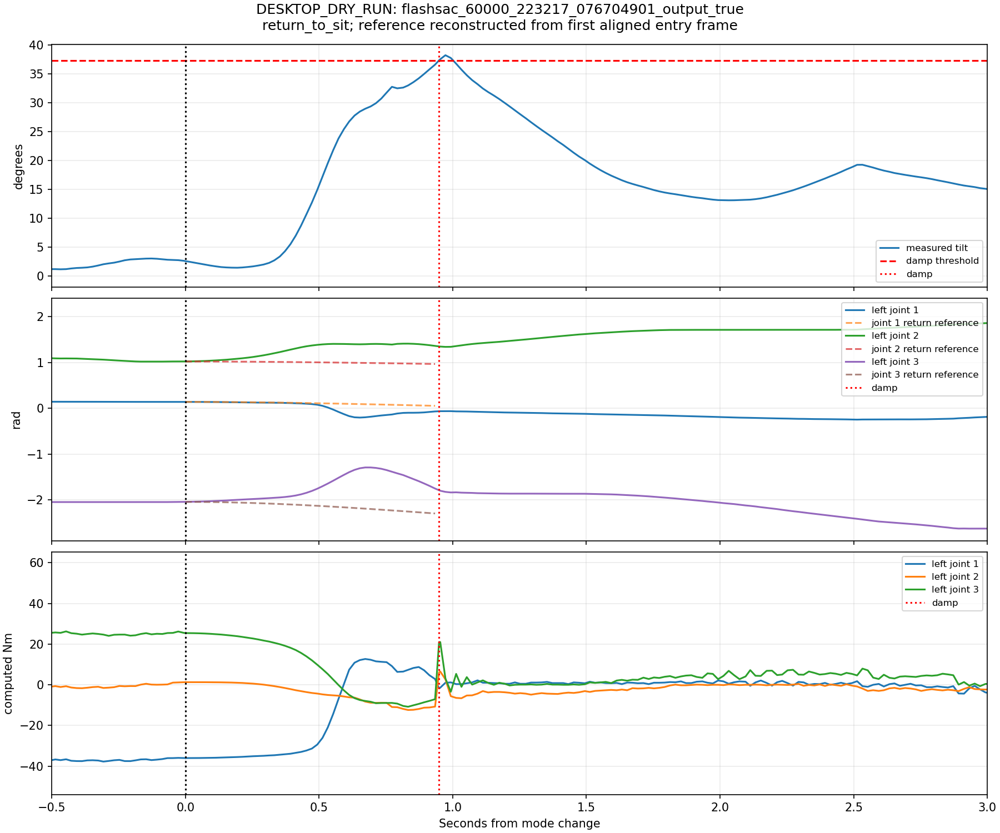

# FlashSAC stop/return collapse and previous TITA PPO handoff comparison

- Execution Domains: ROBOT_READ_ONLY (previous workspace source/configuration inspection), DESKTOP_DRY_RUN (production-header probes and finalized recording analysis).
- Evidence Status: PASS for source provenance, feedback calculation, previous-core probe and recorded state transitions; SUSPICIOUS for inadequate physical support during current handoff; NOT_TESTED for any corrected controller or unsupported robot trial.
- FlashSAC checkpoint SHA256: `6d3cba9fa76eebe9fb2f40ef23d34115b8b95028ec788571531ffb33ce821a05`.
- FlashSAC ONNX SHA256: `f44f07ed44970e3ff565eae67fd9229adf0be5c02215591c52a691ffcbb71b2a`.
- Previous My33 policy hash from archived stage2 configuration: `339b120f8021d5bca196787d8952bf764c927ad77a3fa2796cbf49811b9c9132` (previous model not executed in this task).
- Branch: `agent/codex/dev_tita_gluon`.
- Operator observation: both software stop and RL-to-sit return can make the robot suddenly sit/collapse. No new physical test was requested or run.

## Main finding

The two current paths have different support problems:

1. **EStop removes pose support deliberately.** It sends only clipped `-Kd*dq`. At rest this is zero regardless of leg position. No position stiffness, feedforward support, policy balance or sitting trajectory remains.
2. **ReturnToSit preserves the previous torque sample while nearly eliminating live feedback initially.** Its smooth torque interpolation also multiplies the new PD stiffness and damping by a coefficient starting at zero. Smooth output continuity does not establish support under changing load or motion.

The previous workspace actually installed a custom `tita_stage1_controller`,
whose `SAFE_HOLD` retains full leg PD, slews leg references toward its stand
pose, removes feedforward and decelerates the wheel velocity references.
That is materially different from the current damping stop and frozen-torque
return. Both previous and current paths can ultimately calculate torque in
the SBC and use the same torque CAN API; a wheel-driver mode change is not
needed to explain the handoff difference.

## Which previous implementation was inspected

Read-only SBC backup:

```text
/home/robot/tita_backups/tita_ws_before_flashsac_2026-10-16_112137/
```

The backup contains an installed
`install/tita_stage1_controller/lib/libtita_stage1_controller.so` and stage2
configuration links. It does not contain an installed `rl_controller` package.
The old installed configuration symlinks still point to the original
`/home/robot/tita_ws/src/...` and are broken after workspace replacement;
the preserved source configuration was read instead.

The archived `stage1_core.cpp` and `stage1_core.hpp` hashes exactly match
the desktop copies in `tita_gluon_ws/src/tita_stage1_controller/`. Thus the
desktop pure-core probe uses the same source as the robot backup.
The archived configuration references `policy_my33_2999_estimator_diagnostic.onnx`.
This establishes the preserved implementation, not which launch overrides
were active in every earlier operator experiment.

The backup also includes older upstream DDT FSM sources. Those implement
`RL -> transform_down -> idle`; their default YAML still says `np3o`, while
the shared RL transition class is also inherited by RLPPO. They are useful
secondary references, but should not be mistaken for the custom controller
actually installed in the replaced workspace.

Source copies and provenance are in
`flashsac_transition_review/`, including
[robot_source_provenance.log](flashsac_transition_review/robot_source_provenance.log).

## Current EStop: damping is not position holding

`sim2real/tita_ws/src/tita_controller/include/tita_controller/state_machine.hpp`,
lines 95–96, selects the same expression for Idle, Damp and EStop:

```text
tau = clip(-Kd * dq)
Kd  = [8, 8, 8, 0.5, 8, 8, 8, 0.5]
```

The node immediately exits policy inference, clears action/command history
outside RL and resets velocity bias. It still sends the damping torque while
sensors/output are valid. This is a latched software mode, not an electrical
power cutoff and not a controlled descent into the sit pose.

At `dq=0`, support torque is zero even if a knee has moved substantially from
its previous pose. Gravity/load can therefore move the legs and body; damping
opposes resulting motion but does not restore the pose. This directly explains
why a damping stop can feel like the robot suddenly loses its support.
It follows the earlier selected damping-stop semantics, whereas the previous
custom PPO `SAFE_HOLD` had active leg position support.

Pure C++ verification against the actual current header confirms zero torque
at rest both before and after a 0.1 rad knee displacement, and -8 Nm for a
1 rad/s knee velocity. Stop latching remains intact.

## Current RL return: live feedback is scaled almost to zero

The left-release button requests `ReturnToSit`, not startup `TransformUp`.
The node captures measured joint position and the previous final computed
torque vector. It stops updating the policy immediately. With `T=2 s`:

```text
a(t)       = smoothstep(t / T)
q_ref(t)   = q_start + a(t) * (q_sit - q_start)
tau_PD(t)  = Kp * (q_ref(t) - q(t)) - Kd*dq(t) + FF
tau(t)     = (1-a(t))*tau_previous_sample + a(t)*tau_PD(t)
```

Consequently the live feedback derivatives, away from torque clipping, are:

```text
Kp_effective = a(t)*Kp
Kd_effective = a(t)*Kd
```

The pure-header finite-difference probe measures:

| Time after return request | Blend a | Knee Kp | Knee Kd | Wheel Kd |
| --- | ---: | ---: | ---: | ---: |
| 2 ms | 0.0000030 | 0.000240 | 0.000024 | 0.0000015 |
| 100 ms | 0.00725 | 0.58 | 0.058 | 0.003625 |
| 200 ms | 0.028 | 2.24 | 0.224 | 0.014 |
| 500 ms | 0.15625 | 12.5 | 1.25 | 0.078125 |
| 1 s | 0.5 | 40 | 4 | 0.25 |
| 2 s | 1 | 80 | 8 | 0.5 |

For comparison, the frozen FlashSAC RL adapter has leg Kp=60, Kd=1.5 and
wheel Kd=0.5. The previous hold has full knee Kp=80, Kd=8 from the first
hold cycle. Current hip Kp is also multiplied by the blend, then rises to
600; the transition changes feedback authority substantially in both directions.

The retained torque is one instantaneous sample, not a continuously updated
gravity/support model or balance controller. A wheel torque sample of +3 Nm,
for example, still contributes +2.978 Nm at 100 ms and +2.531 Nm at 500 ms,
while live wheel damping is almost absent. These numbers are a synthetic
probe, not a measured wheel event. A sample taken during the recently observed
8 Hz RL oscillation can be particularly unsuitable to hold for this long.

At fixed initial pose and zero velocity the reference-motion contribution is
`a^2*Kp*(q_sit-q_start)`, since both the reference and its torque are blended.
Thus joint trajectory smoothness alone does not imply a prompt restoring force.
Simply increasing the two-second duration would prolong the weak-feedback phase.

The return endpoint also uses the old transform-up feedforward, including
-25 Nm at both knees; the previous custom SAFE_HOLD removes feedforward.
This changes the final holding equilibrium as well as the transient.

Resetting velocity bias on RL exit does not by itself create an immediate
return-torque step: the full previous corrected torque is captured. Its later
retention and the simultaneous removal of policy balance remain concerns.

## Direct evidence in existing robot recordings

Three finalized local bags from 2026-10-16 were inspected read-only. Legacy
topics were paired to state samples within 8 ms, with unique matches. All
numeric arrays are finite, all databases pass SQLite quick_check.

- **22:32:17 run:** return starts at about 2.60 degrees tilt. At return+0.493 s, tilt is 14.92 degrees; at +0.893 s it is 34.94 degrees. At +0.949 s it crosses 37.31 degrees and enters `damp`, before the planned 2.2-second completion.
- The same failed return starts with a left-knee computed torque about +25.44 Nm and position -2.040 rad. At +0.493 s, knee position has moved to -1.754 rad despite a more-negative requested sit reference. The old torque sample retains substantial influence while feedback is weak. Operator support/handling is not labelled, so this does not isolate every physical cause.
- **22:17:10 run:** another return completes in sit after 2.200 s, peaking at 8.76 degrees tilt. Therefore the defect is not a deterministic immediate pose jump on every return; initial state, load, support and torque phase matter.
- **22:18:02 run:** EStop during TransformUp exactly reproduces clipped `-Kd*dq`; after about half a second several leg torques are zero. This validates the mode implementation, not preservation of standing support.

The failed return happened before velocity bias was added. Bias is therefore
not required for this handoff problem. The latest bias recording's 12–14 degree
lean and fast oscillation can make subsequent handoff conditions worse, but
that recording ends through Ctrl+C and contains no ReturnToSit/EStop event;
it cannot serve as a new measured return-failure trial.



The tilt guard itself is a secondary response to the growing tilt; disabling
it would not restore lost feedback or balance.

## Previous custom PPO SAFE_HOLD

`Stage1Core::make_output` and the operator stop path retain these properties:

| Property | Previous custom SAFE_HOLD | Current EStop | Current ReturnToSit |
| --- | --- | --- | --- |
| Leg feedback | Full Kp 600/80/80, Kd 8 | Position Kp 0, velocity damping only | Starts near zero; rises to 600/80/80 and Kd 8 |
| Leg reference | Last target slewed toward stand pose | No pose reference used | Measured pose to sit in 2 s |
| Reference slew | Up to 1.5 rad/s | None | Smoothstep trajectory |
| Feedforward | Zero in hold | Zero | Blended to transform FF |
| Wheels | Previous velocity target decelerates toward zero at 5 rad/s² | Immediate zero-velocity damping | Frozen previous torque blended into damping |
| Policy balance | Stopped | Stopped | Stopped |
| Restart | Latched hold, no automatic RL re-entry | Latched stop | Returns to sit, then a fresh RL request |

At a 2 ms controller step the old pose target moves by at most 0.003 rad and
wheel velocity target by at most 0.01 rad/s. A pure archived-identical core probe
confirms full knee feedback immediately, zero feedforward, target slew and
latched hold. It uses ideal sensor tracking; it does not simulate the robot.
The old code can still switch gains abruptly and stop active pitch balance;
it should not be treated as a universally stable or impact-free design.

Both archived hardware xacro and bridge select `pvt_ctrl=false`: the bridge
computes `effort + kp*(q_ref-q) + kd*(dq_ref-dq)` and calls
`set_target_joint_t`. The semantic difference is which references/feedback
remain alive, not a requirement to introduce motor-side velocity control.

## Direction for a correction, not implemented here

Use the previous hold's retained leg feedback and bounded references as the
starting point for an operator-requested mode change. A normal RL exit should
reduce motion while balance is still available, then transfer to a supporting
posture controller after appropriate pitch/rate/velocity conditions. Keep the
live position/velocity feedback active through takeover. If torque continuity
is required, use a suitable transient offset/reference/gain handoff rather
than scaling all new feedback from zero around one frozen torque sample.

Leg pose support alone does not preserve fore/aft balance on two wheels.
Neither blindly copying the old hold nor adding a longer pose interpolation
establishes a successful unsupported descent. Operator hold/normal sit return
and actual sensor/CAN-failure responses also need distinct validity semantics.
Do not replace fault behavior using untrusted sensor data.

No control behavior, parameters or robot files were changed. Any proposed
implementation needs desktop/simulation dynamics validation and separately
authorized deployment/physical verification.

## Checks, files and limitations

- PASS: new `test/sim2real/transition_feedback_probe.cpp`, compiled C++17 with Wall/Wextra/Werror/pedantic, actual current-header stiffness/damping derivatives and frozen-torque/stop checks. [CSV](flashsac_transition_review/feedback_probe.csv), [log](flashsac_transition_review/feedback_probe.log).
- PASS: new `test/sim2real/previous_ppo_hold_probe.cpp`, strict pure-core compilation linked against the source verified identical to the SBC backup. [Log](flashsac_transition_review/previous_hold_probe.log).
- PASS: existing `python3 test/sim2real/test_joystick_buttons.py`, nine scenario groups. These establish state logic, limits and torque continuity, not loaded-robot stability. [Log](flashsac_transition_review/existing_button_regression.log).
- PASS: new `test/sim2real/analyze_transition_handoff.py` executed on 1,909 / 709 / 5,501 aligned frames; zero / zero / two unmatched samples discarded. [Analysis log](flashsac_transition_review/recorded_analysis.log), [metrics](flashsac_transition_review/recorded_transitions.json).
- Added this report, plots and copied source/configuration evidence under `docs/exp/2026-10-17/flashsac_transition_review/`.
- Current production state-machine hash: `5ec02ce61441112d0fe76bc394759d591b1f15851de9d4f2a483023cefe9a590`, matching SBC. Previous core hash: `918731fdba173b62f742aa5c0d26ab5bdd22c8a33739710fac36b9d6118c76ec`.
- Repository check and scope record: [agent_check.log](flashsac_transition_review/agent_check.log), `flashsac_transition_review/completion_integrity.json`. Pre-existing unrelated whitespace errors remain untouched.

All torques above are computed commands, not calibrated applied motor torque.
Recordings are approximately 50 Hz and do not establish every 500 Hz peak or
deadline. New probes are algebraic/kinematic checks; no physical dynamics,
controller deployment, robot service change, MCU request or torque test occurred.
