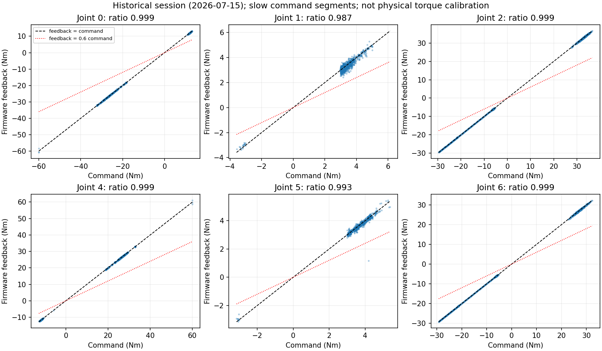

# 모터 토크 경로·SDK·실기 피드백 읽기 전용 감사

Execution Domains: ROBOT_READ_ONLY — 켜진 로봇의 기존 프로세스·설정·SDK·CAN 수신·과거 로그 조회. DESKTOP_DRY_RUN — 소스/ARM binary 분석, 기존 데이터 비교. 로봇 제어기 실행·서비스 변경·CAN 송신·설정 변경·배포 없음.

Evidence Status: **PASS** — 소프트웨어 경로 추적·수동 CAN 수신/해석·과거 command/feedback 집계. **SUSPICIOUS** — 과거 피드백과 현재 물리 출력의 연결. **NOT_TESTED** — 현재 FlashSAC 부하 상태의 전류/토크 추종, 물리 Nm 교정, 모터 드라이버 내부 Kt·기어비·전류 제한·열 derating.

Installed Policy Checkpoint SHA256: `381e846e3ffb1d5a9ed629c02b55c9740ec3c5b089ca443f38b3d73b6abbd730` (75000). 이번 조사에서는 이 정책을 실행하지 않았다.

기존 grid fit 대상 60000 SHA256: `6d3cba9fa76eebe9fb2f40ef23d34115b8b95028ec788571531ffb33ce821a05`.

Branch: `agent/codex/dev_tita_gluon`

## 핵심 결론

**현재 공개된 PC→SDK→CAN 토크 경로에서 다리만 0.6배로 줄이는 항은 찾지 못했다. 과거 실제 command와 펌웨어 torque feedback은 느린 명령 구간에서 약 0.987–0.999배로 맞았다.** 따라서 real-to-sim grid의 0.60을 ‘하드웨어 토크 출력이 정확히 40% 부족하다고 측정했다’로 해석하면 안 된다. 이는 다른 모델 오차까지 설명할 수 있는 시뮬 등가 계수다.

반대로 이번 결과로 실제 모터의 물리 Nm가 정확하다거나 현재 부하 상태에서 문제가 없다고 확정하지도 않는다. 펌웨어 feedback이 전류 기반 추정이고 command와 같은 Kt/기어비 변환을 쓰면, 양쪽 값이 맞아도 외부 물리 출력 교정 오류는 남을 수 있다. 현재 전원을 켠 대기 상태만으로 출력 배율을 측정할 수 없다.

## 1. 소프트웨어·송신 경로

`policy action → joint 목표 → PC PD 계산/clip → set_target_joint_t → CAN FD → MCU/driver → motor`

- `tita_controller/adapter.hpp`의 다리 RL PD는 `60*(q_target-q)-1.5*dq`, 다리 final clip ±60 Nm다. 휠은 Kd=0.5, clip ±12 Nm다. 60000/50000/75000의 adapter 설정은 같다. 최종 계산 벡터를 `tita_node.cpp`가 500Hz loop에서 SDK로 전달한다. 0.6 배율·추가 기어비·전류 단위 환산은 이 경로에 없다.
- 실제 ARM SDK를 실행하지 않고 `objdump`로 조사했다. `set_target_joint_t`는 입력 double을 float으로 변환(`fcvt s0,d0`)하고 position/Kp/velocity/Kd를 0으로 둔 `api_motor_out_t`에 torque를 저장한다. native joint 순서는 보존한다.
- `CanfdApi::send_motors_can`은 모터 두 개씩 24byte packed record를 48byte payload에 복사해 CAN ID 0x120–0x123(offset=0일 때)로 전달한다. 8모터/4dof 분기를 확인했다. `CanTxDev::send_can_message`도 payload 복사 후 socket write 경로다. 해당 경로에서 torque scaling/clipping을 추가하는 연산은 보이지 않았다.
- 수신 `motors_data_callback`은 0x108/0x109의 16byte record 4개를 복사한다. `get_joint_t()`는 record의 torque float을 double로 변환해 반환한다. 공개 문서는 Nm로 설명하지만 독립 토크센서 측정이라는 명시는 없다.
- 읽은 함수의 ARM excerpt를 [`set_target_joint_t_arm64.txt`](motor_torque_path_audit/set_target_joint_t_arm64.txt), [`send_motors_can_arm64.txt`](motor_torque_path_audit/send_motors_can_arm64.txt), [`get_joint_t_arm64.txt`](motor_torque_path_audit/get_joint_t_arm64.txt)에 보관했다. 단순 명령어 검색만이 아니라 값의 load→conversion→store→payload copy를 추적했다. MCU 펌웨어 내부 경로는 이 SDK binary에 포함되지 않는다.

SDK source/install SHA256: `22460f0b59fd10265b100ab725828c34a62654f858468f1afaa28359c050ae7d`, PC 보관 ARM SDK와 일치한다. node는 기존 배포와 같은 `fd3f0285acfe42a60bb998e9d3824f4ff669bb326e934c9527e9893f9f26be95`다.

기본 `/opt/tita/ros2` SDK hash는 `357834cff399b318b3842f10c5be0e292d2f6610f4f6d1221e6dd654328690bf`로 다르다. 현재 기본 bringup 프로세스는 이 `/opt` SDK를 사용한다. ROS Humble + `~/tita_ws/install/setup.bash`를 source한 환경에서 FlashSAC node의 `ldd`는 예상한 workspace SDK로 해석된다. 기본 SDK의 `set_target_joint_t`/`get_joint_t`에서도 직접 float 변환이 보인다. 버전 차이만으로 0.6배 원인을 찾았다고 주장하지 않는다. [실행 의존성](motor_torque_path_audit/robot_runtime_linkage.log), [기본 프로세스 maps](motor_torque_path_audit/robot_ros_graph.log).

## 2. 현재 켜진 로봇에서 읽은 것

조회 시작·종료 모두 `tita-bringup.service` active, 기존 ros2_control/teleop 프로세스 유지, FlashSAC `tita_node` 미실행이다. 기본 hardware ctrl_mode는 `mcu`, 로드된 ROS controller는 없고 command interface는 unclaimed다. 기본 bringup을 중지하거나 새 controller를 만들지 않았다.

`timeout 6s candump -L can0`로 기존 트래픽을 수신만 했다. timeout 종료 코드 124는 지정한 수신 시간 종료이며 캡처 오류로 해석하지 않는다.

- 총 **42,769 frame**, 관측 길이 **5.9963초**.
- 모터 피드백 0x108/0x109 각 **5,994 frame**, 각각 약 **999.7Hz**.
- 8개 관절 position/velocity/torque float이 유한하고 record 크기 64byte와 일치한다.
- 다리 reported torque 절댓값 최대는 약 **0.15 Nm**. 거의 0인 대기 상태다.
- SDK command ID 0x120–0x123은 이 캡처에서 **0 frame**. 별도 ID 0x110–0x113 payload는 전부 0이며, 이 다른 ID군의 세부 의미는 추정하지 않았다.
- 수신 IMU pitch 평균 −0.2415°±0.0095°다. 실제 몸체 기준면을 수평계로 맞춘 실험이 아니므로 IMU 장착 offset 검증값은 아니다. 사용자의 기존 real2sim IMU 확인 결과를 부정하거나 CoM 원인을 확정하지 않는다.
- CAN bus-error counter는 0이다. 초기 RX dropped 19,866은 후속 조회에서도 같은 값이었다. 이 초기 누적값을 과거 RL drift 원인이나 현재 지속적인 손실로 해석하지 않는다.

[원시 수신 로그](motor_torque_path_audit/can_passive_6s.log), [해석 JSON](motor_torque_path_audit/passive_metrics.json), [motor feedback NPZ](motor_torque_path_audit/motor_feedback.npz). 공개 motor struct에는 motor별 전류·온도·Kt·기어비·전류 제한 필드가 없다. 배터리 current 필드는 모터별 current가 아니다.

## 3. 과거 부하가 있는 기록에서 추가 확인

읽기 전용 조사 중 다음 기존 파일을 발견했다:

`/home/robot/direct_ws/runs/hardware_session_1784091897/hardware_write_log.csv`

파일명 epoch 기준 **2026-07-15 14:04:57 KST**의 과거 세션이다. 현재 10월 FlashSAC 실행과 동일 세션·조건이라고 간주하지 않는다. 원본 **92,343,044 bytes**, SHA256 `8ebe3202d5cba9e678000fa8c34a49a279381490e1d90e7ca0954c1ebd9a137f`. 원격 읽기 전후 full-file hash가 같음을 확인하고 필요한 command/feedback·flag·시간 열만 PC에 복사했다.

총 **36,750 row**, 시간 길이 **73.496초**, 중앙 주기 **1.994ms**. `written/read_valid/command_prepared`는 모두 1이다. 로컬 hardware bridge 소스상 `final_torque`는 최종 SDK 송신 command이고 `measured_effort`는 SDK `get_joint_t()` 피드백이다. 이 과거 파일의 생성 당시 실행 binary·펌웨어 hash는 확보되지 않았으므로 현재 소스와의 완전한 동일성을 주장하지 않는다.

피드백은 write 직전 read에서 오므로 같은 row의 단순 비율은 빠른 과도에서 오해할 수 있다. 이를 피하려고 **written/read_valid, |command|>3 Nm, 중심 11개 sample(약 20ms)의 command 범위 <0.5 Nm**인 느린 명령 구간만 집계했다. 별도 전달함수나 지연 식별은 하지 않았다. 아래 gain은 원점을 지나는 `Σ(command*feedback)/Σ(command²)`이며 신뢰구간이 아니다.

| 관절(native index) | 사용 sample | reported feedback / command gain | 두 값의 차이 RMS |
|---|---:|---:|---:|
| 왼쪽 leg_1 (0) | 34,312 | **0.9989** | 0.093 Nm |
| 왼쪽 leg_2 (1) | 3,642 | **0.9873** | 0.156 Nm |
| 왼쪽 leg_3 (2) | 22,088 | **0.9991** | 0.112 Nm |
| 오른쪽 leg_1 (4) | 34,134 | **0.9987** | 0.093 Nm |
| 오른쪽 leg_2 (5) | 1,673 | **0.9934** | 0.110 Nm |
| 오른쪽 leg_3 (6) | 21,593 | **0.9989** | 0.116 Nm |

이 자료는 적어도 당시 다리 firmware feedback에 일괄적인 0.6 배율이 나타났다는 설명을 지지하지 않는다. 반면 펌웨어가 실제 물리 토크와 같은 값을 보낸다는 외부 교정 검증은 아니다. command와 feedback이 같은 잘못된 Kt/기어비를 공유하면 두 수치는 일치할 수 있다.



## 4. 아직 확인하지 못한 설정과 다음 검증

공개 SDK·로봇의 SDK/low-level 설정을 검색했지만 **모터 드라이버 내부 Kt·기어비·전류 제한·열 derating 값을 읽는 API/설정을 확인하지 못했다.** 현재 exposed RPC는 model/serial 및 board mode 등이며 해당 motor calibration getter가 없다. SDK 바깥의 제조사 드라이버 도구·펌웨어 문서 또는 별도 측정이 필요하다. 임의 CAN register query나 firmware 변경은 수행하지 않았다.

다음 operator 실험에서 필요한 것은 같은 시간축의 다음 세 단계다:

1. PC의 최종 command와 CAN 0x120–0x123 payload를 대조해 software→wire 변환을 확인한다.
2. 0x108/0x109 feedback을 함께 기록하고 지연을 고려해 부하·속도·온도/배터리 조건에 따른 tracking을 본다. 기존 FlashSAC atomic log와 JointState에는 이 reported motor torque가 없다(계산 torque만 기록, JointState effort 비어 있음). 수신 전용 CAN 기록을 병행하면 controller를 고치지 않고 추가할 수 있다.
3. feedback이 command와 맞아도 실제 Nm가 의심되면, 제조사 Kt/기어비 확인 및 알려진 외부 하중/모멘트암을 이용한 별도 물리 교정이 필요하다. 이것은 이번 읽기 전용 작업에서 수행하지 않은 물리 실험이다.

따라서 현 시점에서 시뮬의 0.6은 **재현·강건성 검증 조건**으로 사용할 수 있으나, 실측 모터 상수로 확정하지 않는다. 현장에서 출력 배율을 자동 변경하거나 새 정책을 실행하지 않았다.

## 변경·검증·재현

- 신규 `test/sim2real/audit_motor_can_passive.py`와 이 보고서, `motor_torque_path_audit/` 원시·분석 artifact만 추가. 기존 controller·SDK·학습 설정·정책은 수정하지 않았다.
- **PASS:** 실제 42,769개 수신 frame의 형식·유한값·timestamp·8모터 decode 검사, 과거 projection 36,750행의 유한값/monotonic time/조건별 집계. 최초 passive 분석 성공 후 과거 기록 비교를 추가해 전체 script를 다시 실행했다. [실행 로그](motor_torque_path_audit/passive_analysis.log).
- **PASS:** 실제 ARM SDK 및 기본 SDK 정적 경로 확인, 원격 설치 SDK와 PC 보관 hash 일치, source/SDK fingerprints 기록. [fingerprints](motor_torque_path_audit/audit_sources.json), [최종 원격 상태](motor_torque_path_audit/robot_final_state.log).
- 필수 `./scripts/agent-check.sh`는 [로그](motor_torque_path_audit/agent_check.log)에 보관한다. 전체는 기존 `my_flat_env_cfg.py` 공백 오류로 FAIL이며 해당 파일은 수정하지 않았다. 구문/URDF 검사는 별도 PASS 여부를 로그로 확인한다.
- 최종 task diff·status를 확인했다. Commit/push 및 실기 배포 없음.

재현은 로봇 연결 없이 가능하다:

```bash
# DESKTOP_DRY_RUN
MPLCONFIGDIR=/tmp/tita_motor_audit_plot /usr/bin/python3 test/sim2real/audit_motor_can_passive.py \
  --capture docs/exp/2026-10-17/motor_torque_path_audit/can_passive_6s.log \
  --history docs/exp/2026-10-17/motor_torque_path_audit/historical_torque_projection.json \
  --output docs/exp/2026-10-17/motor_torque_path_audit
```
