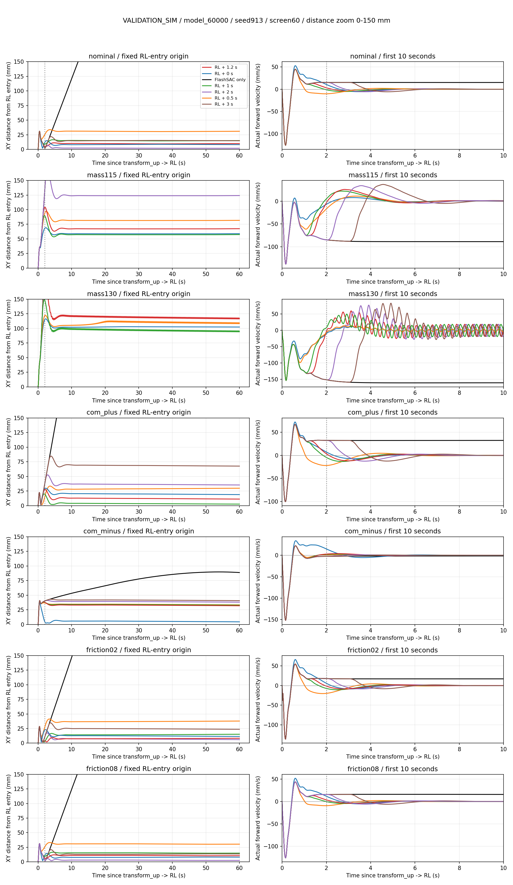
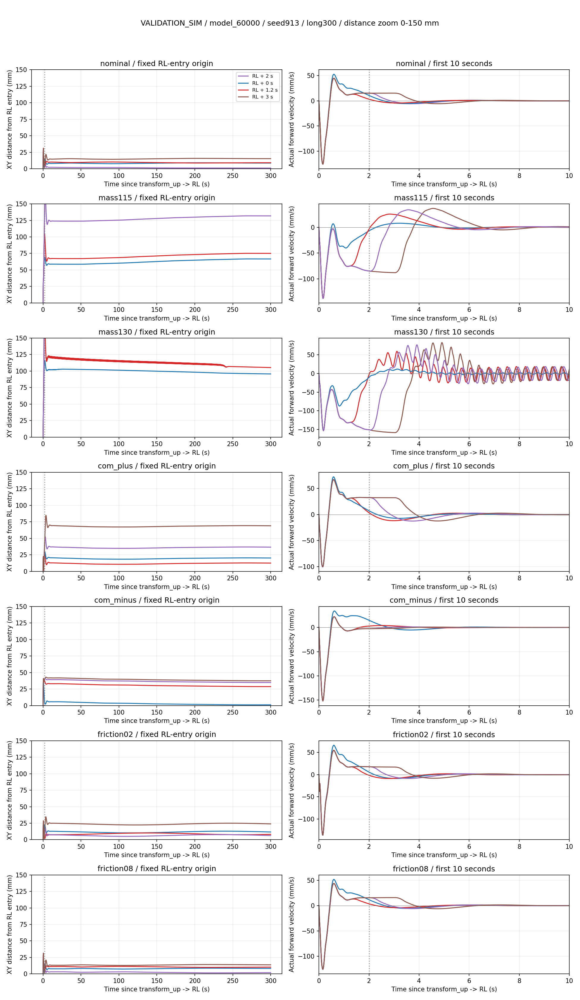
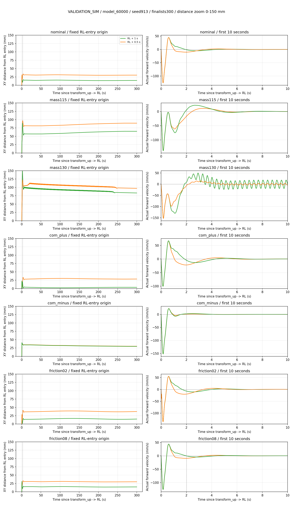

# Velocity bias 활성 시간 비교

후속 변경: 사용자가 주 체크포인트의 명목 환경 결과를 기준으로 **2초를 기본값으로 선택**했다. [기본값 적용 및 검증](velocity_bias_default_2s.md)을 참고한다. 아래의 "기본 1.2초 유지"는 이 비교 실험을 마쳤을 당시의 상태를 나타낸다.

Execution Domain: VALIDATION_SIM

Evidence Status: SUSPICIOUS — 225회 실행·재현성 검증 완료; 긴 대기에서 초기 위치 이탈 기준 미달이 있음.

Policy Checkpoint SHA256 (주 정책): `6d3cba9fa76eebe9fb2f40ef23d34115b8b95028ec788571531ffb33ce821a05`

ONNX SHA256 (주 정책): `f44f07ed44970e3ff565eae67fd9229adf0be5c02215591c52a691ffcbb71b2a`

Branch: `agent/codex/dev_tita_gluon`

## 시간 기준과 평가 정의

사용자가 제안한 RL 진입 후 2초를 자세 평가의 기준 시점으로 두고, velocity bias의 활성 지연을 0/0.5/1/1.2/2/3초로 비교한다. `transform_up → RL`로 전이한 직후를 공통 t=0 및 XY 위치 원점으로 둔다. 이 시점은 기존 시뮬레이터가 자동 기립 동작을 마치고 정책 제어를 시작하는 시점이다. GUI 수동 전이 경로에서는 transform_up 이후 sit을 거쳐 RL에 진입한다.

**2초는 사용자가 제안한 공통 기립 과도구간이며, 실제 자세 안정성을 판별하는 센서 기반 조건을 새로 학습하거나 검증한 값이 아니다.** 첫 2초 동안 기존 strict 자세/높이/joint guard 위반을 모두 기록하고, t≥2초부터 strict guard를 적용한다. 전 구간에서 finite 검사와 큰 전도(roll/pitch >0.9 rad)·심한 높이 저하(root z <0.025 m)는 즉시 실패 처리한다. 기존 velocity bias의 적응 조건인 |roll/pitch|≤0.3 rad, |추정 속도|≤1 m/s는 시간 후보에 관계없이 유지한다.

보정기는 시뮬레이션 첫 RL tick부터 관측하며, 시간 조건과 기존 자세·속도 조건을 모두 만족하면 초기 속도 seed를 설정한다. 이후 0.25초 ramp와 slew 제한을 거쳐 출력한다. 활성시간이 0초여도 자세/속도 조건 때문에 실제 활성은 더 늦어질 수 있으며, 첫 eligible 시점과 첫 nonzero 출력 시점을 따로 기록한다. 모든 실행의 명령은 zero command라 hold age와 RL 경과시간이 일치한다. 이동 후 다시 정지하는 상황의 타이머 정책은 이번 실험 범위 밖이다.

기존 1.2초 준비 구간을 제외하던 실험과 달리 **대기 중 이동량을 포함한 RL 진입점 기준 최대 XY 거리/위치 IAE**를 주 지표로 사용한다. 모든 후보에서 동일한 t=2초 기준 추가 이동량도 보조 지표로 기록한다. 후보별로 활성 순간에 위치 원점을 재설정하지 않는다. 이전 보고서의 8 mm/35 mm/62 mm와 직접 수치 비교하면 안 된다.

제어 이득과 한도는 기존 velocity bias와 동일하다: P=0, I=4, initial seed gain=3, filter 0.1초, bias ±2 m/s, slew 3 m/s², ramp 0.25초. 정책·action/observation scale·기존 production 제어기는 변경하지 않는다. 연구용 subclass에서 시간 문턱만 달리하며 1.2초 출력이 production과 정확히 일치하는 검사를 선행했다.

## 실험 범위

- 60초: 주 model_60000의 물리 7조건 × 초기 seed913/914/915 × baseline 및 활성시간 6개 = 147회.
- 60초 추가 정책: 주 run model_5000/25000/100000 및 두 번째 run model_60000, 명목 seed913 × baseline 및 활성시간 6개 = 28회.
- 300초: 주 model_60000의 물리 7조건 × seed913 × 활성시간 0/1.2/2/3초 = 28회.
- 300초 추가: 남은 활성시간 0.5/1초의 주 정책 7조건 및 추가 정책 4개 명목 조건 = 22회. 60초 결과를 본 뒤 통과율이 높은 0.5초를 장기로 확인하고, 주 정책에서 여섯 시간 후보를 모두 300초로 맞췄다.

물리는 명목, 전체 질량/관성 ×1.15/×1.30, base CoM x ±5 mm, 바닥·휠 마찰 0.2/0.8이다. 각 실행은 새 시뮬레이터를 만들고 물리 변경은 첫 startup step 전에 적용한다. 동일 정책/seed/물리 후보끼리 RL 진입 시점 qpos/qvel/previous raw action hash를 비교한다. GT 몸체 위치·속도는 평가에만 쓰며 actor observation에 GT 선속도 항목이 없는지 확인한다.

성능 gate는 이전 평가와 같이 완료/넘어짐 없음, 최대 XY 거리 ≤0.25 m(60초) 또는 ≤0.5 m(300초), 마지막 20초 실제 전후 속도 평균 절댓값 ≤5 mm/s·RMS ≤20 mm/s, 추정 속도 오차 RMS ≤50 mm/s다. 위치 원점이 바뀌었으므로 이 gate의 위치 판정은 이전 보고서와 직접 동일시하지 않는다.

`observed_speed_settled_rl_s`는 t≥2초에서 실제 속도가 마지막으로 ±5 mm/s를 벗어난 뒤, 관측 종료까지 최소 1초 동안 계속 범위 안에 있었던 시작 시각이다. 유한한 기록 구간에서의 관측값이며 이후 영구적인 안정성이나 실기 응답 보장이 아니다.

## 선행 검사

새 검사 2개 PASS: production/연구용 1.2초 observer·제어 출력의 250 tick 완전 일치, RL 진입 후 2.00초 활성 및 그 이전 native baseline torque 완전 일치. 후자는 이전 1.2초에 2초를 추가한 3.2초가 아님도 확인한다.

실험 코드/검사는 `test/compare_velocity_bias_activation.py`, `test/test_velocity_bias_activation.py`, `test/plot_velocity_bias_activation.py`에 둔다. raw job/result/trace, startup guard 사건, 소스 snapshot은 [실험 폴더](velocity_bias_activation_timing/)에 기록한다. 기존 실행기 기본 1.2초 설정과 실기 코드는 변경하지 않았으며 hardware evidence는 NOT_TESTED다.

## 결과

**자세 평가는 RL 진입 2초부터 적용할 수 있었지만, 보정 시작도 반드시 2초까지 늦추는 것이 최선은 아니었다.** 225회 모두 수치 오류/넘어짐/중단 없이 완료했다. 모든 실행에서 t≥2초의 최대 roll/pitch 절댓값은 0.198 rad 미만이었다. 이 결과는 해당 초기 상태·물리·정책에서의 관측이며 2초를 보편적인 실기 안정 시간으로 입증한 것은 아니다.

60초 평가: 각 시간 후보당 **25조건**이다(주 정책 물리 7조건×seed3 + 추가 정책 4개). 아래 최대 이탈은 RL 진입 위치를 기준으로 하며 대기 중 이동도 포함한다.

| 보정 시작 | 성능 gate PASS | 최대 이탈 중앙값 | 최대 이탈 최악값 |
|---|---:|---:|---:|
| FlashSAC only | 3/25 | 924.6 mm | 21,792.8 mm |
| RL +0초 | 24/25 | 39.6 mm | 327.3 mm |
| RL +0.5초 | **25/25** | 41.0 mm | **236.7 mm** |
| RL +1초 | 24/25 | 40.8 mm | 286.1 mm |
| RL +1.2초 | 24/25 | 40.8 mm | 347.5 mm |
| RL +2초 | 20/25 | 51.0 mm | 634.7 mm |
| RL +3초 | 16/25 | 65.1 mm | 1,009.7 mm |

velocity bias를 사용한 150개 60초 실행에서 **속도 평균/RMS·관측 gate는 전부 통과**했다. 17개의 성능 기준 미달은 모두 초기 위치 이탈이 250 mm를 넘은 경우다. 0초는 주 run model_25000에서 327.3 mm로 미달했고 0.5초는 그 사례를 포함해 전부 통과했다. 2초의 미달 5개는 주 정책 질량 +30%의 seed3, 추가 model_5000/25000이며, 3초는 질량 +15%/+30% seed3 및 추가 model_5000/25000/100000에서 미달했다. 1초/1.2초의 미달은 추가 model_25000이다. baseline은 별도로 3/25 PASS, 나머지는 drift 기준 미달이다.

주 정책 seed913의 300초 **최대 XY 거리**(mm):

| 조건 | 0초 | 0.5초 | 1초 | 1.2초 | 2초 | 3초 |
|---|---:|---:|---:|---:|---:|---:|
| Nominal | 30.44 | 33.68 | 31.02 | 31.02 | 31.02 | 31.02 |
| Mass +15% | 69.11 | 97.34 | 89.77 | 104.31 | 170.88 | 258.35 |
| Mass +30% | 116.50 | 122.45 | 149.07 | 176.96 | 295.01 | 452.36 |
| CoM x +5 mm | 29.82 | 33.48 | 22.51 | 27.59 | 52.64 | 84.80 |
| CoM x −5 mm | 39.75 | 40.85 | 40.85 | 40.85 | 40.97 | 42.98 |
| Friction 0.2 | 27.86 | 41.34 | 28.59 | 28.59 | 28.59 | 34.75 |
| Friction 0.8 | 30.80 | 33.20 | 31.38 | 31.38 | 31.38 | 31.38 |

주 정책 42개 300초 실행 및 추가 정책 8개 실행, 합계 **50/50이 300초 gate를 통과**했다. 300초 위치 gate는 500 mm이므로, 60초의 250 mm 기준 미달이 장기 평가에서 PASS로 보이는 경우가 있다. 더 오래 평가해서 초기 최대 이탈 자체가 사라진 것으로 해석하면 안 된다. 0.5초는 주 정책 7조건 + 추가 정책 4개, 총 **11/11** 300초 실행에서 통과했고 최악 최대 이탈은 236.7 mm였다.



다만 **통과율과 위치 IAE의 최적 시간은 같지 않다.** 명목 주 정책 seed913의 300초 위치 IAE(mm·s)는 다음과 같다.

| 시작 시간 | 0초 | 0.5초 | 1초 | 1.2초 | 2초 | 3초 |
|---|---:|---:|---:|---:|---:|---:|
| 위치 IAE | 2,549.83 | 9,125.17 | 4,349.62 | 2,817.19 | **465.96** | 4,530.88 |

이 조건에서는 2초가 1.2초보다 IAE를 **83.46%** 줄였다. 속도 제어는 원점 복귀를 목표로 하지 않으므로 활성 시점에 따라 남는 위치 offset이 달라진다. 명목 환경의 유리한 offset만으로 다른 정책/물리에서도 2초가 우수하다고 결론내릴 수 없다. 예를 들어 질량 +30%에서는 2초 대기 중 RL+2초에 이미 약 228 mm 이동했고, 보정 과도응답을 포함하면 최대 약 295 mm였다.





현재 근거에서는 **0.5초가 60초 위치 기준 통과율과 최악 이탈에서 가장 좋은 후보**지만, 모든 조건의 IAE까지 최적인 값은 아니다. 기본값을 바꾸는 결정과 별도로 이번 실험은 연구용으로 기록한다. production `--velocity_bias`의 기존 1.2초 기본값은 유지했다.

## 재현성·검사·변경 범위

- 실행 결과: screen60 175/175 완료(136 PASS / 39 SUSPICIOUS), long300 28/28 PASS, finalists300 22/22 PASS. SUSPICIOUS는 성능 gate 미달이며 실행 오류가 아니다.
- 동일 정책/물리/seed 후보의 RL 진입 시점 qpos/qvel/previous raw action hash는 모두 일치했다. 각 stage의 실제 실행 소스 snapshot/hash도 일치했다. 추가 정책 4개를 포함한 [정책 hash 목록](velocity_bias_activation_timing/policy_hashes.json)에 checkpoint/ONNX SHA256를 기록했다.
- 신규 검사 **2개 PASS**. production과 연구용 1.2초 observer/control의 정확한 일치 및 RL+2초 타이머/native torque 경로를 확인했다.
- 기존 production 1.2초 평가와 이번 결과의 공통 시간 구간 비교 **7개 PASS**, 전체 state 최대 차이 0. 별도 [회귀 결과](velocity_bias_activation_timing/legacy_1p2_trace_regression.json)에 기록했다.
- 50개 300초 실행의 첫 60초와 해당 screen60 trace 비교 **50개 PASS**, 상태 최대 차이 0. [기간 비교 결과](velocity_bias_activation_timing/horizon_regression.json)에 기록했다.
- 0.5/1초 장기 실행을 추가할 때 기존 worker가 모두 종료한 뒤 scheduler만 확장했다. 제어·관측·평가 계산식은 바꾸지 않았고 [scheduler diff](velocity_bias_activation_timing/scheduler_extension.diff)를 보관했다.
- `./scripts/agent-check.sh`: **FAIL**. Python 구문 **483/483 PASS**, URDF **8/8 PASS**이며 실패 원인은 기존 사용자 파일 `lab/ddt_lab/ddt_lab/tasks/manager_based/locomotion/robots/tita/my_flat_env_cfg.py` 431/437/443/449/455/461행 trailing whitespace다. 해당 파일은 수정하지 않았다. 전체 출력을 `agent_check.log`에 보관했다.

추가한 파일은 `test/compare_velocity_bias_activation.py`, `test/test_velocity_bias_activation.py`, `test/plot_velocity_bias_activation.py`, 이 보고서 및 실험 artifact다. 기존 runtime/기존 평가기의 사전 hash를 보관해 변경 여부를 확인한다. unrelated dirty/untracked 파일은 수정하지 않는다. 커밋/push/실기 실행/배포는 하지 않았다.

최종 diff와 변경 범위 확인: 기존 runtime/평가기 hash 모두 유지, 추가 상태 항목은 작업 파일/산출물/관련 Python cache에만 해당, 기존 status 항목 삭제 0개였다. 작업 파일에 whitespace/conflict marker 오류가 없고 보고서의 로컬 링크가 모두 존재함을 확인했다. [완료 확인 기록](velocity_bias_activation_timing/completion_integrity.json)과 `task_files.diff`에 저장했다.

위치 offset 및 yaw는 별도 유지하지 않는다. 전체 실행 중 약 438°의 yaw 변화도 있었으므로 drift 감소를 완전한 자세 정지로 해석하지 않는다. 실제 IMU/encoder noise·동기화·휠 미끄럼·토크 응답 부호에 대한 실기 검증은 NOT_TESTED이며, 기존 ±2 m/s bias 한도는 시뮬레이션 설정이다.

저장소 루트에서 새 output 디렉터리로 재실행한다:

```bash
/home/cocel/venvs/cosim_ros2_jazzy/bin/python test/compare_velocity_bias_activation.py \
  --output docs/exp/2026-10-17/velocity_bias_timing_rerun_screen --stage screen --workers 8

/home/cocel/venvs/cosim_ros2_jazzy/bin/python test/compare_velocity_bias_activation.py \
  --output docs/exp/2026-10-17/velocity_bias_timing_rerun_long --stage long --workers 8

/home/cocel/venvs/cosim_ros2_jazzy/bin/python test/compare_velocity_bias_activation.py \
  --output docs/exp/2026-10-17/velocity_bias_timing_rerun_finalists --stage finalists --workers 8
```

기존 `velocity_bias_overnight/exports`의 5개 정책을 읽어 사용한다. 새 실행기 flag나 실기 parameter는 추가하지 않았다.
