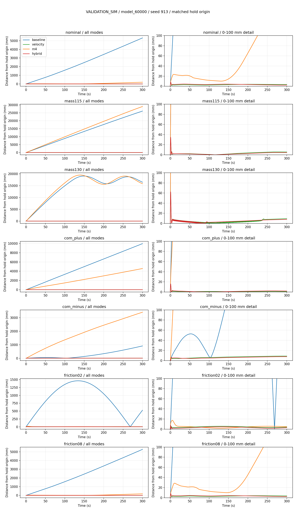

# Velocity bias + frozen M4 LQR 결합 비교

Execution Domain: VALIDATION_SIM

Evidence Status: SUSPICIOUS — 비교 실행·재현성 PASS; frozen K 결합의 일관된 성능 개선은 확인되지 않음.

Policy Checkpoint SHA256: `6d3cba9fa76eebe9fb2f40ef23d34115b8b95028ec788571531ffb33ce821a05`

ONNX SHA256: `f44f07ed44970e3ff565eae67fd9229adf0be5c02215591c52a691ffcbb71b2a`

Branch: `agent/codex/dev_tita_gluon`

## 비교 정의

정책은 `tita_flash_sac_115632_883848/model_60000`으로 고정한다. 현재 M4가 이 체크포인트에만 보정되어 있어 다른 체크포인트로 일반화하지 않는다.

| 모드 | 휠 목표 속도 보정 | 추가 휠 토크 합계 |
|---|---|---|
| baseline | 없음 | 없음 |
| m4 | 없음 | 기존 `0.4828 Nm + frozen M4 correction` |
| velocity | 기존 `--velocity_bias` 그대로 | 없음 |
| hybrid | 기존 `--velocity_bias` 그대로 | `frozen M4 correction`만 추가 |

hybrid의 경로는 `FlashSAC wheel target + velocity bias → native wheel velocity PD/effort clip → M4 correction/effort clip`이다. 기존과 동일한 K, 24-state 구성, nominal reference, ±0.05 Nm correction clip, 1.5초 smoothstep ramp 및 2 Nm/s slew를 유지한다. 고정 bias 0.4828 Nm만 제거한다. 토크 합계는 기존과 같이 좌우에 native sign으로 절반씩 분배한다. 속도 bias 기본값은 P=0, I=4, 초기 seed gain=3, filter 0.1초, ±2 m/s, slew 3 m/s², ramp 0.25초다. 어떤 gain/reference도 실험 결과를 보고 재튜닝하지 않는다.

동일 seed와 물리 조건으로 각각 새 시뮬레이터를 생성하고 기존 자동 기립 후 1.2초의 공통 zero-residual RL 구간을 둔다. 네 모드의 시작 qpos/qvel/previous raw action SHA256가 같은지 확인한다. 측정 시작점은 이 구간 직후이며 아래 평가 시간에는 초기 기립/준비 시간이 포함되지 않는다. 조건은 명목, 전체 질량/관성 ×1.15/×1.30, base CoM x ±0.005 m, 바닥/휠 마찰계수 0.2/0.8이다. 물리 변경은 첫 startup step 전에 적용하고 실행 중 고정한다.

제어기는 기존 encoder/IMU observer를 사용한다. 실제 몸체 XY 위치와 전후 속도는 평가에만 사용한다. 기존 FlashSAC observation에 GT 선속도 항목이 없는 상태를 유지한다. 연구 runner의 동기화된 IMU를 모든 모드에 동일하게 사용한다.

평가 지표는 시작점 대비 최대 XY 거리, radial position IAE, 마지막 20초 실제 전후 속도의 평균/RMS, 추정 속도 오차 RMS, tilt/yaw, LQR clip 점유율이다. 완료 기준은 넘어짐/수치 오류 없음, 마지막 평균 속도 절댓값 ≤5 mm/s, RMS ≤20 mm/s, 관측 오차 RMS ≤50 mm/s, 최대 XY 거리 ≤0.25 m(60초) 또는 ≤0.5 m(300초)다. 프로그램 정상 종료와 성능 기준 통과는 구분한다.

## 현재 증거

60초 예비 평가 12개 실행 완료. 모든 모드의 공통 초기 상태 hash 일치. 기존 velocity/M4 기록의 첫 60초와 새 평가기의 state trace가 명목/질량 두 조건 모두 수치적으로 완전히 일치한다(최대 차이 0). 새 hybrid 검사 2개 PASS: 동일 센서 입력에서 고정 bias만 제거했는지, 실제 substep 토크 경로·leg 출력·raw action 이력이 유지되는지 확인했다.

## 결과와 판단

**현재 frozen K를 그대로 더하는 방식이 velocity bias 단독보다 항상 좋지는 않다. 기본 실행 모드는 기존 `--velocity_bias`를 유지한다.** 질량 +15%, CoM −5 mm, 마찰 0.2에서는 위치 IAE가 줄었지만 나머지 네 물리 조건에서는 늘었다. 이는 결합 자체가 불가능하다는 증거가 아니라 현재 K/reference/한도를 그대로 사용한 조합에 대한 결과다. 새 K 설계나 gain/reference 재튜닝은 하지 않았다.

seed913에서 300초 동안 측정한 시작점 대비 **최대 XY 거리**, 단위 mm:

| 조건 | FlashSAC | Fixed M4 | Velocity bias | Hybrid |
|---|---:|---:|---:|---:|
| Nominal | 5,323.40 | 199.90 | **7.975** | 8.150 |
| Mass +15% | 26,103.07 | 28,984.14 | 34.807 | **34.787** |
| Mass +30% | 19,080.67 | 19,488.74 | **62.310** | 62.326 |
| CoM x +5 mm | 9,969.75 | 4,580.09 | **15.923** | 15.998 |
| CoM x −5 mm | 910.68 | 3,404.26 | 8.837 | **7.704** |
| Friction 0.2 | 1,462.42 | 17.48 | **7.685** | 7.733 |
| Friction 0.8 | 5,277.05 | 179.64 | **8.018** | 8.210 |

최대 이동량은 초기 과도응답에 좌우된다. 지속적인 위치 이탈도 비교하기 위해 **radial position IAE**를 함께 계산했다. 아래 변화율은 `(hybrid / velocity − 1) × 100`으로 음수이면 결합이 개선된 것이다. 단위 mm·s이며, 이전 180초 실험의 IAE와 평가 시간/초기화가 다르다.

| 조건 | Velocity bias IAE | Hybrid IAE | 결합 변화율 | Hybrid LQR clip 점유율 |
|---|---:|---:|---:|---:|
| Nominal | 971.02 | 1,062.33 | **+9.40%** | 51.15% |
| Mass +15% | 938.60 | 743.19 | **−20.82%** | 39.02% |
| Mass +30% | 1,328.19 | 1,436.62 | **+8.16%** | 92.79% |
| CoM x +5 mm | 242.27 | 401.68 | **+65.80%** | 99.50% |
| CoM x −5 mm | 2,028.69 | 1,765.60 | **−12.97%** | 90.87% |
| Friction 0.2 | 1,285.43 | 954.96 | **−25.71%** | 99.50% |
| Friction 0.8 | 966.07 | 1,077.16 | **+11.50%** | 54.03% |

LQR clip 점유율은 correction 절댓값이 0.049999 Nm 이상인 제어 tick 비율이다. 자주 clip에 도달한 점은 관측 사실이며, 그것만으로 성능 변화의 인과관계를 확정하지 않는다. 적분기는 추가 LQR 토크에도 반응하므로 단순 중첩만으로 독립적인 개선을 보장할 수 없다. 현재 M4는 원래 고정 토크 bias 주변에서 얻은 gain/reference이며 새 속도 보정 폐루프를 위한 최적 gain이 아니다.



seed914/915로 초기 전진 속도와 leg 속도를 바꾼 추가 비교도 각각 300초 실행했다. 두 모드 사이에는 동일한 초기 상태를 사용한다. 명목/질량 +15%/+30% 세 조건 각각 총 3개 seed에서 확인한 위치 IAE 변화율 범위는 다음과 같다.

| 조건 | Hybrid IAE 변화율, seed913/914/915 |
|---|---:|
| Nominal | +8.46 ~ +9.40% |
| Mass +15% | −20.82 ~ −20.50% |
| Mass +30% | +7.99 ~ +8.16% |

같은 학습 정책의 작은 초기 상태 변화에서 재확인한 결과다. 세 seed를 서로 다른 학습 정책으로 보거나 일반적인 통계적 우월성의 증거로 해석하지 않는다.

## 검증 범위와 한계

- 60초 예비 평가: 12/12 완료, 성능 gate 7 PASS / 5 SUSPICIOUS. 기준 미달은 baseline/Fixed M4에 해당한다.
- 300초 본 평가: 28/28 완료, 성능 gate 17 PASS / 11 SUSPICIOUS. velocity/hybrid는 각각 7/7 PASS이고 기준 미달은 baseline/Fixed M4에 해당한다.
- 다른 초기 seed의 300초 추가 평가: 12/12 완료 및 성능 gate PASS. 합하면 velocity/hybrid 각각 **13/13 PASS**다.
- 52개 전체 실행에서 수치 오류/넘어짐/중단 없음. 비교 그룹마다 초기 qpos/qvel/previous raw action hash 일치. 본 평가/추가 평가 13그룹과 예비 평가 3그룹이다.
- 기존 300초 기록과의 회귀 비교 10개 PASS: velocity 7조건 + Fixed M4 3조건의 전체 state trace 최대 차이가 **0**이다. 기존 기록을 재사용한 것이 아니라 새로 실행한 결과와 비교했다.
- 실제 사용한 checkpoint/ONNX SHA256 재검증 및 actor observation에 GT 선속도 항목이 없음을 확인했다. 각 worker의 실행 소스 hash도 저장된 job과 일치했다.
- 신규 hybrid 검사 **2/2 PASS**. `hybrid_tests.log`에 직접 실행 결과를 기록했다.
- `./scripts/agent-check.sh`: **FAIL**. Python 구문 **480/480 PASS**, URDF **8/8 PASS**이며 실패 원인은 기존 사용자 변경 `lab/ddt_lab/ddt_lab/tasks/manager_based/locomotion/robots/tita/my_flat_env_cfg.py` 431/437/443/449/455/461행 trailing whitespace다. 해당 파일은 수정하지 않았다.

두 후보의 13조건 전체에서 최대 이동량은 velocity 62.3105 mm / hybrid 62.3263 mm, 마지막 속도 RMS의 최댓값은 각각 0.02961 / 0.01840 mm/s였다. 이 작은 RMS는 현재 시뮬레이터의 센서·물리 조건에서 나온 수치이며 실기 정확도가 아니다. heading은 제어하지 않으며 두 모드 모두 일부 조건에서 약 **437°**의 yaw 변화가 있었다. 전후 drift 평가 기준 통과를 완전한 정지 자세 유지로 해석하지 않는다. 휠 미끄럼, 센서 noise/지연, 실제 토크 부호와 응답, 다른 체크포인트의 성능은 이번 결합 비교로 검증되지 않았다. ±2 m/s velocity bias 한도는 기존 시뮬레이션 설정이며 실기 허용값이 아니다.

## 변경 범위와 재현

추가한 파일은 `test/compare_velocity_bias_m4.py`, `test/test_velocity_bias_m4_comparison.py`, 이 보고서 및 실험 artifact 디렉터리다. production controller/CLI/launch, 기존 평가기와 정책 파일은 수정하지 않았다. 커밋·push·실기 실행·배포는 수행하지 않았다.

최종 status 확인 중 별도 `finetune_improvement`/`sim2sim_finetune_*` 산출물과 관련 test 파일의 추가도 관측됐다. 이 실험에서 생성·수정한 파일이 아니므로 그대로 두고 작업 변경 목록에서 제외했다. 확인 대상으로 저장한 runtime/기존 평가기 hash는 모두 유지됐다. `completion_integrity.json`에 작업 경로와 별도로 관측된 상태 항목을 구분해 기록한다.

저장된 `main300/harness_source.py.txt`가 실제 물리 실행 소스다. 실행 종료 후 그래프의 모드별 색상을 모든 subplot에서 고정하고 제목 여백을 확보했으며 미사용 import 하나를 제거했다. 수치 실행 부분은 그대로이며 `post_run_plot_fix.diff`와 `final_harness_source.py.txt`에 차이를 기록했다. raw trace/결과는 수정하지 않았다.

저장소 루트에서, 새 output 경로를 사용해 재실행한다(검증된 Python 환경):

```bash
/home/cocel/venvs/cosim_ros2_jazzy/bin/python test/compare_velocity_bias_m4.py \
  --output docs/exp/2026-10-17/velocity_bias_m4_rerun \
  --duration 300 --workers 4

/home/cocel/venvs/cosim_ros2_jazzy/bin/python test/test_velocity_bias_m4_comparison.py
```

이전 캠페인의 `velocity_bias_overnight/exports`를 읽어 사용한다. hybrid는 **실험용 runner에만** 구현했으며 새 실행기 옵션으로 등록하지 않았다.

원시 데이터, 소스 snapshot, 실행 로그: [velocity_bias_m4_comparison/](velocity_bias_m4_comparison/)

실험용 코드만 `test/compare_velocity_bias_m4.py`, `test/test_velocity_bias_m4_comparison.py`에 작성했다. 실행기 flag나 production controller는 변경하지 않았다. 기존 dirty/untracked 파일은 유지한다. 실기 실행/배포는 없으며 hardware evidence는 NOT_TESTED다.
