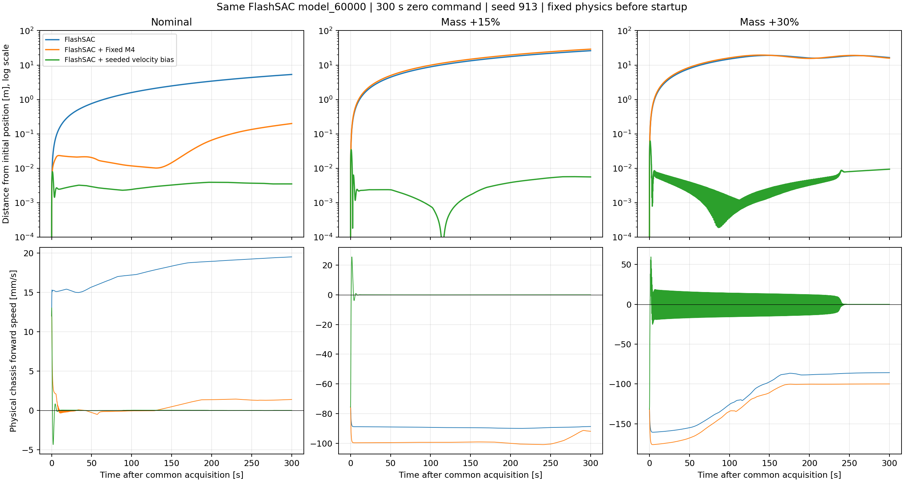
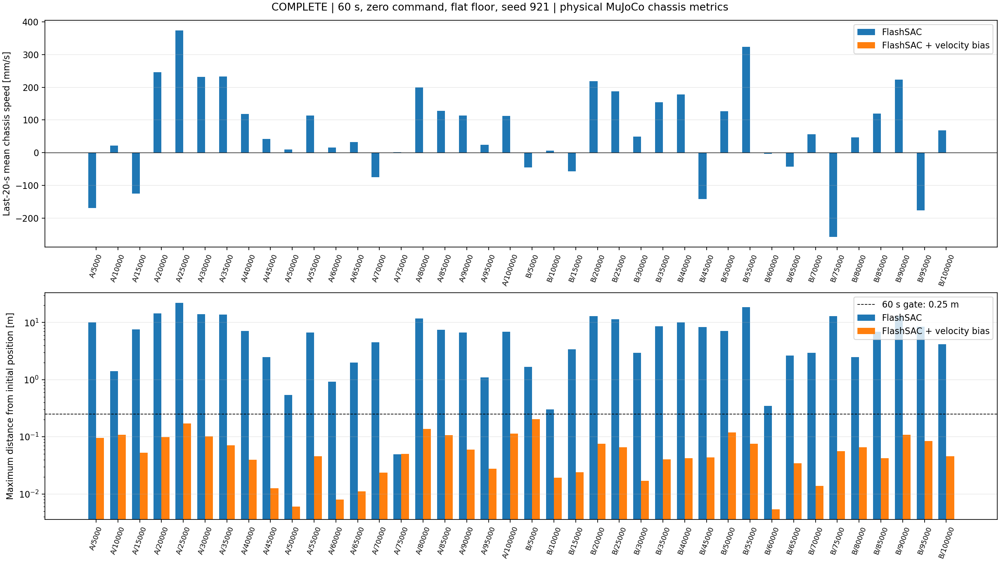

# FlashSAC 양방향 velocity bias 검증 요약

현재 실행기 기본 대기는 **2초**로 변경했다. 주 model_60000 명목 환경에서 비교한 6개 시간 중 300초 위치 IAE가 가장 낮은 설정을 사용자가 선택했다. [2초 적용 및 검증](velocity_bias_default_2s.md)을 참고한다. 아래 표와 기존 실험 결과는 **변경 전 1.2초 설정의 기록**이다.

Execution Domain: VALIDATION_SIM

Evidence Status: SUSPICIOUS — 명목/외란 검증 PASS, 확장 물리 조건에 진동·관측 기준 미달이 남음.

Policy Checkpoint SHA256 (주 실험 model_60000): `6d3cba9fa76eebe9fb2f40ef23d34115b8b95028ec788571531ffb33ce821a05`

ONNX SHA256: `f44f07ed44970e3ff565eae67fd9229adf0be5c02215591c52a691ffcbb71b2a`

Branch: `agent/codex/dev_tita_gluon`

고정된 양수 bias를 사용하는 M4의 한계를 같은 정책에서 재현했고, 관측한 전후 속도에 따라 bias 값과 방향이 바뀌는 `--velocity_bias` 모드를 구현했다. 두 학습 run의 model_5000~100000 체크포인트 40개에서 같은 설정을 사용했다. 정책 가중치와 observation/action 메타데이터는 그대로 사용한다. 새 모드는 휠 목표속도를 보정하며, 기존 Fixed M4와 별도로 선택한다.

기존 M4는 ramp 이후 총 보정이 `0.4828 ± 0.05 Nm` 범위여서 양수에 묶인다. 새 모드의 bias는 초기 속도에 비례해 시작하고, 이후 느린 적분으로 보정한다. 피드백 부호는 MuJoCo에서 확인한 frozen FlashSAC의 저주파 응답에 맞춘 값이다. 실기의 피드백 부호가 검증된 것은 아니다.

```text
v_hat = IMU + wheel/joint encoder + relative FK 전후 속도
초기 I = clip(3 * s * v_hat_start, ±2 m/s)
I += 4 * s * LPF(v_hat, tau=0.1 s) * dt
b = ramp(0.25 s), saturation(±2 m/s), slew(3 m/s²) 적용
wheel_target += native_motor_sign * b / wheel_radius
기존 wheel velocity PD -> 기존 모터 effort clip
```

`s=+1`, 제어 주기 20 ms, wheel radius 0.0925 m이다. zero-command 진입 후 1.2초 동안 초기 동작을 기다린다. 이동 명령에서는 적분을 초기화하고 bias를 감쇠시키며, RL 이탈/reset에서는 즉시 초기화한다. 큰 tilt(0.3 rad 초과) 또는 추정 속도(1 m/s 초과)에서는 bias 적응을 억제한다. 모델 A/B/c, LQR K, 정책 학습이나 probing은 새 제어기에 없다.

아래는 동일 model_60000, 동일 초기 물리 상태와 raw action 이력, 동일 seed913에서 공통 1.2초 준비 후 300초 동안 측정한 **시작점 대비 최대 XY 거리**다. 이전 180초 IAE 표와는 별도의 재평가다. 실제 MuJoCo 몸체 위치/속도를 평가에 사용했고 제어에는 넣지 않았다.

| 조건 | FlashSAC | Fixed M4 | 새 velocity bias | 새 모드 마지막 20초 속도 RMS |
|---|---:|---:|---:|---:|
| Nominal | 5,323.4 mm | 199.9 mm | 8.0 mm | 0.0005 mm/s |
| Mass +15% | 26,103.1 mm | 28,984.1 mm | 34.8 mm | 0.0054 mm/s |
| Mass +30% | 19,080.7 mm | 19,488.7 mm | 62.3 mm | 0.0296 mm/s |

기본 FlashSAC의 마지막 평균 전후 속도는 명목 +19.47 mm/s, 질량 +15% −88.88 mm/s, +30% −85.85 mm/s로 방향이 바뀌었다. 새 모드는 세 조건 모두에서 보정했다.



최종 설정을 고정한 뒤 확인한 범위는 다음과 같다. 속도 기준은 마지막 20초 평균 절댓값 ≤5 mm/s, RMS ≤20 mm/s이고 위치 기준은 60초 최대 0.25 m, 300초 이상 최대 0.5 m이다. 관측 기준은 추정/실제 전후 속도의 마지막 RMS 오차 ≤0.05 m/s다.

| 평가 | 완료 / 시도 | 평균 속도·위치 통과 | 진동·관측까지 포함 |
|---|---:|---:|---:|
| 실행기 명목 checkpoint 40개 + 추가 3조건, 60초 | 43 / 43 | 43 | 43 |
| checkpoint 40개, 300초 | 40 / 40 | 40 | 40 |
| 앞/뒤 0.2 m/s 가상 외란, checkpoint 40개 | 80 / 80 | 80 | 80 |
| checkpoint 40개 × 물리 7조건, 60초 | 276 / 280 | 276 | 267 |
| 선택한 3개 정책, 900초 | 3 / 3 | 3 | 3 |

- 40개 정책 300초: 최대 이동량 203.8 mm, 마지막 평균 속도 최대 절댓값 0.386 mm/s.
- 양방향 외란 80조건: 최대 이동량 212.2 mm, 마지막 평균 속도 최대 절댓값 1.092 mm/s.
- 선택 정책 900초: 최대 이동량 171.6 mm, 마지막 평균 속도 최대 절댓값 0.011 mm/s.

주 정책 model_60000에서는 CoM +5 mm/−5 mm와 마찰 0.2/0.8도 각각 300초 추가 검증했다. 최대 이동량은 순서대로 15.9/8.8/7.7/8.0 mm였고 네 조건 모두 속도·위치·관측 기준을 통과했다. 따라서 주 정책의 일곱 물리 조건 전체는 300초까지 확인했다.

물리 조건은 명목, 전체 질량/관성 +15%/+30%, base CoM x ±5 mm, 마찰계수 0.2/0.8이다. 물리 값은 첫 startup step 전에 설정했고 각 실행 내에서 고정했다. 유효한 276개 물리 비교와 외란 80개 비교에서 초기 qpos/qvel/raw-action hash가 baseline과 같았고, 새로 추가된 넘어짐은 없었다. 300초/900초 기존 baseline 재사용도 초기 상태 hash로 확인했다.



다음 한계는 남아 있다.

- 저마찰 네 조건(A/5000, A/10000, B/15000, B/50000)은 공통 준비 구간에서 baseline도 실패하여 제어 적용 평가를 완료하지 못했다. A=tita_flash_sac_115632_883848, B=tita_flash_sac_193248_068255이다.
- 완료한 물리 조건 중 여섯 조건은 속도 RMS 기준을 넘었다: A/10000 질량+15%(33.15 mm/s), A/10000 CoM+5mm(22.21), A/15000 질량+30%(28.50), A/20000 CoM−5mm(42.51), A/90000 질량+30%(24.91), B/50000 질량+30%(43.62). 모두 평균 속도/위치 기준은 통과했으나 잔여 진동이 있다.
- 저마찰 A/25000, A/90000, B/85000은 몸체가 거의 멈춰도 추정 wheel rolling 속도가 7~8 m/s인 미끄럼 사례다. 제어기를 억제했고 관측 품질 실패로 기록했다. B/50000 질량+30%도 관측 오차 기준을 넘었다.
- 전후 속도 보정이며 초기 과도 이동을 반드시 원점으로 되돌리는 위치 제어는 아니다. yaw도 직접 유지하지 않는다. 주 실험 명목 조건은 5분에 약 25.8°의 yaw 변화가 있었고, 전체 명목 정책 중에는 약 738°까지 회전한 사례가 있다. 완전한 자세 정지의 성공을 주장하지 않는다.
- 검증된 자연 drift 범위는 대략 −0.262~+0.374 m/s다. 임의 정책·임의 외란·미끄럼에서도 항상 멈춘다는 보장은 없다.

실행은 저장소 루트에서 다음과 같다. 세 residual 모드는 서로 동시에 선택하지 않는다.

```bash
python sim2sim/sim2sim_ros2_jazzy/launch/sim2sim.launch.py \
  --ckpt lab/ddt_lab/logs/flash_sac/tita_flash_sac_115632_883848/model_60000 \
  --velocity_bias
```

`--headless --steps 1000` CLI 실행도 완료했다. CLI 실행 기록에 실제 사용한 gain, wheel radius, controller/observer 소스 hash가 포함된다.

코드/회귀 검증은 controller·ROS 통합 13개 PASS, 기존 Fixed M4 4개 PASS, 기존 PD 4개 PASS다. 기존 M4 출력과 참조 구현의 최대 차이는 2.09e-9 Nm였다. 새 기본값과 40개 실제 runtime trace의 bias 차이는 최대 1.46e-8 m/s였다. encoder/IMU URDF FK와 상대 geometry의 차이는 9.14e-8 m 이내였고, root 위치·선속도 변경에 의존하지 않는 것도 확인했다. 40개 actor의 observation에는 GT base velocity가 없다.

전체 `./scripts/agent-check.sh`는 기존 `lab/ddt_lab/ddt_lab/tasks/manager_based/locomotion/robots/tita/my_flat_env_cfg.py` 431/437/443/449/455/461행 trailing whitespace 때문에 FAIL이다. 해당 사용자 변경은 수정하지 않았다. Python 구문 476/476과 URDF 8/8 fast check는 PASS다. 최종 completion_agent_check.log에 전체 출력을 남긴다.

변경한 runtime 파일은 `velocity_bias.py`(신규), `residual_wheel_pd.py`(mode별 slew hook), `sim2sim_node.py`, `cli.py`, `launch/sim2sim.launch.py`이다. Fixed M4의 gain/reference 파일, action adapter, 실기 controller/launch는 이 작업에서 수정하지 않았다. 연구·검증 스크립트는 test/에 두었고 전체 task diff와 hash 목록을 실험 폴더에 남겼다. 커밋/배포는 수행하지 않았다.

최신 실기 bag `flashsac_60000_223217_076704901_output_true`는 DESKTOP_DRY_RUN으로 읽기 전용 분석 및 passive shadow 계산을 수행했다. 기록된 baseline 궤적에 계산한 값이므로 실제 폐루프 개선을 추론할 수 없다. 실제 바닥 속도 GT, 센서 프레임·시간 정렬, 피드백 응답 부호, 토크 경로와 작은 안전 한도는 실기 단계에서 별도 검증해야 한다.

±2 m/s는 시뮬레이션 bias 한도다. kd=0.5와 radius=0.0925 m에서는 effort clip 전 휠당 최대 약 10.81 Nm에 해당하므로, 이 수치를 실기에 그대로 적용하는 설정으로 해석하면 안 된다. 실기 코드는 미변경 상태이고 hardware evidence는 NOT_TESTED다.

전체 checkpoint hash, 각 실행의 job/result/trace/summary, 실패한 후보, 소스 snapshot은 [실험 폴더](../2026-10-16/velocity_bias_overnight/)에 있다. [최종 집계 JSON](../2026-10-16/velocity_bias_overnight/selected_controller_result.json), [초기 warmup 실험 정정](../2026-10-16/velocity_bias_overnight/entry01_errata.md), [M4 평가기 초기화 정정](../2026-10-16/velocity_bias_overnight/primary_m4_comparison_errata.md), [중복 시각 impulse 관측 정정](../2026-10-16/velocity_bias_overnight/impulse_observer_errata.md)을 함께 보관한다. 최종 외란 수치는 중복 시각 문제를 수정한 source로 평가했다.
