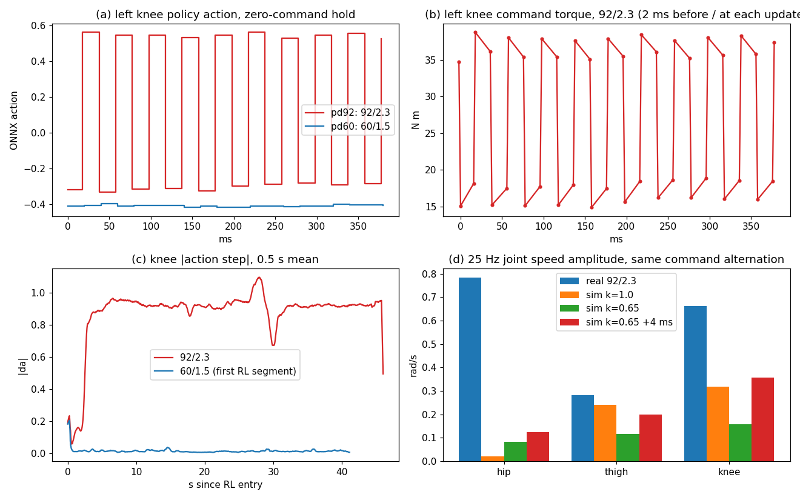

# FlashSAC A80k, RL 다리 PD 92/2.3 실기 run 분석 — 25 Hz 진동("다다다닥")

Execution Domain:
- `ROBOT_READ_ONLY`: 로그 복사(scp). SHA256은 원격과 로컬이 일치한다.
- `DESKTOP_DRY_RUN`: bag 분석.
- `VALIDATION_SIM`: MuJoCo 500 Hz sweep.
- 로봇 명령, 배포, 설정 변경은 하지 않았다.
- 실기 주행 자체(`ROBOT_STATE_CHANGING`)는 operator가 수행했다.

**대상 run:** `flashsac_80000_115354_446182414_output_true` (2026-10-18 11:53:54–11:55:14 KST). 흐름은 RL 46.0 s → return_to_sit → sit → 오른쪽 버튼 estop 순이다. velocity bias는 OFF였다.

**정책·설정:**

| 항목 | SHA256 / 값 |
|---|---|
| Policy checkpoint | `79f9175bb8c3be0c5138866e30891b90cc1282b6c98023cdb76c2e33b229068c` |
| ONNX | `26f0d86b65a68475fb8a315fb31e829ae16eaa2cf16dabbbcf38e69f28c933e9` |
| config | `10d66ca0…` (RL 다리 Kp/Kd 92/2.3, 휠 Kd 0.5, clip 60/12) |
| 비교 run 10:59 `flashsac_80000_105921` config | `2072d9a4…` (60/1.5). 같은 정책 |
| 이번 bag db3 | `ebefac000d55467dab512f002b55b59e448e06d4cb34408032d49fba800129b1` |

Branch는 `agent/codex/dev_tita_gluon`이다. Commit은 없다.

**Evidence Status:**
- **PASS**
  - 로그 복사 무결성: [copy_verification.log](flashsac_80000_115354_pd92_review/copy_verification.log).
  - 게인 적용 확인: logged command로 최소자승 fit한 결과, 다리는 Kp 92.00 / Kd 2.300, 휠은 Kd 0.500이다. 10:59 run은 60.00/1.500이었다.
- **PASS (관측)**: RL 중 hip·thigh·knee가 25 Hz period-2 limit cycle에 있었다.
- **SUSPICIOUS (원인 해석)**: 실기 hip의 고주파 compliance 가설이다. 데이터와 맞지만 증명되지는 않았다.
- **NOT_TESTED**: 소리 발생 위치, 해결책.

## 1. 결론

1. **방아쇠는 RL 다리 게인 ×1.53(92/2.3)이다.**
   - 같은 정책이 60/1.5에서는 정지 중 조용했다(무릎 action step RMS 0.01).
   - 92/2.3에서는 RL 진입 2.5–3 s 뒤부터 return_to_sit까지 RL 시간의 100%(진입 3 s 이후)에서 진동했다.
   - return_to_sit·sit(고정 PD)에서는 바로 멈췄다.
2. **진동하는 주체는 정책 루프다.**
   - hip·knee의 policy action이 20 ms마다 정확히 뒤집힌다. Δa의 lag-1 자기상관은 −1.00이고 PSD 최고점은 25.0 Hz다.
   - 그 결과 무릎 command 토크가 15 ↔ 38 Nm 사각파가 된다. 정책 갱신마다 knee 19–24 Nm, hip 11 Nm의 토크 step이 들어간다.
   - 500 Hz PD 자체의 2 ms 변화는 0.3–0.7 Nm로 작다. 따라서 모터 내부 PD 발진이 아니다.
3. **모터 지연·토크 포화·출력 이상은 주원인이 아니다.**
   - 정지 구간에 clip이 0이다.
   - reported 토크가 command를 0.35–1.2 Nm RMS 이내로 따라간다.
   - MuJoCo 144개 구성(게인 ×1.0–1.53, 다리 계수 k 1.0/0.65, 토크 지연 0–12 ms, 1차 lag 0–4 ms)에서 25 Hz period-2가 한 번도 재현되지 않았다. lag-1 최솟값은 −0.10, 실기는 −1.00이다.
4. **실기만 발진하는 이유(가설):** 같은 25 Hz 명령 교번에 대한 관절 반응이 다르다.
   - 실기 hip은 MuJoCo보다 **4–40배** 크게 반응한다.
   - knee는 지연과 k = 0.65를 넣으면 sim과 비슷해진다.
   - MuJoCo(강체 관절·강체 바퀴)에 없는 고주파 동역학이 정책의 루프 이득을 키운다. 후보는 감속기 compliance·backlash, 타이어 측방향 변형, 링크 휨, 모터측 encoder다.
   - 게인 ×1.53이 그 이득을 1 위로 올렸다.
5. **소리 위치(추정):** thigh(허벅지)가 가장 유력하다.
   - 평균 토크가 약 1.3 Nm인데 ±3–5 Nm로 교번한다. 그래서 정책 갱신의 67%/98%(L/R)에서 토크 부호가 뒤집힌다. 이는 backlash 충돌 조건이다.
   - hip(±28 Nm)·knee(약 25 Nm)는 preload가 커서 부호가 바뀌지 않는다. 다만 ±5–12 Nm 진동을 전달한다.
6. **자세 보상 효과는 실제로 있었다.**
   - pitch 8.4° → 4.81°, drift −0.073 → −0.049 m/s, 무릎 −2.10 → −1.76 rad.
   - MuJoCo k = 0.65 모델의 예측(×1.0: 9.6°, ×1.53: 4.92°)과 맞는다.
   - 그러나 연속 25 Hz ±11–24 Nm 토크 사각파 때문에 **이 설정은 계속 쓰지 않는 것을 권한다.**

## 2. 실기 비교 (정지 hold 구간, 같은 정책 A80k)

| 항목 (L/R) | 92/2.3 (35.8 s) | 60/1.5 (32.5 s) |
|---|---|---|
| action step RMS hip | **0.493 / 0.469** | 0.008 / 0.005 |
| thigh | 0.153 / 0.215 | 0.030 / 0.035 |
| knee | **0.819 / 1.026** | 0.016 / 0.011 |
| wheel | 0.033 / 0.044 | 0.026 / 0.020 |
| Δa lag-1 자기상관 hip·knee | **−1.00** | −0.48 … −0.76 (미세 noise) |
| 정책 갱신 토크 step Kp·Δtarget RMS hip [N m] | 11.3 / 10.8 | 0.12 / 0.08 |
| thigh | 3.5 / 5.0 | 0.44 / 0.52 |
| knee | **18.8 / 23.6** (p99 20–25) | 0.24 / 0.17 |
| 2 ms 상태변화 잔차 RMS hip/knee [N m] | 0.45–0.73 / 0.31–0.45 | ≤ 0.01 |
| 토크 평균 ± std knee | 26.8±10.7 / 24.4±13.2 | 29.9±1.0 / 24.0±1.3 |
| hip | −27.7±7.3 / 27.3±7.0 | −28.1±3.2 / 28.7±3.5 |
| thigh | 1.4±2.3 / 1.2±3.0 | 2.7±0.7 / −0.4±0.8 |
| thigh 토크 부호 반전 (갱신 순간) | **67% / 98%** | 0% / 11% |
| clip (hold) | 0 | 0 |
| reported − 직전 command RMS hip/knee | 0.98–1.11 / 0.72–1.18 | ≤ 0.07 |
| PSD 최고점 (action·torque·dq, 다리 전부) | **25.0 Hz** | 1.2 Hz 등 저주파 |
| 25 Hz 관절 진폭 hip / thigh / knee | 1.5–3.9 / 1.6–2.3 / 1.0–2.6 mrad | ≈ 0 |
| gyro step RMS roll/pitch/yaw [rad/s] | 0.148 / 0.037 / 0.081 (roll·yaw 25 Hz) | 0.017 / 0.026 / 0.010 |

- **진동 모드:** 두 hip action은 같은 부호로, 두 knee는 반대 부호로 교번한다. 좌우 비대칭 모드라서 몸통에 roll·yaw 25 Hz가 생긴다.
- **원인 순서:** 같은 tick에서 Δa와 Δdq의 상관이 −1.00이다. 직전 action step이 만든 관절 속도 변화에 정책이 반대로 반응하고, 이것이 매 step 과잉 보정으로 이어진다.
- **RL 진입:** knee 첫 step command는 +73/+76 N m였고 60에서 clip됐다. 첫 1 s 동안 다리 clip 3 sample, 휠 clip 4 sample이 있었다(60/1.5는 0/6).
  - Codex의 nominal sim이 경고한 진입 순간 knee clip과 같은 현상이다.
  - startup pitch peak는 8.5°로, 60/1.5의 14.0°/13.2°보다 작았다.
- **참고 R0 (17:44, 60/1.5):** 정지 hold가 2.1 s로 짧다. 그래도 hip/knee step 0.4–0.5 N m로 조용하다.
- **자세·drift (held neutral):**

  | 항목 | 92/2.3 | 60/1.5 (두 segment) |
  |---|---|---|
  | FK 속도 | −0.049 ± 0.027 m/s | −0.073 / −0.115 m/s |
  | pitch | 4.81 ± 0.36° | 8.4 / 8.1° |
  | 무릎 | −1.76 / −1.75 rad | −2.10 / −2.02 rad |
  | 허벅지 | 0.82–0.84 rad | 0.88–0.93 rad |

  10:59 run은 주행 비율이 더 높아서, 비교는 정지 hold window 기준이다.

## 3. MuJoCo 검증

**Harness:** [`test/sim2real/sim_pd_gain_latency_chatter.py`](../../../test/sim2real/sim_pd_gain_latency_chatter.py) (`7838ae45…`).
- Codex의 500 Hz native bridge harness(`validate_sit_transitions.py`, `f843256c…`)를 수정 없이 import한다. 실제 C++ state machine·observation·adapter를 쓴다.
- canonical startup 뒤 zero command RL 12 s를 돌리고, 3 s 이후를 평가한다.

**Sweep 144개:** 게인 {1.0, 1.2, 1.35, 1.533} × k {1.0, 0.65} × 토크 전달 지연 {0, 2, 4, 6, 8, 12 ms} × 1차 lag {0, 2, 4 ms}. 지연·lag는 RL 진입 후에만 적용했다.
- 결과: [log](flashsac_80000_115354_pd92_review/sim_latency_sweep.log), [results.json](flashsac_80000_115354_pd92_review/sim_latency_sweep/results.json).
- fault는 0이다. 같은 코드로 다시 돌린 결과가 첫 실행과 완전히 같았다(최대 차이 0.0).
- **period-2는 재현되지 않았다.**
  - 다리 Δa lag-1 최솟값은 −0.10이다.
  - 큰 진동은 k = 0.65, 게인 1.0에서 저주파(lag-1 > +0.5)뿐이었다. 실기 60/1.5에서는 이 저주파 진동도 없었다. 이전 grid가 쓴 관절 마찰을 이번 sweep에서 빼서일 수 있다.
  - 지연 12 ms에서도 ≤ 12.5 Hz 성분만 생겼다.
- **pitch:**

  | 조건 | sim (k = 0.65) | 실기 |
  |---|---|---|
  | 게인 ×1.0 | 9.6° | 8.4° |
  | 게인 ×1.533 | 4.92° | 4.81° |

  k = 1.0일 때 sim pitch는 각각 5.1°, 3.3°로 실기와 멀다. 정적 등가 계수 k ≈ 0.65를 다시 지지한다.

**25 Hz 반응 probe:** [log](flashsac_80000_115354_pd92_review/sim_excite_probe.log).
- RL 6 s 이후 다리 6개 action을 고정하고, 실기와 같은 교번 패턴과 진폭을 더했다. 패턴은 hip ±0.246/0.234, thigh ∓0.076/±0.108, knee ±0.409/∓0.513이다.
- 휠은 정책이 계속 제어한다(closed loop).
- sim 토크 step이 실기와 같은지 확인했다: hip 11.1, knee 21.4 N m.

| 25 Hz dq 진폭 [rad/s] (L/R) | hip | thigh | knee |
|---|---|---|---|
| 실기 92/2.3 | **0.73 / 0.84** | 0.27 / 0.29 | 0.61 / 0.71 |
| sim ×1.533, k 1.0 | 0.02 / 0.02 | 0.16 / 0.32 | 0.24 / 0.39 |
| sim ×1.533, k 0.65 | 0.08 / 0.08 | 0.06 / 0.18 | 0.12 / 0.19 |
| sim k 0.65 + 4 ms | 0.12 / 0.12 | 0.15 / 0.25 | 0.31 / 0.40 |
| sim k 0.65 + 12 ms | 0.18 / 0.19 | 0.24 / 0.31 | 0.70 / 0.87 |

- knee는 지연을 넣으면 실기 수준에 도달한다.
- **hip은 어떤 sim 조합에서도 실기보다 4–40배 작다.** sim의 hip 측방향 운동은 강체 바퀴 접지와 몸통 관성에 묶여 있다. 실기 encoder는 같은 명령에 훨씬 크게 움직인다.
- **한계:** 이것이 감속기·타이어·링크 중 어디서 오는지는 이 로그로 구분할 수 없다.

## 4. 권고 (실행은 모두 별도 operator 승인 사항)

1. **A80k는 60/1.5로 되돌린다.**
   - SBC에 Codex rollback backup이 있다: `~/tita_ws/docs/exp/2026-10-18/flashsac_80000_leg_pd_92_23/before_deployment.tar.gz`.
   - 92/2.3은 자세를 개선했지만, hip·knee 감속기에 연속 25 Hz ±11–24 N m 충격을 준다.
2. **배포 쪽 게인 보상은 nominal 학습 정책에 쓰지 않는다.**
   - 중간값(예: ×1.2 = 72/1.8)의 25 Hz 여유는 sim으로 예측할 수 없다. sim은 ×1.53에서도 안정했다.
   - 시험한다면 실기 짧은 시험과 즉시 정지 계획이 필요하다.
3. **C1/C2(학습 쪽 보상)에도 같은 위험이 있다.**
   - 약한 다리(k 0.55–0.78)로 학습한 정책은 피드백 이득이 더 클 수 있다.
   - MuJoCo 수용시험(강체)은 이 모드를 잡지 못한다.
   - 실기 시험 때 **25 Hz chatter 지표**를 실시간으로 본다. 정지 중 다리 |Δa| RMS > 0.1이면서 lag-1 < −0.9이면 즉시 return_to_sit.
   - 런타임 자동 guard는 제안만 한다. 코드·배포 변경이라 승인이 필요하다.
4. **근본 대책 후보 (학습):**
   - **(a) action 필터를 학습·배포에 동일하게 넣는다.** 예: 2-tap 평균은 25 Hz에서 이득이 0이다. 학습의 0–20 ms action delay DR 안에서 저주파 성능을 sim으로 확인해야 한다.
   - **(b) Nyquist를 겨냥한 action 2차 차분 penalty.** 다만 sim에서 이 모드가 생기지 않으면 효과가 약하다.
   - **(c) hip compliance 식별 후 모델 반영.** 예: 소토크 step 시험에서 모터 encoder와 IMU를 동시에 기록한다(실기 시험 필요). 이후 sim·학습에 series compliance를 넣는다.

## 4a. 관절별 게인 조합 (추가 sim, 사용자 질문: 무릎만 92/2.3 + hip 유지, shoulder는?)

**조건:** `VALIDATION_SIM`. k = 0.65(정적 등가 모델), zero command 12 s, 지연 0/4 ms, 관절 마찰 없음·fitted(다리 2.0, 휠 0.3 N m).
- 결과: [log](flashsac_80000_115354_pd92_review/sim_joint_gain_patterns.log), [results.json](flashsac_80000_115354_pd92_review/sim_joint_gain_patterns/results.json).
- 스크립트 버전 `bb74c017…`. 기본 경로는 이전 sweep을 그대로 재현한다(8 job, 차이 0): [regression](flashsac_80000_115354_pd92_review/sim_regression_check.log).
- "92"는 92/2.3, "60"은 60/1.5이다. 관절 순서는 hip(leg_1)/shoulder(leg_2)/knee(leg_3)다.

| RL PD hip/shoulder/knee | pitch [°] 마찰 無 / 有 | 무릎 [rad] | shoulder [rad] | sim 속도 [m/s] 마찰 無 / 有 |
|---|---|---|---|---|
| 60/60/60 (기존) | 9.6–9.8 / 9.2 | −2.02, −2.03 | 0.85–0.88 | +0.03 / −0.00 |
| 92/92/92 (실기 시험값) | 4.92 / 5.5–5.6 | −1.75…−1.77 | 0.79–0.81 | −0.02 / +0.07…+0.08 |
| **60/60/92 (무릎만)** | **4.66 / 4.9–5.1** | −1.74…−1.77 | 0.78–0.82 | −0.08 / −0.02…−0.05 |
| 60/92/92 (hip만 유지) | 4.93 / 5.5–5.6 | 92/92/92와 같음 | | −0.02 / +0.07…+0.08 |
| 92/60/92 (shoulder만 유지) | 4.65 / 4.9–5.0 | 무릎만과 같음 | | −0.08 / −0.02…−0.05 |
| 60/92/60 (shoulder만) | 9.2–9.4 / 9.4–9.5 | −2.03 | 0.85–0.88 | +0.05 / +0.03…+0.04 |

실기 참고값은 다음과 같다.
- 60/60/60: pitch 8.4°, 무릎 −2.10/−2.02, shoulder 0.88/0.92, drift −0.073.
- 92/92/92: pitch 4.81°, 무릎 −1.76/−1.75, shoulder 0.82–0.84, drift −0.049.

**해석:**
- **자세 개선은 전부 무릎 게인에서 나온다.** 무릎만 올려도 92/92/92와 같은 무릎 각도와 pitch(4.7–5.1°)가 나온다.
- **hip 게인은 자세·속도에 영향이 없다.** hip만 다른 행끼리 값이 같다.
- **shoulder 게인도 pitch를 개선하지 않는다.** 정지 토크가 약 1–3 N m라 게인 차이가 정지 오차 ≤ 0.02 rad에 그친다.
- **shoulder 게인은 sim drift를 +0.06…+0.13 m/s 바꾼다.** 그 방향과 크기는 마찰 모델에 따라 달라진다. sim drift 예측은 실기 92/92/92(−0.049)와도 ±0.05–0.13 차이가 나서 신뢰하기 어렵다.
- **진동:** 모든 조합이 sim에서 조용했다. 25 Hz chatter 위험은 sim으로 판단할 수 없다(3절).

**권고: shoulder도 60/1.5를 유지하고 무릎만 92/2.3으로 올린다.**
- 설정: `joint_kp [60, 60, 92, 0, 60, 60, 92, 0]`, `joint_kd [1.5, 1.5, 2.3, 0.5, 1.5, 1.5, 2.3, 0.5]`.
- 근거:
  1. 자세 효과는 무릎만으로 충분하다.
  2. k ≈ 0.65 보상 근거는 무릎에서만 식별됐다.
  3. shoulder는 preload가 거의 없어, 92/2.3 run에서 토크 부호가 갱신의 67–98%에서 뒤집힌 관절이다. 소리의 유력 후보라 토크 step을 키우지 않는 편이 낫다.
  4. 바꾸는 항목이 적을수록 실기 결과를 해석하기 쉽다.
- **남은 위험:**
  - 무릎도 25 Hz 모드에 크게 참여했다(action ±0.41/0.51). 실기 무릎 반응은 sim의 약 2배였다. 그래서 무릎만 올려도 chatter가 남을 수 있다.
  - RL 진입 때 무릎 command clip(+73/+76 → 60 N m)도 그대로 남는다.
  - 실기 시험은 별도 승인 사항이다. 정지 중 다리 |Δa| RMS > 0.1이면서 lag-1 < −0.9이면 즉시 return_to_sit한다. 남으면 다리 action 필터(4절 대안 a)를 같이 검토한다.

## 5. 한계

- **로깅:** TrainingSample·MotorFeedback이 50 Hz라서 25 Hz 초과 성분은 보이지 않는다. 소리 주파수는 측정하지 않았다. "다다다닥"을 25 Hz 사각파·thigh backlash로 연결한 것은 추론이다.
- **토크 값:** `computed`는 command, `reported`는 SDK 값이다. 보정된 실측 토크가 아니다.
- **sim:** 지연·lag·k는 가설값이다. probe는 다리 open loop, 휠 closed loop 조건이다. 실기 1회 run이다.
- **주장하지 않는 것:** 모터 고장, 실제 출력 부족 비율, 새 정책의 실기 성공은 주장하지 않는다.

## 6. 파일

- **분석 출력:** [`flashsac_80000_115354_pd92_review/`](flashsac_80000_115354_pd92_review/)
  - 복사한 bag, console, summary
  - `segments.json`·`signals.npz` ([`analyze_rl_segments_pitch.py`](../../../test/sim2real/analyze_rl_segments_pitch.py))
  - `pd_vibration.json`·`pd_vibration_series.npz`·`pd_vibration.log`
  - sim 결과, 그림
- **신규 test/ 스크립트:**
  - [`analyze_pd_vibration.py`](../../../test/sim2real/analyze_pd_vibration.py) (`77589ff2…`): 정책 갱신 토크 step 분해, chatter 지표, 게인 fit.
  - [`sim_pd_gain_latency_chatter.py`](../../../test/sim2real/sim_pd_gain_latency_chatter.py): 현재 `bb74c017…`이고 관절별 게인·마찰 옵션을 추가했다. 3절 결과는 `7838ae45…`로 만들었고, 기본 경로가 같음을 회귀 검사로 확인했다.
  - [`plot_pd92_vibration.py`](../../../test/sim2real/plot_pd92_vibration.py)
- **수정하지 않은 것:** 제품 코드, 배포 파일, 학습 task(C1/C2 학습 중)는 수정하지 않았다.
- **`./scripts/agent-check.sh`:** [log](flashsac_80000_115354_pd92_review/agent_check.log).
