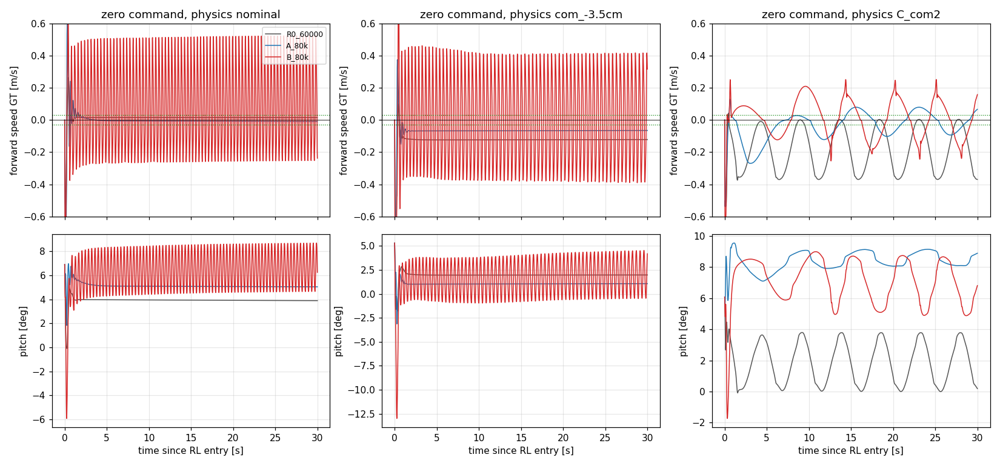

# FlashSAC A/B 재학습 — sim2sim 결과 보고서

Execution Domains: `TRAINING_SIM` (완료된 학습 확인), `VALIDATION_SIM` (export·ONNX parity 14건, MuJoCo rollout 705회), `DESKTOP_DRY_RUN` (집계). 로봇 접근·배포 없음.

Evidence Status:
- **PASS**: 학습 완료, export와 parity, 평가 실행.
- **FAIL**: 사전 고정 gate를 모두 통과한 정책 없음.
- **SUSPICIOUS**: 평가 물리(특히 C)의 실기 대표성.
- **NOT_TESTED**: 실기.

| 정책 | run | Policy checkpoint SHA256 | ONNX SHA256 |
|---|---|---|---|
| R0 (기준) | `tita_flash_sac_115632_883848/model_60000` | `6d3cba9fa76eebe9fb2f40ef23d34115b8b95028ec788571531ffb33ce821a05` | `f44f07ed44970e3ff565eae67fd9229adf0be5c02215591c52a691ffcbb71b2a` |
| **A 80k (선택)** | `tita_flash_sac_201940_278440/model_80000` | `79f9175bb8c3be0c5138866e30891b90cc1282b6c98023cdb76c2e33b229068c` | `26f0d86b65a68475fb8a315fb31e829ae16eaa2cf16dabbbcf38e69f28c933e9` |
| **B 80k (선택)** | `tita_flash_sac_201942_248862/model_80000` | `930b75afd2b9734f361859fd8d28dcffd3cbebf747fcc79fa3833ecb6ca68019` | `994e7c8d74ed7b9b345999cc9f4dfcb17cd539ec97e8e04efcd1bf6e5caf922e` |

나머지 12개 checkpoint의 hash는 [export_results.json](flashsac_ab_sim2sim/exports/export_results.json)에 있다. 평가 protocol SHA256: `044c96111c203a6c5686518609746b963339d2822c23b93264e09583d3f14dda`. Branch: `agent/codex/dev_tita_gluon`. Commit/push 없음.

## 결론

1. **두 arm 모두 사전 고정 gate를 전부 통과하지 못했다.** 지금 단계에서 실기 배포를 추천할 정책은 없다.
2. **A (CoM-only)**
   - 장점: nominal·CoM 조건에서 동작이 매끄럽다(정지 pitch std ≤ 0.02°). 전후진 추종도 R0보다 정확하고 대칭적이다(nominal ±0.3 m/s 명령에 +0.35 / −0.35).
   - zero-command 후진: CoM −3.5 cm에서 −0.123 → −0.066 m/s, −5 cm에서 −0.177 → −0.068 m/s로 줄었다. 그래도 기준(0.03)을 넘는다.
   - 약점: 다리가 약한 조건(C, A_imu2, B_com1_imu1)에서 **−0.3과 −0.6 m/s 후진이 모두 실패**하고, −0.5 rad/s 회전도 실패한다.
3. **B (CoM + 다리 계수·마찰 DR)**
   - 장점: 모든 mismatch 조건에서 zero-command drift가 거의 0이다(−0.012 ~ +0.036 m/s). **315 rollout 동안 실패 0건**이다(C의 −0.6 후진 포함).
   - 약점 1: 다리 출력이 nominal인 조건에서 **2–3.6 Hz 진동이 7개 checkpoint 전부에 나타난다**. 정지 중 속도 ±0.4–0.5 m/s, pitch std 1.3–2.6°, 휠 토크 RMS는 R0의 16–32배다.
   - 약점 2: startup에서 다리 토크가 60 N m에 포화되고 pitch peak가 13°까지 오른다.
   - 약점 3: nominal(CoM 0)에서 +0.10 m/s 전진 drift가 있다.
4. **해석 (가설, 미검증)**
   - B의 진동: 다리 배율 분포(log-U[0.5, 1.05], 중앙값 약 0.72)가 약한 다리 쪽에 몰려 있어서, 정책이 약한 다리에 맞춘 피드백을 배웠을 수 있다. 그 상태로 정상 출력 다리를 만나면 limit cycle이 생겼다는 해석이다.
   - A의 후진 실패: 다리 쪽 차이에 대한 강건성이 없기 때문이다.
   - 실기가 어느 쪽에 가까운지는 미결이다. 0.6 등가 계수는 실기 자세를 재현하지만 firmware는 명령 ≈ 보고를 보인다. 그래서 실기에서 B의 진동과 A의 후진 실패 중 어느 쪽이 나타날지 sim만으로는 판단할 수 없다.



## 1. 학습 완료

| arm | run / W&B | 종료 | step / update | 마지막 보상 | 최종 actor SHA256 |
|---|---|---|---|---:|---|
| A | `tita_flash_sac_201940_278440` / [7gy479xy](https://wandb.ai/bjy6614-postech/tita_flat_flash_sac/runs/7gy479xy) | 10/18 00:58 | 100k / 199,948 | 0.0558 | `3f8f4bc4…66f0` |
| B | `tita_flash_sac_201942_248862` / [rgva5dwa](https://wandb.ai/bjy6614-postech/tita_flat_flash_sac/runs/rgva5dwa) | 10/18 01:00 | 100k / 199,948 | 0.0597 | `64fa5e96…92ac3` |

두 run 모두 `train.py` 판정 PASS다(console log 마지막 `Requested finite training updates completed`). 학습 시간은 GPU 1장을 공유해 각 약 4시간 40분이다. 보상 값만으로는 locomotion 품질을 판단하지 않는다.

## 2. Export (평가 전용)

- `export.py`의 task 고정 검사는 승인 사항이라 수정하지 않았다(실행 전후 SHA256 동일).
- 대신 [test/export_ab_checkpoints.py](../../../test/export_ab_checkpoints.py)가 run별 확인을 거친 경우에만, export 호출 동안 그 run의 task를 허용했다. 확인 항목:
  - `policy_interface.json`과 `action_mapping.json`이 115632와 바이트 단위로 같을 것
  - `ddt.json`이 33/8과 해당 task, actor hash 일치를 보고할 것
- 14건(A·B × 40k–100k, 10k 간격) 모두 PASS. Torch↔ONNX parity 최대 오차 5.2e−6 (256 샘플).
- 생성된 sim2sim config는 경로·hash를 제외하고 60k export와 관측·action·PD·clip·기본 자세·제어 주기가 모두 같다(14/14). adapter source hash도 같다.
- 출력은 [exports](flashsac_ab_sim2sim/exports/)에만 썼다. 배포 bundle은 건드리지 않았다.

## 3. 평가 방법 (실행 전 고정)

[evaluation_protocol.json](flashsac_ab_sim2sim/evaluation_protocol.json):

- **1단계 (checkpoint 선택):** R0와 A·B 각 7개 checkpoint를 CoM 물리 세트(nominal, base CoM −2/−3.5/−5 cm, C = 다리 계수 0.6·마찰·CoM −2 cm)에서 돌렸다. 시나리오는 7개로, zero-command 30 s(seed 104·270), ±0.3·±0.6 m/s 전후진 후 정지 재진입, ±0.5 rad/s 회전이다. gate는 [기존 수용시험](../2026-10-17/flashsac_retrain_prep.md)과 같다. 선택 규칙:
  - arm별로 통과 gate 수가 최대인 checkpoint(실패 rollout은 해당 시나리오 gate 전부 실패로 계산)
  - 동률이면 4개 mismatch 조건의 zero-command 평균 |v̄|가 작은 쪽
  - 그래도 동률이면 나중 step
- **2단계 (선택본 + R0):** A/B/C 물리 세트(IMU·CoM 대안)를 돌리고, 17:44:21 실기 명령 시퀀스를 nominal / CoM −3.5 cm / C에서 재생했다. 재생은 실기 궤적과 비교하는 것이 아니다. 같은 sim 물리 안에서 정책끼리 비교하는 현실적 명령 프로파일이다.
- **속도·토크 정의:** sim 속도는 MuJoCo GT, 토크는 명령 PD 토크다.

## 4. 1단계 — checkpoint 선택

| 정책 | gate 통과 (/140) | mismatch zero 평균 \|v̄\| | 실패 rollout | 정지 pitch std / 진동 주파수 (nominal · CoM −3.5) |
|---|---:|---:|---|---|
| R0 60k | 78 | 0.135 | C −0.6 | 0.02° · 0.00° (진동 없음) |
| A 40k | 93 | 0.025 | – | 0.08° · 0.08° |
| A 50k | 83 | 0.072 | C −0.3, −0.6 | 0.00° · 0.00° |
| A 60k | 64 | (C 정지 실패) | C −0.3, −0.6, zero ×2 | 0.14° · 0.00° |
| A 70k | 87 | 0.038 | C −0.3, −0.6 | 0.11° · 0.01° |
| **A 80k** | **96** | **0.052** | C −0.3, −0.6 | 0.02° · 0.01° |
| A 90k | 67 | (C 정지 실패) | C −0.3, −0.6, zero ×2 | 0.03° · 0.01° |
| A 100k | 74 | 0.094 | C −0.3, −0.6 | 0.01° · 0.01° |
| B 40k | 95 | 0.023 | – | 1.55° @2.7 Hz · 2.55° @2.0 Hz |
| B 50k | 80 | 0.115 | – | 1.86° @3.6 Hz · 2.08° @3.1 Hz |
| B 60k | 65 | 0.069 | – | 1.41° @2.8 Hz · 2.04° @2.5 Hz |
| B 70k | 90 | 0.015 | – | 1.29° @2.9 Hz · 1.56° @2.5 Hz |
| **B 80k** | **95** | **0.020** | – | 1.49° @2.6 Hz · 1.78° @2.2 Hz |
| B 90k | 82 | 0.034 | – | 1.35° @2.6 Hz · 1.31° @2.4 Hz |
| B 100k | 72 | 0.064 | – | 1.42° @2.5 Hz · 1.50° @2.4 Hz |

- **선택:** A 80k, B 80k. B는 40k와 95로 동률이었고 동률 규칙에 따라 80k가 됐다.
- **checkpoint 간 변동:** 인접 checkpoint 사이에도 gate 수가 64–96으로 크게 변한다(seed 1개).
- **arm 공통 성질:** B의 진동은 모든 checkpoint에, A의 C 후진 실패는 40k를 제외한 모든 checkpoint에 나타난다. 개별 checkpoint의 우연이 아니다.
- **gate 계산의 한계:** gate 수는 진동을 pitch std와 startup 항목에서만 감점한다. 그래서 B의 진동 문제는 총점에 덜 반영된다.

## 5. 선택 정책 비교

### zero-command (5–30 s): 평균 속도 / 25 s 이동 / pitch std

| 물리 | R0 60k | A 80k | B 80k |
|---|---|---|---|
| nominal | +0.015 / +0.4 m / 0.02° | −0.007 / −0.2 m / 0.02° | **+0.101 / +2.5 m / 1.49° (2.6 Hz)** |
| CoM −2 cm | −0.054 / −1.3 m / 0.00° | −0.058 / −1.5 m / 0.00° | +0.030 / +0.7 m / 1.72° |
| CoM −3.5 cm | −0.123 / −3.1 m / 0.00° | −0.066 / −1.7 m / 0.01° | **+0.006 / +0.1 m** / 1.78° (2.2 Hz) |
| CoM −5 cm | −0.177 / −4.4 m / 0.04° | −0.068 / −1.7 m / 0.02° | +0.036 / +0.9 m / 1.68° |
| C | −0.187 / −4.7 m / 1.31° | −0.015 / −0.4 m / 0.49° | +0.007 / +0.2 m / 1.32° |
| A_imu2 | −0.259 / – / 1.06° | −0.018 / – / 0.40° | +0.006 / – / 1.39° |
| B_com1_imu1 | −0.215 / – / 1.23° | −0.013 / – / 0.44° | −0.012 / – / 1.37° |

### 전후진 추종 오차 (v̄ − 명령, 6–13 s; 순서 +0.3 / −0.3 / +0.6 / −0.6)

| 물리 | R0 60k | A 80k | B 80k |
|---|---|---|---|
| nominal | −0.08 / −0.17 / −0.12 / −0.11 | +0.05 / −0.05 / +0.10 / +0.01 | +0.12 / −0.02 / +0.13 / +0.04 |
| CoM −3.5 cm | −0.14 / −0.31 / −0.17 / −0.28 | −0.02 / −0.04 / −0.06 / −0.00 | +0.02 / −0.07 / −0.00 / −0.01 |
| C | −0.12 / −0.16 / −0.19 / **실패** | +0.01 / **실패** / −0.03 / **실패** | −0.00 / +0.05 / −0.04 / +0.12 |

- **정지 재진입:** CoM 조건에서 R0는 −0.05 ~ −0.18 m/s, A는 −0.04 ~ −0.07, B는 0.00 ~ +0.04다. nominal에서 B는 +0.09 ~ +0.11이다.
- **yaw ±0.5 rad/s:** C 조건에서 B는 +0.28 / −0.33으로 덜 돈다. A는 nominal에서 +0.34 / −0.35로 덜 돈다. 그 외 조건은 대체로 ±0.05 이내다.

### Startup (0–3 s): 휠·다리 토크 peak / pitch peak

| 물리 | R0 60k | A 80k | B 80k |
|---|---|---|---|
| nominal | 7.5 / 44 N m / 6.9° | 12.0 (포화) / 48 / 7.0° | 12.0 (포화) / **60 (포화)** / 8.2° |
| CoM −3.5 cm | 8.5 / 43 / 5.3° | 12.0 / 45 / 5.3° | 12.0 / 60 / **13.0°** |
| C | 12.0 / 55 / 6.1° | 12.0 / 49 / 9.6° | 12.0 / 60 / 8.5° |

### 2단계 합계와 17:44 명령 재생

- **A/B/C 물리 세트 gate:** R0 53/112(−0.6 후진 실패 3), A 80k 70/112(후진 0.3·0.6과 yaw −0.5 실패 8), B 80k 74/112(실패 0).
- **17:44 명령 재생**(sim 내부 정책 비교):

| 물리 | 지표 | R0 60k | A 80k | B 80k |
|---|---|---:|---:|---:|
| C | 중립 W1 (7.71–9.25 s) / W2 (31.67–32.19 s) 속도 | −0.259 / −0.273 | −0.248 / −0.237 | **−0.038** / −0.164 |
| CoM −3.5 cm | W1 / W2 | −0.074 / −0.012 | −0.053 / −0.036 | −0.014 / +0.050 |
| nominal | W1 / W2 | +0.043 / +0.075 | +0.133 / +0.083 | +0.168 / +0.231 |
| 3 s 이후 \|v − 명령\| 평균 | C / CoM −3.5 / nominal | 0.158 / 0.116 / 0.114 | 0.188 / 0.127 / 0.156 | 0.166 / 0.293 / 0.289 |

- **명령 재생에서 본 A·B:** 명령이 섞인 프로파일에서는 B가 C 조건의 중립 drift를 가장 크게 줄였다. 하지만 nominal·CoM −3.5에서는 진동 때문에 추종 오차가 가장 크다. 두 새 정책은 nominal(CoM 0, 학습 분포 밖)에서 명령 후 전진 drift를 보인다.
- **C 조건의 실기 대표성:** C에서는 R0도 0.2 Hz로 0 ~ −0.37 m/s를 오가는 느린 출렁임을 보인다. 실기 60k 자유 drift는 −0.20 m/s에 표준편차 0.02 m/s로 일정했다. 따라서 C는 평균 특징은 맞추지만 동역학 재현은 제한적이다.

## 6. 다음 단계 제안

- **실기:** 지금 두 정책 모두 배포 권고가 없다.
  - operator가 그래도 시험한다면, nominal 다리 조건에서 진동이 없는 A 80k가 상대적으로 안전하다.
  - 다만 다리가 약한 모델에서 후진 실패가 있었으므로 zero-command와 작은 전진 명령만, 손 지지 상태로 시작할 것을 권한다.
  - B는 실기 다리가 nominal에 가까우면 2–3 Hz 진동이 날 수 있어 위험하다.
  - 어느 쪽이든 별도 승인이 필요하다.
- **다음 학습 후보 (B′):** B의 장점을 유지하면서 진동과 nominal drift를 없애는 방향이다.
  1. 다리 배율 분포를 nominal 쪽으로 옮긴다. 예: log-U[0.7, 1.05], 또는 50%는 1.0 고정.
  2. CoM x 범위에 0을 포함한다(예: −5.5 ~ +0.5 cm).
  3. arm마다 seed 2개로 돌린다.
  4. 선택 규칙에서 진동(정지 pitch std ≤ 1°)과 startup 포화를 hard filter로 둔다.
- **export 검사:** `export.py` task 검사 완화는 실기 bundle을 만들 때 필요하다. 승인 대기 중이다.

## 한계

- arm마다 seed 1개다. checkpoint 간 변동이 크므로 A·B 차이의 일부는 학습 분산일 수 있다. 다만 B의 진동과 무실패, A의 C 후진 실패는 checkpoint 전반에서 일관됐다.
- 평가 물리는 실기 로그 2개로 맞춘 sim 등가 후보다. IMU는 operator 판단으로 정상 처리했다. MuJoCo armature 0.01 vs Isaac 0 차이가 남아 있다.
- 1단계 rollout 600개의 원시 신호는 용량 때문에 scratch에만 두었다(metrics JSON은 보관). 스크립트로 재실행할 수 있다.
- 모든 결과는 sim이다. 실기 성공·실패의 증거가 아니다.

## 변경·검사

- **신규:** [test/export_ab_checkpoints.py](../../../test/export_ab_checkpoints.py), [test/evaluate_ab_policies.py](../../../test/evaluate_ab_policies.py).
- **수정:** `test/real2sim_leg_wheel_grid.py`(job의 `config_path` 지원; SHA256 `c6d03905…`).
- **수정하지 않은 것:** 학습 설정, `export.py`, 제어 코드, 배포 bundle.
- **산출물:** [flashsac_ab_sim2sim/](flashsac_ab_sim2sim/)(43 MB: exports 15 MB, 2단계 신호 25 MB, metrics·protocol·log·그래프).
- **PASS:** export 14/14, interface 동일성 14/14, 1단계 rollout 600 실행(실패 판정 A 16, R0 1, B 0), 2단계 105 실행(실패 A 8, R0 3, B 0), 그래프 육안 확인.
- **`./scripts/agent-check.sh`:** [log](flashsac_ab_sim2sim/agent_check.log).

## 재현 (`VALIDATION_SIM`)

```bash
/home/cocel/isaac/env_isaaclab/bin/python test/export_ab_checkpoints.py
cd test && /home/cocel/venvs/cosim_ros2_jazzy/bin/python evaluate_ab_policies.py --stage1-signals <scratch dir>
```

## 7. 실기 후보 사후 안전 선별

Execution Domain: `VALIDATION_SIM`. Evidence Status: **FAIL** (4개 기준을 모두 통과한 후보 없음). 아래 추천 근거는 **SUSPICIOUS**(sim 전용).

- **성격:** 사전 고정한 gate 수 선택(A 80k)과 별개다. 1단계 결과를 본 뒤 실기 안전을 우선하는 기준으로 정의했고, 추가 rollout 전에 [screen_protocol.json](flashsac_ab_sim2sim/sim2real_screen/screen_protocol.json)(SHA256 `abd4d42a…`)에 고정했다.
- **기준:**
  1. 모든 물리·시나리오(CoM 세트 + A/B/C 세트 + 17:44 재생)에서 실패 0
  2. nominal 다리 조건에서 정지 pitch std ≤ 1°
  3. startup pitch peak ≤ 10°
  4. mismatch 조건 zero-command 평균 |v̄|가 R0보다 작을 것
- **추가 rollout:** A 40k·A 70k·B 40k의 2단계 105회를 실행했다([screen_results.json](flashsac_ab_sim2sim/sim2real_screen/screen_results.json)).

| 후보 | 실패 | 최대 정지 pitch std | 최대 startup pitch | mismatch 평균 \|v̄\| | 결과 |
|---|---:|---:|---:|---:|---|
| R0 60k | 3 (−0.6 후진) | 0.04° | 9.2° | 0.169 | 실패 있음 |
| **A 40k** | **0** | **0.09°** | 12.8° (CoM −5 cm만; −3.5 cm 10.1°, 나머지 ≤ 9.0°) | **0.018** | startup만 불통과 |
| A 70k | 6 (다리 약한 조건 후진) | 0.11° | 15.6° | 0.026 | 불통과 |
| A 80k | 8 (후진, yaw −0.5) | 0.02° | 11.0° | 0.040 | 불통과 |
| B 40k / 80k | 0 | 2.64° / 1.78° (진동) | 16.4° / 14.8° | 0.021 / 0.016 | 진동으로 불통과 |

### 실기 후보: A 40k (`tita_flash_sac_201940_278440/model_40000`)

- Checkpoint SHA256 `2044f8f48a0f246667eb503f9c17041c86d655b6c72a9625939581c7ff1f3dad`
- ONNX SHA256 `5df35a3e486802679154ef8d1bfc420067840991ca226d531279d4d9d43fd72d` (parity 3.7e−6)

**근거:**
- 평가한 75 rollout 전부에서 실패가 0이다(다리 약한 C, IMU·CoM 대안 포함).
- 정지 진동이 없다.
- zero-command drift: CoM −5 cm −0.001, −3.5 cm +0.034, −2 cm +0.060, C +0.005, A_imu2 0.000, B_com1_imu1 +0.008 m/s. R0는 −0.054 ~ −0.259였다.

**알려진 위험 (모두 sim 근거):**
- **startup:** pitch peak가 최대 12.8°이고, RL 진입 직후 휠 토크가 모든 조건에서 12 N m에 포화된다.
- **CoM 0 근처 drift:** 실기 CoM이 URDF 값에 가깝다면 +0.06 ~ +0.07 m/s 전진 drift가 날 수 있다(nominal +0.074).
- **후진 약함:** 다리 약한 조건(C)에서 후진이 거의 안 된다(−0.3 명령 → −0.09, −0.6 → −0.04 m/s). 넘어지지는 않았다.
- **명령 이후 drift:** 17:44 명령 재생의 C 조건 마지막 중립 구간에서 −0.29 m/s 후진이 나타났다(R0 −0.27). 명령 이력 뒤의 drift는 개선되지 않았다.

**제안하는 실기 절차 (operator 실행, 별도 승인 필요):**
1. Bundle 생성과 SBC 배포가 필요하다. 기존 50000 배포 절차를 따르되, export task 검사나 bundle 생성 경로에 대한 승인이 먼저 필요하다.
2. sit → RL 전이 첫 3초는 손으로 지지한다.
3. 손 대지 않은 zero-command 20–30초 동안 바닥 표시와 줄자로 실제 이동거리를 기록한다.
4. 이어서 전진 0.1–0.2 m/s, yaw ±0.3 rad/s를 시험한다. 후진은 마지막에 −0.2 m/s 이하로만 한다.
5. pitch가 10°를 넘거나 진동이 보이면 즉시 중단한다.

**대안:** B′ 두 seed가 14:35 전후 끝나므로, 같은 선별을 적용한 결과를 보고 후보를 다시 정할 수 있다([B′ 기록](flashsac_bprime_training.md)).

## 8. sim2sim launcher로 직접 보기 (VALIDATION_SIM)

- **캐시가 필요한 이유:** `sim2sim.launch.py`는 `<model>/sim2sim/actor/`의 export 캐시를 사용한다. 캐시가 없으면 `export.py`를 호출하는데, A·B·B′ run은 task 검사에서 막힌다.
- **캐시 생성:** `test/export_ab_checkpoints.py --cache --arms A B`로 14개 캐시를 만들었다. 인터페이스 동일성을 확인한 뒤 생성했고, `export.py`는 수정하지 않았다([log](flashsac_ab_sim2sim/cache_export.log)).
- **검증:**
  - 캐시 ONNX가 평가에 쓴 ONNX와 14/14 같다.
  - launcher `--prepare-only`가 R0·A 40k·B 80k 캐시를 인식했다.
  - A 40k headless 300 step이 PASS했다([log](flashsac_ab_sim2sim/launcher_headless_A40k.log)).
- **물리 조건 한계:** launcher는 nominal 물리만 지원한다. CoM 이동·다리 약화 조건은 볼 수 없다. nominal에서의 예상 동작:
  - R0: 거의 정지 (+0.015 m/s)
  - A 40k: 약한 전진 creep (+0.07 m/s)
  - B 80k: 2–3 Hz 제자리 진동

```bash
# 저장소 루트, 실제 터미널(TTY)에서. 키: 1 sit → 0 정책 시작, w/s 전후, a/d 회전, r 정지, 2 reset, Ctrl-C 종료
python3 sim2sim/sim2sim_ros2_jazzy/launch/sim2sim.launch.py --ckpt lab/ddt_lab/logs/flash_sac/tita_flash_sac_201940_278440/model_40000
# B′ (학습 종료 후 캐시 먼저 생성)
/home/cocel/isaac/env_isaaclab/bin/python test/export_ab_checkpoints.py --cache --arms Bp42 Bp7
```
