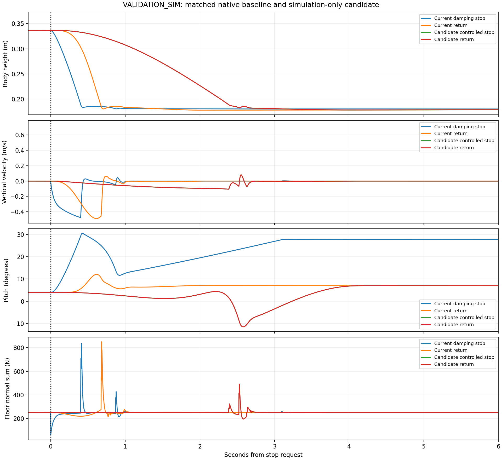

# 현재 실기 전환 로직의 MuJoCo 급낙하 재현과 제어된 앉기 후보

- Execution Domains: `VALIDATION_SIM` — MuJoCo rollout, `DESKTOP_DRY_RUN` — parity·수치검사·저장 상태 렌더링.
- Evidence Status: 기존 급낙하 재현·native math parity·동일 초기상태 비교·결정론적 재실행 **PASS**. 개선 후보는 아래 nominal 수용조건 **18/18 PASS**, A/B 각 **2/2 PASS**, C **0/2 FAIL**. 실기 안전성·배포·bias ON 조건 **NOT_TESTED**.
- Policy: frozen `tita_flash_sac_115632_883848/model_60000`.
- Checkpoint SHA256: `6d3cba9fa76eebe9fb2f40ef23d34115b8b95028ec788571531ffb33ce821a05`.
- ONNX SHA256: `f44f07ed44970e3ff565eae67fd9229adf0be5c02215591c52a691ffcbb71b2a`.
- Branch: `agent/codex/dev_tita_gluon`.
- 범위: 요청의 첫 단계인 “현재 sim2real 값으로도 동일하게 팍 앉는가”를 먼저 검증하고, 시뮬레이션 전용 개선 후보를 비교했다. 로봇 접근·배포·서비스 조작·CAN 명령은 수행하지 않았다.

## 먼저 확인한 결과: 현재 코드로 두 현상이 모두 재현된다

현재 sim2real의 C++ `StateMachine`, `ObservationBuilder`, `ActionAdapter`를
그대로 shared library로 빌드해 MuJoCo에서 호출했다. 별도로 작성한 Python
상태기계를 baseline으로 사용하지 않았다.

공통 RL 상태를 만든 뒤 다음 세 가지로 분기했다. 정책/초기조건/물리값은 같고,
전환만 다르다. 표는 nominal, seed 42, RL 8초 뒤 전환이다.

| 모드 | 시작 몸체 높이 | 최저 높이 | 최대 하강속도 | 바닥 normal force 합의 최대값 | 주요 결과 |
| --- | ---: | ---: | ---: | ---: | --- |
| RL 계속 유지 | 33.65 cm | 33.65 cm | 0.000008 m/s | 252 N | 높이 유지 |
| 현재 EStop | 33.65 cm | 18.04 cm | **0.475 m/s** | **835 N** | 감쇠만 남기면서 빠르게 주저앉음 |
| 현재 ReturnToSit | 33.65 cm | 17.82 cm | **0.488 m/s** | **851 N** | 2초 목표 보간에도 초반 급하강 |

최종 하강량의 90%에 도달하는 시간은 EStop 약 **0.390초**, ReturnToSit
약 **0.660초**다. “전환이 2초이므로 몸체도 2초에 걸쳐 부드럽게 내려온다”는
해석은 이 실행에서 성립하지 않았다. 반면 전환하지 않은 대조군은 높이를 유지했다.

수치는 MuJoCo의 몸체 상태와 접촉 solver 값이다. 실제 로봇의 충격력 측정값이 아니다.

**영상:** [현재값 재현 — RL 유지 / EStop / RL→앉기, 1배속](flashsac_sit_validation/baseline_video/comparison.mp4).

## 실기 값과 맞춘 부분 / 식별하지 않은 부분

- 정책 50 Hz, 상태기계·PD·fall guard·물리 step **500 Hz / 2 ms**. 기존 export의 5 ms×4는 이번 실기 타이밍 재현에서 2 ms×10으로 바꿔 사용했다.
- 저장된 33차원 observation 순서·scale·clip과 8차원 action mapping을 config에서 읽어 실제 C++ builder/adapter에 전달했다. 정책 weights와 raw previous-action convention은 유지했다.
- RL leg Kp=60, Kd=1.5; wheel Kd=0.5. 최종 한도는 leg ±60 Nm, wheel ±12 Nm.
- 실제 C++ EStop의 `-Kd*dq`, ReturnToSit의 이전 토크 보관·smoothstep·2초 보간·0.2초 settle, 센서 기울기 0.65 rad의 damp 요청을 재현했다.
- **Velocity bias OFF**를 첫 기준으로 선택했다. 최신 motor-feedback 실험과 같은 설정이며, 전환 결함을 bias 영향과 분리한다. RLS·LQR·학습·probing은 사용하지 않았다.
- canonical splay pose에서 실제 native transform-up을 거쳐 RL에 진입한다. 초기 작은 속도 perturbation은 seed로 고정한다. 조종기 UART/통신 지연 대신 정해진 시점의 상태 요청을 사용했다.
- 평지 정지 시험이므로 기존 scene의 장애물 collision을 끈다. floor와 로봇 collision은 유지한다.
- nominal은 기존 corrected MuJoCo 모델이다. 실기의 모터 지연·센서 잡음·바닥 탄성·외부 지지 상태까지 동일하다고 주장하지 않는다.
- 로컬 simulator는 MuJoCo 3.10.0, CPU Python ONNX Runtime 1.27.0이다. 실제 SBC C++ 추론기의 ORT 1.19.2 실행시간·비트 단위 동일성은 재현하지 않았다. 공유 C++ 코드는 상태기계와 관측/토크 adapter이고, policy 파일은 동일한 pinned ONNX다.
- A/B/C는 기존 real2sim 등가 가설이다: leg torque scale 0.6, leg/wheel frictionloss 2/0.3 Nm; A=IMU +2°, B=CoM −1 cm 및 IMU +1°, C=CoM −2 cm. **0.6은 실측 모터 출력 계수가 아니다.** 실제 보고 토크/명령 gain이 약 1이었던 이후 증거와 구분해야 한다.

## 급하강의 코드상 원인도 물리 실행과 일치한다

EStop은 위치 피드백을 제거해 정지 관절의 지지 토크가 0이 된다.
ReturnToSit은 이전 토크 한 샘플과 새 PD 출력을 혼합하므로, 전환 초반
유효 Kp/Kd가 blend 계수만큼 낮아진다. 100 ms 시점의 무릎 Kp는 0.58이다.
새로운 하중/관절 변위에 대응하는 복원력이 약한 상태에서 목표를 따라 내려앉는다.
이 현상은 실제 C++ 토크 계산을 MuJoCo에 적용했을 때도 나타났다.

다리 PD만 처음부터 유지하는 단순 후보도 시험했지만 nominal에서 1.388초 뒤
fall guard에 걸렸고 기울기 최대 46.67°였다. 따라서 다리 지지만 복원하는 것은
두 바퀴 로봇의 앞뒤 균형까지 보장하지 않는다. 이 후보는 채택하지 않았다.

## 시뮬레이션 전용 개선 후보

선택한 비교 후보는 `candidate_com_estop` / `candidate_com_return`이다.
두 모드의 앉기 토크 궤적은 같고, 최종 상태가 latched estop / sit으로 다르다.
실기 EStop의 동작을 이 코드로 교체한 것은 아니다.

1. 다리 PD는 처음부터 유지한다. 초기 effective reference를 직전 실제 계산 토크와 맞춰 첫 토크가 연속이 되도록 한다. 전체 피드백을 0부터 키우지 않는다.
2. 4초 smoothstep 경로로 기존 sit PD의 effective target에 접근한다. FF를 Kp로 나눈 reference offset으로 표현하므로 최종 다리 토크 식은 원래 sit PD와 같다.
3. 중간에 두 허벅지 reference에 `0.3*sin(pi*alpha)` rad의 굽힘 경로를 추가한다. 무릎만 접을 때 무게중심이 바퀴 뒤로 빠지는 것을 줄인다.
4. IMU quaternion·gyro와 encoder로 **nominal robot model의 FK**를 계산해 바퀴 축 대비 무게중심 기울기를 추정한다. 실제 plant의 root position/velocity/COM을 제어 입력으로 쓰지 않는다. A/B/C의 perturbed CoM도 controller에 알려주지 않는다.
5. 휠 공통 토크에 기울기/각속도/휠 속도 피드백을 추가한다. 비교 후보의 계수는 30 / 5 / 1이다. 초기 wheel velocity reference도 토크 연속성을 맞춘 뒤 감소시킨다.
6. encoder 무릎 각도 −2.35→−2.65 rad의 crouch 진행에 따라 balance 항을 fade out하고 원래 wheel damping으로 인계한다. 센서·plant contact force나 GT height를 gate 입력으로 쓰지 않는다.

이 FK/전환은 `test/`의 연구 하네스에만 있다. 기존 ROS sim2sim 실행기와
sim2real 상태기계, 조종기 코드, 학습 환경은 수정하지 않았다. SBC에서 사용하려면
별도 구현·실행시간·센서/고장 처리·상태 전환 검증이 필요하다.

| nominal, 같은 초기 상태 | 최대 하강속도 | 최대 바닥 normal force 합 | 최대 기울기 | 하강 90% 시간 |
| --- | ---: | ---: | ---: | ---: |
| 현재 ReturnToSit | 0.488 m/s | 851 N | 12.08° | 0.660 s |
| 개선 후보 | **0.106 m/s** | **491 N** | **11.47°** | **2.332 s** |

후보는 하강속도를 약 78%, peak floor force를 약 42% 줄였다.
최종 몸체 높이는 약 17.91 cm, 마지막 1초 수평속도는 약 0.000021 m/s다.
현재 EStop의 최종 27° 부근 기울어진 상태와 달리 후보는 약 6.93°의 sit에 정착한다.

**영상:** [현재 두 전환과 개선 후보 두 전환 비교, 1배속](flashsac_sit_validation/comparison_video/comparison.mp4).



## 수용 기준과 결과

후보 검토를 위해 정한 **실험용** 기준은 [acceptance.json](flashsac_sit_validation/acceptance.json)에 있다.
최대 하강속도 ≤0.2 m/s, 기울기 ≤20°, floor normal 합 ≤2×중량(약 504 N),
fall guard 없음, 마지막 1초 gyro RMS ≤0.1 rad/s, 몸체 높이 0.14–0.22 m,
수평속도 ≤0.05 m/s, 최대 수평 이동 ≤0.5 m다. 제조사 안전 규격이 아니다.
수평속도/이동 기준은 초기 후보의 빠른 구름을 발견한 뒤 추가했으며,
어느 후보도 그 전에 통과 판정을 받지 않았다.

본 비교는 seed 42/270/913 × RL 3/8/12초 후 전환의 nominal 9조건과,
A/B/C 각 seed42·8초 후 전환 3조건으로 구성했다. 각 조건에서 baseline 두 모드와
선택 후보 두 모드를 비교해 총 **48 rollout**이다.

| 조건 | 기존 전환 통과 | 후보 통과 | 비고 |
| --- | ---: | ---: | --- |
| nominal, 9 초기조건×2모드 | 0/18 | **18/18** | 후보 하강 0.105–0.106 m/s, peak 489–492 N |
| A | 0/2 | **2/2** | 후보 peak 약 496 N |
| B | 0/2 | **2/2** | 후보 peak 약 471 N |
| C | 0/2 | **0/2** | 후보 peak 약 **645 N**, floor-force 기준 초과 |

한 초기조건의 두 후보 모드는 같은 토크 경로를 공유하므로 독립적인 물리
조건 18개라고 해석하면 안 된다. nominal은 9개 초기조건이다. seed 변화는
startup 속도 perturbation이며, 넓은 미지 물리 분포를 보장하지 않는다.

C에서는 하강속도는 줄었지만 기존 ReturnToSit peak 약 514 N보다 후보의
접촉력 peak가 커졌다. 따라서 **모든 물리 가설에서 안전한 앉기 완료라고
판정하지 않는다.** nominal도 force 기준의 여유가 크지 않다. 실기 배포는 하지 않았다.

## 증거 무결성과 실제 실행한 검사

- PASS: 모든 비교 쌍의 전환 직전 qpos/qvel/raw action/직전 토크 SHA256과 physics fingerprint가 일치한다.
- PASS: 48개 trace의 유한값, 매 2 ms 토크 한도와 기록 metric을 다시 계산했다. [benchmark_audit.log](flashsac_sit_validation/benchmark_audit.log), [CSV](flashsac_sit_validation/benchmark.csv), [요약](flashsac_sit_validation/benchmark_summary.json).
- PASS: nominal seed42·8초의 네 모드를 다시 실행했으며 전체 rows/qpos/qvel/sample-times 최대 오차 **0.0**이다. `repeat_nominal/`에 원본과 재실행을 보존했다.
- PASS: 기존 C++/Python parity 검사 — 33차원 observation 50개 최대 오차 1.20e-7, RL torque 7.17e-6 Nm, transform torque 1.17e-4 Nm, 상태 불일치 0/6000. [native_parity.log](flashsac_sit_validation/native_parity.log).
- PASS: 기존 버튼/상태 회귀 9개 시나리오. [native_buttons.log](flashsac_sit_validation/native_buttons.log). 최종 CLI 기본 후보값으로 네 모드를 실행해 선택 benchmark의 전체 trace와 동일함도 확인했다(`final_default_check/`).
- 저장된 상태만 재생해 동영상을 렌더링했다. 렌더링에서 physics step이나 로봇 API를 호출하지 않았다.
- 전체 repository 검사 결과는 [agent_check.log](flashsac_sit_validation/agent_check.log), 변경 범위/소스 무결성은 `completion_integrity.json`에 기록한다.

`agent-check`는 기존 `my_flat_env_cfg.py`의 trailing whitespace 때문에 **FAIL**이다.
Python syntax 537개, URDF 8개와 실험 디렉터리 검사는 PASS였다. 기존 파일의
해당 공백과 다른 training/config 변경은 건드리지 않았다.

초기 병렬 하네스 빌드에서 sandbox마다 PID가 같아 shared library 임시 파일명이
충돌했다. UUID 파일명과 `dlopen` 후 정리로 고쳤고, 실패 로그는 남겼다.
일부 초기 CoM 후보는 perturbed model을 FK에도 사용했으므로 본 수용 결과에서
제외했다. 최종 비교는 별도의 unmodified nominal FK model을 사용한다.
단순 live-PD·body-pitch feedback·captured-reference·FF/시간 변경 등의 탐색 결과는
별도 디렉터리에 보존했으며, 이 표에 섞지 않았다.

## 파일과 재현

신규 파일:

- `test/sim2real/sit_validation_bridge.cpp`: 실제 sim2real 수학 코드의 C ABI. ROS/SDK/CAN 링크 없음.
- `test/sim2real/validate_sit_transitions.py`: 500 Hz plant, native baseline, 시뮬레이션 후보와 metric.
- `test/sim2real/render_sit_validation.py`: 저장 상태 영상.
- `test/sim2real/summarize_sit_validation.py`: 비교 무결성 검사와 표/그래프.
- 이 보고서와 `docs/exp/2026-10-18/flashsac_sit_validation/` 증거.

```bash
PY=/home/cocel/venvs/cosim_ros2_jazzy/bin/python

# 현재 sim2real 두 전환 + RL 유지 대조군. 새 출력 폴더를 사용한다.
$PY test/sim2real/validate_sit_transitions.py \
  --output docs/exp/2026-10-18/flashsac_sit_baseline_repeat

# 선택 후보 비교: 기본 후보값은 T=4, gains=30/5/1, thigh hump=0.3, FF scale=1.
$PY test/sim2real/validate_sit_transitions.py \
  --modes baseline_estop baseline_return candidate_com_estop candidate_com_return \
  --duration 8 \
  --output docs/exp/2026-10-18/flashsac_sit_candidate_repeat
```

이번 결과는 baseline 급낙하 재현과 제한된 시뮬레이션 후보의 검증이다.
최종 후보의 이동 중 정지·bias ON·외란·통신/센서 오류·모든 joint envelope와
모터 지연을 포함한 실기 수용시험은 남아 있다. 특히 C 접촉력 실패를 해결하기
전에는 범용 안전 전환이나 실기 준비 완료로 해석하지 않는다. 실기·학습·기존
sim2sim 코드는 그대로이며 commit/push도 수행하지 않았다.
