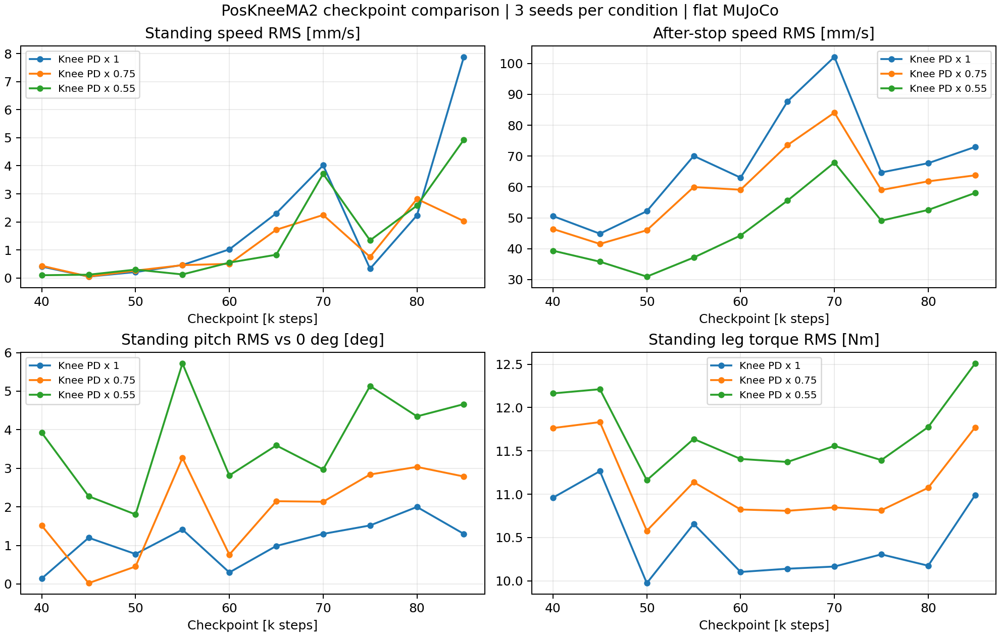
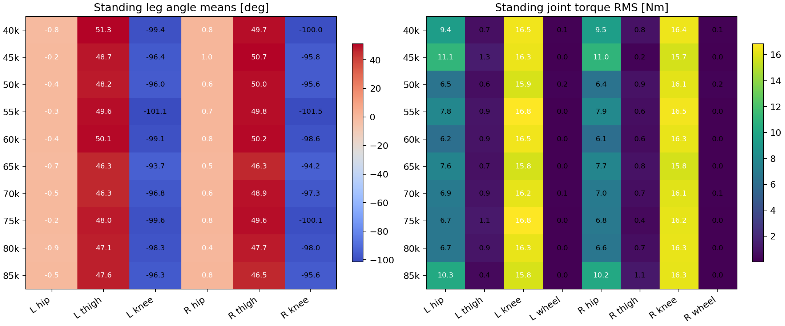
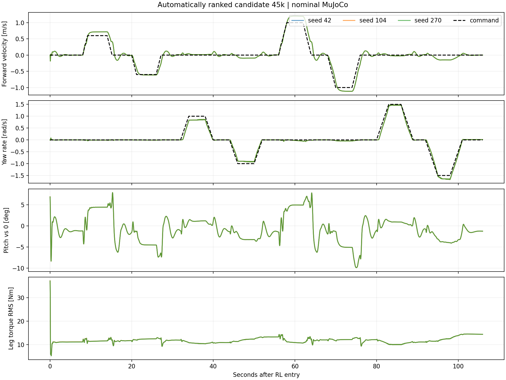

# PosKneeMA2 40k–85k 체크포인트 비교

Execution Domain: VALIDATION_SIM

Evidence Status: PASS (sim screening); hardware NOT_TESTED.

Run: `tita_flash_sac_180212_290240` · task `DDT-Velocity-Flat-Tita-My-PosKneeMA2-v0` · branch `agent/codex/dev_tita_gluon`

10 checkpoints × 3 seeds (42/104/270) × knee PD scales (1.0/0.75/0.55) × stand/drive = 180 rollouts. Stand: 32 s, measured after 8 s (24 s). Drive: 106 s, commands ±0.6/±1.0 m/s and ±1.0/±1.5 rad/s, 0.5/s ramp; after-stop metrics use the last 3 s of each stop. The world-body obstacles are disabled only in the evaluation plant to compare flat-ground policies. Production source code and robot configuration are unchanged.

Pitch error uses horizontal 0°, consistent with flat orientation. Drift displacement is GT base world-x over the settled 24 s; speed RMS is GT planar speed (used only as evaluation data). Joint angles are absolute encoder angles, not action offsets. Torque is MA2 → action mapping → `clip(Kp*(q_target-q)+Kd*(qd_target-dq), ±effort_limit)` sampled every physics substep. The knee sensitivity changes Kp/Kd before clipping, exactly matching the training event semantics. It is not a measured hardware motor coefficient.

Automated ranking (predeclared zero-command speed criterion): **45k** first. See `evaluation_protocol.json` for the selection rule; trajectory tracking, pitch and torque are reported separately.

## Nominal plant, mean of 3 seeds

| ckpt | drift Δx /24s [cm] | stand speed RMS [mm/s] | after-stop speed RMS [mm/s] | pitch mean ± temporal std [°] | leg torque RMS [Nm] | wheel torque RMS [Nm] | failures /18 |
|---|---:|---:|---:|---:|---:|---:|---:|
| 40k | +0.103 | 0.408 | 50.577 | -0.142 ± 0.016 | 10.960 | 0.106 | 0 |
| 45k | +0.024 | 0.051 | 44.878 | -1.198 ± 0.004 | 11.266 | 0.011 | 0 |
| 50k | +0.004 | 0.212 | 52.162 | -0.777 ± 0.005 | 9.974 | 0.153 | 0 |
| 55k | +0.306 | 0.464 | 70.066 | +1.411 ± 0.035 | 10.657 | 0.038 | 0 |
| 60k | -0.107 | 1.022 | 63.019 | -0.298 ± 0.031 | 10.102 | 0.019 | 0 |
| 65k | -0.271 | 2.305 | 87.713 | +0.983 ± 0.078 | 10.140 | 0.011 | 0 |
| 70k | -0.593 | 4.017 | 102.128 | +1.295 ± 0.097 | 10.165 | 0.119 | 0 |
| 75k | +0.366 | 0.331 | 64.711 | +1.518 ± 0.011 | 10.305 | 0.018 | 0 |
| 80k | -0.303 | 2.234 | 67.712 | +1.997 ± 0.063 | 10.175 | 0.012 | 0 |
| 85k | -1.184 | 7.879 | 72.978 | +1.286 ± 0.179 | 10.989 | 0.049 | 0 |

## Nominal standing joint means [deg]

| ckpt | L hip | L thigh | L knee | R hip | R thigh | R knee |
|---|---:|---:|---:|---:|---:|---:|
| 40k | -0.79 | 51.25 | -99.39 | 0.76 | 49.68 | -100.02 |
| 45k | -0.19 | 48.68 | -96.38 | 1.00 | 50.73 | -95.83 |
| 50k | -0.42 | 48.24 | -95.98 | 0.59 | 49.97 | -95.61 |
| 55k | -0.32 | 49.56 | -101.12 | 0.66 | 49.77 | -101.46 |
| 60k | -0.36 | 50.15 | -99.15 | 0.85 | 50.24 | -98.58 |
| 65k | -0.66 | 46.33 | -93.71 | 0.52 | 46.31 | -94.20 |
| 70k | -0.52 | 46.29 | -96.81 | 0.56 | 48.91 | -97.28 |
| 75k | -0.21 | 48.05 | -99.59 | 0.78 | 49.57 | -100.08 |
| 80k | -0.94 | 47.14 | -98.32 | 0.42 | 47.72 | -98.01 |
| 85k | -0.53 | 47.57 | -96.28 | 0.78 | 46.48 | -95.57 |

## Nominal standing torque RMS [Nm]

| ckpt | L hip | L thigh | L knee | L wheel | R hip | R thigh | R knee | R wheel |
|---|---:|---:|---:|---:|---:|---:|---:|---:|
| 40k | 9.371 | 0.700 | 16.514 | 0.106 | 9.454 | 0.810 | 16.420 | 0.106 |
| 45k | 11.090 | 1.262 | 16.342 | 0.011 | 11.050 | 0.204 | 15.739 | 0.012 |
| 50k | 6.491 | 0.623 | 15.858 | 0.153 | 6.440 | 0.862 | 16.143 | 0.153 |
| 55k | 7.814 | 0.934 | 16.845 | 0.038 | 7.902 | 0.635 | 16.517 | 0.039 |
| 60k | 6.189 | 0.915 | 16.454 | 0.020 | 6.110 | 0.588 | 16.272 | 0.019 |
| 65k | 7.621 | 0.741 | 15.791 | 0.011 | 7.694 | 0.811 | 15.780 | 0.010 |
| 70k | 6.876 | 0.901 | 16.224 | 0.119 | 6.961 | 0.663 | 16.116 | 0.120 |
| 75k | 6.666 | 1.149 | 16.809 | 0.017 | 6.795 | 0.424 | 16.203 | 0.019 |
| 80k | 6.689 | 0.939 | 16.307 | 0.012 | 6.626 | 0.653 | 16.287 | 0.012 |
| 85k | 10.260 | 0.447 | 15.823 | 0.049 | 10.162 | 1.120 | 16.253 | 0.049 |

## Sensitivity: speed RMS while stopped [mm/s]

Each cell: stand / post-move stop. Equal scene/seeds/commands; only the two knee PD gains change.

| ckpt | knee x1.0 | knee x0.75 | knee x0.55 | worst zero-speed score [mm/s] |
|---|---:|---:|---:|---:|
| 40k | 0.408 / 50.577 | 0.437 / 46.408 | 0.100 / 39.373 | 25.492 |
| 45k | 0.051 / 44.878 | 0.053 / 41.562 | 0.119 / 35.806 | 22.464 |
| 50k | 0.212 / 52.162 | 0.265 / 45.985 | 0.301 / 30.977 | 26.187 |
| 55k | 0.464 / 70.066 | 0.459 / 59.979 | 0.128 / 37.151 | 35.265 |
| 60k | 1.022 / 63.019 | 0.505 / 59.115 | 0.550 / 44.298 | 32.020 |
| 65k | 2.305 / 87.713 | 1.721 / 73.565 | 0.830 / 55.590 | 45.009 |
| 70k | 4.017 / 102.128 | 2.247 / 84.077 | 3.712 / 67.910 | 53.072 |
| 75k | 0.331 / 64.711 | 0.753 / 59.022 | 1.342 / 49.088 | 32.521 |
| 80k | 2.234 / 67.712 | 2.817 / 61.834 | 2.582 / 52.574 | 34.973 |
| 85k | 7.879 / 72.978 | 2.029 / 63.774 | 4.928 / 58.066 | 40.429 |

## Evidence and limits

`policies.json`: checkpoint/ONNX/config hashes and all native-vs-ONNX parity results (256 inputs each). `results.json`: every rollout, per-joint angle and torque statistics, stop windows and tracking. `joint_angles_torques.csv`: all checkpoints × knee scales × 8 joints, mean/std and torque RMS/peaks. `signals/*.npz`: complete policy-tick states/actions and physics-substep torques. `summary.csv`, `summary.json`: comparison and ranking.

The screening harness was checked against the actual public Sim2SimNode for the 75k nominal seed-42 stand: 1600 RL ticks match exactly in joint state, raw action, applied action and PD torque (`public_node_replay.log`). All policy observations are the saved 34-element encoder/IMU definition; no GT velocity is fed into the actor.

An initial smoke criterion (base height <0.18 m) rejected the legitimate crouched RL entry at 0.179 m. Before the sweep it was replaced with actual base-floor collision and the 0.65-rad tilt guard. The original smoke/protocol are retained as `smoke.log`, `evaluation_protocol_initial_height_guard.json`. No selection was made from that invalid smoke.

No motor calibration, extra delay, IMU noise, backlash/compliance or physical 25 Hz chatter is modelled. Three small initial-state perturbations do not establish hardware confidence. The result selects a candidate for staged experiments, not a deployment approval. No robot access, deployment, commit or publication.

## Policy provenance

| ckpt | Policy Checkpoint SHA256 | ONNX SHA256 |
|---|---|---|
| 40k | `8318ed75379595284b54d722a5f463c1555cc9e9f6203c36f482c6c982e3e084` | `8bd63868e208fced777c5eab986b7e60d641d30194bca99ac5dac0d44777a303` |
| 45k | `a3cb78a22739c70f1a039fcf7897e9e602a6c8ca3ed67b663904c8cf78964435` | `e341714a6f8559ddd51147c1348444913872c078694556654361cf47ac008a84` |
| 50k | `baba6974b76d4e8a7b7107cdfab9d2b7bb73695df00419009279549ebd51f992` | `4b922a52b4e371f4e1ed28d64a0a9d4211161ba24950a1d5a92d2ccf26918553` |
| 55k | `5bc891b3b64c1751d2967396cfe774b87af9a078c6d9cacfbd21e901f8711be3` | `d39ac35bfd95b591b9d1213cc6a6896fc9e743ad0e9c58daee4f08cd5f370739` |
| 60k | `b0e2949c378803bdb1f375b7c8189367f56d2935e086adaeadc0448a28a49a78` | `98c8ba046af1612166d67ff4be426c3af1bed222f5c255bb29913d93d5c74ca2` |
| 65k | `20e7db8a7d495cf00851e679253a52434f83723e329fbbff4b6b601c7f4f65dd` | `721a9478eceb165735ff8455482504c5e81cec3fe4ebda67c4553bb14d1e04f2` |
| 70k | `b0db0f39cdc6c9e404047cba5601ea9356c6c8a42abf815d10851c09a33a3400` | `73eaa0208d127a73abe6ecb9b4441ed051c65fc0acc6daf174f2f416fb5ad4b8` |
| 75k | `9c22f34e0e3b9d7840f29250c214452bb84cadde6037d277d90df55221e84150` | `128734f230868b947c9eac59ef647b8394043c6603781a335fd4e3b4700a2001` |
| 80k | `ecabe82902215a093ba77d8363152915e9c06ea9d5b891ed936468bf0bd08094` | `3a7d1db905a7c4610afbeead3788bb1ba0f10e42686086c227cf36617b0a58e1` |
| 85k | `1accdd8db1befe97af6d7f7fbb6e798725eded10ab1b9d36ab2c61ca9767a7de` | `c073f0049eaa3a8156c85c2646eb2b77c77a2e39f4ba729fe26e1926622cb7b1` |

## Selection interpretation

**For an initial stationary/stop-hold experiment, choose model_45000.** It has the lowest nominal standing speed RMS (0.051 mm/s) and the lowest nominal after-stop RMS (44.88 mm/s), and ranks first under the preregistered worst-domain zero-command speed rule. With knee Kp/Kd x0.55, its standing pitch is +2.27° versus +3.92° (40k), +1.80° (50k), +5.14° (75k). All 18 rollouts per checkpoint completed.

45k has a real tradeoff in this simulation: stationary hip torque RMS is 11.09/11.05 Nm (L/R), compared with 6.49/6.44 Nm for 50k and 6.67/6.80 Nm for 75k. **50k is the alternative if stationary torque/pitch balance matters more.** It has 9.97 Nm pooled leg RMS, pitch -0.78°, and after-stop RMS 52.16 mm/s. **75k remains a useful driving comparison**: at commanded +/-0.6 m/s, nominal measured speeds are +0.571/-0.609 m/s; 45k gives +0.717/-0.613 m/s. The stationary recommendation does not mean 45k dominates tracking.

After-stop residual speeds here are not the same as long-duration stationary drift: they are the last 3 s of finite stops after manoeuvres. The 45k value of 44.88 mm/s is about 0.045 m/s, despite its tiny stationary RMS; do not interpret this as perfect position hold after driving.

## Transient torque peaks, nominal plant

All checkpoints reach the 60 Nm knee / 12 Nm wheel caps briefly when all RL entry and drive samples are included. Settled zero-command torque saturation is zero for every tested checkpoint/domain. To distinguish RL entry from motion, the table below excludes the first 8 s from each rollout. These are command torques in simulation.

| ckpt | after-8s leg peak [Nm] | after-8s wheel peak [Nm] | full leg saturation [%] | full wheel saturation [%] |
|---|---:|---:|---:|---:|
| 40k | 29.38 | 3.11 | 0.0157 | 0.0290 |
| 45k | 19.58 | 3.06 | 0.0157 | 0.0217 |
| 50k | 22.07 | 4.90 | 0.0225 | 0.0217 |
| 55k | 28.25 | 3.24 | 0.0266 | 0.0217 |
| 60k | 19.81 | 2.35 | 0.0242 | 0.0254 |
| 65k | 19.53 | 3.37 | 0.0266 | 0.0145 |
| 70k | 19.31 | 2.95 | 0.0217 | 0.0072 |
| 75k | 21.66 | 3.81 | 0.0238 | 0.0290 |
| 80k | 20.82 | 3.04 | 0.0266 | 0.0290 |
| 85k | 27.66 | 2.91 | 0.0278 | 0.0290 |

## Figures

## Verification and change record

New files: `test/evaluate_posknee_checkpoints.py`, `test/check_posknee_screen_replay.py`, `test/report_posknee_checkpoints.py`, this report and evidence under `posknee_checkpoint_screen/`. Export caches were generated for the selected ten checkpoints; actor weights were not modified. No pre-existing tracked source files changed (`change_integrity.json`). All 180 rollout signals were saved before a summary-only nested-dictionary lookup error; three lookup paths were corrected, and `--summarize` regenerated the table from the unchanged results without rerunning/changing rollouts. `runtime_sources.json` retains the rollout-time source hash; `analysis_sources.json` records the final analysis source.

Required `./scripts/agent-check.sh`: FAIL from the same six pre-existing trailing-whitespace lines in `my_flat_env_cfg.py`; Python syntax and 8 URDF parse checks PASS. A final post-fix agent-check is recorded alongside the first log. No production code, robot deployment, commit or PR.

Final check evidence: `agent-check-final.log` reports 638 Python files compiled with zero failures and 8 URDFs parsed. The overall command exits FAIL only because of the unchanged pre-existing whitespace at my_flat_env_cfg.py lines 431/437/443/449/455/461. All 180 distinct rollout signals and all 10 checkpoint/config/ONNX hashes were reverified after evaluation. Runtime: 50 Hz policy / 200 Hz physics (saved dt=0.005, decimation=4); total RL simulated duration 12,420 s, 621,000 policy decisions. Experiment scripts and final diff were inspected; no unrelated tracked changes.
