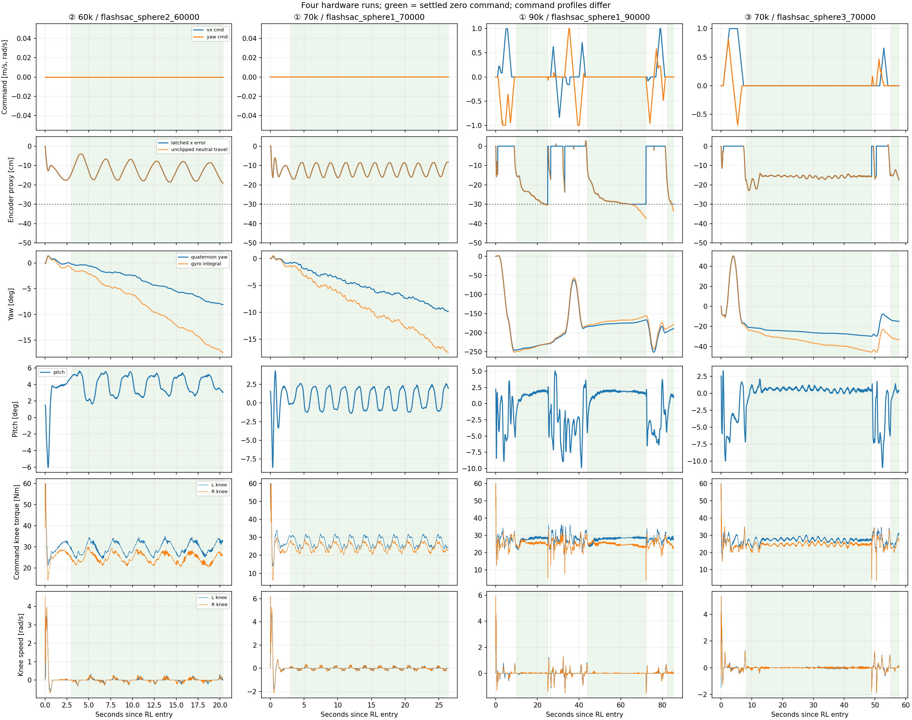
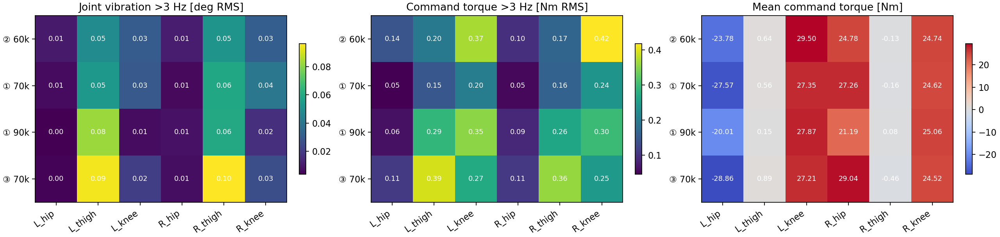
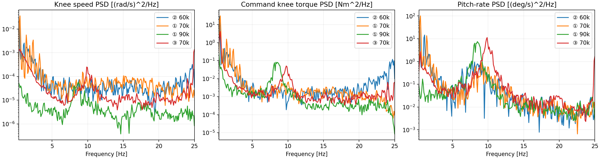

# Sphere 후보 4개 — 실기 x/yaw drift·진동·토크 비교

- Execution Domain: **DESKTOP_DRY_RUN** (복사한 실기 로그 오프라인 분석), **ROBOT_READ_ONLY** (SBC에서 파일 읽기/복사만).
- 실험: 2026-10-19 KST 08:19–08:25. 사용자 첨부 콘솔의 실행 4건을 그대로 선택했다.
- Operator annotation: **손 외란 없음, 스틱 명령 조건은 실행마다 다름**. 사용자 답변: “외란은 안줬고, 스틱 커맨든느 다르긴함”. 지면 접촉/미끄럼은 별도 외부 계측 없음.
- Evidence Status: 복사·DB·프레임 정합·정책/필터/PD/위치 관측 재생 **PASS**. 실행 사이 성능 순위의 인과 해석은 **SUSPICIOUS** (명령·초기 자세가 다름). 외부 기준 x/yaw와 실제 관절 힘 **NOT_TESTED**.
- Branch: `agent/codex/dev_tita_gluon`. 제품 코드·기체 설정 변경 없음. 새 수집기/ROS 노드/SDK/CAN/서비스 명령 실행 없음.

## 1. 결론

**③ 70k는 긴 중립 홀드 후 전후 속도와 낮은 주파수의 몸통 흔들림이 가장 작다. 다만 약 16 cm 밀린 위치에서 서고, yaw와 휠·허벅지 잔진동은 남는다.**

**① 70k는 적용된 무릎 토크의 빠른 변화량이 가장 작지만, 0.49 Hz의 앞뒤 흔들림이 남는다.** 따라서 “작은 토크 step”과 “몸통이 조용히 서 있음”은 다른 지표다.

② 60k도 25 Hz 목표 교번이 심하게 커지진 않았지만 0.39 Hz 앞뒤 흔들림·약 4° pitch가 있고, ① 90k는 명령 후 중립에서 더 멀리 후퇴하고 yaw도 더 크다. 아래 수치는 이번 실행의 관찰 결과이며 동일 조건의 정책 순위가 아니다.

## 2. 원본과 검증

원본은 [raw/](raw/)에 모두 보관했다. DB·metadata·console·summary의 원격 SHA256과 로컬 복사본은 [copy_verification.log](copy_verification.log)에서 모두 일치했다. 각 DB `PRAGMA quick_check`도 PASS다.

| 후보 | Run ID | Actor SHA256 | ONNX SHA256 | DB SHA256 |
|---|---|---|---|---|
| ② 60k | `flashsac_sphere2_60000_081920_534970468_output_true` | `a4c2bfbf6a58240a6623ee8bb8d863774b9336f62df7de3d1993b76725334b2a` | `b744091bb984f3540ec9517f4d3a8a70b5d76cf0f1c7a811d122baac15017040` | `8a503f71a62582b0de851dea923acf4a43fa675ec7c3097cc47594cc6a7ede8e` |
| ① 70k | `flashsac_sphere1_70000_082037_308736107_output_true` | `8e23cf5d1844a6d825482939e5cfc455cd672dd566b2320570080ff606782c77` | `df54bb61b09c681aad403b41ae52dc83807002f2832b8f969c2ba56a441297d7` | `7d36dc8dc656d403a7671d1fa79bdaf299aaa41a7976a6ade1abfec0b81d5b25` |
| ① 90k | `flashsac_sphere1_90000_082156_461599321_output_true` | `df2a03faeb6e054310c8cc0c2c11f811c1f6e845dd87a66c40ff3cd29dd8b311` | `08d57aa5b0d63063ddcd1f64a08fc545f7ad2ab317aa1c1044cb80ea15a0710a` | `ba6b51fcb327743ee6fcb0c1619937f8b76b2d6b8aad1f715ed4f0fda986acfc` |
| ③ 70k | `flashsac_sphere3_70000_082406_198769317_output_true` | `b9d411eaee09753d3bb6a00d12da8a3f18ce205b2c95faec954c91699e811263` | `204693483d123b77d9ad1698819ee10179ba27b5881bc8a41c1e5fc138ee16ff` | `3fddd2f6ed9077ef8b993f226926d23b871b6b74e66ed58f09d7458123c262f4` |

- RL 중 `sensors_valid`, `policy_valid`, `output_enabled`, `torque_sent`가 모두 true이고 RL feedback/filter 유실은 0이다. 이것은 센서/추론 유효성과 CAN 전송 수락 기록이며 모터 응답 ACK는 아니다.
- `sequence_id` 연속, steady timestamp 증가. 정상 주기 중앙값 약 20 ms, p99 약 20.5 ms, 최대 23.3 ms. 상태 전환 직후 추가 publish로 2–6 ms 간격이 포함된다.
- ONNX에 기록 obs를 다시 넣었을 때 raw action 최대 오차 ≤2.53e-6, MA2/none replay 오차 0, teacher와 적용 action 오차 0. 동일 double 연산으로 재계산한 PD torque 오차 ≤8.89e-16 Nm.
- wheel_position_error 관측을 엔코더 unwrap·IMU pitch·래치 규칙으로 재구성한 오차 ≤2.39e-8 m. 필터 누락, 다른 정책 실행, bias 개입, 관측 매핑 오류는 이 재생에서 보이지 않았다.
- 후처리 분석의 yaw/x 홀드 결과를 기존 `test/sim2real/analyze_posma2_yaw_drift.py`로 4건 모두 재계산해 7개 홀드의 yaw 변화·전후 이동량을 대조했다([crosscheck_results.json](crosscheck_results.json)).

## 3. 비교 구간과 x/yaw

중립은 실기와 같은 float32 경계 `|cmd| <= [0.02,0.02,0.03]`이다. 기본 정지 통계는 **RL 첫 3초와 각 중립 진입 첫 1초를 제외**했다. 이 표의 x 순이동은 예외적으로 중립 시작부터 끝까지라 진입 과도를 포함한다. 움직임 뒤 짧은 중립은 별도 홀드 표로 분리했다. 15초 이상 홀드의 마지막 10초 통계와 첫 긴 홀드의 3–13초 통계도 [metrics.json](metrics.json)에 저장했다.

**x는 `0.0925 × mean(unwrap(wheel)+pitch+thigh+knee)`의 변화량이다.** 정책과 같은 rolling-distance proxy이며 외부에서 측정한 world-x가 아니다. yaw가 바뀐 경로 전체를 world-x로 간주하지 않는다. 음수는 이 proxy에서의 후퇴다.

| 후보 | RL 길이 / 중립 비율 | 긴 중립의 x 순이동 | x의 반복 흔들림 폭¹ | yaw 속도: quaternion / gyro² | pitch 평균 / std | pitch-rate의 주 피크 |
|---|---|---|---|---|---|---|
| ② 60k | 20.3 s / 100.0% | -19.1 cm | 11.4 cm | -0.45 / -0.94 °/s | +4.01 / 1.11° | 0.39 Hz |
| ① 70k | 26.4 s / 100.0% | -8.2 cm | 7.9 cm | -0.39 / -0.69 °/s | +0.66 / 1.31° | 0.49 Hz |
| ① 90k | 85.4 s / 61.5% | -30.1 cm / -37.6 cm | 1.3 cm / 2.5 cm | +0.91 / +1.22 °/s | +1.46 / 0.81° | 8.50 Hz |
| ③ 70k | 57.8 s / 81.3% | -15.8 cm | 2.0 cm | -0.29 / -0.63 °/s | +0.49 / 0.40° | 9.86 Hz |

¹ 각 긴 중립의 마지막 10초에서 선형 추세를 제거한 x의 P99−P1 폭이다. 서로 다른 홀드의 끝점·진입 과도를 혼합하지 않았다. ②/①70k처럼 진동이 크면 마지막 5초 끝점 속도도 위상에 따라 달라지므로 이를 지속 drift 속도로 해석하지 않는다.

² Quaternion은 구간별 unwrapped yaw 변화/시간을 합산, gyro는 roll/pitch를 반영한 Euler yaw rate다. 이 두 yaw 속도는 **0.3–0.5 °/s 정도 다르므로 하나를 절대 정답으로 단정하지 않는다**. Idle에서 관절/휠이 거의 정지한 샘플의 gyro-z 중앙값은 −0.107~−0.137 °/s로, 정지 바이어스만으로 전체 차이를 설명할 수 없다. 방향은 quaternion·gyro·휠 차동이 일치한다. 현재 로그만으로 IMU fusion/동적 오차·슬립을 분리하지 못한다.

### 중립 홀드 상세

| 후보 | RL 상대 시간 | 홀드 길이 | 시작→끝 x 순이동 | x 관측 끝값 | 첫 1초 이후 yaw 변화 (quat / gyro 적분) | 마지막 10초 x 추세³ |
|---|---|---|---|---|---|---|
| ② 60k | 0.00–20.35 s | 20.35 s | -19.1 cm | -19.1 cm | -8.9 / -17.9° | +0.047 cm/s |
| ① 70k | 0.00–26.40 s | 26.40 s | -8.2 cm | -8.2 cm | -9.7 / -17.2° | +0.098 cm/s |
| ① 90k | 8.96–24.96 s | 16.00 s | -30.1 cm | -30.0 cm | +15.7 / +21.4° | -0.794 cm/s |
| ① 90k | 43.02–72.16 s | 29.14 s | -37.6 cm | -30.0 cm | +17.7 / +25.0° | -0.778 cm/s |
| ① 90k | 81.42–85.40 s | 3.98 s | -33.2 cm | -30.0 cm | +8.2 / +9.5° | 짧은 홀드 |
| ③ 70k | 7.30–48.90 s | 41.60 s | -15.8 cm | -15.8 cm | -10.9 / -24.5° | -0.020 cm/s |
| ③ 70k | 54.16–57.78 s | 3.62 s | -17.5 cm | -17.3 cm | -1.5 / -2.7° | 짧은 홀드 |

³ 선형 회귀 기울기이며 반복 흔들림 폭과 함께 봐야 한다.

- **② 60k / ① 70k:** RL 내내 command=0. 둘 다 진입 약 1초에 11–13 cm 밀린 뒤, x와 pitch가 반복해서 흔들린다. ②의 x 폭은 약 11 cm, ①70k는 약 8 cm이다. 최종 위치가 −19 cm/−8 cm인 사실만으로 일정 속도 drift라 부르면 진동을 놓친다.
- **① 90k:** 주행·회전 뒤 두 긴 중립에서 −30.1 / −37.6 cm 이동했다. 후반에도 약 −0.78 cm/s의 회귀 추세가 남는다. 관측은 −30 cm에 clip되어 두 번째 홀드의 추가 후퇴를 표시하지 못한다. 세 번째 짧은 중립도 4초에 −33.2 cm다. 이 실행의 위치 복귀는 좋지 않다.
- **③ 70k:** 첫 주행 후 중립 초반 −23 cm까지 밀린 뒤 −15.8 cm로 일부 회복한다. 긴 홀드 마지막 10초의 x 회귀 기울기는 −0.020 cm/s, 흔들림 폭 약 2 cm다. **속도는 거의 멈추지만 원래 위치로 돌아오지는 않는다.** 마지막 짧은 중립도 −17.5 cm이므로 제로 진입 과도는 남는다.

## 4. 관절·몸통 진동

아래 빠른 떨림은 로그의 **3 Hz 이상 high-pass RMS**다(50 Hz 표본, 양방향 4차 Butterworth, 연속 중립 구간 양끝 0.5초 제거). 실제 25 Hz 이상 현상은 alias될 수 있다. 500 Hz 전체 토크나 소리의 직접 계측으로 해석하면 안 된다.

| 후보 | 허벅지 각도 RMS L/R | 무릎 각도 RMS L/R | 무릎 적용 토크 step RMS L/R | 휠 명령 토크 high-pass RMS L/R |
|---|---|---|---|---|
| ② 60k | 0.048 / 0.052° | 0.031 / 0.031° | 0.668 / 0.704 Nm | 0.193 / 0.171 Nm |
| ① 70k | 0.053 / 0.059° | 0.030 / 0.040° | 0.304 / 0.307 Nm | 0.186 / 0.181 Nm |
| ① 90k | 0.082 / 0.060° | 0.007 / 0.016° | 0.376 / 0.326 Nm | 0.459 / 0.350 Nm |
| ③ 70k | 0.095 / 0.096° | 0.021 / 0.026° | 0.350 / 0.323 Nm | 0.794 / 0.648 Nm |

- ②60k·①70k는 **0.39 / 0.49 Hz**의 큰 전후 흔들림이 주성분이다. ①70k의 pitch std는 전체 중립 1.31°, 마지막 10초도 1.30°다. MA2는 이 낮은 주파수를 거의 그대로 통과시키므로 평균 필터만 더 강하게 해서 해결된다고 볼 근거는 없다.
- ①90k·③70k는 각각 로그에서 **8.50 / 9.86 Hz**의 pitch-rate·허벅지 성분이 두드러진다. 무릎의 빠른 각도 떨림 자체는 작고, ③은 허벅지 약 0.095° RMS와 휠 토크 0.65–0.79 Nm RMS가 남는다. 휠 토크의 빠른 RMS는 ①70k보다 약 3.6–4.3배 크다.
- 같은 주파수에서 휠 공통 토크와 pitch-rate의 coherence는 ①90k 0.988 / ③70k 0.966이다([coherence_check.json](coherence_check.json)). 두 신호가 폐루프에서 함께 흔들린다는 증거이며 **휠 토크가 최초 원인이라는 인과 증거는 아니다**.
- ③70k raw 무릎 action의 연속 차분 RMS는 L/R 0.319/0.237, 차분의 lag-1은 약 −0.995로 강하게 교번한다. 하지만 MA2 이후 차분 RMS는 0.0153/0.0140으로 약 **95% / 94% 감소**하고, 실제 적용 토크 step도 0.35/0.32 Nm다. raw action의 교번 크기를 곧바로 관절 흔들림으로 해석하면 안 된다. 반대로 SDK joint velocity에는 Nyquist 부근 성분도 남아 있으므로 “25 Hz 진동이 완전히 없어졌다”는 주장도 하지 않는다.
- ③70k의 pitch std는 전체 중립 0.40°, 마지막 10초 0.20°다. **낮은 주파수의 자세 유지와 9–10 Hz의 잔진동을 분리해서 봐야 한다.**

## 5. 토크와 yaw 차동

정지 통계는 위와 같은 settled-zero 구간이다. `computed_torque`는 명령, `reported_torque`는 SDK 추정/보고 Nm이며 보정된 힘 센서가 아니다.

| 후보 | Hip 명령 평균 L/R | Knee 명령 평균 L/R | Knee 명령 std L/R | Wheel 명령 평균 L/R | SDK−직전 명령 RMS: knee L/R |
|---|---|---|---|---|---|
| ② 60k | -23.78 / +24.78 | +29.50 / +24.74 | +2.74 / +2.24 | +0.11 / +0.07 | +0.11 / +0.15 Nm |
| ① 70k | -27.57 / +27.26 | +27.35 / +24.62 | +2.61 / +2.10 | +0.06 / +0.08 | +0.12 / +0.18 Nm |
| ① 90k | -20.01 / +21.19 | +27.87 / +25.06 | +1.43 / +0.96 | -0.18 / +0.08 | +0.06 / +0.07 Nm |
| ③ 70k | -28.86 / +29.04 | +27.21 / +24.52 | +1.30 / +1.20 | +0.10 / -0.13 | +0.09 / +0.11 Nm |

- RL 첫 **0.04–0.12초** 부근에는 무릎 ±60 Nm·휠 ±12 Nm 한도에 짧게 닿는다. 전체 RL 중 각 모터의 포화 비율은 0.04–0.30% 이하이고, 기본 중립 통계 구간에는 포화가 없다. 진입 과도의 문제와 정지 중 진동을 섞지 않았다.
- 정지에서 SDK 평균 토크는 명령과 약 0.01–0.04 Nm 차이, SDK와 직전 500 Hz 명령의 knee RMS 차이는 약 0.06–0.18 Nm다. 이 기록은 전송 누락이나 과거의 CAN 송신 실패보다는 **정책·PD가 계산한 출력이 기록 경로에서 일관되게 유지됨**을 보여준다. 실제 출력 계수가 1이라는 물리적 증거는 아니다.

| 후보 | 우−좌 휠 목표 속도 | 우−좌 실제 휠 속도 | 우−좌 명령 토크 | 해석 |
|---|---|---|---|---|
| ② 60k | -0.177 rad/s | -0.085 rad/s | -0.046 Nm | 음의 yaw 방향 차동 |
| ① 70k | -0.018 rad/s | -0.052 rad/s | +0.017 Nm | 목표는 거의 대칭, 약한 반대 방향 토크 |
| ① 90k | +0.682 rad/s | +0.158 rad/s | +0.262 Nm | 양의 yaw 방향 차동 |
| ③ 70k | -0.524 rad/s | -0.064 rad/s | -0.230 Nm | 음의 yaw 방향 차동 |

①90k·③70k는 중립에도 뚜렷한 좌우 휠 목표 차이가 남아 각각의 회전 방향과 맞는다. ①70k는 목표가 거의 대칭이고 약한 역방향 토크라, 모든 실행에 “정책이 같은 방식으로 회전을 계속 밀어준다”는 설명을 적용할 수 없다. 기구 비대칭·마찰·측정 오차를 이 데이터만으로 분리하지 못한다.

## 6. 다음 비교에서 볼 것

- **정지 유지 후보는 ③70k**, 느린 흔들림과 빠른 토크 step의 비교 기준은 **①70k**로 남기는 것이 이번 기록에 맞다. 둘을 같은 command=0 홀드와 같은 주행→중립 순서로 비교해야 정책 차이의 결론을 강화할 수 있다.
- ②/①70k의 0.4–0.5 Hz 운동과 ①90k/③의 8–10 Hz 운동은 같은 필터 문제로 묶지 않는다. ③의 다음 진단 대상은 raw knee 교번만이 아니라 **적용된 휠·허벅지 토크와 몸통 pitch-rate의 동시 성분**이다.
- 외부 x/yaw 기준이나 더 높은 주파수 계측이 없으므로 절대 위치/heading 오차와 실제 고유 진동수는 미확정이다. 이번 분석에서는 설정 변경·재배포·새 실기 시험을 하지 않았다.

## 7. 산출물·재현·검사

- [overview.png](overview.png) / [PDF](overview.pdf): command, 중립 위치 오차·unclipped travel, quaternion/gyro yaw, pitch, knee torque/velocity.
- [neutral_psd.png](neutral_psd.png) / [PDF](neutral_psd.pdf): 중립의 knee velocity·토크와 pitch-rate PSD.
- [joint_metrics.png](joint_metrics.png): 관절별 각도/토크 떨림과 평균 토크.
- [metrics.json](metrics.json), [joint_metrics.csv](joint_metrics.csv), 정책별 `*_signals.npz`에 상세 수치·파형을 보관했다.
- 신규 파일: `test/sim2real/analyze_sphere_hardware_runs.py`와 이 실험 폴더의 복사본·결과·그림. 기존 분석기·제품 코드·학습 설정은 변경하지 않았다. 원본 hash 검증 및 로컬 변경 범위 확인 완료.
- `./scripts/agent-check.sh`: [agent_check.log](agent_check.log). 기존 `my_flat_env_cfg.py:431,437,443,449,455,461`의 trailing whitespace 때문에 전체 **FAIL**. 이 분석기의 실행·모든 재생 assert·기존 분석기 cross-check는 **PASS**. Fast syntax/URDF 결과는 해당 로그를 기준으로 한다.

```bash
source /opt/ros/jazzy/setup.bash
source test/sim2real/notch_work/install/setup.bash
export MPLCONFIGDIR="$PWD/test/sim2real/sphere_review_work/matplotlib"
/home/cocel/venvs/cosim_ros2_jazzy/bin/python test/sim2real/analyze_sphere_hardware_runs.py
```






