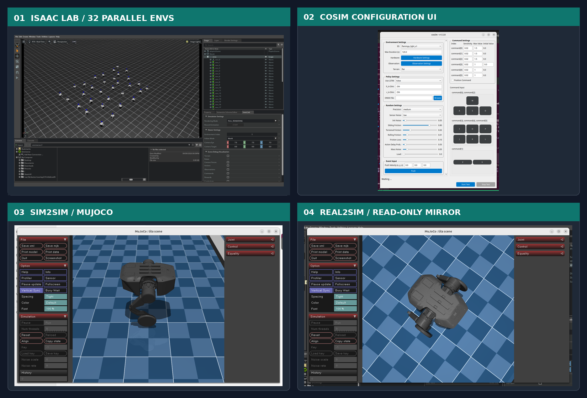
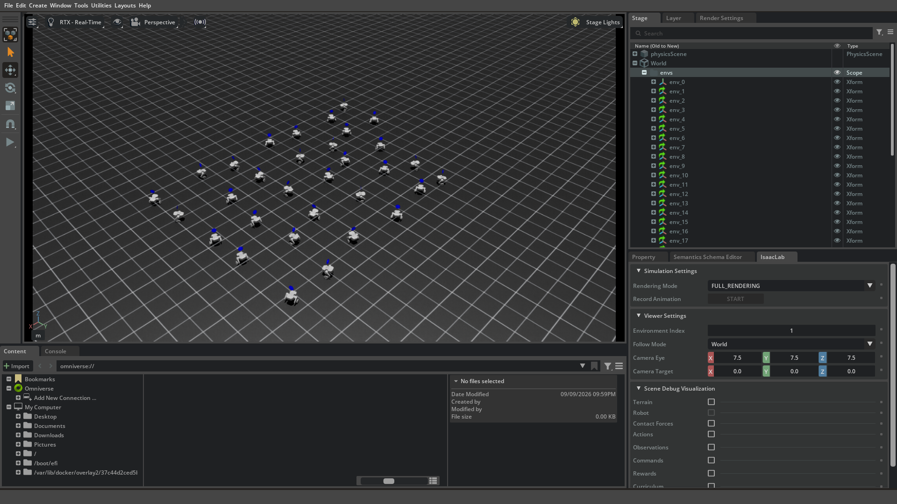
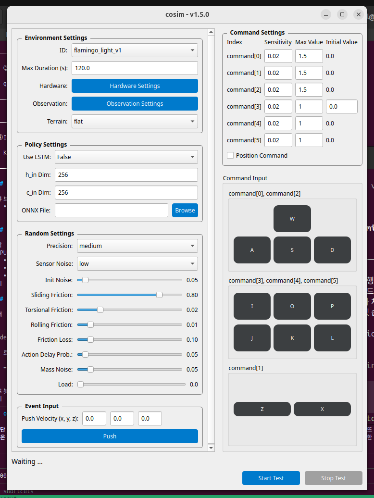
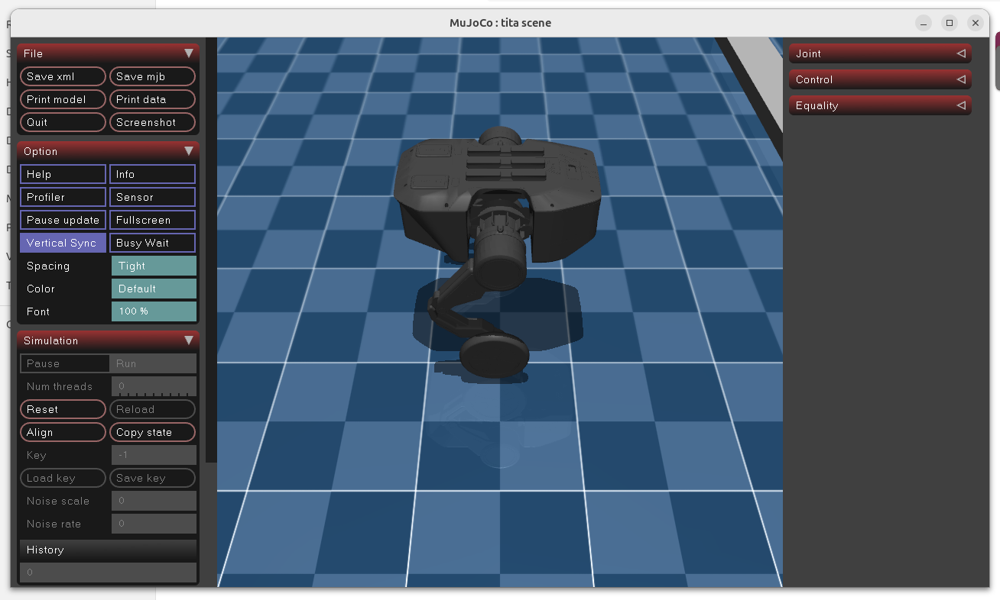
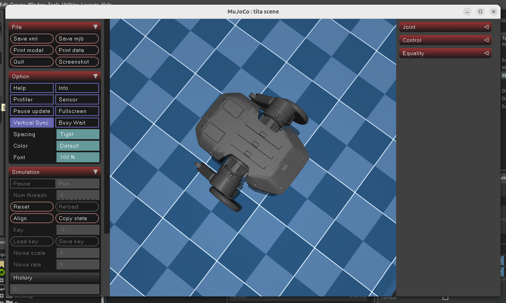
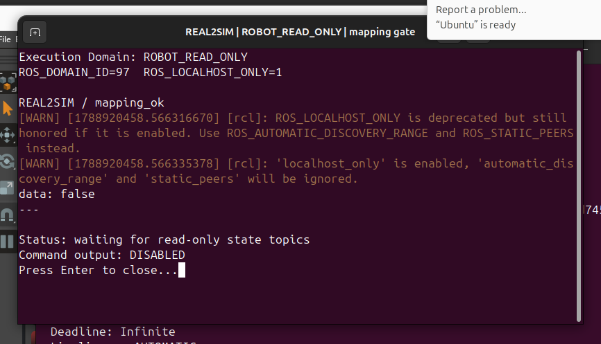

# TITA closed-loop interface captures

2026-09-09에 포트폴리오용으로 캡처한 TITA 검증 인터페이스입니다. 화면은
`Isaac Lab → SIM2SIM → REAL2SIM` 흐름을 보여주며, 실제 로봇에는 연결하지 않았습니다.
Isaac Lab 대표 이미지는 32개 병렬 환경 실행을 기준으로 갱신했습니다.

## 01. Isaac Lab checkpoint playback — 32 parallel environments

- Execution Domain: `TRAINING_SIM`
- Task: `DDT-Velocity-Flat-Tita-My-Play-v0`
- Checkpoint: `My43 @ 2700`
- Parallel environments: `32` (`--num_envs=32`), spacing `2.5`
- Visible evidence: Isaac Sim 5.1 viewport의 병렬 TITA 인스턴스와 Stage tree의 `/World/envs/env_0` … 환경 계층
- Capture: `1920×1080`, setup 이후 화면을 정지해 구도를 고정
- Evidence Status: `PASS` for the 32-env UI/model capture; `SUSPICIOUS` for performance claims because the desktop run emitted PhysX/CUDA fallback warnings
- Close-up reference: [single-environment Isaac Lab capture](captures/tita_isaaclab_play.png)

## 02. CoSim configuration interface

- Execution Domain: `VALIDATION_SIM`
- Visible evidence: environment, policy/ONNX, randomization, command and keyboard-input panels
- Evidence Status: `PASS` for the interface capture
- Scope note: this is the generic CoSim v1.5.0 configuration UI; the default dropdown shown is `flamingo_light_v1`, not a TITA-specific environment selection

## 03. SIM2SIM MuJoCo viewer

- Execution Domain: `VALIDATION_SIM`
- Visible evidence: TITA `mujoco_corrected/scene.xml` loaded in MuJoCo with joint/control panels
- Policy artifact: `policy_my43_2700.onnx` (hash recorded below)
- Evidence Status: `PASS` for the TITA MJCF/viewer capture; `SUSPICIOUS` for the full ROS2 policy-loop claim because the current dirty worktree has an `ObservationBuilder.include_base_height` interface mismatch

## 04. REAL2SIM read-only mirror

- Execution Domain: `ROBOT_READ_ONLY` on an isolated desktop dry-run (`ROS_DOMAIN_ID=97`, localhost discovery)
- State source configured: `/tita4252763/joint_states`, IMU, and odometry topics
- Visible evidence: TITA MuJoCo mirror plus `mapping_ok: false` while no state source is present
- Safety evidence: `Command output: DISABLED`; no command publisher or motor-control path was started
- Evidence Status: `PASS` for read-only node startup and safety gate; `BLOCKED` for live real-state mapping because no physical robot was connected

## Artifact hashes

| Artifact | SHA256 |
| --- | --- |
| `model_2700.pt` | `3766e05c683d6f2565bbeb2c21f500f872b243ffe39fb48b40fd3ae7ff608ef8` |
| `exported/policy.onnx` | `ecb0fd3ec56eb9aed5349250e9de11040156f59e3a98c54ae83dadde672a7705` |
| `deploy/tita/policy_my43_2700.onnx` | `ecb0fd3ec56eb9aed5349250e9de11040156f59e3a98c54ae83dadde672a7705` |

## Portfolio wording suggestion

> Built and validated a TITA closed-loop locomotion pipeline from Isaac Lab policy training and checkpoint export through MuJoCo SIM2SIM, then implemented a read-only REAL2SIM mirror with explicit observation-mapping and command-output safety gates.

The REAL2SIM image should be described as an interface/safety-gate capture, not as a live hardware result.
