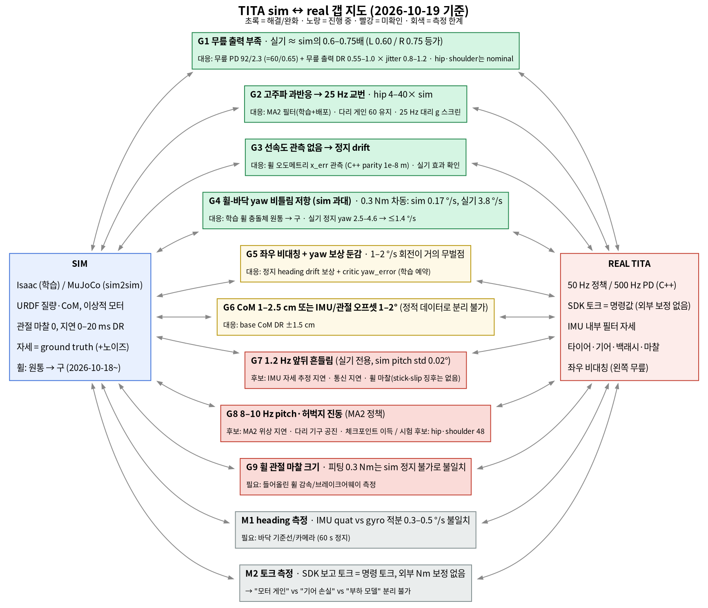
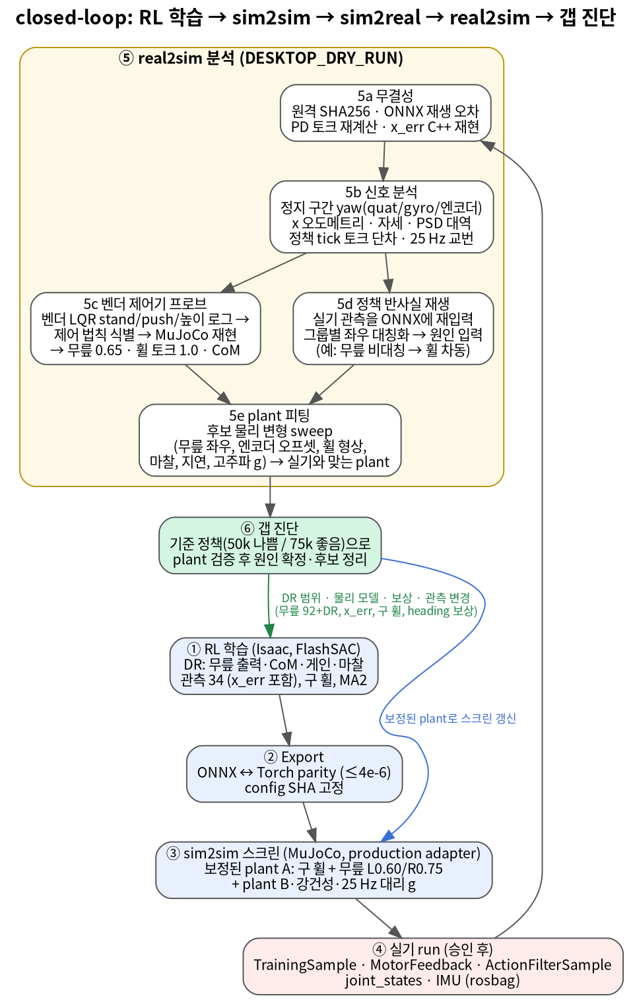

# TITA sim2real 갭 정리 (2026-10-19 기준)

- 성격: 정리 문서. 근거는 아래에 링크한 `docs/exp/` 실험 기록이고, 각 갭의 증거 수준은 표의 "상태"에 적었다. 이 문서를 만들면서 로봇 명령은 보내지 않았다(`DESKTOP_DRY_RUN`).
- 도식 원본: `docs/exp/2026-10-19/sim2real_gap_summary/*.dot`. `dot -Tpng`로 다시 그린다.

## 1. 요약

- **지금까지 확인된 큰 갭은 둘이다.**
  - 무릎 출력 부족: 실기 무릎이 sim의 0.6–0.75배처럼 움직이고, 왼쪽이 더 약하다.
  - 휠-바닥 yaw 비틀림 저항: sim 원통 휠은 제자리 회전을 붙잡지만, 실기는 작은 토크 차에도 돈다.
- 둘 다 학습 쪽 대응이 들어갔다.
  - 무릎: 무릎 PD 92/2.3, 무릎 출력 DR
  - yaw: 구 휠, heading 보상(학습 예약)
  - 해결된 갭도 둘 있다. 고주파 과반응(25 Hz)은 MA2로, 선속도 관측 부재(정지 drift)는 x_err 관측으로 해결했다.
- **아직 원인이 확정되지 않은 것**:
  - 1.2 Hz 앞뒤 흔들림 (실기 전용)
  - 8–10 Hz pitch·허벅지 진동 (MA2 정책)
  - 휠 관절 마찰의 크기
- **측정 한계**가 판정을 막는 곳도 있다.
  - heading: IMU quat와 gyro 적분이 0.3–0.5 °/s씩 어긋난다.
  - 토크: SDK 보고값은 명령값과 같고, 외부 보정이 없다.
- 무릎 게인·휠 마찰 가설에 대한 의견은 5절에 있다.
  - **무릎**: 동의한다. 가장 강한 근거가 있다. 다만 "모터 게인"인지 "기어 손실"인지 "부하 모델 오차"인지는 아직 분리하지 못했다.
  - **휠 마찰**: 반만 동의한다. 효과가 컸던 것은 바닥 비틀림 마찰이었고(구 휠로 해결), 휠 관절 마찰은 아직 근거가 약하다.

## 2. 도식

### 2.1 갭 지도: sim과 real 사이를 무엇으로 메우고 있나

### 2.2 closed loop: real2sim이 학습으로 돌아가는 경로

## 3. 갭 목록

| ID | 무엇이 다른가 | 실기 증거 | 어떻게 찾았나 | 대응 | 상태 |
|---|---|---|---|---|---|
| G1 | 무릎 출력 부족 | 벤더 자세 재현에 무릎 0.65배가 필요했다. RL 정지 무릎 처짐은 L 17.7° / R 14.3°이고, sim nominal은 10°다. L0.60/R0.75로 0.3° 이내 재현했다 | 벤더 제어기 프로브(5c), plant 피팅(5e) | 무릎 PD 92/2.3 (= 60/0.65), 무릎 출력 DR 0.55–1.0 × 관절별 jitter 0.8–1.2. hip·shoulder는 nominal 유지(전체 약화 학습 C2는 실기에서 후진) | 완화 (평균), 좌우 차이 남음 |
| G2 | 고주파 과반응 | 다리 게인 92(×1.53)에서 25 Hz 주기 2 교번이 났다. hip 고주파 응답이 sim의 4–40배다 | 정책 tick 토크 단차 분해(5b), 25 Hz 대리 g(5e) | MA2 필터(학습+배포), hip·shoulder 60 유지. MA2 없는 ② 60k도 실기 25 Hz 없음 | 해결 |
| G3 | 선속도 관측 없음 | 정지 명령에서 일정 속도 drift | 실기 로그 x 오도메트리(5b) | 휠 오도메트리 x_err 관측 (C++ 재현 오차 1e-8 m) | 해결 (실기 효과 확인) |
| G4 | 휠-바닥 yaw 비틀림 저항이 sim에서 과대 | 휠 토크 차 0.37 Nm에 실기는 3.8 °/s로 돈다. 원통 휠 sim은 0.30 Nm에 0.17 °/s | 정책 반사실 재생(5d), plant 피팅(5e) | 학습 휠 충돌체를 원통(폭 3.4 cm)에서 같은 반경의 구로 바꿈 | 완화: 실기 정지 yaw 2.5–4.6 → ≤1.4 °/s |
| G5 | 좌우 비대칭 + yaw 보상 둔감 | 왼쪽 무릎이 더 약하다(벤더도 같음). yaw 추종 exp(σ 0.5 rad/s)에서 1–2 °/s 회전은 보상 손실 0.1–0.5% | 5c, 5d, 보상 코드 확인 | 정지 heading drift 보상 + critic yaw_error. 정책 관측은 34개 그대로 | 진행 중 (학습 예약) |
| G6 | CoM 또는 IMU/관절 오프셋 | 벤더 정적 자세에 CoM 1–2.5 cm 뒤 또는 1–2° 오프셋이 필요하다. 정적 데이터로는 둘을 분리할 수 없다 | 5c | base CoM DR ±1.5 cm | 부분 |
| G7 | 1.2 Hz 앞뒤 흔들림 | ② 60k, ① 70k: pitch ±1.0–1.3°, x ±4–6 cm. 같은 체크포인트가 sim에서는 pitch std 0.02–0.03° | 5b, 5e | 없음. 후보는 5절 | 미확인 |
| G8 | 8–10 Hz pitch·허벅지 진동 | MA2 정책 전부(50k 9.4, 75k 9.0, ① 90k 8.2, ③ 70k 9.8 Hz)에 있고, MA2 없는 ②가 가장 작다 | 5b | 시험 후보: hip·shoulder 48/1.5 (학습 DR 하한, sim 부작용 작음) | 미확인 |
| G9 | 휠 관절 마찰 크기 | 피팅한 0.3 Nm를 넣으면 sim에서 nominal 정책도 못 서는데, 실기는 선다 | 5e | 없음 (마찰 DR은 작게 유지) | 미식별 |
| M1 | heading 측정 | IMU quat와 gyro 적분이 정지 구간 9개 모두에서 회전 방향으로 0.1–0.5 °/s 어긋난다 | 5b | 외부 기준(바닥 기준선, 카메라) 필요 | 측정 한계 |
| M2 | 토크 측정 | SDK 보고 토크가 명령 토크를 그대로 따른다(이득 ≈ 1.0). 외부 Nm 보정이 없다 | 5a, 5b | 외부 하중 시험 필요 | 측정 한계 |

## 4. real2sim 분석을 어떻게 하고 있나

원칙은 셋이다.
1. 실기 로그는 읽기 전용으로 복사하고 원본 SHA256과 대조한다.
2. 로그가 실제 제어기 동작과 같은 의미인지 먼저 증명한다.
3. "알려진 것"(벤더 제어기, 결과를 아는 기준 정책)으로 sim plant를 맞춘 뒤 새 정책 평가에 쓴다.

### 4.1 기록하는 데이터

| 토픽 | 내용 | 용도 |
|---|---|---|
| `/sim2real/training_sample` | 정책 tick(50 Hz)마다 관측 34, raw action, teacher action, 계산 토크, q, dq, quaternion, gyro, 상태·유효 플래그 | 거의 모든 분석의 기준 |
| `/sim2real/motor_feedback` | SDK 보고 토크, 직전 500 Hz 명령 토크, 전송 성공 여부 | 토크 단차 분해, 명령 대비 보고 토크 |
| `/sim2real/action_filter_sample` | 필터 모드, 필터를 거친 action | MA2 재현 확인 |
| `joint_states`, IMU | 벤더 캡처에서는 500 Hz | 벤더 제어기 식별 |

### 4.2 단계

**5a 무결성: "로그가 말하는 것이 실제로 일어난 일인가"**
- 원격 `sha256sum` → `scp` → 로컬 `sha256sum -c`로 복사 손상을 배제한다.
- 기록된 관측을 같은 ONNX에 다시 넣는다. 기록된 raw action과의 오차는 2.7e-6 이하였다.
- PD 식(Kp·(target−q) − Kd·dq, 휠은 Kd·(target−dq), 토크 한계 clip)으로 계산 토크를 다시 만든다. 오차 1e-8 Nm 미만이었다.
- MA2 필터를 재현한다(오차 0).
- x_err를 엔코더와 IMU만으로 다시 계산해 C++ 관측과 맞춘다(오차 1.2e-8 m).
- 여기서 하나라도 어긋나면 이후 해석을 하지 않는다. 이 단계 덕분에 "C++ 관측 = sim adapter 관측"이 보장된다.

**5b 신호 분석: "무엇이 얼마나 다른가"**
- 정지 구간: |vx|, |vy| ≤ 0.02, |yaw| ≤ 0.03인 구간에서 진입 1 s를 빼고 잰다.
- heading은 세 소스로 잰다: IMU quat yaw, gyro z 적분, 엔코더 차동(R·(v_R − v_L)/W, W는 yaw 명령 구간에서 gyro로 맞춘 유효 트랙 폭). 셋이 어긋나는 폭이 측정 오차의 하한이다(M1).
- x는 휠 오도메트리 s = R·mean(q_wheel + pitch + q_thigh + q_knee)로 잰다. 휠 각도는 ±π에서 wrap되므로 unwrap한다.
- 자세·토크: 관절 평균각, 목표 대비 처짐, 계산 토크의 좌우 차이를 본다. 무릎 처짐 차이가 G1, G5의 직접 증거다.
- 진동: 정지 구간 PSD를 0.3–3, 3–8, 8–15, 15–25 Hz 대역으로 나눈다. 정책 tick 사이 토크 단차를 Kp·Δtarget 성분과 2 ms 상태 변화 성분으로 분해한다. 25 Hz 교번 진폭을 잰다. 로그가 50 Hz라 25 Hz 이상은 aliasing된다.
- 휠 stick-slip 지표: 휠이 멈춘 비율, 멈췄을 때 토크, 속도 부호 반전 빈도.

**5c 벤더 제어기 프로브: "우리 정책과 무관하게 plant만 본다"**
- 벤더(MCU LQR) 제어기로 정지·밀기·높이별·점프·고속 데이터를 수집했다(`vendor_lqr_reproduction.md`).
- 회귀로 벤더 법칙을 식별했다.
  - 허벅지 ≈ 56·pitch + 2.6·pitch_rate (R² 0.99)
  - 무릎·hip은 강하게 고정
  - 휠은 pitch·속도·허벅지 + 약한 위치항
- 같은 법칙을 MuJoCo에서 돌렸을 때 넘어지거나 자세가 다르면, 그 차이는 정책이 아니라 plant 탓이다. 결과:
  - 무릎 출력 0.65배여야 벤더 자세가 재현된다 (G1).
  - 휠 토크 단위는 1.0이다. 0.65로 주면 넘어지므로 휠 모터는 약하지 않다.
  - CoM 1–2.5 cm 뒤 또는 IMU 1–2° 오프셋이 필요하다 (G6).
- 벤더 데이터에서도 수평 정지 시 왼쪽 무릎이 1.4–3.4° 더 굽고 토크가 4–12% 더 컸다. 실기 고유의 좌우 차이라는 근거다 (G5).

**5d 정책 반사실 재생: "정책이 왜 그 행동을 했나"**
- 실기 관측을 ONNX에 다시 넣고, 입력 그룹(관절 위치, 각속도, 마지막 action 등)을 하나씩 좌우 거울 평균으로 대칭화한다. 그때 출력(예: 우−좌 휠 목표)이 얼마나 바뀌는지 잰다.
- 예: posma2 50k의 정지 회전은 관절 위치 비대칭에서 왔다(휠 차동 +4.4 rad/s). gyro는 +0.3, x_err는 0이었다.
- 같은 입력을 40k–85k 10개 체크포인트에 넣으면 모두 +3.9 ~ +5.9였다. 체크포인트 문제가 아니라 학습 전체가 그렇게 배운 것이다.

**5e plant 피팅: "어떤 sim 물리가 실기를 재현하나"**
- production sim2sim 코드(관측 빌더, x_err, MA2, PD adapter, 상태기계)를 MuJoCo 500 Hz / 50 Hz 추론으로 그대로 돌리고, 물리 후보만 바꿔 실기 지표와 비교한다.

| 후보 | 결과 | 판정 |
|---|---|---|
| 무릎 좌우 배율 L0.60/R0.75 | 실기 무릎 처짐 17.7/14.3°를 17.5/14.6°로 재현 | 채택 |
| 무릎 엔코더 오프셋 −3° | 처짐 패턴을 재현하지 못함 | 기각 |
| 휠 원통 → 구 | 50k 정지 yaw sim 2.2/3.3 °/s (실기 2.5–4.6), 75k sim 0.2/0.4 °/s (실기 0.15–0.53) | 채택 → plant A |
| 고주파 증폭 g (raw + g·Δraw) | A80k 게인 92의 실기 25 Hz 교번을 g 1–1.5 문턱으로 설명 | 25 Hz 위험 대리 지표로 사용 |
| 휠 관절 마찰 0.3 Nm | nominal 정책도 sim에서 못 섬 (실기는 섬) | 크기 불일치, 보류 |

**6 진단과 피드백**
- 실기 결과를 아는 기준 정책(50k: 회전 큼, 75k: 양호)으로 plant A를 먼저 검증한다. 그다음 새 체크포인트 스크린(`sphere_wheel_screen.md`)에 쓴다.
- 배포한 정책의 실기 결과는 다시 plant 검증 데이터가 된다. 이번 구 휠 후보 4개는 실기 정지 yaw가 모두 ≤1.4 °/s로 sim 예측 범위에 들었다. 다만 부호는 일부 달랐다.
- 진단 결과는 학습 변경으로 돌아간다: 무릎 92 + DR, x_err, MA2, 구 휠, heading 보상.

### 4.3 한계

- 외부 기준이 없다: heading, 관절 토크(Nm), world 위치.
- run마다 명령·정지 시간·시작 상태가 달라 짝지은 비교가 아니다.
- sim 스크린은 단일 seed, 단일 마찰, 지연 없음이다.
- 무릎 배율과 고주파 g는 sim 등가값이지 측정값이 아니다.

## 5. 가설에 대한 의견: 무릎 모터 게인, 휠 마찰

### 5.1 무릎 모터 게인: 동의 (가장 강한 근거)

- 세 독립 데이터가 같은 방향이다.
  - 벤더 자세 재현에 0.65배가 필요했다.
  - RL 정지 처짐이 sim nominal보다 크다(14–18° 대 10°).
  - sim에서 L0.60/R0.75가 실기 처짐을 0.3° 이내로 재현한다.
- 좌우 차이(왼쪽이 더 약함)도 실기 고유다. 이것이 정책의 휠 차동을 통해 yaw로 번진다.
- 다만 "게인"이라고 부르기 전에 분리할 것이 있다. SDK는 명령 토크를 그대로 냈다고 보고한다(M2). 그런데 관절은 0.6–0.75배처럼 움직인다. 원인 후보는 셋이다.
  1. 모터 토크 상수·전류 제한(진짜 게인 문제)
  2. 기어 효율·마찰 손실
  3. 무릎이 받는 부하 모델(URDF 질량·링크·CoM)의 오차
- 정적 데이터로는 이 셋을 구분할 수 없다. 무릎에 알려진 하중을 걸고 명령 토크 대 각도를 보는 정적 하중 시험이 필요하다(실기, 승인 필요).
- 지금 대응: 92/2.3과 학습 DR로 평균은 보상했고, 좌우 차이는 heading 보상으로 대응 중이다. 무릎 게인을 낮추는 것은 비추다. sim에서 pitch가 2.5–4.5° 커지고 yaw와 고주파 민감도가 나빠졌다(`leg_gain_sim.md`).

### 5.2 휠 마찰: 반만 동의 ("마찰"이 두 종류다)

- **(a) 휠-바닥 비틀림 마찰 (yaw)**: sim이 과대했다. 원통 휠은 폭 방향 여러 점이 바닥을 잡는다. 이것이 이번 yaw 문제의 핵심이었고, 구 휠로 바꾼 것이 가장 효과가 컸다(G4).
- **(b) 휠 관절 마찰 (모터·베어링, 구름 방향)**: sim은 0이고 실기 값은 식별하지 못했다.
  - 예전에 피팅한 0.3 Nm는 sim에서 정지가 불가능해서 과대다.
  - 1.2 Hz 흔들림(G7)의 원인으로는 근거가 약하다. 흔들린 run(②, ① 70k)에서 휠이 멈춘 비율은 5%였고, 초당 1.7–2.1번 부드럽게 방향을 바꾸는 연속 진동이었다. stick-slip이라면 "멈춰서 토크가 쌓이다 튀는" 구간이 길어야 한다. 오히려 조용한 run(③, 75k)에서 멈춘 비율이 12–18%로 더 컸다.
  - 정지 직후 0.1–0.3 m 후퇴의 원인 후보로는 남아 있다.
- 측정 제안:
  - 로봇을 들어 올린 상태에서 휠 브레이크어웨이 토크와 감속 곡선을 잰다(실기, 승인 필요).
  - 또는 sim 마찰 sweep으로 흔들림이 재현되는지 본다(아래 6절).

### 5.3 두 가설로 설명되지 않는 것

- 25 Hz 교번: 고주파 과반응 문제였고 해결됐다(G2).
- 8–10 Hz 진동: MA2 위상 지연이 의심된다(G8).
- 1.2 Hz 흔들림: IMU 자세 추정 지연과 통신 지연도 후보다. 정책은 IMU 필터 자세를 쓰고, sim은 실제 자세를 쓴다(G7).
- 보상 설계: yaw 보상이 작은 회전에 둔감했다(G5).
- 측정 한계: M1, M2.

## 6. 다음 판별 실험 (우선순위)

1. **heading 보상 run**(예약됨, `heading_drift_experiment.md`) → sim 스크린 → 실기 정지 yaw 비교.
2. **sim 1.2 Hz 재현 sweep**(오프라인): 휠 관절 쿨롱·점성 마찰 0.05–0.3 Nm, 제어 지연 10–30 ms, IMU 자세 1차 지연 τ 20–100 ms를 ② 60k·① 70k(실기에서 흔들림)과 ③ 70k·75k(조용)에 넣는다. 흔들리는 쪽만 흔들리는 조건이 원인 후보다.
3. **실기 (승인 필요)**
   - ③ 70k hip·shoulder 48/1.5 A/B (G8)
   - 무릎 정적 하중 시험 (G1 원인 분리)
   - 휠 브레이크어웨이 (G9)
   - 바닥 기준선 heading 60 s (M1)

## 근거 문서

- [real_runs_vs_training.md](../docs/exp/2026-10-18/real_runs_vs_training.md): 학습 설정과 실기 로그 비교, 무릎·hip 결론
- [vendor_lqr_reproduction.md](../docs/exp/2026-10-18/vendor_lqr_reproduction.md): 벤더 제어기 식별·재현
- [flashsac_80000_115354_pd92_review.md](../docs/exp/2026-10-18/flashsac_80000_115354_pd92_review.md): 25 Hz 교번
- [flashsac_posma2_50000_202450_review.md](../docs/exp/2026-10-18/flashsac_posma2_50000_202450_review.md): yaw 원인, 무릎 비대칭, 휠 접촉 (7절)
- [flashsac_posma2_75000_210936_review.md](../docs/exp/2026-10-18/flashsac_posma2_75000_210936_review.md)
- [sphere_wheel_screen.md](../docs/exp/2026-10-19/sphere_wheel_screen.md): 구 휠 run 스크린, plant A 검증
- [sphere_hardware_yaw_review.md](../docs/exp/2026-10-19/sphere_hardware_yaw_review.md): 구 휠 후보 실기 비교, IMU/gyro, 진동 원인 (부록 A, B)
- [leg_gain_sim.md](../docs/exp/2026-10-19/leg_gain_sim.md): 다리 게인 변경의 sim 부작용
- [heading_drift_experiment.md](../docs/exp/2026-10-19/heading_drift_experiment.md): heading 보상 실험 예약
